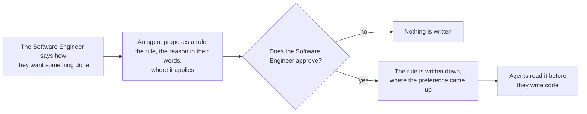
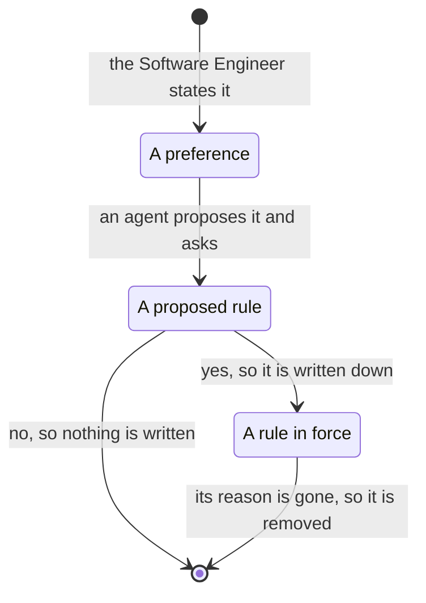

# Standards

*Verified against commit bd7b1ce.*

## What it is and why it exists

A project can build up its own rules from the preferences of the Software Engineer. When an agent notices a preference, in a conversation or in a review comment, it proposes a rule and asks. Only the Software Engineer's yes writes the rule down, with the reason in their words, where it applies, the date and where it came from. These rules, with the decision records, are the only documents that shape the code: agents read them before they write code, and when code comes out wrong, the rule or the decision is corrected and the code is written again from scratch, instead of being patched.

It exists because a rule steers every later piece of code. A rule nobody approved would steer it wrongly and no one would notice, so nothing is ever inferred silently. And a project's rules belong to that project: the baseline cannot know them in advance, so it fixes none of them.

## Who can use it

| Who | Can do | Under which conditions |
|---|---|---|
| The Software Engineer | Approve or refuse a proposed rule | Every rule needs their yes |
| An agent | Notice a preference and propose a rule | It writes nothing until the answer is yes |
| An agent that writes code | Read the rules first | Only where the project has chosen to keep rules |
| The docs agent | Say, in a lesson, which rule shaped the code it shows | Where a rule did |

The [Users and access page](access.md) says what each role is.

## What a person can do

- Choose once, when the project starts, whether to build up rules over time.
- Have a preference turned into a rule only when they approve it.
- See beside every rule why it exists, where it applies, when it was approved and where it came from.
- Keep a rule for the whole project or for one part of it.
- Remove a rule whose reason is gone, with its history kept.

## Journeys

*A preference reaches the rules only through the Software Engineer's approval, and the one thing to notice is that a no ends with nothing written: no rule is ever taken from what the Software Engineer said without asking.*

This repository chose to keep rules. Its folder of rules holds only the page that explains how it fills, because no preference has been approved as a rule yet.

**Evidence.** The written standard: its part on the standards mechanism sets how a rule is proposed and approved and what it records, and the repository's own folder of rules was read. Both were read at the commit above.

## The rules a person experiences

- A rule is written only after the Software Engineer's yes.
- Every rule carries its reason, where it applies, its date and its source.
- When generated code is wrong, the fix goes into the rule or the decision record, and the code is written again in a fresh session.
- A rule whose reason is gone is removed. An accepted decision record, by contrast, is never removed, only replaced.
- The rules are the same whoever reads the documents: the record of who the documents are for never changes them.

*A rule is in force from the Software Engineer's yes until its reason is gone, and the one thing to notice is that a no and a removal both end the rule's life, while nothing in between lets an agent write one alone.*

## When things go wrong

- **Generated code is wrong.** The rule or the decision record that guided it is corrected, and the code is written again from scratch in a fresh session, not patched.
- **A rule's reason no longer holds.** An agent that notices says so and lets the Software Engineer decide; the rule is then removed, and its history stays.
- **The project chose not to keep rules.** There is no folder of rules, and an agent does not create one on its own.

## Limits today

- There is no command that proposes and records a rule; the agent puts the question in the conversation and the rule is written by hand.
- The baseline checks no rule: whether and how a rule is checked is the project's own choice.
- The choice to keep rules is recorded in two places, and nothing checks that the two agree.

## Related

- [Decision records](decision-records.md) and [Documents pitched for the team](documents-pitched-for-the-team.md).
- For engineers: [standards and the reader profile](../architecture/06-standards-and-the-reader-profile.md) in the architecture reference.
