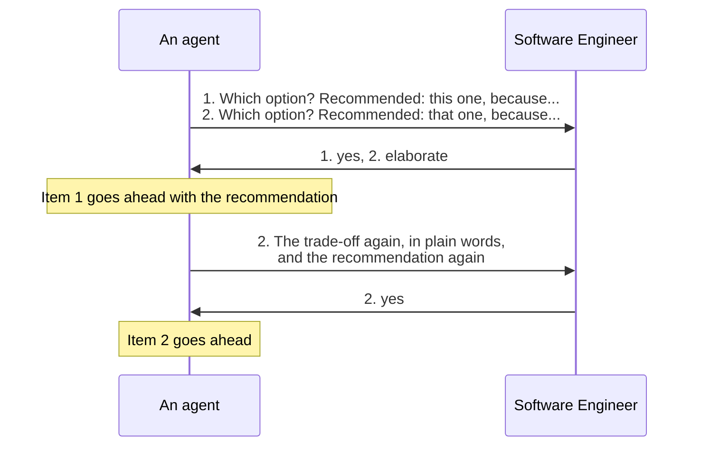
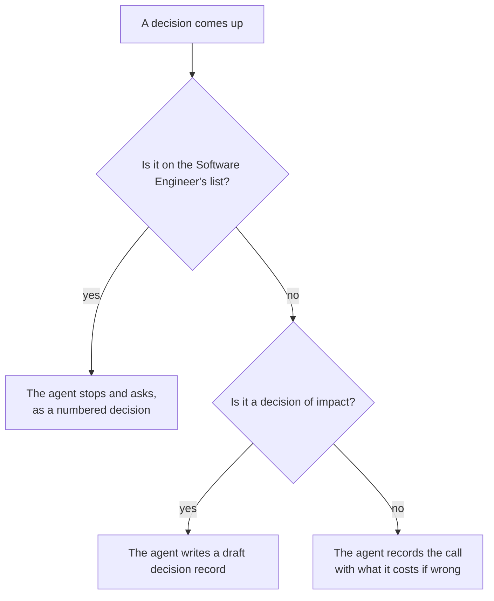

# Working with the Software Engineer

*Verified against commit 9d4518e.*

## What it is and why it exists

The baseline draws a clear line between what the Software Engineer decides and what the agents decide. The Software Engineer decides what only they can: what to build and why, how work is done, merging and publishing, anything that cannot be undone, whether a decision record is accepted, and who the documents are for. The agents decide everything else without stopping, and record each such decision with what it would cost if it were wrong. When a decision is the Software Engineer's, an agent puts it to them as a numbered list, with its recommendation first and one reason, and the Software Engineer answers by number.

It exists so that one person can direct agents without either deciding everything or losing sight of what was decided for them. The agents keep moving, and every decision taken on the Software Engineer's behalf still reaches them, with its cost, when they review the work.

## Who can use it

| Who | Can do | Under which conditions |
|---|---|---|
| The Software Engineer | Decide the calls on their list, answer by number, and see every other decision with its cost | Their word in the conversation wins for that task |
| The regular agent | Decide every call not on the list, and record it | It stops and asks on any call on the list |
| The docs agent | Decide the calls of its own work, and record them | It stops and asks on any call on the list |

The [Users and access page](access.md) says what each role is.

## What a person can do

- Answer a decision in a word: "1. yes" takes the recommendation of item 1.
- Ask for a decision to be explained again with "elaborate", and get it in plainer words with a recommendation again.
- See every decision an agent took on their behalf, with what it would cost if wrong.
- Get, while they are busy with something else, the exact command or click path for each step only they can take.
- Read every report in the same order: what they have to decide, what is ready to merge, what was checked, what was not, and the decisions taken for them.
- Change any of this for one task simply by saying so in the conversation.

## Journeys

*Every decision is answered by its number, and the one thing to notice is that "elaborate" costs one more round and ends, again, in a recommendation, so the second answer can be a single word too.*

**Evidence.** The written standard: its working rules set the Software Engineer's list, the numbered form, the hand-over while they are busy and the five parts of a report, and the agents' guide states them as instructions. Both were read at the commit above.

## The rules a person experiences

- An agent never takes a call on the Software Engineer's list. It stops and asks.
- Every other call is taken without stopping and recorded with what it would cost if wrong.
- A decision is always a numbered list with the recommendation first and one reason.
- While the Software Engineer is busy, the agents go on with everything that does not need them.
- Agents never edit a document that an AI skill produced to make it fit the baseline, never edit by hand an index that a tool produces, and never change the code inside a pull request of documents.

*Every decision lands in one of three places, and the one thing to notice is that only the first branch waits for the Software Engineer: the other two are recorded and the work goes on.*

## When things go wrong

- **An agent is unsure whose a call is.** It reads the list again; a call on the list is put to the Software Engineer, and any other is taken and recorded.
- **The Software Engineer says something that differs from the written rules.** What they say in the conversation wins for that task.
- **A rule no longer has a reason.** The agent says so in its report and lets the Software Engineer decide whether it goes.

## Limits today

- Nothing checks that a pull request lists every decision an agent took; the agents' own discipline does.
- The decisions an agent records reach the Software Engineer in the descriptions of the pull requests. While those are not yet up for review, as for most of this repository's first stack, the list was handed over as a file instead, and how that is best done is still being confirmed.

## Related

- [Work delivered as a stack](delivery-as-a-stack.md), [Decision records](decision-records.md) and [Standards](standards.md).
- For engineers: [security and trust](../architecture/08-cross-cutting.md#security-and-trust) in the architecture reference.
