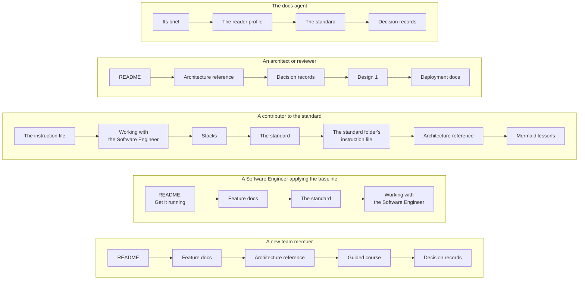

# Reader profile

## What this file is

This file records who the documents in this repository are written for. The header, the block between the two `---` lines at the top, is its machine-readable source: the docs agent (the fresh agent that writes the descriptive documents from the finished code) reads it to decide which basics each document explains. The text below the header explains how to read it and how to change it.

The profile describes the team the documents are written for, not the Software Engineer's own skill. It is also the bar the Software Engineer hires against: "average in Mermaid, advanced in the software delivery process" says both how a document is pitched and who is brought onto the project.

The header has five keys:

| Key | What it holds |
|---|---|
| `project` | The project's name. |
| `software_engineer` | The person who decides. |
| `standards_enabled` | The answer to the intake's one question about standards: whether to build standards from the Software Engineer's preferences over time. The intake is the set of questions asked when a project starts. `true` means the `docs/standards/` folder exists, and its [README](standards/README.md) explains how it fills. |
| `knowledge_areas` | The subjects the project depends on, each with a `level`. |
| `technologies` | The languages, frameworks and tools the project uses, each with a `level` and a `compare_with` setting. |

A `level` tells a document how much to explain to that reader:

| Level | What a document does for that reader |
|---|---|
| `beginner` | The reader is new to it. The document explains from the first line of syntax. |
| `average` | The reader is comfortable programming. The document skips basic syntax and constructs such as loops and variables, and still explains idioms, conventions and sharp edges. |
| `advanced` | The reader is fluent. The document explains only what is specific to this project or non-obvious. |

`compare_with` names a stack the reader already knows, or says `none`. A named stack adds marked "Coming from X" asides that say where the analogy breaks and never replace the explanation native to the technology. `none` means treat the technology as brand new. Every entry here says `none`, so no document in this repository carries such an aside.

Read for this repository, the header says:

- **Advanced:** Markdown, git and GitHub, and the software delivery process. A document explains only what is specific to this project or non-obvious.
- **Average:** Mermaid, YAML, Claude Code and skills, technical writing and AI-agent workflows. A document skips the basics and still explains idioms, conventions and sharp edges.
- **Beginner:** `gh stack` and stacked PRs. A document explains them from the first command.

The levels decide only which basics get explained. Detail is always at its maximum and the architecture is always fully documented, so the profile never changes the code, the scope or the architecture. Because: a reader's level shapes the documents only and never lowers what is built.

From the header the docs agent generates three more sections inside this file: who can contribute (the hiring bar, per technology and per knowledge area), prerequisites (what a reader must know before the first chapter) and reading paths by role. It writes them when it writes the docs section.

## Changing it

Edit the header. Leave the generated sections to the docs agent. Because: it regenerates them from the header, so a hand edit would be replaced.

- **The Software Engineer decides every change.** An agent that thinks a level is wrong proposes the change and asks; it does not edit the header. Because: the levels say who the documents are for and who is hired, and both are the Software Engineer's call.
- **A change is a thinking PR.** A thinking PR is the kind of pull request that holds prescriptive documents: the spec, the plan, decisions, standards updates, the playbooks and this file. Because: the profile is a prescriptive input that decides how every descriptive document is pitched, so it is read for intent and soundness before any document is regenerated from it, and apart from code and descriptions. Git keeps the history of the profile, so the file holds only the current answers.
- **A technology needs an entry before the docs agent writes about it.** An entry is a `name`, a `level` and a `compare_with`. A knowledge area needs a `name` and a `level`. A docs agent that finds a technology with no entry stops and asks the Software Engineer. Because: without an entry it cannot know how much of the technology the reader already knows, and a guessed level either repeats what the reader knows or leaves out what they need.
- **The docs agent regenerates what depends on the header.** That is the three generated sections and the lessons whose basics a change would add or remove, in a docs-only stack of description PRs above the thinking PR. Because: documents pitched at the old level contradict the new header until they are regenerated.

<!-- The three sections below are generated from the header by the docs agent (standard/04-reader-profile.md, "What is generated from it"). Do not edit them by hand: change the header, and they are regenerated. -->

## Who can contribute

The levels in the header are also the bar the Software Engineer hires against. Read as a hiring bar, they ask this of someone who joins the project.

| Technology or knowledge area | Level | What a contributor brings |
|---|---|---|
| Markdown | advanced | Writes GitHub-flavoured Markdown fluently: tables, fenced blocks, relative links, anchors and front matter, with no explanation needed. |
| git and GitHub | advanced | Works fluently with branches, commits, rebases, remotes and pull requests, and reads a linear history at a glance. |
| gh stack and stacked PRs | beginner | May be new to stacked PRs and to `gh stack`. The documents explain both from the first command. |
| Mermaid | average | Reads and edits Mermaid diagrams comfortably; the documents still explain its idioms and sharp edges, such as quoting labels and keeping colour out of a diagram. |
| YAML | average | Reads and edits YAML comfortably; the documents still explain its sharp edges, such as quoting versions and `none` being a plain word. |
| Claude Code and skills | average | Uses an AI agent harness and its skills comfortably; the documents still explain how the baseline meets each skill. |
| technical writing | average | Writes clear technical prose; the documents still explain the baseline's own rules for evidence and for "not verified". |
| software delivery process | advanced | Knows delivery through reviewed changes fluently; the documents explain only what is specific to the baseline's stack. |
| AI-agent workflows | average | Has worked with AI agents; the documents still explain how decisions are split between the Software Engineer and the agents. |

## Prerequisites

Before the first document, a reader should already:

- write GitHub-flavoured Markdown and read a Markdown file in its raw form;
- use git and GitHub: clone, branch, commit, push, and open and review a pull request;
- know how software is delivered through reviewed changes;
- be able to read a Mermaid diagram's source and a YAML file;
- have used an AI agent harness, such as Claude Code, with skills.

No knowledge of `gh stack` or of stacked PRs is needed: the documents teach them from the first command.

## Reading paths by role

| Role | What to read, in order |
|---|---|
| A new team member | [README](../README.md), [the feature docs](features/README.md), [the architecture reference](architecture/README.md), [the guided course](course/README.md), [the decision records](adr/README.md) |
| A Software Engineer applying the baseline to a project | [README](../README.md), especially "Get it running", [the feature docs](features/README.md), [the standard's index](../standard/README.md), [the working-with-the-engineer playbook](agents/working-with-the-engineer.md) |
| A contributor to the standard | [`AGENTS.md`](../AGENTS.md), [the working-with-the-engineer playbook](agents/working-with-the-engineer.md), [the stacks playbook](agents/stacks.md), [the standard's index](../standard/README.md), [the standard folder's `AGENTS.md`](../standard/AGENTS.md), [the architecture reference](architecture/README.md), [the Mermaid lessons](course/languages/mermaid/README.md) |
| An architect or reviewer | [README](../README.md), [the architecture reference](architecture/README.md), [the decision records](adr/README.md), [design 1](superpowers/specs/2026-11-14-baseline-standard-design.md), [the deployment docs](deploy/README.md) |
| The docs agent | [The docs agent's brief](agents/docs-agent.md), this reader profile, [the standard's index](../standard/README.md), [the decision records](adr/README.md) |

*Each role reads in its own order, and the one thing to notice is that only the contributor and the docs agent start from the rules for agents rather than from the README, because each of them writes into the repository by following those rules.*
