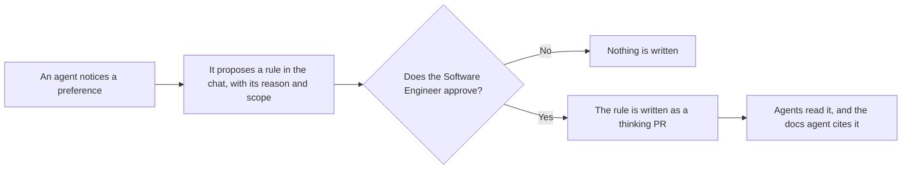

# Standards

## What this folder is

`docs/standards/` holds this project's standards: preferences the Software Engineer has approved, each written as a rule that says what to do and why. Together with the architecture decision records (ADRs), the standards are the only documents that drive code, and agents generate code with them in mind. An ADR records one decision, with the options that were considered and why one was picked.

When generated code is wrong, fix the standard or the ADR that guided it and regenerate the code in a fresh context. Do not patch the code. Because: the standards and ADRs are what drive the code, so a fix belongs in them. A patch repairs one result and leaves the text that produced it unchanged, so the next generation can repeat the mistake, and a fresh context reads the corrected text and not the earlier mistake.

The folder is named for standards in general and not for coding style. Because: it also holds verification, dependency, security and release preferences.

The folder exists because the answer to one intake question was yes. The intake is the set of questions asked when a project starts, and this one asks once whether to build standards from the Software Engineer's preferences over time. The answer is recorded as `standards_enabled: true` in the header of the [reader profile](../reader-profile.md) and in `baseline.yml`. A project that answers no has no folder. The folder starts empty apart from this README. Because: a standard comes from a preference the Software Engineer actually holds, so nothing is written for them in advance.

## How it fills

A rule enters the folder in the order shown below.

*A preference becomes a rule only through the Software Engineer's approval, so an agent that notices one proposes it and writes nothing until the answer is yes.*

1. **An agent notices a preference.** It comes up in a conversation or in a review comment. Because: those are the places where the Software Engineer says how they want the work done, and the folder is built from what they say over time.
2. **The agent proposes a rule in the chat and asks.** The proposal gives the rule, the reason in the Software Engineer's words and the scope, which is the whole project or one stack folder. Because: the reason and the scope are what the Software Engineer needs in order to answer, and what a later reader needs to judge whether the rule still holds.
3. **Only the Software Engineer's approval lets the rule be written.** Nothing is inferred silently, and if the answer is no, nothing is written. Because: a standard steers every later generation of code, so a rule nobody approved would steer it wrongly and no one would notice.
4. **The approved rule is written as a thinking PR, at the point in the stack of PRs where the preference came up.** A thinking PR is the kind that holds prescriptive documents: the spec, the plan, decisions and standards. Because: a standard says how work is done, so it is read for intent and soundness, and at that point in the stack the reviewer reads it before the code that follows it.
5. **Agents read it.** Agents find the standards through a pointer in `AGENTS.md`, and the docs agent, the fresh agent that writes the descriptive documents from the finished code, cites them in the "In this codebase" part of the lessons it writes. Because: `AGENTS.md` is the primary instruction file for working in the repository, so a pointer there reaches every agent, and a lesson that shows code a standard shaped should say so.

## What each rule records

Each rule states what to do and records four things beside it:

| Record | What it holds | Why it is recorded |
|---|---|---|
| Reason | Why the Software Engineer wants the rule, in their words. | A later reader needs it to judge whether the rule still applies. |
| Scope | The whole project, or one stack folder (one of the folders listed under `stack_folders` in `baseline.yml`). | An agent applies a rule where it applies and nowhere else. |
| Date | The date the rule was approved. | It places the rule in time, so a reader can check whether the project has changed since. |
| Source | The PR or conversation where the preference came up. | The rule can be traced back to what prompted it. |

A rule whose reason is gone is removed in a thinking PR, and git keeps the history. Because: a rule without a living reason is an unexplained constraint on every later generation of code, and removing it loses nothing, since git keeps it.

## What belongs here

Preferences that belong to one project and change as the project does:

- coding style;
- verification and release levels;
- security and secrets handling;
- dependency and update policy;
- privacy rules;
- base-image policy;
- slicing preferences, which are how work is cut into the slices of a stack.

Each is a per-project decision, so the baseline fixes none of them. Because: the baseline is the same for every kind of project and cannot know a project's kind or goals.

## What it is not

- **Not enforced by the baseline.** The baseline does not check that any standard is followed, and whether and how to check one is the project's decision. Because: a standard is a per-project preference, and many cannot be checked mechanically.
- **Not the place where decisions are recorded.** Those are ADRs. An accepted ADR is not rewritten, only superseded by a later one, while a rule is removed when its reason is gone. Because: the two answer different questions. An ADR keeps why a decision was made at the time, and a standard keeps a preference only as long as it still holds.
- **Not owned by the baseline.** The standards belong to the project, and a baseline update never touches them. Because: an update that rewrote them would erase the Software Engineer's own preferences.
- **Not a way to change a skill.** The skills run untouched. Because: the baseline sits beside the skills and changes nothing about how they work, so a standard reaches an agent through `AGENTS.md` and never by editing a skill.
- **Not shaped by the reader's level.** A standard is the same whoever reads the documents. Because: the reader profile shapes documents only and never the code.
