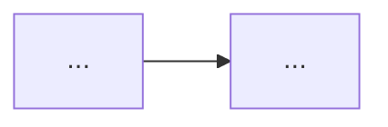

# The Baseline Standard Implementation Plan

> **For agentic workers:** REQUIRED SUB-SKILL: Use superpowers:subagent-driven-development (recommended) or superpowers:executing-plans to implement this plan task-by-task. Steps use checkbox (`- [ ]`) syntax for tracking.

**Goal:** Build design 1's deliverables as the baseline's own first stack: the bootstrap files, 31 ADR drafts, six playbooks with `AGENTS.md`, and the standard text in `standard/`, leaving the docs section to a fresh docs agent.

**Architecture:** One linear branch, `standard/build`, committed in stack order, so every stack branch is a pointer made with `git branch` at a slice boundary. Each document task is test-first against a throwaway verification helper kept outside git in `.verify/`. Steps marked **GATE** stop and ask the Software Engineer before anything is pushed, opened or created on GitHub.

**Tech Stack:** Markdown, Mermaid (mermaid-cli 12.2.0, pinned in the `learn-rust` repository), YAML, git, GitHub CLI 2.103 with `gh stack` v0.3.0, Python 3.9 (standard library only) for the helper, Ruby for parsing YAML.

**Spec:** [design 1, the standard](../specs/2026-11-14-baseline-standard-design.md) and its [decision trail](../specs/2026-11-14-baseline-decision-trail.md). In this plan "§" means a section of design 1. Read both before starting any task.

## Global Constraints

- **Repository:** `/Users/dev/dev/baseline-framework`, `origin` = `git@github.com:chandanbsd/baseline-framework.git` (private), branch `main`, no commits yet. One repository per project, no exceptions (C1). Work in this checkout, not a worktree: the spec and trail are untracked here until Task 3.
- **Venue:** documents are GitHub-flavoured Markdown plus Mermaid, readable on GitHub in dark and light themes (C2).
- **History:** one linear history on `standard/build` in stack order: bootstrap on `main`, then spec, plan, ADR drafts, playbooks, standard slices. Stack branches are pointers, `git branch standard/<nn>-<slug>` at each slice boundary (§6.3 rule 12). Branch names are `<topic>/<nn>-<slug>` with topic `standard`; docs branches are `standard/docs-<nn>-<slug>` (§6.4).
- **Commits:** conventional prefixes (`feat(scope):`, `fix(scope):`, `docs:`, `test:`, `refactor:`), small and logical, the message says why, and never an attribution line (a `Co-Authored-By:` trailer or a "Generated with" line), in commits or in PR descriptions (§6.4).
- **Nothing outward without a yes:** nothing is pushed, no PR is opened, no repository is created, and nothing merges, deploys or publishes unless the Software Engineer says so (§6.3 rule 10). A step marked **GATE** needs their explicit yes in chat first; without it, skip the step and report it as not done.
- **Skills untouched (C4):** do not edit the spec or the decision trail while executing. If either looks wrong, stop and ask. A change to a decision is a new ADR; a spec edit gets its own thinking PR (§6.3 rule 8).
- **No descriptive docs here:** the root `README.md`, architecture reference, feature docs, deployment docs, reference pages and the course are written only by a fresh docs agent from the finished tip (§10, §16.3). No task writes them, and the final reviewer is told they are deferred. At the finish menu pick "Keep the branch as-is", never "push and create a PR" (§14).
- **Reasons beside rules:** every rule in `standard/`, `docs/agents/`, `AGENTS.md` and `docs/standards/` states its reason (§8.10). No provenance tags (`[Decided]`, `[Call]`, `[Validate]`) and no "the writer" in any file this plan creates. Files under `standard/` and `docs/agents/` are self-contained: they never cite design 1's section numbers.
- **Pitch:** detail is always maximum, with no length budget (C6). The reader profile (§16.6) sets which basics get explained: none for Markdown, git and GitHub; idioms for Mermaid, YAML and Claude Code skills; stacked PRs and `gh stack` from the first command.
- **Diagrams:** Mermaid, each followed by a one-line italic caption saying what it shows and the one thing to notice (§9.3); legible in dark and light; no hard-coded colours except the approved palette, exactly `classDef added fill:#2ea04340,stroke:#2ea043,stroke-width:3px`, `classDef removed fill:#f8514940,stroke:#f85149,stroke-width:3px` and `classDef changed fill:#d2992240,stroke:#d29922,stroke-width:3px` (§9.4); at least each file's minimum below.
- **Links:** a file links only to files that already exist at its own commit, so links point backward in the stack; later files are named in backticks without a link. Link to files, not anchors. Never link to an individual ADR draft (the docs agent renames drafts when it numbers them); name decisions by their Appendix A number in plain text.
- **No stubs:** do not create `kit/`, `checkers/`, `skills/` or `examples/` (§16.1); they arrive with designs 2 and 3.
- **Checks:** every document task ends with `python3 .verify/verify_doc.py check <its files>` printing `OK` (Task 1).

## Review Focus

1. A standard file that disagrees with the spec on a count, name or order (13 architecture sections, 11 deployment areas, 10 README parts, 13 stack rules, 3 PR kinds, 9 skill seams). Pinned by the `counts` in the manifest entries of Tasks 12 to 23, which fail when a list has the wrong number of entries.
2. Brainstorm residue in normative or operational files: provenance tags, "the writer", placeholders. Pinned by the `clean` check inside every `check` run (Tasks 2 and 7 to 23).
3. An ADR draft that invents a pro, a con, evidence or a number where the trail says "Not recorded". Pinned by the `adr` check's parity and unsourced-number rules (Tasks 7 to 11).
4. A diagram that parses but breaks in the dark or the light theme, hard-codes colour outside the approved palette, or has no caption. Pinned by the `diagrams` check (Tasks 2 and 7 to 23).
5. A link from a lower slice to a file that exists only higher in the stack, an attribution line in a commit or PR, or a push or PR before the Software Engineer's yes. Pinned by the `links` check at each commit, the `git log` and PR-body greps (Tasks 6 and 24), and the GATE steps (Tasks 5, 6 and 25).

## The stack this plan builds

| PR | Branch (a pointer) | Made after | Kind | Contents |
|---|---|---|---|---|
| (bootstrap) | `main` | Task 2 | n/a | reader profile, standards folder, `baseline.yml`, `.gitignore` (the one direct-to-main commit) |
| 1 | `standard/01-spec` | Task 3 | thinking | design 1 and the decision trail |
| 2 | `standard/02-plan` | Task 4 | thinking | this plan |
| 3 | `standard/03-adr-drafts` | Task 11 | thinking | 31 ADR drafts |
| 4 | `standard/04-playbooks` | Task 14 | thinking | six playbooks, `AGENTS.md`, `CLAUDE.md` |
| 5 | `standard/05-foundations` | Task 15 | code | why and scope, vocabulary, stack model |
| 6 | `standard/06-profile-and-layout` | Task 16 | code | reader profile, project layout |
| 7 | `standard/07-feature-and-architecture` | Task 17 | code | feature docs, architecture reference |
| 8 | `standard/08-course` | Task 18 | code | lessons, system chapters, reference pages |
| 9 | `standard/09-adrs-deployment-readme` | Task 19 | code | ADRs, deployment docs, README |
| 10 | `standard/10-pr-descriptions-and-agents` | Task 20 | code | PR descriptions, `AGENTS.md` and playbooks |
| 11 | `standard/11-diagrams-and-evidence` | Task 21 | code | diagrams, evidence and truth |
| 12 | `standard/12-docs-agent-standards-rules` | Task 22 | code | docs agent, standards mechanism, working rules |
| 13 | `standard/13-seams-tooling-index` | Task 23 | code | skill seams, tooling requirements, the index |
| 14 and up | `standard/docs-14-...` | the docs agent, after Task 24 | description | README, architecture, features, deployment, reference pages, the course |

The spec's picture shows the standard text as one node; §6.3 rule 6 lets the agent group code, and this plan groups it into nine slices of about 400 lines each.

## The ADR draft template (Tasks 7 to 11)

One file per decision: `docs/adr/draft-<slug>.md`, unnumbered. The docs agent numbers it later from the id in its Links section.

````markdown
# <Title from Appendix A of the design>

Status: Draft
Date: 2026-11-14
Deciders: the Software Engineer

## Context
<the trail entry's Context, in plain prose>

## Decision drivers
<the trail entry's Drivers, ranked as recorded; otherwise "Not recorded.">

## Options

### Option 1: <name>
<one sentence on how it works, drawn only from the trail>


*<what it shows and the one thing to notice>*

- **Pros:** <recorded pros, or "Not recorded.">
- **Cons:** <recorded cons, or "Not recorded.">
- **Evidence:** <recorded evidence, or "Not recorded.">

### Option 2: <name>
<same parts>

### Option N: Do nothing
<same parts, described from the Context>

## Comparison
<a table of the options against the recorded drivers or trade-offs; "Not recorded." where the trail gives none>

## Decision
<the pick, who made it and why it beats the others, from the trail's Pick>

## Consequences
<what gets easier, what gets harder, risks, from the trail's Consequences>


*<the impact of the decision and the one thing to notice>*

## Revisit when
<the trail's Revisit when>

## Links
- Design 1, Appendix A, <id>: [design 1](../superpowers/specs/2026-11-14-baseline-standard-design.md)
- Decision trail, entry <id>: [decision trail](../superpowers/specs/2026-11-14-baseline-decision-trail.md)
````

Rules, enforced by the `adr` check unless marked otherwise:

1. **Source.** Every fact comes from the draft's trail entry and its Appendix A row. Never invent a pro, a con, evidence or a number; where the entry has none, write `Not recorded.` in that place. (Pros and cons are the reviewer's check; the numbers and `Not recorded` rules below are the helper's.)
2. **Options.** The entry's options in the order given, then `Do nothing`, described from the Context (the situation before the decision). Its Pros, Cons and Evidence are `Not recorded.` unless the Context states the problem it leaves, which is then its Cons. At least three options, and the last is named `Do nothing`.
3. **Diagrams.** One per option showing how that option works, drawn only from the trail's description of it, plus one under Consequences showing the impact: at least the number of options plus one, each with its caption.
4. **Numbers.** Write counts in words unless the trail uses digits. Digits in prose must occur in the trail entry; headings, the header lines, code blocks and the Links section are exempt.
5. **Not recorded.** The draft contains `Not recorded` at least as many times as the trail entry does.
6. **Who decided.** `Deciders` is always `the Software Engineer`. Where the trail credits the pick to the writer, the Decision section says "Proposed by the agent that wrote design 1; approved by the Software Engineer."
7. **Form.** `Status: Draft`, the `Date: 2026-11-14` of the brainstorm, the exact `##` headings above in that order, and the Links lines with `Appendix A, <id>` where `<id>` is the four-digit id.

---

### Task 1: The verification helper (outside git)

**Files:**
- Create: `.verify/verify_doc.py`
- Create: `.verify/test_verify_doc.py` and `.verify/fixtures/` (one small file per test)
- Modify: `.git/info/exclude` (add `.verify/`)

**Interfaces:**
- Consumes: mermaid-cli at `/Users/dev/dev/learn-rust-beginner-to-super-advanced/tools/mermaid/node_modules/.bin/mmdc`, with the Puppeteer config `/Users/dev/dev/learn-rust-beginner-to-super-advanced/tools/mermaid/puppeteer.json`; env vars `MMDC` and `MMDC_PUPPETEER` override both.
- Produces: the command line every later task uses.

```
python3 .verify/verify_doc.py check FILE...   # each FILE against its entry in .verify/manifest.json
python3 .verify/verify_doc.py scan PATH...    # tables, links, clean and diagrams (minimum 0) on every .md under PATH, skipping docs/superpowers/
```

Exit 0 and the single line `OK` when everything passes; otherwise exit 1 and one `FAIL <file>: <reason>` line per problem.

Manifest: `.verify/manifest.json`, an object keyed by repo-relative path. Entry fields: `headings` (list, optional), `counts` (object of heading to integer, optional), `min_diagrams` (integer, default 0), `kind` (`doc` by default, or `adr`), `id` (four-digit ADR id, required when `kind` is `adr`). A FILE with no entry fails with `no manifest entry`.

Fenced code blocks (any fence length) are skipped by the title, headings, counts, tables and links checks; `diagrams` looks only at top-level fences whose info string is `mermaid`; `clean` looks at everything. A leading YAML front matter block is skipped before the title check.

| Check | Passes when |
|---|---|
| title and headings | the first line after any front matter is a `# ` title; when `headings` is given, the file's `##` headings equal the list, in order |
| counts | for each heading in `counts`, the first table (body rows) or list (top-level items), whichever comes first, under that `##` heading has exactly that many entries |
| diagrams | at least `min_diagrams` mermaid blocks; each renders with mermaid-cli in the dark theme (background `#0d1117`) and the default theme (background `#ffffff`); no line starts with `style` or `linkStyle`; no block contains `%%{`; every `classDef` line is exactly one of the three approved palette lines; every block is followed, within two lines of its closing fence, by an italic caption line that starts and ends with `*` |
| tables | every Markdown table has the same column count on every row |
| links | every relative link `[text](path)` resolves to an existing file; a `#anchor` suffix is ignored and `http` links are skipped |
| clean | no `[Decided]`, `[Call]`, `[Validate]`, `TBD`, `TODO`, `FIXME`, "the writer" (case-insensitive), and no line starting with `Co-Authored-By:` or `🤖 Generated with` (case-insensitive) |
| adr (kind `adr` only) | the ADR rules of "The ADR draft template" that the helper enforces: form, at least three options with the last named `Do nothing`, Pros/Cons/Evidence bullets in each option, diagrams at least options plus one, `Not recorded` parity with the trail entry `docs/superpowers/specs/2026-11-14-baseline-decision-trail.md` section `## <id>.`, no unsourced digits |

- [ ] **Step 1: Write the tests.** In `.verify/test_verify_doc.py` (unittest, one fixture per test), assert the exit code and that the output names the broken rule: `test_good_doc_passes`, `test_missing_heading_fails`, `test_wrong_heading_order_fails`, `test_count_mismatch_fails`, `test_too_few_diagrams_fails`, `test_unparseable_diagram_fails`, `test_style_line_fails`, `test_unapproved_classdef_fails`, `test_missing_caption_fails`, `test_ragged_table_fails`, `test_broken_link_fails`, `test_provenance_tag_fails`, `test_attribution_line_fails`, `test_no_manifest_entry_fails`, `test_good_adr_passes`, `test_adr_two_options_fails`, `test_adr_without_do_nothing_fails`, `test_adr_unsourced_number_fails`, `test_adr_not_recorded_parity_fails`, `test_scan_reports_broken_link`.
- [ ] **Step 2: Run them to see them fail.** Run: `python3 -m unittest discover -s .verify -v`. Expected: errors because `verify_doc` does not exist.
- [ ] **Step 3: Implement `.verify/verify_doc.py`** with the two commands and the checks above: Python 3.9, standard library only, one function per check, each diagram rendered into a temporary directory. If the `mmdc` executable is missing, print `FAIL: mermaid-cli not found at <path>` and exit 1.
- [ ] **Step 4: Run the tests.** Run: `python3 -m unittest discover -s .verify -v`. Expected: `Ran 20 tests` and `OK`.
- [ ] **Step 5: Keep the helper out of git.** Run: `printf '.verify/\n' >> .git/info/exclude && git status --short`. Expected: `?? docs/` is listed (and `?? .superpowers/` if the execution skill has already made its workspace), and no `.verify`. No commit in this task.

### Task 2: The bootstrap files (on `main`)

**Files:**
- Create: `.gitignore`, `baseline.yml`, `docs/reader-profile.md`, `docs/standards/README.md`

**Interfaces:**
- Consumes: §16.6 (the confirmed profile), §7.4 (the header format), §12 (the standards folder).
- Produces: `docs/reader-profile.md` header keys `project`, `software_engineer`, `standards_enabled`, `knowledge_areas`, `technologies` (the docs agent reads them); `baseline.yml` keys `baseline_version`, `standards_enabled`, `artifact_map`, `stack_folders`.

Exact `baseline.yml`:

```yaml
baseline_version: 0.1.0
standards_enabled: true
artifact_map:
  spec: ["docs/superpowers/specs/**"]
  plan: ["docs/superpowers/plans/**"]
  other: []
# Folders whose changes are code for PR-kind purposes
stack_folders: [standard, kit, checkers, skills, examples]
```

Exact header of `docs/reader-profile.md`:

```yaml
---
project: baseline-framework
software_engineer: Chandan
standards_enabled: true
knowledge_areas:
  - name: technical writing
    level: average
  - name: software delivery process
    level: advanced
  - name: AI-agent workflows
    level: average
technologies:
  - name: Markdown
    level: advanced
    compare_with: none
  - name: git and GitHub
    level: advanced
    compare_with: none
  - name: gh stack and stacked PRs
    level: beginner
    compare_with: none
  - name: Mermaid
    level: average
    compare_with: none
  - name: YAML
    level: average
    compare_with: none
  - name: Claude Code and skills
    level: average
    compare_with: none
---
```

- [ ] **Step 1: Write the checks.** Add manifest entries: `docs/reader-profile.md` with headings `What this file is`, `Changing it`; `docs/standards/README.md` with headings `What this folder is`, `How it fills`, `What each rule records`, `What belongs here`, `What it is not` and `min_diagrams` 1. Run: `python3 .verify/verify_doc.py check docs/reader-profile.md docs/standards/README.md`. Expected: a `FAIL` line per file (missing).
- [ ] **Step 2: Create `.gitignore`** with the two lines `.superpowers/` and `.DS_Store`. Reason: the execution skills keep their ledger, briefs and review packages in `.superpowers/`, and scratch is never a PR (§6.3 rule 5).
- [ ] **Step 3: Create `baseline.yml`** exactly as above.
- [ ] **Step 4: Create `docs/reader-profile.md`:** the header above, a `# Reader profile` title, then the two sections. "What this file is" says who the repository's documents are written for and that the header is the machine-readable source; "Changing it" says a change is a thinking PR, a technology needs an entry before the docs agent writes about it, and the docs agent regenerates the sections that depend on it. Generated sections (who can contribute, prerequisites, reading paths with the reading-path map) are added later by the docs agent, so none appears here.
- [ ] **Step 5: Create `docs/standards/README.md`** from §12, with one flowchart of how a preference becomes a rule (noticed, proposed with its reason and scope, approved, written as a thinking PR, read by agents) and its caption.
- [ ] **Step 6: Verify.** Run: `python3 .verify/verify_doc.py check docs/reader-profile.md docs/standards/README.md`. Expected: `OK`. Run: `ruby -ryaml -e 'puts YAML.load_file("baseline.yml").keys.sort.join(",")'`. Expected: `artifact_map,baseline_version,stack_folders,standards_enabled`. Run: `ruby -ryaml -e 'h = YAML.load_file("docs/reader-profile.md"); puts [h["technologies"].size, h["knowledge_areas"].size, h["standards_enabled"]].join(" ")'`. Expected: `6 3 true`.
- [ ] **Step 7: Commit on `main`.** Run: `git add .gitignore baseline.yml docs/reader-profile.md docs/standards/README.md && git commit -m "chore: bootstrap the repository with its reader profile, standards folder and baseline.yml"`. Expected: `git log --oneline` shows one commit and `git status --short` shows only `?? docs/superpowers/`.

### Task 3: Commit the spec and the decision trail (PR 1)

**Files:**
- Commit as they are: `docs/superpowers/specs/2026-11-14-baseline-standard-design.md`, `docs/superpowers/specs/2026-11-14-baseline-decision-trail.md`

**Interfaces:**
- Produces: the working branch `standard/build` and the pointer `standard/01-spec`.

- [ ] **Step 1: Create the working branch.** Run: `git switch -c standard/build`. Expected: `Switched to a new branch 'standard/build'`.
- [ ] **Step 2: Confirm the files are the approved text.** Run: `shasum -a 256 docs/superpowers/specs/*.md`. Expected: `e9b77f5f0101e5ca002ca966466138dad2ae6dbe49be1f75c79b8c51ac291b7e` for the decision trail and `971028350d2c620ceb2a2c521582c8e34bdd9f25ce577304bc01e44146a07014` for the design. If either differs, stop and ask: the approved text changed.
- [ ] **Step 3: Commit them as produced.** Run: `git add docs/superpowers/specs/ && git commit -m "docs: add design 1 (the standard) and its decision trail"`. Expected: `git show --stat HEAD` lists exactly those two files.
- [ ] **Step 4: Mark the boundary.** Run: `git branch standard/01-spec`. Expected: `git rev-parse standard/01-spec` equals `git rev-parse HEAD`.

### Task 4: Commit this plan (PR 2)

**Files:**
- Commit as it is: `docs/superpowers/plans/2026-11-14-baseline-standard.md`

**Interfaces:**
- Produces: the pointer `standard/02-plan`.

- [ ] **Step 1: Confirm the plan is the only new file.** Run: `git status --short`. Expected: `?? docs/superpowers/plans/`.
- [ ] **Step 2: Commit it as produced.** Run: `git add docs/superpowers/plans/ && git commit -m "docs: add the implementation plan for design 1"`.
- [ ] **Step 3: Mark the boundary.** Run: `git branch standard/02-plan`. Expected: `git rev-parse standard/02-plan` equals `git rev-parse HEAD`.

### Task 5 (GATE): Validate the stack flow in a throwaway repository

**Interfaces:**
- Produces: a yes or no on "branches cut as pointers into linear history work with `gh stack link`" (§17.2, V4), which Tasks 6 and 25 rely on. V1 and V2 wait for design 3, where the stack gate and the schema-diff block are built; V3 waits for design 2 or 3; V5 is exercised in Task 24.

- [ ] **Step 1: GATE.** Ask the Software Engineer to approve creating the private repository `baseline-stack-sandbox` under `chandanbsd` for this test. If they decline, skip to Task 6 and treat PRs 1 and 2 as the validation, repairing with `gh stack unstack` if the flow misbehaves.
- [ ] **Step 2: Create the sandbox** in a temporary directory outside this repository. Run: `gh repo create chandanbsd/baseline-stack-sandbox --private --clone --add-readme`. Expected: a clone with one commit on `main`.
- [ ] **Step 3: Build three commits on one branch and cut pointers.** In the clone run:

```bash
git switch -c sandbox/build
i=0; for n in a b c; do i=$((i+1)); echo "$n" > "$n.md"; git add "$n.md"; git commit -m "docs: add $n"; git branch "sandbox/0$i-$n"; done
```

Expected: branches `sandbox/01-a`, `sandbox/02-b`, `sandbox/03-c` exist at commits one, two and three.
- [ ] **Step 4: Link them into a stack.** Run: `gh stack link sandbox/01-a sandbox/02-b sandbox/03-c --open`. Expected: three open PRs. `gh pr list --json number,headRefName,baseRefName` shows bases `main`, `sandbox/01-a`, `sandbox/02-b`, and `gh stack view` lists the three branches bottom to top.
- [ ] **Step 5: Record the result** (commands, output, anything surprising) for the final report. If the stack was not created or the bases do not chain, stop and ask the Software Engineer before Task 6.
- [ ] **Step 6: GATE.** Ask the Software Engineer to delete the sandbox: `gh repo delete chandanbsd/baseline-stack-sandbox --yes` (needs the `delete_repo` scope; otherwise they delete it in the browser). Then remove the temporary directory.

### Task 6 (GATE): Open PRs 1 and 2

**Interfaces:**
- Consumes: the pointers `standard/01-spec` and `standard/02-plan`; the thinking-PR form of §8.9.
- Produces: PRs 1 and 2 on GitHub as the bottom of the stack.

- [ ] **Step 1: GATE.** Ask the Software Engineer to approve pushing `main` and opening PRs 1 and 2 now, so they can read while the build runs (§6.3 rule 3).
- [ ] **Step 2: Push the bootstrap.** Run: `git push -u origin main`. Expected: `git ls-remote origin main` prints the same SHA as `git rev-parse main`.
- [ ] **Step 3: Open the first two PRs as a stack.** Run: `gh stack link standard/01-spec standard/02-plan --open`. Expected: two open PRs; `gh pr list --json number,headRefName,baseRefName` shows PR 2's base is `standard/01-spec`.
- [ ] **Step 4: Set titles and descriptions.** Titles: `docs: design 1, the standard, and its decision trail` and `docs: implementation plan for design 1`. Each description is the thinking form of §8.9: the stack table (the PRs that exist so far, each with kind, link and one-line purpose, and a note that the stack grows as the build proceeds), the kind (`thinking`), what the artifact is, which skill produced it (`superpowers:brainstorming`, `superpowers:writing-plans`), what to read first, and the decisions it contains (PR 1: Appendix A and the decision trail; PR 2: the stack table of this plan). Write them to `.verify/pr-1.md` and `.verify/pr-2.md` and apply each with `gh pr edit <number> --title "<title>" --body-file <file>`.
- [ ] **Step 5: Verify.** Run: `gh pr view standard/01-spec --json body --jq .body | head -5`. Expected: the stack table. Run: `git log standard/02-plan --format=%B | grep -i -c -E '^(co-authored-by:|🤖 generated with)'` and the same grep over each PR body (`gh pr view <n> --json body --jq .body`). Expected: `0` each time.

### Task 7: ADR drafts on scope and approach

**Files:**
- Create under `docs/adr/`: `draft-adrs-with-options-explored.md` (trail 0001), `draft-baseline-scope.md` (0002), `draft-delivery-standard-kit-skills.md` (0003), `draft-build-order.md` (0028), `draft-software-engineer-and-the-ladder.md` (0031)

**Interfaces:**
- Consumes: "The ADR draft template" above; each draft's trail entry and Appendix A row.
- Produces: five drafts whose Links name `Appendix A, <id>`.

- [ ] **Step 1: Write the checks.** Add a manifest entry per draft with `kind` `adr` and its `id` (`0001`, `0002`, `0003`, `0028`, `0031`). Run `python3 .verify/verify_doc.py check` on the five files. Expected: a `FAIL` line per file (missing).
- [ ] **Step 2: Write `docs/adr/draft-adrs-with-options-explored.md`** from trail 0001, titled "Record decisions as ADRs with the options explored".
- [ ] **Step 3: Write `docs/adr/draft-baseline-scope.md`** from trail 0002, titled "Baseline scope".
- [ ] **Step 4: Write `docs/adr/draft-delivery-standard-kit-skills.md`** from trail 0003, titled "Delivery".
- [ ] **Step 5: Write `docs/adr/draft-build-order.md`** from trail 0028, titled "Build order".
- [ ] **Step 6: Write `docs/adr/draft-software-engineer-and-the-ladder.md`** from trail 0031, titled "The Software Engineer and the ladder as the baseline's why".
- [ ] **Step 7: Run the checks.** Run the Step 1 command again. Expected: `OK`.
- [ ] **Step 8: Commit.** Run: `git add docs/adr/ && git commit -m "docs(adr): add draft decisions on scope and approach"`.

### Task 8: ADR drafts on the reader and the course

**Files:**
- Create under `docs/adr/`: `draft-reader-profile-is-the-target-team.md` (0004), `draft-detail-always-maximum.md` (0005), `draft-comparisons-in-marked-asides.md` (0006), `draft-course-scope.md` (0014), `draft-course-tiers.md` (0015), `draft-practice-standard.md` (0016)

**Interfaces:**
- Consumes: the template; trail entries 0004, 0005, 0006, 0014, 0015, 0016.
- Produces: six drafts.

- [ ] **Step 1: Write the checks.** Manifest entries (`kind` `adr`, ids as listed); run `check` on the six files. Expected: a `FAIL` line per file.
- [ ] **Step 2: Write `draft-reader-profile-is-the-target-team.md`** from 0004, titled "The reader profile is the target team".
- [ ] **Step 3: Write `draft-detail-always-maximum.md`** from 0005, titled "Detail is always maximum".
- [ ] **Step 4: Write `draft-comparisons-in-marked-asides.md`** from 0006, titled "Comparisons with a known stack".
- [ ] **Step 5: Write `draft-course-scope.md`** from 0014, titled "Course scope".
- [ ] **Step 6: Write `draft-course-tiers.md`** from 0015, titled "Course tiers".
- [ ] **Step 7: Write `draft-practice-standard.md`** from 0016, titled "Practice standard".
- [ ] **Step 8: Run the checks.** Run the Step 1 command again. Expected: `OK`.
- [ ] **Step 9: Commit.** Run: `git add docs/adr/ && git commit -m "docs(adr): add draft decisions on the reader and the course"`.

### Task 9: ADR drafts on the stack model and the skills

**Files:**
- Create under `docs/adr/`: `draft-docs-at-top-of-stack.md` (0007), `draft-fresh-docs-agent.md` (0008), `draft-one-kind-per-pr.md` (0009), `draft-skill-artifacts.md` (0010), `draft-adr-authorship-and-approval.md` (0011), `draft-adr-placement-in-stack.md` (0012), `draft-one-repo-per-project.md` (0013)

**Interfaces:**
- Consumes: the template; trail entries 0007 to 0013.
- Produces: seven drafts.

- [ ] **Step 1: Write the checks.** Manifest entries (`kind` `adr`, ids `0007` to `0013`); run `check` on the seven files. Expected: a `FAIL` line per file.
- [ ] **Step 2: Write `draft-docs-at-top-of-stack.md`** from 0007, titled "Descriptive docs at the top of the stack".
- [ ] **Step 3: Write `draft-fresh-docs-agent.md`** from 0008, titled "The docs author".
- [ ] **Step 4: Write `draft-one-kind-per-pr.md`** from 0009, titled "One kind per PR, for easier review".
- [ ] **Step 5: Write `draft-skill-artifacts.md`** from 0010, titled "Skill-produced artifacts".
- [ ] **Step 6: Write `draft-adr-authorship-and-approval.md`** from 0011, titled "ADR authorship and approval".
- [ ] **Step 7: Write `draft-adr-placement-in-stack.md`** from 0012, titled "ADR placement in the stack".
- [ ] **Step 8: Write `draft-one-repo-per-project.md`** from 0013, titled "One repo per project".
- [ ] **Step 9: Run the checks.** Run the Step 1 command again. Expected: `OK`.
- [ ] **Step 10: Commit.** Run: `git add docs/adr/ && git commit -m "docs(adr): add draft decisions on the stack model and the skills"`.

### Task 10: ADR drafts on documents and diagrams

**Files:**
- Create under `docs/adr/`: `draft-architecture-reference-form.md` (0017), `draft-feature-docs.md` (0018), `draft-generated-indexes.md` (0019), `draft-diagram-tooling-and-theme.md` (0020), `draft-database-diagrams.md` (0021), `draft-reading-venue.md` (0022)

**Interfaces:**
- Consumes: the template; trail entries 0017 to 0022.
- Produces: six drafts.

- [ ] **Step 1: Write the checks.** Manifest entries (`kind` `adr`, ids `0017` to `0022`); run `check` on the six files. Expected: a `FAIL` line per file.
- [ ] **Step 2: Write `draft-architecture-reference-form.md`** from 0017, titled "Architecture reference form".
- [ ] **Step 3: Write `draft-feature-docs.md`** from 0018, titled "Feature docs".
- [ ] **Step 4: Write `draft-generated-indexes.md`** from 0019, titled "Indexes".
- [ ] **Step 5: Write `draft-diagram-tooling-and-theme.md`** from 0020, titled "Diagram tooling and theme".
- [ ] **Step 6: Write `draft-database-diagrams.md`** from 0021, titled "Database diagrams".
- [ ] **Step 7: Write `draft-reading-venue.md`** from 0022, titled "Reading venue".
- [ ] **Step 8: Run the checks.** Run the Step 1 command again. Expected: `OK`.
- [ ] **Step 9: Commit.** Run: `git add docs/adr/ && git commit -m "docs(adr): add draft decisions on documents and diagrams"`.

### Task 11: ADR drafts on enforcement and tooling

**Files:**
- Create under `docs/adr/`: `draft-enforcement.md` (0023), `draft-standards-folder.md` (0024), `draft-update-mechanism.md` (0025), `draft-checker-language.md` (0026), `draft-worked-example.md` (0027), `draft-conventions.md` (0029), `draft-agents-md-shape.md` (0030)

**Interfaces:**
- Consumes: the template; trail entries 0023 to 0027, 0029, 0030.
- Produces: seven drafts, completing all 31; the pointer `standard/03-adr-drafts`.

- [ ] **Step 1: Write the checks.** Manifest entries (`kind` `adr`, ids `0023` to `0027`, `0029`, `0030`); run `check` on the seven files. Expected: a `FAIL` line per file.
- [ ] **Step 2: Write `draft-enforcement.md`** from 0023, titled "Enforcement".
- [ ] **Step 3: Write `draft-standards-folder.md`** from 0024, titled "Standards folder".
- [ ] **Step 4: Write `draft-update-mechanism.md`** from 0025, titled "The update mechanism".
- [ ] **Step 5: Write `draft-checker-language.md`** from 0026, titled "Checker language".
- [ ] **Step 6: Write `draft-worked-example.md`** from 0027, titled "The worked example".
- [ ] **Step 7: Write `draft-conventions.md`** from 0029, titled "Conventions".
- [ ] **Step 8: Write `draft-agents-md-shape.md`** from 0030, titled "Shape of AGENTS.md".
- [ ] **Step 9: Run the checks.** Run the Step 1 command again. Expected: `OK`. Run: `ls docs/adr/draft-*.md | wc -l`. Expected: `31`.
- [ ] **Step 10: Commit and mark the boundary.** Run: `git add docs/adr/ && git commit -m "docs(adr): add draft decisions on enforcement and tooling" && git branch standard/03-adr-drafts`. Expected: `git rev-parse standard/03-adr-drafts` equals `git rev-parse HEAD`.

### Task 12: Playbooks for working, stacks and PR descriptions

**Files (create):**

| File | Source | `##` headings, in order | Counts | Min diagrams |
|---|---|---|---|---|
| `docs/agents/working-with-the-engineer.md` | §13, §8.10 | When to read this · Who decides what · How decisions are put to the Software Engineer · While the Software Engineer is busy · Reporting · Rulings | none | 2 |
| `docs/agents/stacks.md` | §6, §14 | When to read this · What gh stack is · The rules · Cutting the stack from linear history · Opening and updating the stack · Small changes · Seams with the skills | none | 2 |
| `docs/agents/pr-descriptions.md` | §8.9 | When to read this · The header every PR starts with · Thinking PRs · Code PRs · Description PRs · Keeping stack tables current | Code PRs 11 | 2 |

**Interfaces:**
- Consumes: the cited sections. Playbooks are operational: every rule is followed by `Because:` and its reason; they contain no links (files are named in backticks) and never cite design section numbers.
- Produces: three playbooks that Task 14's `AGENTS.md` points to. `stacks.md` explains `gh stack` from its first command for a beginner and states that this baseline uses `gh stack link` over branches made with plain git.

- [ ] **Step 1: Write the checks.** Add the three manifest entries from the table and run `check` on the three files. Expected: a `FAIL` line per file.
- [ ] **Step 2: Write `docs/agents/working-with-the-engineer.md`:** who decides and who records rulings, how decisions are put (a numbered list, options with the recommendation first and one reason, answered by number, "elaborate" meaning explain the trade-off again then recommend again), what agents do while the Software Engineer is busy (everything that needs no decision, then exact commands for the rest), and the five-part report. Diagrams: who decides, and the shape of a report.
- [ ] **Step 3: Write `docs/agents/stacks.md`:** the stack picture, the three PR kinds and why each is kept apart (easier review), the rules of §6.3 and conventions of §6.4 with their reasons, how to cut branch pointers with `git branch` and open the stack with `gh stack link <branches> --open`, how a mixed or late change is separated when PRs are opened, small changes as a two-PR stack, and the skill seams of §14 as instructions. Diagrams: the stack picture, and linear history with branch pointers.
- [ ] **Step 4: Write `docs/agents/pr-descriptions.md`:** the shared header (stack table, kind), the full code-PR template of eleven parts, the short thinking form, the description form, and how to refresh stack tables when the stack grows. Diagrams: a stack table with its stack diagram, and the order a reviewer reads in.
- [ ] **Step 5: Run the checks.** Run the Step 1 command again. Expected: `OK`.
- [ ] **Step 6: Commit.** Run: `git add docs/agents/ && git commit -m "docs(agents): add the working, stacks and PR description playbooks"`.

### Task 13: Playbooks for the docs agent, ADRs and standards

**Files (create):**

| File | Source | `##` headings, in order | Counts | Min diagrams |
|---|---|---|---|---|
| `docs/agents/docs-agent.md` | §10, §16.3, §8.9 | When to read this · What you are · What to read · What not to read · What to produce · The rules · When to stop and ask · Evidence · Hand-over | The rules 6 | 2 |
| `docs/agents/adrs.md` | §11, §8.6 | When to read this · When to write a draft · How to write one · The lifecycle · The guard rail for the docs agent · The presence check | When to write a draft 6 | 2 |
| `docs/agents/standards.md` | §12 | When to read this · What belongs in docs/standards/ · How a preference becomes a standard · When generated code is wrong · What a rule records | none | 2 |

**Interfaces:**
- Consumes: the cited sections; the Task 12 conventions (`Because:`, no links, no section numbers).
- Produces: `docs-agent.md` is the brief a fresh agent is started from, so it is self-contained: the reading list (the repository at the tip, `docs/adr/`, the spec, `docs/standards/`, `docs/reader-profile.md`, the "Rulings I made" lists in the PR descriptions, the stack table), the exclusions (the plan, the build conversation), the PR order (reference, language lessons, stack lessons, system chapters) and branch naming that continues the stack's numbering, the stop-and-ask rule for a technology with no reader-profile entry, ADR numbering from the `Appendix A` ids in each draft's Links, two permitted crossovers into thinking files (ADR review edits, and regenerating the generated sections of `docs/reader-profile.md`), and the indexes it writes by hand under the bootstrap exception (the ADR index, course index, file map and glossaries).

- [ ] **Step 1: Write the checks.** Add the three manifest entries from the table and run `check` on the three files. Expected: a `FAIL` line per file.
- [ ] **Step 2: Write `docs/agents/docs-agent.md`** as above, with the sequence diagram of §10 and a diagram of the PR order.
- [ ] **Step 3: Write `docs/agents/adrs.md`:** the six criteria, the draft template location (`standard/11-adrs.md`, named in backticks), the lifecycle state diagram, the guard rail, the presence check, and what to do for decisions made in brainstorming.
- [ ] **Step 4: Write `docs/agents/standards.md`:** what belongs in `docs/standards/`, the propose-with-reason-and-scope loop, fixing standards or ADRs and regenerating in a fresh context when code is wrong, and what each rule records. Diagrams: the proposal loop and the regenerate loop.
- [ ] **Step 5: Run the checks.** Run the Step 1 command again. Expected: `OK`.
- [ ] **Step 6: Commit.** Run: `git add docs/agents/ && git commit -m "docs(agents): add the docs agent, ADR and standards playbooks"`.

### Task 14: `AGENTS.md` and `CLAUDE.md`

**Files:**
- Create: `AGENTS.md`, `CLAUDE.md`

**Interfaces:**
- Consumes: §8.10; the six playbooks of Tasks 12 and 13.
- Produces: the instruction entry point; the pointer `standard/04-playbooks`.

`AGENTS.md` has these `##` headings in order: `Who and what`, `The core rules`, `The playbooks`, `The repo map`; counts `The core rules` 7 and `The playbooks` 6. It is about 100 lines. The seven core rules, each with its reason and the playbook that explains it: (1) work as stacks, one kind per PR, because each kind is easier to review on its own (`stacks.md`); (2) one repository per project, because stacks cannot span repositories and agents then see the whole product (`stacks.md`); (3) skills run as written and write where they write, agents do not edit a skill's documents to fit the baseline, and a skill's own later revision gets its own PR (`stacks.md`); (4) nothing merges, deploys or publishes unless the Software Engineer asks (`working-with-the-engineer.md`); (5) no attribution lines in commits or PR descriptions (`stacks.md`); (6) descriptive docs are written only by the fresh docs agent from the finished tip (`docs-agent.md`); (7) agents propose standards and never write them silently (`standards.md`). "Who and what" names the Software Engineer, points to `docs/reader-profile.md`, and says that if the Software Engineer says something different in the conversation, the conversation wins for that task. "The repo map" lists only folders that exist (`standard/`, `docs/`, `baseline.yml`) and says folders for later designs appear when those designs are built. It names `standard/README.md` in backticks.

- [ ] **Step 1: Write the check.** Add the `AGENTS.md` manifest entry (headings and counts above). Run `python3 .verify/verify_doc.py check AGENTS.md`. Expected: `FAIL` (missing).
- [ ] **Step 2: Write `AGENTS.md`** as specified above.
- [ ] **Step 3: Write `CLAUDE.md`** as exactly two lines: a sentence saying the instructions live in `AGENTS.md` and to read it first, then the line `@AGENTS.md`.
- [ ] **Step 4: Run the checks.** Run: `python3 .verify/verify_doc.py check AGENTS.md`. Expected: `OK`. Run: `wc -l < CLAUDE.md`. Expected: `2`. Run: `grep -c '@AGENTS.md' CLAUDE.md`. Expected: `1`.
- [ ] **Step 5: Commit and mark the boundary.** Run: `git add AGENTS.md CLAUDE.md && git commit -m "docs(agents): add AGENTS.md and the CLAUDE.md pointer" && git branch standard/04-playbooks`. Expected: `git rev-parse standard/04-playbooks` equals `git rev-parse HEAD`.

### Task 15: The standard, foundations

**Files (create):**

| File | Source | `##` headings, in order | Counts | Min diagrams |
|---|---|---|---|---|
| `standard/01-why-and-scope.md` | §1 to §3 | Who it is for · The why · What the baseline is · What success looks like · The principle that outranks all others · Goals · Non-goals · Anti-goals · Constraints | What success looks like 6 · Goals 10 · Non-goals 7 · Anti-goals 9 · Constraints 7 | 2 |
| `standard/02-vocabulary.md` | §5 | Roles · Terms | none | 1 |
| `standard/03-stack-model.md` | §6 | The picture · The three PR kinds · How the kind is decided · When something changes later · The rules of the stack · Conventions | The three PR kinds 3 · The rules of the stack 13 · Conventions 7 | 3 |

**Interfaces:**
- Consumes: the cited sections of the spec as it stands (including the ladder of §1.1 and rule 8 of §6.3); the Global Constraints.
- Produces: the three files; later files link back to them.

- [ ] **Step 1: Write the checks.** Add the three manifest entries from the table and run `python3 .verify/verify_doc.py check` on the three files. Expected: a `FAIL` line per file.
- [ ] **Step 2: Write `standard/01-why-and-scope.md`** from §1 to §3 as a standard, not a brainstorm record: the ladder diagram and table under "The why", the three-part picture under "What the baseline is", and the goals, non-goals, anti-goals and constraints with their ids and reasons.
- [ ] **Step 3: Write `standard/02-vocabulary.md`** from §5: a roles diagram and a terms table containing at least every term of §5.
- [ ] **Step 4: Write `standard/03-stack-model.md`** from §6: the stack picture, the kinds table with its "kept out, for easier review" column and the reason beside it, the thirteen rules, the seven conventions, and a diagram of branches cut as pointers into linear history.
- [ ] **Step 5: Run the checks.** Run the Step 1 command again. Expected: `OK`.
- [ ] **Step 6: Commit and mark the boundary.** Run: `git add standard/ && git commit -m "feat(standard): add the foundations (why and scope, vocabulary, stack model)" && git branch standard/05-foundations`.

### Task 16: The standard, reader profile and project layout

**Files (create):**

| File | Source | `##` headings, in order | Counts | Min diagrams |
|---|---|---|---|---|
| `standard/04-reader-profile.md` | §7 | Purpose · What is asked · When it runs · The saved file · What is generated from it | What is asked 3 | 2 |
| `standard/05-project-layout.md` | §8.1, §8.2, §15.1, §15.2 | The folder layout · baseline.yml · Baseline-owned and project-owned files · The artifact map | none | 2 |

**Interfaces:**
- Consumes: the cited sections; the files of Task 15 (link back by path).
- Produces: the two files. The artifact map section says the map records where skills write and never tells a skill where to write.

- [ ] **Step 1: Write the checks.** Add the two manifest entries and run `check` on the two files. Expected: a `FAIL` line per file.
- [ ] **Step 2: Write `standard/04-reader-profile.md`** from §7: the levels table (three rows) first under "What is asked", the intake flowchart, the saved-file format with the `software_engineer` field, and what the docs agent generates from the profile.
- [ ] **Step 3: Write `standard/05-project-layout.md`** from §8.1, §8.2, §15.1 and §15.2: the document map of §8.1 and the folder layout under "The folder layout", the `baseline.yml` keys, the baseline-owned and project-owned split, and the artifact map; the document map and the ownership split are the two diagrams.
- [ ] **Step 4: Run the checks.** Run the Step 1 command again. Expected: `OK`.
- [ ] **Step 5: Commit and mark the boundary.** Run: `git add standard/ && git commit -m "feat(standard): add the reader profile and project layout" && git branch standard/06-profile-and-layout`.

### Task 17: The standard, feature docs and architecture reference

**Files (create):**

| File | Source | `##` headings, in order | Counts | Min diagrams |
|---|---|---|---|---|
| `standard/06-feature-docs.md` | §8.3 | Purpose and audience · The overview page · The Users and access page · Each feature page · Systems with no screen · Evidence | Each feature page 8 | 2 |
| `standard/07-architecture-reference.md` | §8.4 | Purpose and shape · The file header · The thirteen minimum sections · Adding sections · When a section does not apply | The thirteen minimum sections 13 | 2 |

**Interfaces:**
- Consumes: the cited sections; earlier standard files (link back by path).
- Produces: the two files. "When a section does not apply" states the one-line `Not applicable: why` form.

- [ ] **Step 1: Write the checks.** Add the two manifest entries and run `check` on the two files. Expected: a `FAIL` line per file.
- [ ] **Step 2: Write `standard/06-feature-docs.md`** from §8.3, with the eight-part feature page as a numbered list under "Each feature page", the access state diagram and the capability map described as required diagrams.
- [ ] **Step 3: Write `standard/07-architecture-reference.md`** from §8.4, with the thirteen sections as one table under "The thirteen minimum sections".
- [ ] **Step 4: Run the checks.** Run the Step 1 command again. Expected: `OK`.
- [ ] **Step 5: Commit and mark the boundary.** Run: `git add standard/ && git commit -m "feat(standard): add the feature docs and architecture reference standards" && git branch standard/07-feature-and-architecture`.

### Task 18: The standard, the course

**Files (create):**

| File | Source | `##` headings, in order | Counts | Min diagrams |
|---|---|---|---|---|
| `standard/08-course-lessons.md` | §8.5 (tiers, scope, lesson anatomy, header, practice) | Purpose · The three tiers · Scope · Lesson anatomy · The lesson file header · The practice standard | Lesson anatomy 10 | 3 |
| `standard/09-course-system-chapters.md` | §8.5 (system chapters) | Purpose · System chapter anatomy · Labs · Practice for system chapters | System chapter anatomy 10 | 3 |
| `standard/10-course-reference-pages.md` | §8.5 (reference pages), §9.6 rules 9 and 11 | The three reference pages · The file map · The glossaries · The what else it offers map · How each is produced | The three reference pages 3 | 2 |

**Interfaces:**
- Consumes: the cited sections; the profile file of Task 16 (link back by path).
- Produces: the three files. The lesson header's YAML example and the practice mix (3 predict, 3 diagnose, 2 trade-offs, 2 systems reasoning; 3 warm-up, 4 core, 3 stretch) are copied exactly from §8.5.

- [ ] **Step 1: Write the checks.** Add the three manifest entries and run `check` on the three files. Expected: a `FAIL` line per file.
- [ ] **Step 2: Write `standard/08-course-lessons.md`** from §8.5, with the ten-row lesson anatomy table (header table plus parts 1 to 9).
- [ ] **Step 3: Write `standard/09-course-system-chapters.md`** from §8.5, with the ten-row system chapter anatomy and the four lab kinds (run it, break it, trace it, fix it).
- [ ] **Step 4: Write `standard/10-course-reference-pages.md`** from §8.5, §9.6 rule 9 and rule 11: the three pages, how each is produced (generated, assembled, written) and the bootstrap exception.
- [ ] **Step 5: Run the checks.** Run the Step 1 command again. Expected: `OK`.
- [ ] **Step 6: Commit and mark the boundary.** Run: `git add standard/ && git commit -m "feat(standard): add the course standards (lessons, system chapters, reference pages)" && git branch standard/08-course`.

### Task 19: The standard, ADRs, deployment docs and README

**Files (create):**

| File | Source | `##` headings, in order | Counts | Min diagrams |
|---|---|---|---|---|
| `standard/11-adrs.md` | §8.6, §11, "The ADR draft template" of this plan | What an ADR is · The template · Decisions of impact · The lifecycle · The rules · The presence check | Decisions of impact 6 | 3 |
| `standard/12-deployment-docs.md` | §8.7 | Purpose · The eleven areas · The honesty rule · Diagrams | The eleven areas 11 | 2 |
| `standard/13-project-readme.md` | §8.8 | Purpose · The ten parts · Stack READMEs · The verification rule | The ten parts 10 | 2 |

**Interfaces:**
- Consumes: the cited sections; the template block of this plan, copied verbatim into `standard/11-adrs.md` under "The template".
- Produces: the three files.

- [ ] **Step 1: Write the checks.** Add the three manifest entries and run `check` on the three files. Expected: a `FAIL` line per file.
- [ ] **Step 2: Write `standard/11-adrs.md`:** the model of §11 (criteria, lifecycle state diagram, the guard rail, numbering at publish, append-only once accepted, the presence check) and the template with its seven rules.
- [ ] **Step 3: Write `standard/12-deployment-docs.md`** from §8.7, with the eleven areas as one table and the five required diagrams named under "Diagrams".
- [ ] **Step 4: Write `standard/13-project-readme.md`** from §8.8, with the ten parts as a numbered list and the clean-environment verification rule.
- [ ] **Step 5: Run the checks.** Run the Step 1 command again. Expected: `OK`.
- [ ] **Step 6: Commit and mark the boundary.** Run: `git add standard/ && git commit -m "feat(standard): add the ADR, deployment docs and README standards" && git branch standard/09-adrs-deployment-readme`.

### Task 20: The standard, PR descriptions and `AGENTS.md`

**Files (create):**

| File | Source | `##` headings, in order | Counts | Min diagrams |
|---|---|---|---|---|
| `standard/14-pr-descriptions.md` | §8.9, §9.5 | Purpose · The header every PR starts with · Thinking PRs · Code PRs · Description PRs · Database changes | Code PRs 11 | 2 |
| `standard/15-agents-md-and-playbooks.md` | §8.10, §14 (generated instruction files) | Purpose · AGENTS.md · CLAUDE.md · The playbooks · Rules for the files themselves · Generated instruction files | The playbooks 6 | 2 |

**Interfaces:**
- Consumes: the cited sections; the playbooks of Tasks 12 to 14 (the standard names them in backticks).
- Produces: the two files. `standard/14-pr-descriptions.md` carries the three PR templates as copyable Markdown blocks and the colour-coded schema-diff rules, including that Mermaid colours whole tables only so column and relationship changes use `+`, `~` and `-` in the text.

- [ ] **Step 1: Write the checks.** Add the two manifest entries and run `check` on the two files. Expected: a `FAIL` line per file.
- [ ] **Step 2: Write `standard/14-pr-descriptions.md`** from §8.9 and §9.5.
- [ ] **Step 3: Write `standard/15-agents-md-and-playbooks.md`** from §8.10 and the generated-instruction-file row of §14, listing the six playbooks by name.
- [ ] **Step 4: Run the checks.** Run the Step 1 command again. Expected: `OK`.
- [ ] **Step 5: Commit and mark the boundary.** Run: `git add standard/ && git commit -m "feat(standard): add the PR description and AGENTS.md standards" && git branch standard/10-pr-descriptions-and-agents`.

### Task 21: The standard, diagrams and evidence

**Files (create):**

| File | Source | `##` headings, in order | Counts | Min diagrams |
|---|---|---|---|---|
| `standard/16-diagrams.md` | §9.1 to §9.5 | How diagrams are drawn · Minimum diagrams per document · Quality rules · Theme rules · The approved palette · Database diagrams | Minimum diagrams per document 9 | 3 |
| `standard/17-evidence-and-truth.md` | §9.6 | Why the evidence rules exist · The rules · Not applicable, with the reason · The bootstrap exception for indexes | The rules 11 | 2 |

**Interfaces:**
- Consumes: the cited sections; the approved palette lines from Global Constraints, copied exactly.
- Produces: the two files. `standard/16-diagrams.md` includes an entity-relationship example using the palette's `added`, `removed` and `changed` classes, which the `diagrams` check must accept.

- [ ] **Step 1: Write the checks.** Add the two manifest entries and run `check` on the two files. Expected: a `FAIL` line per file.
- [ ] **Step 2: Write `standard/16-diagrams.md`** from §9.1 to §9.5.
- [ ] **Step 3: Write `standard/17-evidence-and-truth.md`** from §9.6, with all eleven rules as one numbered list and the two elaborating sections.
- [ ] **Step 4: Run the checks.** Run the Step 1 command again. Expected: `OK`.
- [ ] **Step 5: Confirm the approved palette in both themes** (§17.1). Render the entity-relationship example of `standard/16-diagrams.md` twice with mermaid-cli to PNG under `.verify/` (`-t dark -b "#0d1117"` and `-t default -b "#ffffff"`, with `-s 2`) and view both images. Expected: every entity's text is legible and the green, red and amber borders are visible in both. If not, stop and ask before changing any value.
- [ ] **Step 6: Commit and mark the boundary.** Run: `git add standard/ && git commit -m "feat(standard): add the diagram and evidence standards" && git branch standard/11-diagrams-and-evidence`.

### Task 22: The standard, the docs agent, the standards mechanism and working rules

**Files (create):**

| File | Source | `##` headings, in order | Counts | Min diagrams |
|---|---|---|---|---|
| `standard/18-docs-agent.md` | §10 | Purpose · What it reads · What it does not read · What it produces · The rules · Why a fresh agent | The rules 6 | 2 |
| `standard/19-standards-mechanism.md` | §12 | Purpose · Opt-in · How it fills · What each rule records · Where changes land · Who reads it · What belongs here | none | 2 |
| `standard/20-working-rules.md` | §13 | Who decides what · How decisions are put to the Software Engineer · While the Software Engineer is busy · Reporting | none | 2 |

**Interfaces:**
- Consumes: the cited sections; earlier standard files (link back by path).
- Produces: the three files. `standard/18-docs-agent.md` includes the sequence diagram of §10.

- [ ] **Step 1: Write the checks.** Add the three manifest entries and run `check` on the three files. Expected: a `FAIL` line per file.
- [ ] **Step 2: Write `standard/18-docs-agent.md`** from §10.
- [ ] **Step 3: Write `standard/19-standards-mechanism.md`** from §12.
- [ ] **Step 4: Write `standard/20-working-rules.md`** from §13.
- [ ] **Step 5: Run the checks.** Run the Step 1 command again. Expected: `OK`.
- [ ] **Step 6: Commit and mark the boundary.** Run: `git add standard/ && git commit -m "feat(standard): add the docs agent, standards mechanism and working rules" && git branch standard/12-docs-agent-standards-rules`.

### Task 23: The standard, skill seams, tooling requirements and the index

**Files (create):**

| File | Source | `##` headings, in order | Counts | Min diagrams |
|---|---|---|---|---|
| `standard/21-skills-seams.md` | §14 | The principle · The seams · Generated instruction files · Adding another skill | The seams 9 | 2 |
| `standard/22-tooling-requirements.md` | §15.3 to §15.6, §6.3 rule 12 | What the tooling must do · The mechanical checks · The stack gate · What is not checked · The kit and the commands · The update flow · The checker language | none | 3 |
| `standard/README.md` | all files above | What this is · The why · How to read it · Contents · Versioning | Contents 22 | 2 |

**Interfaces:**
- Consumes: the cited sections; all 21 earlier standard files.
- Produces: the last three files. `standard/22-tooling-requirements.md` states for each check whether it blocks or only notifies (the mixed-kind notice never blocks). `standard/README.md` is the single writer of the index: a table of the 22 numbered files in reading order, each linked, with one line on what it covers, and the semver rules of §15.5 under "Versioning".

- [ ] **Step 1: Write the checks.** Add the three manifest entries and run `check` on the three files. Expected: a `FAIL` line per file.
- [ ] **Step 2: Write `standard/21-skills-seams.md`** from §14, with the nine seams as one table.
- [ ] **Step 3: Write `standard/22-tooling-requirements.md`** from §15.3 to §15.6 and §6.3 rule 12.
- [ ] **Step 4: Write `standard/README.md`** as specified above.
- [ ] **Step 5: Run the checks.** Run the Step 1 command again. Expected: `OK`.
- [ ] **Step 6: Commit and mark the boundary.** Run: `git add standard/ && git commit -m "feat(standard): add the skill seams, tooling requirements and the index" && git branch standard/13-seams-tooling-index`.

### Task 24: Check the tip and hand off to the docs agent

**Interfaces:**
- Consumes: everything above.
- Produces: a verified tip and the hand-off to a fresh docs agent (§16.3).

- [ ] **Step 1: Scan the whole tree.** Run: `python3 .verify/verify_doc.py scan standard docs/adr docs/agents docs/standards docs/reader-profile.md AGENTS.md CLAUDE.md`. Expected: `OK`.
- [ ] **Step 2: Count the files.** Run: `ls docs/adr/draft-*.md | wc -l`, `ls standard/*.md | wc -l`, `ls docs/agents/*.md | wc -l`. Expected: `31`, `23`, `6`.
- [ ] **Step 3: Check for attribution lines.** Run: `git log standard/build --format=%B | grep -i -c -E '^(co-authored-by:|🤖 generated with)'`. Expected: `0`.
- [ ] **Step 4: Check the spec and trail are untouched.** Run: `git diff standard/01-spec standard/build --stat -- docs/superpowers/specs/`. Expected: no output.
- [ ] **Step 5: Check the branches form a chain.** For each consecutive pair in `standard/01-spec`, `02-plan`, `03-adr-drafts`, `04-playbooks`, `05-foundations`, `06-profile-and-layout`, `07-feature-and-architecture`, `08-course`, `09-adrs-deployment-readme`, `10-pr-descriptions-and-agents`, `11-diagrams-and-evidence`, `12-docs-agent-standards-rules`, `13-seams-tooling-index`, run `git merge-base --is-ancestor <lower> <upper>`. Expected: exit status 0 for every pair, and `git rev-parse standard/13-seams-tooling-index` equals `git rev-parse standard/build`.
- [ ] **Step 6: Check the tree is clean.** Run: `git status --short`. Expected: no output.
- [ ] **Step 7: Hand off.** Report to the Software Engineer: the stack so far (13 branches), what was verified (Steps 1 to 6), what was not (GitHub behaviour beyond Task 5's sandbox; §17.2 V1, V2 and V3), and the instruction to start the docs agent: in a fresh Claude Code session at `/Users/dev/dev/baseline-framework` on `standard/build`, say "Follow docs/agents/docs-agent.md to write the docs section for this repository." The agent produces `standard/docs-14-reference`, `standard/docs-15-system-chapters` and any further description branches it needs. Then record what the brief lacked, as the check of §17.2 V5.

### Task 25 (GATE): Publish the stack

**Interfaces:**
- Consumes: the 13 pointers of Task 24 plus the docs agent's description branches, all in one linear chain.
- Produces: the whole stack on GitHub, approved by the Software Engineer and merged only if they say so.

- [ ] **Step 1: Check the chain again** with Task 24 Step 5, now including the docs branches. Expected: exit status 0 for every pair.
- [ ] **Step 2: GATE.** Ask the Software Engineer to approve pushing and opening PRs 3 to N.
- [ ] **Step 3: Link the whole stack.** Run: `gh stack link <every branch from standard/01-spec to the last docs branch, bottom to top> --open`. Existing PRs 1 and 2 are reused. Expected: each PR's base is the branch below it (`gh pr list --json number,headRefName,baseRefName`).
- [ ] **Step 4: Write every description.** Per `docs/agents/pr-descriptions.md`: the shared header with the current stack table, then the form for the PR's kind (thinking, code or description). Apply with `gh pr edit <number> --title "<title>" --body-file <file>`, and refresh the stack table in PRs 1 and 2.
- [ ] **Step 5: Verify.** Run: `gh stack view`. Expected: every branch in order. Run: `gh pr list --json number,isDraft --jq 'map(select(.isDraft))'`. Expected: `[]`. Run the attribution grep of Task 6 Step 5 over every PR body. Expected: `0` each.
- [ ] **Step 6: Report** the stack's links in order and say the whole stack now awaits the Software Engineer's review. Merging bottom-up in one sitting is theirs to ask for and is not a task here (§6.3 rule 10).
