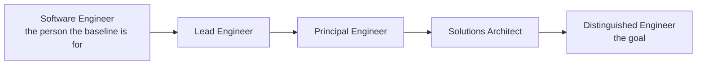
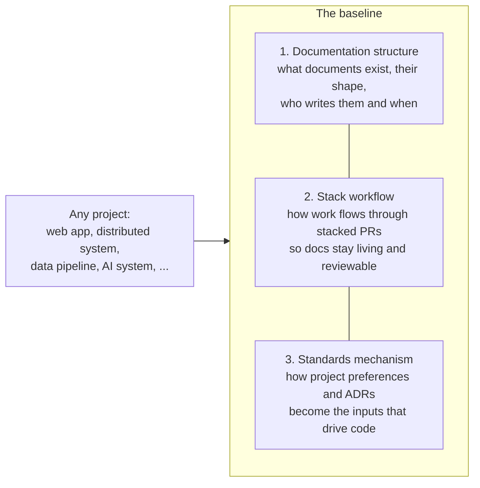
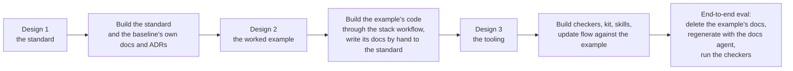
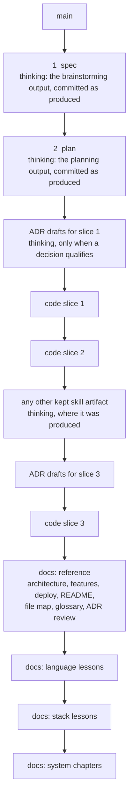
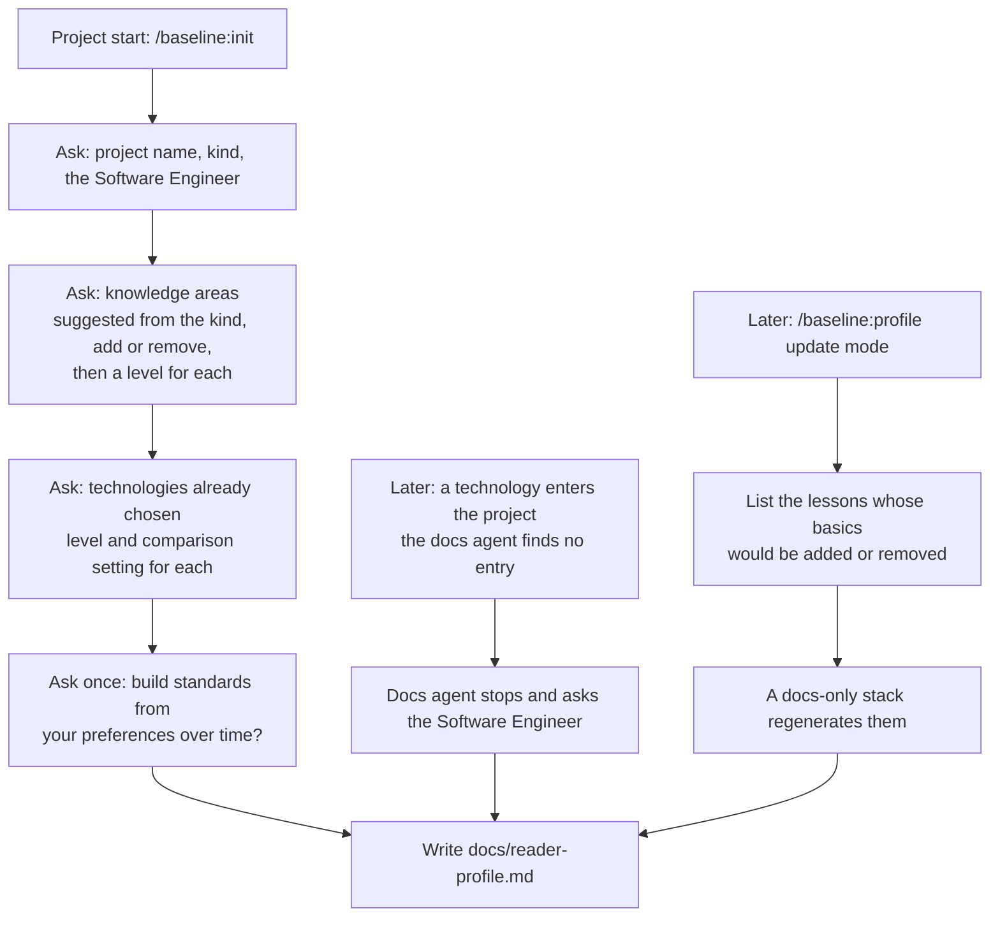
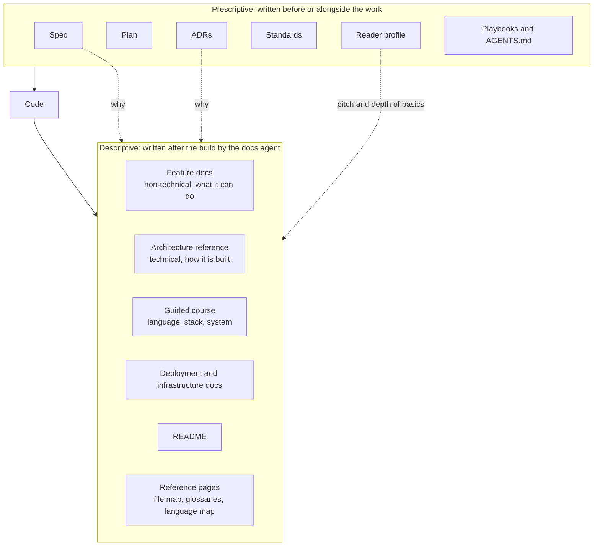
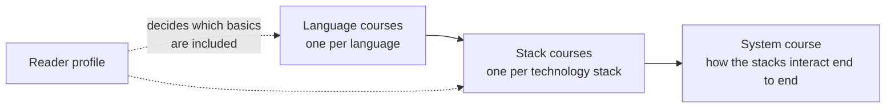
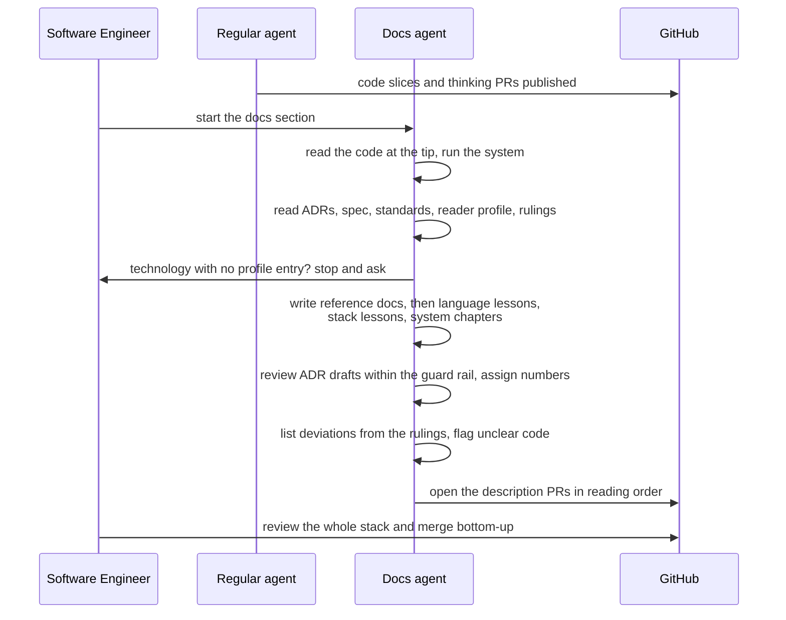
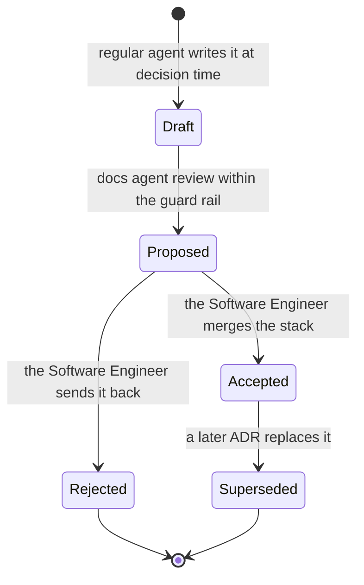
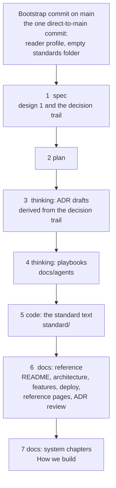

# The Baseline Standard: design 1 of 3

**Design document** · 2026-11-14 · status: **draft for approval**

The Baseline Framework is the Software Engineer's reusable foundation for every software project: how it is documented, how its work is delivered, and how the rules that shape its code are recorded. Its purpose is to let one Software Engineer act as a Distinguished Engineer (section 1.1). It lives in the private repository `chandanbsd/baseline-framework`.

This is **design 1 of 3**. It specifies **the standard**: what documents every project has, what shape each has, who writes them and when, how they stay true, and how work flows through pull requests. It also lists the baseline's own documentation and decision records (section 16).

| Design | Covers | Status |
|---|---|---|
| **1. The standard** (this document) | documents, stack workflow, standards mechanism, working rules, the baseline's own docs and ADRs | draft |
| 2. The worked example | a Rust notes service with a CLI client and its complete doc set, used as reference, test fixture and end-to-end eval | not started |
| 3. The tooling | the starter kit, the checkers, the skills, the update flow | not started |

**Companion file:** [the decision trail](2026-11-14-baseline-decision-trail.md) holds the context, options, evidence and reasons behind every decision in Appendix A, so the ADRs can be written from a source.

**How to read the provenance tags.** Every rule below carries one of three tags, so you can see what the Software Engineer decided and what the writer filled in.

| Tag | Meaning |
|---|---|
| **[Decided]** | The Software Engineer chose or approved it in the brainstorming conversation. |
| **[Call]** | The writer's call, made to complete the design; the Software Engineer has not seen this exact detail. Change freely. |
| **[Validate]** | A claim about an outside system that must be proven against the real thing before it is relied on. |

---

## 1. Intent and the why

### 1.1 Who it is for, and the why **[Decided; the two right-hand columns of the table are a Call]**

**The Software Engineer** is a professional engineer working alone on ventures with large capital behind them. They take on the most technically demanding problems: a distributed NoSQL database modelled in TLA+ and implemented in Rust, multi-device synchronization engines, event-streaming data movement between databases, multi-agent AI systems, and web back ends. AI agents write most of the code. The people who join later vary in skill and number.

**The why.** The Software Engineer's goal is to behave as a **Distinguished Engineer**, and to get there by taking on, rung by rung, the responsibilities of the Lead Engineer, the Principal Engineer and the Solutions Architect. The baseline is how one person who directs agents, rather than writing most of the code, can carry those responsibilities on real projects. Every document, rule and workflow below exists to make one of them possible, and each decision in this design is judged against that.



*On the way to the goal the Software Engineer takes on each rung's responsibilities and keeps carrying them.*

| Rung | The responsibility the Software Engineer takes on | What the baseline gives them to carry it |
|---|---|---|
| **Software Engineer** | Turns a problem into working software, here by directing agents and reading, running and checking what they produce. | The architecture reference, the file map and the guided course, so they can read what was built; the evidence rules, so every claim is checked. |
| **Lead Engineer** | Leads delivery: slices the work, orders it, keeps each step reviewable and makes sure it ships working. | The stack model (spec, plan, slices, docs section), the stack table and PR descriptions that teach. |
| **Principal Engineer** | Owns technical quality across the codebase: the standards the code follows and the hard technical calls. | ADRs with the options explored, `docs/standards/` and the monthly line-by-line read. |
| **Solutions Architect** | Owns how the whole system fits together and fits its purpose: structure, boundaries, contracts between parts, deployment and operation, and the trade-offs among them. | The architecture reference, the deployment docs, the system chapters of the course, and ADRs on topology, trust boundaries and contracts. |
| **Distinguished Engineer** | Sets technical direction beyond one project and makes the people and agents around them better. | The guided course, the reader profile as the hiring bar, and the baseline itself, reused in every project. |

### 1.2 The problem

When agents write the code, humans keep control only if they can understand the system well enough to read it, review it and challenge it. Documentation is that control surface. Today the Software Engineer's four reference projects each document well in different ways (a 28-chapter tutorial with checker-verified code excerpts, a living architecture document with append-only decision records, a stacked-PR workflow with teaching PR descriptions, a spec with goals and anti-goals), but none has the whole set, and nothing is reusable.

### 1.3 What the baseline is

Three things, applied to any project regardless of stack, kind or goal: **[Decided]**



*The baseline is the same for every kind of project. What differs is what the documents say, and the docs agent works that out from the code.*

### 1.4 What success looks like

1. A new project gets a complete document set that takes a reader at the stated level from zero to contributing, with the architecture always fully documented.
2. A reader who reviews a stack reads the thinking first (spec, plan, decisions), then the code, then the documents that describe what was built.
3. Every factual claim in a descriptive document was checked against the code or a real run, and anything that could not be checked says so.
4. The monthly line-by-line read by the team and architects finds documents that match the code.
5. The repository itself is a teaching and review resource that the team can use to learn the approach and contribute to it.
6. The Software Engineer can tell from the documents alone whether each rung of the ladder is being carried: delivery (the stacks), technical standards (ADRs and `docs/standards/`), the system as a whole (architecture and deployment), and teaching others (the course).

### 1.5 The principle that outranks all others

The reader's skill level shapes the documents only. It never reduces the scope, scale, vision, architecture or technical quality of the implementation. Every project is built to the maximum standard, idiomatic to its stack, and shaped by the problem, not by the reader. **[Decided]**

---

## 2. Goals, non-goals and anti-goals

### Goals

| # | Goal |
|---|---|
| G1 | The Software Engineer can act as a Distinguished Engineer: carry the Lead Engineer's, Principal Engineer's and Solutions Architect's responsibilities on real projects while agents write most of the code (section 1.1). **[Decided]** |
| G2 | One documentation structure for every project, complete and deep, with extensive diagrams in every document. **[Decided]** |
| G3 | Documents that live: they change in the same stack as the code and are verified against it. **[Decided]** |
| G4 | A guided course in three tiers (language, stack, system) that builds engineers and systems thinkers, scoped to what the codebase uses and taught to full depth. **[Decided]** |
| G5 | A stack workflow in which every kept artifact gets its own reviewable PR, and thinking, code and description go in separate PRs because each is easier to review on its own. **[Decided]** |
| G6 | Decision records that show the options explored, written when the decision is made. **[Decided]** |
| G7 | A standards mechanism that turns the Software Engineer's approved preferences into the documents that drive code. **[Decided]** |
| G8 | Superpowers and any other skill run exactly as written and put their documents wherever they put them. The baseline adds the documents it needs on top and arranges the PRs around whatever the skills produce. **[Decided]** |
| G9 | The baseline repository documents itself to its own standard and is a good source for the team to learn from. **[Decided]** |
| G10 | Projects can adopt a newer baseline version through a reviewable update. **[Decided]** |

### Non-goals

| # | Not the baseline's job |
|---|---|
| N1 | Security, dependency, privacy, vulnerability, verification and release policy. These are per-project standards that grow over time. **[Decided]** |
| N2 | Per-kind overlays (web, distributed, AI, and so on) or per-stack slicing recipes. The agent groups work logically; preferences accumulate in `docs/standards/`. **[Decided]** |
| N3 | Coding style. It is recorded as approved project standards, never imposed. **[Decided]** |
| N4 | Whole-language curricula. A course like `learn-rust` is a separate product that a project's course can link to. **[Decided]** |
| N5 | A hosted documentation site or PDF export. GitHub is the only reading venue for now; a site may come later. **[Decided]** |
| N6 | Teaching the Software Engineer a language. The courses teach the codebase; language curricula are separate. |
| N7 | Deciding where a skill writes its documents, or editing, steering or reformatting them. **[Decided]** |

### Anti-goals (failures even if everything "works")

| # | Failure |
|---|---|
| A1 | **Rigidity.** A rule or check that cannot know the project's kind or goal. The Software Engineer's words: "we can't be overly rigid without knowing the project type, kind and goal." **[Decided]** |
| A2 | **Documenting the plan.** A descriptive document that says what was meant instead of what exists. **[Decided]** |
| A3 | **Level shaping code.** Simpler code, smaller scope or weaker architecture because the reader is a beginner. **[Decided]** |
| A4 | **Backfilled rationale.** An ADR whose options were written after the decision to justify it. **[Decided]** |
| A5 | **Analogy leaking into the idiomatic explanation.** A comparison that replaces, rather than sits beside, the stack-native explanation. **[Decided]** |
| A6 | **Unverified claims.** A statement about behaviour, output, numbers or performance that nobody ran or measured and that is not marked "not verified". **[Decided]** |
| A7 | **Rebase conflicts on shared files.** Hand-edited indexes, counts or tables that every PR in a stack touches. **[Decided]** |
| A8 | **Colour as the only carrier of meaning**, or a diagram that is unreadable in dark or light theme. **[Decided]** |
| A9 | **Overreach on skills.** Dictating where a skill writes, or editing a spec, plan or other skill-produced document to fit the baseline. A skill may revise its own documents in a later loop; the baseline only asks that the revision be opened as its own PR (section 6.3, rule 8). **[Decided]** |

---

## 3. Constraints

| # | Constraint |
|---|---|
| C1 | **One repository per project, no exceptions.** Anything that must be published separately (an SDK, say) is a folder in the repo that CI publishes as a package. **[Decided]** |
| C2 | **GitHub is the venue.** Documents are GitHub-flavoured Markdown plus Mermaid, readable on GitHub in dark and light themes; the Software Engineer reads in dark. **[Decided]** |
| C3 | **Stacked PRs through `gh stack`** and GitHub's native stacked pull requests. GitHub's documented rules, as recorded in the Software Engineer's `learn-rust` design: a stack is two or more PRs in the same repository, merged bottom-up, with linear history, and required checks are evaluated for every PR in the stack. The feature is in public preview. **[Decided; Validate]** |
| C4 | **The skills run untouched.** Superpowers and any other skill are never edited and are not told where to write: a skill's spec, plan and other artifacts stay wherever the skill puts them. The baseline's instructions to agents cover how those artifacts are arranged into PRs, which documents are added on top, and what to skip at the execution seams (section 14). **[Decided]** |
| C5 | **The primary agent harness is Claude Code**; the standard itself is plain Markdown and does not depend on it. **[Decided]** |
| C6 | **Detail is always maximum.** There is no length budget on documents; completeness is judged against each document's shape, not by size. **[Decided]** |
| C7 | **The Software Engineer decides what the baseline cannot know.** Where a rule would depend on the project's kind or goal, it moves to the project's standards. **[Decided]** |

---

## 4. How the baseline is built

### 4.1 Approaches considered **[Decided]**

| | Approach | Trade-off | Verdict |
|---|---|---|---|
| **A** | **Standard first, proven by a worked example, then tooling.** Write the standard in full, build the example's code through the stack workflow, write its docs to the standard by hand, then build the checkers, kit and skills against it, and close the loop with the end-to-end eval. | Slowest to something that runs, but the tooling encodes only settled decisions and the cheapest test of the standard happens before anything is automated. | **Chosen** |
| B | Tooling first. Build the checkers and skills from the draft standard and refine the standard by using them. | Faster to something that runs, but the tooling would encode decisions that may still change. | Rejected |
| C | Pilot on a copy of an existing repo. | Proves the standard on real code, but the repo's history does not follow the stack model and it skips the worked example the Software Engineer wants as a teaching resource. | Rejected |

### 4.2 Delivery approaches considered **[Decided]**

| | Approach | Trade-off | Verdict |
|---|---|---|---|
| **A** | Copy-in starter kit only. | Simple, agent-neutral, but copies drift from the baseline. | Rejected |
| B | Claude Code plugin only. | One source of truth, but tied to one tool and invisible to a human reading a repo. | Rejected |
| **C** | **A Markdown standard, a starter kit, and thin skills that apply them.** The standard works without the skills; each project's `AGENTS.md` points back at it. | More parts, but no lock-in and updates propagate. | **Chosen** |

### 4.3 Build order



*Each design is written, checked by an independent reader and approved before its build starts.* **[Decided]**

---

## 5. Vocabulary and roles

| Term | Meaning |
|---|---|
| **Project** | One product in one repository. **[Decided]** |
| **Stack (of PRs)** | An ordered series of PRs, each based on the one below, delivered with `gh stack`. Not to be confused with a technology stack, which this document calls a **technology** or a **stack folder**. |
| **Software Engineer** | The person who decides, named in the project's `AGENTS.md`, and the person the baseline is built for: an engineer working toward Distinguished Engineer by taking on the Lead Engineer's, Principal Engineer's and Solutions Architect's responsibilities (section 1.1). When the team grows, areas may have their own deciders. **[Decided]** |
| **Regular agent** | The agent that works on a task: brainstorms, plans, builds, writes ADR drafts. It may use any skill. |
| **Docs agent** | A fresh agent that writes the descriptive documents from the finished code. **[Decided]** |
| **Prescriptive document** | Says what will be built or how work is done: spec, plan, ADRs, standards, playbooks, the reader profile. Written before or alongside the work. |
| **Descriptive document** | Says only what exists at the tip of the code: features, architecture, course, deployment, README, reference pages. Written after the build. **[Decided]** |
| **Thinking / code / description PR** | The three kinds of PR (section 6). **[Decided]** |
| **Ruling** | A decision an execution skill took on the Software Engineer's behalf, recorded as `Ruling: what, why, cost if wrong`. |
| **ADR draft** | An architecture decision record written by the regular agent at decision time, before the docs agent reviews it. |
| **Standard (lowercase, project)** | An approved preference in `docs/standards/` that drives code generation. |
| **Reader profile** | The project's recorded target reader level per technology and per knowledge area (section 7). |
| **Docs owed** | The auto-generated list on a code PR of what the docs section will cover. |

---

## 6. The stack model

### 6.1 The picture **[Decided]**

Every piece of work is delivered as one stack. Thinking goes below the code it governs, building goes in the middle, and descriptions of what was built go on top.



*Merging goes bottom-up. The docs section sits on top because it describes the final built state.*

### 6.2 The three PR kinds **[Decided]**

Each PR holds one kind of change, because each kind is reviewed in a different way: thinking is read for intent and soundness, code for correctness, and description for whether it matches the code. A PR that mixes kinds is not wrong, only harder to review, so the baseline asks that the kinds be separated when PRs are opened.

| Kind | Holds | Kept out, for easier review |
|---|---|---|
| **Thinking** | The spec, the plan, ADR drafts, any other kept skill artifact, standards updates, the reader profile, the baseline-owned playbooks. Committed as produced. | Code. |
| **Code** | Code and tests. Docstrings and comments count as code. | Any of the project's doc families. |
| **Description** | The docs section: reference docs, lessons, system chapters, reference pages, and the docs agent's review edits to ADRs. | Code. If writing a document exposes a bug or unclear code, the fix goes in the code PR it belongs to and the docs are rebased and re-verified. |

**How the kind is decided.** The kind is inferred from the paths a PR touches, using the artifact map in `baseline.yml` (section 15), so no naming rule is needed. The one permitted crossover: a description PR may edit ADR files (review edits and numbering). **[Decided; paths and the exception are a Call]**

**When something changes later.** A skill may revise its own spec or plan in a later loop, and a code change may call for a document change. Nothing forbids either. When the PRs are opened, the change goes in its own PR of the matching kind, at the point in the stack where it happened (rule 8). **[Decided]**

### 6.3 The rules of the stack

1. **The spec is PR 1.** When brainstorming finishes and the Software Engineer approves the spec, the spec is committed on the stack's first branch, untouched. **[Decided]**
2. **The plan is PR 2.** When the plan is written, it is committed on the next branch, untouched. **[Decided]**
3. **PRs 1 and 2 are opened immediately.** They contain only documents, nothing merges early, and the Software Engineer can read and comment while the build runs. **[Call]**
4. **ADR drafts are small PRs of their own**, one per slice that has any, directly beneath the first slice that depends on them. **[Decided]**
5. **Any other kept artifact a skill produces gets its own PR**, as produced, in the order produced, below the code it governs. An artifact produced mid-build sits between the slices around it. The skill decides where the file is written; the artifact map (section 15.1) only records the path. Scratch files (the execution ledger, briefs, review packages) are git-ignored and never a PR. **[Decided]**
6. **The agent decides how code is grouped** into logical slices. The grouping appears in the stack table at the top of every PR description so the reviewer sees the shape before reading any code. There is no approval step for the layout. **[Decided]**
7. **The docs section is last**, in reading order from foundational to integrated: reference, language lessons, stack lessons, system chapters. It is written by the docs agent (section 10). **[Decided]**
8. **Plan and spec edits made during the build get their own PR.** A skill may revise its spec or plan in a later loop; nothing stops it. When the stack is cut, the revision becomes its own thinking PR at the point in the stack where it happened, below the code that needed it, so the reviewer reads the changed thinking first. PR 2 stays as first written. A change to a *decision* is also a new ADR draft, not only a spec edit. **[Decided; the placement and the ADR sentence are a Call]**
9. **Code PRs carry an "Implements" line** linking the spec, plan and ADRs they follow, and the docs link back to the PRs, so a future reader can follow why, how and what through the history. **[Call]**
10. **Merge rule.** The whole stack, docs section included, is approved first, then merged bottom-up in one sitting. Nothing merges, deploys or publishes unless the Software Engineer asks. **[Decided; the one-sitting detail is a Call]**
11. **Small changes.** A change with no spec stays a single code PR. If it affects documents, it becomes a two-PR stack: the code PR, then a description PR from the docs agent. A change with no documentary impact needs no description PR. This keeps each PR to one kind, which is what makes it quick to review. **[Call; see section 17.4]**
12. **The stack's branches are cut as pointers into the linear commit history** that the execution skills produce, at the slice boundaries the agent chose. No re-commit and no edit to the plan is needed. If a commit mixes kinds, or a thinking commit sits inside a slice, the agent splits or moves it when cutting; keeping each commit to one kind makes the cut pointer-only. **[Call; Validate]**
13. **Every PR leaves the repository working** (it builds, and the project's own checks pass). What those checks are is the project's decision. **[Call]**

### 6.4 Conventions **[Decided]**

| Convention | Rule |
|---|---|
| **Branch names** | `<topic>/<nn>-<slug>`, numbered in stack order, for example `sync-engine/01-spec`, `sync-engine/02-plan`, `sync-engine/03-op-log`. Docs branches: `<topic>/docs-<nn>-<slug>`. |
| **Commits** | Conventional prefixes (`feat(scope):`, `fix(scope):`, `docs:`, `test:`, `refactor:`), small and logical, the message says *why*. Plan tasks keep the commit messages the plan gives them. |
| **Attribution** | Never add attribution lines ("Generated with...", "Co-authored-by...") to commits or PR descriptions. Claude Code adds such lines by default, so `AGENTS.md` states the rule explicitly. |
| **One idea per PR** | A refactor or a move goes in its own PR, apart from any behaviour change, so each diff can be read for what it is. |
| **Size guide** | About 400 changed lines for a code PR, not counting tests and generated files. Thinking and description PRs are exempt. |
| **Stack tooling** | `gh stack`. The stack is registered as a native GitHub stack and its PRs are marked ready. A repair that rewrites pushed history waits for the Software Engineer's yes. A cross-cutting fix goes in as a new PR on top. |
| **Everything is a PR** | The one exception is the very first commit of a new repository (the kit's bootstrap), since there is nothing yet to branch from. The foundation itself (CI, the document skeleton, the first code) is then its own stack. |

---

## 7. The reader profile and the intake

### 7.1 Purpose **[Decided]**

The intake records **who the documents are written for**. Its answers are also the bar the Software Engineer hires against: "average in Rust, advanced in distributed systems" is both how the docs are pitched and who is brought onto the project. The answers describe the target team, not the Software Engineer's own skill. They change **documents only**, never the implementation.

### 7.2 What is asked **[Decided]**

For each **knowledge area** the project depends on (for example distributed systems, formal specification, event streaming) and for each **technology** (language or framework):

| Level | Meaning |
|---|---|
| **Beginner** | New to it. Explain from the first line of syntax. |
| **Average** | Comfortable programming. Skip basic syntax and constructs (loops, variables); still explain idioms, framework conventions and sharp edges. |
| **Advanced** | Fluent. Explain only what is specific to this project or non-obvious. |

For each technology, also: **compare with a known stack (which one?), or treat it as brand new.** Comparisons appear only in marked asides ("Coming from X"), which say where the analogy breaks and never replace the stack-native explanation. The code stays idiomatic to the stack either way.

**Detail is always maximum and the architecture is always fully documented.** The levels decide only which basics get explained. The profile never changes the code, the scope or the architecture.

### 7.3 When it runs **[Decided]**



### 7.4 The saved file **[Decided; field names are a Call]**

`docs/reader-profile.md` is readable by people and carries the answers in a machine-readable header.

```yaml
---
project: notes-sync
software_engineer: Chandan
standards_enabled: true
knowledge_areas:
  - name: distributed systems
    level: advanced
technologies:
  - name: Rust
    level: average
    compare_with: C#        # a named stack, or none
---
```

From it the docs agent generates, inside the same file: **who can contribute** (the hiring bar, per technology and per area), **prerequisites** (what a reader must know before chapter 1), and **reading paths by role** (for example front-end contributor, back-end contributor, architect, new hire). Git keeps the history of the profile. The reader profile is a prescriptive input and its changes are thinking PRs.

---

## 8. The documents

### 8.1 The document map



*Spec and plan are produced by skills and are not baseline documents. ADRs and standards are the only documents that drive code.*

### 8.2 Where things live in a project **[Call]**

```
<project>/
  README.md   AGENTS.md   CLAUDE.md   baseline.yml
  docs/
    reader-profile.md
    features/        README.md, access.md, glossary.md, <feature>.md
    architecture/    README.md (generated index), NN-<area>.md
    course/
      languages/<language>/   README.md (what else it offers), NN-<lesson>.md
      stacks/<stack>/         README.md (what else it offers), NN-<lesson>.md
      system/                 NN-<flow-or-concern>.md
      reference/              file-map.md, glossary.md  (generated)
    adr/             draft-<slug>.md -> NNNN-<slug>.md, README.md (generated index)
    deploy/          README.md, NN-<area>.md
    standards/       (only if opted in) README.md, <topic>.md
    agents/          baseline-owned playbooks
    superpowers/     specs/ and plans/  (tool-owned, untouched)
  <stack folders>/   code, each with its own README.md and AGENTS.md
```

### 8.3 Feature docs **[Decided]**

The **non-technical** document: what the application can do, from the point of view of whoever interacts with it. It describes only what is built and contains no code and no file paths. It is a folder: an overview, a **Users and access** page, a plain-language glossary, and one page per feature. It is written by the docs agent from the running system, with evidence captured from it: screenshots for screens, interaction transcripts for things with no screen.

**Audience.** Non-technical readers in and around the company (team, product, investors, support, partners) and engineers who want the "what" before the "how". Not a customer help centre. The reader profile never affects it; it is always plain language.

**Overview page.** What the product is and who uses it; a capability map (a diagram grouping everything the product can do by what people are trying to achieve); a table of features, who each is for, and a link; the who-can-do-what matrix; pointers to the access page.

**Users and access page.** Roles apply to every feature, so one page prevents repetition.
- The kinds of user, using **principals** so it also covers non-human users: people, services, devices and agents (for example an agent's tool permissions).
- The roles, as named bundles of ability, and the claims or permissions that refine them (for example "can approve hikes for their own group").
- The conditions that change rights: status, ownership, tenant, time.
- How access is gained, changed and lost (registering, being approved, being promoted, being blocked), with a state diagram.
- The who-can-do-what matrix: capability by role or claim.
- Diagrams: how roles relate, the access state diagram, the access journeys.
- The matrix lives **only** here; the architecture reference links to it and documents enforcement (section 8.4, section 9).

**Each feature page.**
1. What it is and why it exists, in the user's terms.
2. Who can use it: a small table of which roles or claims can do what within this feature, under which conditions, linking to the access page.
3. What a person can do, as a list of capabilities.
4. Journeys: each main journey step by step, with a journey or flow diagram, and evidence captured from the running system.
5. The rules a person experiences: limits, statuses and notifications in plain words, with a plain-language state diagram.
6. When things go wrong: what the person sees in the edge cases (offline, conflicts, duplicates, errors) and what they can do next.
7. Limits today: what it does not do, stated as fact, never as a plan.
8. Related: neighbouring features, and a pointer for engineers to the matching architecture and course pages.

**Systems with no screen** (a distributed database, a sync engine, a data pipeline, an agent): "the person" is whoever uses it, such as an application developer, an operator, a device or an end user. Journeys become interactions: a write, a sync session, an agent run. Guarantees are stated in plain words, for example "a write is never lost once acknowledged".

### 8.4 Architecture reference **[Decided]**

The technical document: the system as it is now, with no history and no plans. A **folder**, one file per area plus a generated index, so a line-by-line read and a PR review stay manageable. Each file has a header with its scope, the commit it was verified against and its reading time. The sections are **minimums**: the docs agent adds whatever sections the system needs (for example a consistency model, an agent topology, a protocol specification) and says why. A minimum section that does not apply stays as a one-line "Not applicable: why" (section 9.6, rule 10).

| # | Section | Contents |
|---|---|---|
| 1 | What the system is | The purpose in a paragraph, the technology choices each linked to its ADR, and the few quality goals that drive the design. |
| 2 | The big picture | A context diagram (users and external systems) and a container diagram (deployable units, datastores and the protocols between them). |
| 3 | Components | The dependency direction between modules and the rule that keeps it so, a module map, each module's responsibility. |
| 4 | Key flows | A sequence diagram for each major flow, matching the system course's chapters and linked to them. |
| 5 | Data | The data model, who owns and writes each piece of data, how schemas evolve, the data lifecycle, the consistency model. **Includes the current-state database diagram (section 9.5).** |
| 6 | State machines | Every status and workflow drawn as a state diagram. |
| 7 | Interfaces and contracts | APIs, events, schemas and wire formats, plus the versioning policy and the error model. |
| 8 | Concurrency and failure model | Threading or async model, ordering and delivery guarantees, idempotency, retries and timeouts, failure modes, the invariants. |
| 9 | Security and trust | A trust-boundary diagram, authentication and authorization (how roles and claims are represented, issued, checked and enforced, with a table from each row of the access matrix to the policy that enforces it and the test that proves it), secrets, data protection. |
| 10 | Operations summary | Logs, metrics, traces and targets, linking to the deployment docs for the detail. |
| 11 | Quality | Performance budgets with measured numbers, and the testing strategy. |
| 12 | Known limits | What the system does not do, and the rough edges found while documenting it. |
| 13 | Where decisions live | The ADRs by area, generated. |

### 8.5 The guided course **[Decided]**

The course is as important as the architecture reference. Its purpose is to build engineers and systems thinkers: people who think critically and technically, not people who only use a language.

**Three tiers.** One course per language, one per technology stack (front end, back end, and so on), and one for how the stacks work together end to end.



**Scope.** Codebase-scoped, at full depth. Every language and framework idea the code uses is taught to the deepest level: theory, pitfalls, practice and what the machine does. Each lesson is written in the docs section of the stack that first uses the idea. Each language and each stack gets a short **"what else it offers" map** so a reader sees the boundary of the course and why other options were not used. Whole-language curricula (like `learn-rust`) stay a separate product, linked from the course. Lessons written for one project seed the next project in that language, re-levelled to the new profile and re-verified against the new project's pinned versions. **[Decided]**

**Lesson anatomy** (language and stack lessons). Every lesson has the same parts, in this order. **[Decided]**

| # | Part | Contents |
|---|---|---|
| 0 | Header table | What you will learn, what you should already know, reading time, the files in this codebase it covers, the versions it was verified against, and the terms it introduces. |
| 1 | Orientation | Why this idea matters in this system, where it shows up, and what you will be able to do afterwards. |
| 2 | Mental model | At least four diagrams: the concept, the data or ownership flow, a sequence or state view, and where it sits in this codebase. |
| 3 | Theory | The idea stated precisely with the reasoning behind its design, not just the syntax. The reader profile decides how much basic material is included; the depth never changes. |
| 4 | In this codebase | Verbatim excerpts of the real code, checked by a script, walked through line by line with captured output. |
| 5 | Pitfalls | The common mistakes, the errors you will actually see and how to read them. When the profile asks for comparisons, a marked "where the analogy breaks" aside goes here. |
| 6 | Under the hood | What the machine does (memory, scheduling, I/O, the network), with a measurement behind every performance claim. |
| 7 | How it fails and scales | Failure modes, concurrency hazards, scale limits, and what to measure. |
| 8 | Summary and cheat sheet | One page, further reading, and a note on what was verified and what was not. |
| 9 | Practice | The practice standard below. |

**Practice standard.** Everything is anchored in this codebase: its real code, traces, diagrams and failure modes. **[Decided; the mix is a Call refined with the Software Engineer]**

- **10 theory questions** with worked answers that show the reasoning and name the common wrong answers: 3 predict the outcome (code and system behaviour, including "will this compile or run, and why not?"), 3 diagnose (given a trace, log or diagram, find the cause), 2 design trade-offs (argue a decision against constraints), 2 systems reasoning (scale, failure, ordering, concurrency, invariants). Comparisons with a known stack appear only as marked asides when the profile asks.
- **10 programming exercises** with tested solutions: 3 warm-up, 4 core, 3 stretch. Some are small isolated drills that fail until solved, and each names the idea in the codebase it prepares for. Others are tasks on the real project about system behaviour, not syntax (make an operation safe under retries, find a race and prove the fix with a test, add backpressure, survive a dependency outage, work out which invariant a change breaks). The model solution of a real-project task is stored as a patch that CI re-applies to the current code, so it cannot silently go stale.
- **What "tested" means** is the project's call per technology (a test run, a model-checker run, a recorded evaluation).

**System chapter anatomy.** One chapter per end-to-end flow and one per cross-cutting concern (authentication across stacks, data consistency, error handling, the deploy pipeline, security boundaries). **[Decided]**

| # | Part | Contents |
|---|---|---|
| 0 | Header table | What you will learn, which language and stack lessons to read first, reading time, the files across all stacks it covers, the versions it was verified against. |
| 1 | The scenario | One real thing that happens, in plain words. |
| 2 | The whole picture | A diagram of every component the scenario touches, then a sequence diagram of the happy path across them. |
| 3 | Hop by hop | For each step between components: the real code on both sides (verbatim, checked), the contract between them (format or schema, versions, timeouts, retries, ordering, idempotency, authentication), and captured real output. |
| 4 | Invariants | What must always be true across the whole flow, who enforces each, where it is tested. |
| 5 | How it fails | For every hop: what happens when it is slow, down, duplicated, reordered or lying; what the operator sees in logs, metrics and traces; how it recovers. |
| 6 | How it scales and what breaks first | The bottleneck, with measured numbers. |
| 7 | Observe it | The commands to run it locally and follow the scenario through logs and traces, with captured output. |
| 8 | Summary and cheat sheet | One page, further reading, what was verified and what was not. |
| 9 | Practice | 10 theory questions weighted toward systems reasoning, plus **labs**: run it, break it on purpose, trace what happened, fix it, each with a checkable outcome. |

**Reference pages.** Three lookup pages in the course. **[Decided]**

| Page | Contents | How it is produced |
|---|---|---|
| **File map** | A table of every tracked file: path, one line on what it does, the lesson that explains it. | **Generated.** Each source file states its purpose in a one-line header comment (files that cannot carry one get a small sidecar entry). The "lesson" column comes from each lesson's "files covered" header. |
| **Glossaries** | A plain-language product glossary (for the feature docs) and a technical glossary (for the course). Each entry has a plain definition and a link to the lesson that teaches it. | **Assembled** from the terms each lesson declares in its header, so no shared file is edited by every PR. |
| **"What else it offers" map** | One short page per language and per stack, a table grouped by topic (types, memory, concurrency, errors, modules, tooling, ecosystem). Each row gives the feature, a one-line description, and whether it is used here (if used, a link to the lesson; if not, why not, linking an ADR when it was a decision), plus a link to the official docs. | Written by the docs agent. Stays short: it is a map, not a course. |

**Lesson file header** (the machine-readable part) **[Call]**:

```yaml
---
learn: "one line"
prerequisites: [lessons/ids]
reading_time_min: 40
files: [path/in/repo, ...]
terms:
  - term: "idempotent"
    definition: "plain definition"
verified_against: { commit: abc1234, versions: { rust: "1.99.1" } }
---
```

### 8.6 ADRs **[Decided]**

Architecture decision records: one file per decision, append-only once Accepted, with the **options explored** and the evidence. The skeleton:

```
# NNNN. Title
Status: Draft | Proposed | Accepted | Rejected | Superseded by NNNN
Date, deciders
Context:           the problem and the forces on it
Decision drivers:  what matters most, ranked
Options:           at least two real ones, plus "do nothing";
                   each with: how it works (diagram), pros, cons,
                   evidence (spike, benchmark, docs, cost)
Comparison:        options against drivers
Decision:          what we chose, and why it beats the others
Consequences:      what gets easier, what gets harder, risks
Revisit when:      the signals that would reopen this
Links:             PRs, course chapters, superseded ADRs
```

The model in full is in section 11.

### 8.7 Deployment and infrastructure docs **[Decided]**

How the system runs in the real world. They describe what is deployed today; the infrastructure code stays in the repo. A folder, one file per area, written by the docs agent.

| # | Area | Contents |
|---|---|---|
| 1 | Topology | A diagram of the whole deployment: environments, hosts or clusters, networks, trust boundaries, datastores and queues, and the path a request takes in. |
| 2 | Environments | Local, CI, staging, production: purpose, how created, how they differ, what data lives there, who has access. |
| 3 | Infrastructure as code | What the repo holds, how it is applied, where its state lives, how drift is detected. |
| 4 | Configuration and secrets | Every setting in a table (name, purpose, default, where set, secret or not), plus how secrets are stored, rotated and accessed. |
| 5 | Build and release pipeline | A flow diagram of workflows, gates and artifacts, with versioning, promotion and approvals, and how a merged stack becomes a deploy. |
| 6 | Deploying | The step-by-step runbook with captured command output, the order across components (data, then back end, then client), what a successful deploy looks like. |
| 7 | Rollback and recovery | How to roll back each component, how reversible the migrations are, backup and restore with a tested restore, disaster recovery with its recovery targets. |
| 8 | Operations | Dashboards, alerts mapped to runbooks, logs and traces, incident response, scaling procedures, routine maintenance. |
| 9 | Security and hardening | Network rules, the access model, hardening steps, audit logs. |
| 10 | Cost | What it costs today per component, and what grows it. |
| 11 | Troubleshooting | A table of symptom, check and fix. |

**Honesty rule.** An agent cannot deploy to production. Runbook commands are verified in staging or in a local reproduction, and anything that could only be checked in production is marked "not verified".

### 8.8 README **[Decided]**

The front door of the repository: a new developer's first hour. It assumes nothing, so every command is spelled out.

1. What this is: a paragraph plus a diagram of how the main pieces fit.
2. Where to go next: links by what you want to do (understand, contribute, operate), pointing to the features, architecture, course and deployment docs. The reading paths come from the reader profile.
3. Prerequisites: every tool with its pinned version and install command, and the accounts or access you need.
4. Get it running: numbered steps from `git clone` to a running system, each with the exact command and the output you should see, ending with a check that proves it works.
5. The daily loop: the commands you repeat (run, test one thing, test everything, format and lint, build, reset local data), with a flow diagram.
6. Repo map: a tree of the folders with one line each, linking to each folder's own README and `AGENTS.md`.
7. How we work: the stacked-PR workflow in brief, and how AI agents are used here, linking to the playbooks.
8. Configuration: the essentials for local development and where the full table lives.
9. Troubleshooting the first hour: a table of common setup errors and their fixes.
10. Help, contributing and licence.

Each stack folder gets its own small README with the same run, test and build structure, scoped to that stack. **Verification rule:** a CI job runs the "get it running" steps in a clean environment so the README cannot quietly rot; steps that cannot run in CI (for example ones that need a cloud account) are marked "not verified". **[Decided]**

### 8.9 PR descriptions **[Decided]**

What a human reviewer reads first. Written by the agent that built the slice for thinking and code PRs, and by the docs agent for description PRs. There is no length limit; it should be readable in one sitting, after the thinking PRs.

**Every PR starts with the same header:** the **stack** (which PR this is, n of N, a table of the whole stack with each PR's kind, link and one-line purpose, and a stack diagram when there are three or more PRs) and the **kind**.

**Code PRs (the full template)**
1. **Implements:** links to the spec, the plan and the ADRs it follows.
2. **Why:** two to four sentences.
3. **What changes:** grouped by idea, not by file.
4. **How it works:** diagrams where they help (flow, sequence, state) and the auto-maintained schema diagram when the database changes (section 9.5).
5. **How to review:** where to start, the reading order, what to skim.
6. **How it was verified:** the commands run and their results, what was tried by hand, and **what was not verified**. Verification is reported in whatever terms the project and its skills use.
7. **Risks and rollout:** migrations, deploy order (data, then back end, then client), rollback, data-loss risk.
8. **Rulings I made:** the execution skill's list, each with what it costs if wrong.
9. **Ideas introduced:** one line per new concept, with a link to its lesson once the docs section exists.
10. **Out of scope and follow-ups.**
11. **Docs owed:** an auto-generated list of what the docs section will cover for this change.

**Thinking PRs (short):** what the artifact is, which skill or tool produced it, what to read first, and the decisions it contains. No verification section, because the artifact is committed untouched.

**Description PRs (docs section):** what is documented and how it was checked (excerpts verified, commands run, diagrams rendered); **not verified**: anything the docs agent could not check; **deviations** from the plan, taken from the rulings; **flagged code**: places where the code was unclear to a fresh reader, fixed in the code PR they belong to and never in a docs PR.

### 8.10 `AGENTS.md` and the playbooks **[Decided]**

The rules reach the agents through one short instruction file with playbooks that give the reason beside each rule, adapted from the Software Engineer's my-quote project.

**`AGENTS.md`** at the repo root is short (about 100 lines) and is the primary instruction for working in the repo; if the Software Engineer says something different in the conversation, the conversation wins for that task. It holds:
1. **Who and what:** the project name and purpose, the Software Engineer, and a pointer to the reader profile.
2. **The core rules**, one line each with its reason, each pointing to the playbook that explains it:
   - work as stacks (spec, plan, ADR PRs, code slices, docs section), one kind per PR so each is easier to review;
   - one repo per project;
   - the skills run as written and write where they write; agents do not edit a skill's documents to fit the baseline (a skill's own later revision gets its own PR);
   - nothing merges, deploys or publishes unless the Software Engineer asks;
   - no attribution lines;
   - descriptive docs are written only by the fresh docs agent from the finished tip;
   - agents propose standards and never write them silently.
3. **The playbooks**, each with when to read it.
4. **The repo map**, with each stack's own `AGENTS.md`.

**`CLAUDE.md`** is a two-line pointer to `AGENTS.md`.

**Playbooks** in `docs/agents/` (baseline-owned, section 15): `working-with-the-engineer`, `stacks`, `pr-descriptions`, `docs-agent`, `adrs`, `standards`. **Each stack folder** gets a short `AGENTS.md` with the commands and the layout, filled in when the stack is introduced; coding preferences go to `docs/standards/`, not there.

Two rules for the files themselves: every rule has its reason beside it, and a rule whose reason is gone is removed. In projects where a tool generates `AGENTS.md` (Laravel Boost does in the Software Engineer's the-way project; **[Validate]**), the baseline content goes into that tool's source folder so regeneration cannot erase it.

---

## 9. Diagrams, evidence and truth

### 9.1 How diagrams are drawn **[Decided]**

- **Mermaid is the default.** It is plain text, so PRs can show a diff of it, an agent can write and fix it, GitHub renders it natively, and CI can check that every diagram parses. It covers flowcharts, sequence, state, entity-relationship, user journey, mind maps, timelines and byte-layout (`packet`) diagrams.
- **When Mermaid cannot draw it,** use another text-based tool, with the source committed next to the rendered image and CI re-rendering it to prove they match: WaveDrom for timing, Graphviz for state-space graphs (TLA+'s model checker can export these), fenced ASCII for memory layouts.
- **Never a hand-drawn image with no source.** It cannot be diffed or verified.

### 9.2 Minimum diagrams per document **[Decided]**

| Document | Minimum |
|---|---|
| Lesson | at least 4 |
| System chapter | at least 5, including the whole picture, the happy-path sequence and the failure flow |
| Architecture file | at least 1 per section |
| Feature page | at least 2: a journey and a state or flow |
| ADR | one per option, plus one showing the impact |
| Deployment docs | topology, pipeline, deploy sequence, rollback flow, backup and restore flow |
| README | at least 2 |
| Reader profile | the reading-path map |
| PR description | a stack diagram when there are 3 or more PRs, plus how it works |

### 9.3 Quality rules **[Decided]**

- Every diagram has a one-line caption saying what it shows and the one thing to notice.
- Labels use the project's glossary terms.
- Each diagram answers a question the text cannot answer as well. The minimums keep the count high; this rule keeps them honest.
- A diagram that names a real file, module or class puts it in backticks, and CI checks that it exists, so diagrams stay true as the code moves.

### 9.4 Theme rules **[Decided]**

- Every diagram is legible in **dark and light**. The Software Engineer reviews in dark, so dark is checked first; light must still work for other readers, exports and printouts.
- **No hard-coded colours in Mermaid** (no `style`, `classDef` or `linkStyle` colours, no theme overrides) except the approved palette below. Default styling follows the viewer's theme; hard-coded colours are what break it.
- **Colour never carries meaning alone.** Meaning is carried by shape, label and line style; emphasis colour comes only from the approved palette.
- **Images from other tools** are rendered in two variants, dark and light, and embedded with `<picture>` so the viewer's theme picks the right one. Both variants are committed next to the source.
- **Screenshots** in the feature docs are captured in dark by default. **[Call]**
- **The approved palette** (verified in the brainstorm by rendering in both themes; final values are the tooling's to confirm): a translucent tint plus a solid coloured border and no text colour set. Green means added, red means removed, amber means changed, plain means unchanged. `classDef added fill:#2ea04340,stroke:#2ea043,stroke-width:3px`, `classDef removed fill:#f8514940,stroke:#f85149,stroke-width:3px`, `classDef changed fill:#d2992240,stroke:#d29922,stroke-width:3px`.

**Evidence from the brainstorm.** A first palette of solid fills with white text looked fine in dark but failed in light theme: every other row of an entity became white text on a white background and was unreadable. That is why the rule says palettes must be tested in both themes. The tinted palette rendered legibly in both with the Mermaid 12.3.0 that the Software Engineer's `learn-rust` repo pins. How GitHub's own bundled Mermaid renders entity styling is **[Validate]** in a throwaway PR; the fallback is a flowchart-based diagram, which styles reliably.

### 9.5 Database diagrams **[Decided]**

- **The current state.** The architecture reference's data file contains an ER diagram of the current schema, split by area when large. The database lessons and system chapters embed the relevant slice. It is **generated from the real database** (CI runs the migrations, reads the schema and renders the diagram), never hand-drawn, and CI regenerates it on every PR and fails if the committed diagram differs. Non-relational stores follow the same idea, with the diagram built from their schema definitions. The generator is a project decision (it depends on the database).
- **PRs that change the database** get a colour-coded diagram showing the schema after the PR with the changes highlighted against the PR's base (in a stack, the PR below, so each PR shows only its own change). CI keeps it up to date inside a marked block in the PR description, refreshed on every push; if migrations changed and the block is missing, the PR fails.
- **What Mermaid can and cannot colour.** It colours whole tables only, not individual columns or relationship lines. Column and relationship changes are therefore marked in the diagram text with `+`, `~` and `-`, so colour never carries the meaning alone.

### 9.6 Accuracy and evidence **[Decided]**

When a team reads line by line, one wrong sentence costs more than a missing one.

1. **Descriptive documents say only what exists at the tip.** Plans and "coming later" live in the spec and plan, never in the architecture, feature docs or course.
2. **Quoted code is verbatim.** A captioned excerpt is a verbatim excerpt of the file it names, checked by script; a gap is a marked ellipsis.
3. **Output is captured by running it**, not written from memory.
4. **Versions are pinned** in each document's header.
5. **Performance claims are measured**, with the benchmark in the repo or a cited source.
6. **Anything that could not be verified says so**, in a "not verified" note.
7. **Quoted numbers are measured** (file counts, test counts, versions), not typed. **[Call]**
8. **Non-deterministic output** (for example a model's answer) records the seed, the model and the versions, or is marked illustrative. **[Call]**
9. **Indexes are generated, never hand-edited:** the course index, the file map, the glossaries and the ADR index, so rebases never conflict on them. **[Decided]**
10. **A minimum section that does not apply stays as a one-line "Not applicable: why".** The reader then sees it was considered, and nothing is invented to fill it. **[Call]**
11. **Bootstrap exception for indexes.** In a repository whose generators do not exist yet (only the baseline's own, during its first stacks), the docs agent writes the indexes in the format the generators will produce, as the single writer of its stack; the generators take over when they land and the checks reconcile any difference. **[Call]**

---

## 10. The docs agent **[Decided]**

A **fresh agent**, started from the finished tip of the stack, writes every descriptive document. It exists to guard "what was built, not what was meant".



*The docs agent never reads the plan or the build conversation.*

**Reads:** the repository at the tip (and runs the system), all ADRs, the spec, `docs/standards/`, `docs/reader-profile.md`, the "Rulings I made" lists in the PR descriptions, and the stack table. **Does not read:** the plan or the build conversation. **Produces:** the description PRs, in reading order, each with the description template of section 8.9.

**Rules**
1. **It never changes code.** If writing a document exposes a bug or unclear code, it flags it for a fix in the code PR the issue belongs to, then rebases and re-verifies.
2. **It stops when a technology has no reader-profile entry** and asks the Software Engineer before writing that technology's course.
3. **Guard rail on ADRs** (section 11).
4. **The deviations list** is taken from "Rulings I made", which the execution skills promise is exhaustive. It is not taken from the plan file's history, which shows only edits that were actually made.
5. **After any amendment to a lower PR,** the docs are re-verified, and the checker names exactly which documents drifted.
6. **It follows the lesson, system chapter and document anatomies** of section 8 and the evidence rules of section 9.6.

**A fresh agent is used** because the agent that built the code tends to document what it meant, and cannot tell when the code does not say it. The cost is more agent runs, and intent that never reached an ADR shows up as a gap to fix. The alternative of the building agent writing its own docs was rejected. **[Decided]**

---

## 11. Architecture decision records: the model **[Decided]**

### 11.1 Criteria, not a gate

There is **no approval gate** before code. Brainstorming already gates the big decisions (it requires the approaches and the Software Engineer's pick before any design exists), and what is left mid-build is rulings, which the execution skills own and report. The regular agent writes an **ADR draft** when it makes or adopts a **decision of impact**:

- a new technology or dependency
- a data model or public interface
- a security or trust boundary
- the deployment topology
- a contract between stacks
- anything hard to reverse

Smaller calls stay rulings. The criteria list is a test, not a gate. **[Decided; the list's use as criteria is from the Software Engineer's refinement]**

### 11.2 Lifecycle



*The Software Engineer's merge of the stack is the acceptance. Append-only starts at Accepted.*

### 11.3 Rules

1. **Drafts are unnumbered** (`draft-<slug>.md`) and committed as their own small PR directly beneath the first slice that depends on them. The docs agent assigns the number at publish time, so two stacks in flight cannot collide. **[Decided; numbering is a Call]**
2. **Decisions from brainstorming need no draft.** The spec's Approaches section already records options, trade-offs, the pick and why. The docs agent writes those ADRs from the spec. **[Call]**
3. **Guard rail for the docs agent.** It may clean up, add and review. It may not rewrite the decision, the drivers, the options or the rationale. Its additions are marked "Added at review". Where the built code departs from the decision, it flags that for the Software Engineer instead of editing the ADR to match. This keeps decision-time reasoning from being backfilled. **[Decided]**
4. **Append-only once Accepted.** A change to an Accepted ADR is a new ADR that supersedes it. Status and links are the only edits permitted.
5. **A presence check at the top of the stack.** A changed dependency manifest, schema or interface file must be covered by an ADR or a ruling. It is treated as an ADR check, not a dependency policy; it checks presence only, not approval. **[Decided]**

---

## 12. The standards mechanism **[Decided]**

`docs/standards/` and ADRs are **the only documents that drive code**. Code is generated with them in mind. When generated code is wrong, the Software Engineer fixes the standards or ADRs and regenerates in a fresh context, instead of patching the code. This becomes a playbook, `docs/agents/standards.md`, in the Software Engineer's words.

- **Name (a Call):** `docs/standards/`, since it will also hold verification, dependency, security and release preferences, not only coding style.
- **Opt-in at init.** The intake asks once whether to build standards from the Software Engineer's preferences over time. If yes, it creates an empty folder with a README explaining how it fills. If no, there is no folder.
- **How it fills.** When an agent notices a preference in a conversation or a review comment, it proposes a rule in the chat, with the reason in the Software Engineer's words and its scope, and asks. Only the Software Engineer's approval writes it. Nothing is inferred silently.
- **Each rule records** its reason, scope (project-wide or one stack), date and source (PR or conversation). A rule whose reason is gone is removed in a PR, and git keeps the history.
- **Where changes land:** as thinking PRs, at the point in the stack where the preference came up.
- **Who reads it:** agents through an `AGENTS.md` pointer, and the docs agent, which cites it in "In this codebase" sections. The skills run untouched, and standards never depend on the reader's level.
- **What belongs here, per project, evolving over time:** coding style, verification and release levels, security and secrets handling, dependency and update policy, privacy rules, base-image policy, slicing preferences. None of these is enforced by the baseline.

---

## 13. Working rules

### 13.1 Who decides what **[Decided]**

**The Software Engineer decides, and agents stop and ask:**
- what to build and why: the scope, and the approach picked during brainstorming;
- anything that changes how work is done: branching, release, CI, tooling;
- merging a stack, deploying, releasing, store submissions: nothing merges, deploys or publishes unless the Software Engineer asks;
- anything that persists or ships and cannot be undone: production data, destructive migrations, domains, accounts, secrets, billing, third-party sign-ups;
- accepting or rejecting an ADR (the merge of the stack is the acceptance), and what to do with a finding that cannot be fixed, such as dismissing an alert or accepting a risk;
- changing the reader profile.

**The agents decide and record as rulings, without stopping:** the order of work, names, how the stack is grouped, small conflicts between plan and code, plan defects and ambiguities, how to fix review findings, dependency bumps that tests show are safe. Every ruling goes in "Rulings I made" with what it costs if wrong.

**The agents never:** edit a skill's documents to fit the baseline (a skill may revise its own; that revision gets its own PR), hand-edit generated indexes, or change code in a description PR.

**How decisions are put to the Software Engineer:** a numbered list. Each item names the options and gives the recommendation first, with one reason. The Software Engineer answers by number ("1. yes, 2. elaborate"), and "elaborate" means explaining the trade-off again in plain words and then recommending again.

**While the Software Engineer is busy:** the agents do everything that does not need them and hand over the rest with the exact command or click path for each step.

### 13.2 Reporting **[Decided]**

Reports open with what the Software Engineer has to do, then the evidence:
1. decisions needed;
2. what is open for merge, in order, with hazards such as deploy order;
3. what was verified, as command and result;
4. what was **not** verified, and why;
5. rulings made.

---

## 14. The seams with the skills **[Decided; the table is a Call]**

The baseline sits beside superpowers and any other skill and changes nothing about how they work. A skill writes its documents wherever it writes them, and the baseline does not tell it otherwise: the baseline reads those paths (the artifact map, section 15.1) and arranges the PRs around them. The seams below are small because the skills already defer to the Software Engineer's instructions: the spec and plan locations are the skill's own defaults, which the Software Engineer may override; finishing a branch says to follow the repo's PR conventions; the worktree skill honours a declared preference; and superpowers ranks `AGENTS.md` above its skills. These were checked against the skill files of superpowers 7.0.2.

| Seam | What the skill does | What the baseline does |
|---|---|---|
| Spec and plan | `brainstorming` and `writing-plans` write to `docs/superpowers/...` and say "committed", but name no branch. | Nothing to where they write or what they contain. When the stack is cut, the spec is committed on the stack's first branch (PR 1) and the plan on the second (PR 2), as `AGENTS.md` says; a later revision of either gets its own thinking PR (section 6.3, rule 8). |
| Code commits | The execution skills commit task by task on one branch. | Nothing during the run. Afterwards the stack branches are cut as pointers into that history at the slice boundaries the agent chose. |
| Rulings | Both execution skills log `Ruling: what, why, cost if wrong`; `subagent-driven-development` gathers them into a final "Rulings I made" message before deleting its ledger. | Nothing. That is already the baseline's format. The list is copied into the PR descriptions. |
| Doc steps in plans | `writing-plans` folds documentation steps into task steps. | Execution rule: skip any step that writes one of the baseline's doc families. The plan file stays as produced. |
| Final reviewer | Its checklist asks "Documentation complete?". | Execution rule: the change description says descriptive docs are deferred to the docs section, so it is not flagged and no fix loop writes docs into code PRs. |
| Finish menu | Runs straight after the final review, before the docs exist. | The Software Engineer's pick at the menu is "Keep the branch as-is" until the docs are in, then the stack is published with `gh stack`. Option 2 ("push and create a PR") would open one PR, so it is never used for stack work. |
| Generated instruction files | Laravel Boost writes `AGENTS.md` and `CLAUDE.md` from `.ai/guidelines/` in the Software Engineer's the-way project, and says only to create docs if explicitly requested. | An adapter per generator: baseline rules go into the generator's source, and a standing request for the docs satisfies Boost's rule. **[Validate]** |
| Execution stops | The execution skills stop only for irreversible or destructive operations, security-sensitive actions, outside side effects (a merge, a push to a shared branch, a publish) and a hopelessly broken plan. | Nothing added. The baseline adds no stop; ADR drafts are written without stopping. |
| Between brainstorming and planning | After spec approval, brainstorming says to invoke `writing-plans` and no other skill. | The steps in between (committing the spec on its own branch) are plain git and `gh` commands written in `AGENTS.md`, never another skill. |

---

## 15. What the standard requires of the tooling (the interface to design 3)

Design 3 specifies how these are built. The standard fixes only what they must do.

### 15.1 `baseline.yml` **[Call]**

The project's baseline configuration. At least: `baseline_version` (the pinned version the project follows), `artifact_map` (the paths of skill-produced artifacts: spec, plan, other), the stack folders, and `standards_enabled`. The artifact map defaults to the superpowers paths (`docs/superpowers/specs/**`, `docs/superpowers/plans/**`); swapping or adding a tool means editing the mapping, not the baseline. The map records where the skills put their documents so that PR kinds can be inferred; it never tells a skill where to write.

### 15.2 Baseline-owned and project-owned files **[Decided]**

Every file the kit copies into a project is either **baseline-owned** (the playbooks, the workflow, a marked block in `AGENTS.md`, the PR template; each carries a marker with the baseline version and is replaced on update) or **project-owned** (the reader profile, standards, ADRs, all documents; never touched by an update). Project-specific wishes therefore live in `docs/standards/` or `baseline.yml`, never in a baseline-owned file.

### 15.3 The mechanical checks the standard requires **[Decided]**

The checks cover only what the baseline owns: the documents and the baseline's own standards. One command, `baseline check`, locally and in CI through a reusable workflow; `pull_request` triggers have no branch filter so every PR in a stack is checked.

**On every PR (blocking, scoped to what that PR contains)**
- **Docs structure:** required sections and minimum diagram counts for each document type present.
- **Diagrams:** parse and render in both themes; no hard-coded colours outside the approved palette; non-Mermaid images have their source and both variants; any real path a diagram names exists.
- **Truth checks:** internal links and anchors resolve; captioned excerpts are verbatim; generated indexes match a fresh generation; the committed schema diagram matches the real schema.
- **ADR rules:** valid status, consistent index, no rewriting of an Accepted ADR.
- **PR rules:** the kind is inferred from paths; the description is complete for its kind; "Implements" links resolve; no attribution lines; the schema-diff block is present and fresh when migrations changed.

**A notice on a PR (never blocking)**
- A PR that mixes kinds gets a comment that lists its files by kind and where it could be split. Mixing is allowed; the notice exists because a mixed PR is harder to review. **[Call]**

**The stack gate (over the whole change from `main` to the tip)**
- Every new technology has a reader-profile entry and its course files; every new source file is on the file map; quoted numbers are measured; every dependency, schema or interface change is covered by an ADR or a ruling.
- Lower PRs show "waiting for the docs section" (pending, not red). The tip either lists what is still owed or passes, and the Software Engineer merges only when it passes.
- **[Validate]** The pending-on-lower-PRs behaviour must be proven on GitHub's stacked-PR feature in a throwaway repository before it is relied on, because the feature is in public preview and required checks apply to every PR in a stack.

**Scheduled, nightly:** external links; captured command outputs re-run and compared (only those marked deterministic); the README "get it running" steps in a clean environment; drift between the reader profile and the technologies actually in the code.

**Not checked by the baseline:** security, secrets, dependencies, vulnerabilities, code verification, release verification. Those are per-project standards. **[Decided]**

### 15.4 The kit and the skills, in outline **[Decided]**

The baseline repo contains four things: the standard (this document's output, plain Markdown), the kit (what is copied into a new project), the checkers (one CLI plus a reusable workflow), and the skills (a Claude Code plugin; thin wrappers, the standard works without them).

The commands (design 3 specifies each): `/baseline:init` (the intake, the kit, and the one direct-to-main commit), `/baseline:adopt` (the same for an existing repo, with the docs agent documenting the current code as a docs-only stack), `/baseline:stack` (cuts the stack branches at the slice boundaries, opens PRs 1 and 2, keeps stack tables current, publishes with `gh stack`), `/baseline:docs` (dispatches the docs agent), `/baseline:adr` (drafts an ADR), `/baseline:profile` (the intake in update mode), `/baseline:standards` (proposes and records a preference), `/baseline:check`, `/baseline:update`.

### 15.5 The update flow **[Decided]**

The baseline reaches a project by three routes: the **skills** through the plugin's own update, the **checkers and CI** through a pinned version, and the **copied files** through `/baseline:update`. `/baseline:update` reads the pinned version, compares owned files with their pristine copies, shows the changelog and any local edits to owned files (the Software Engineer decides to keep as an override or discard), runs the migrations for each version in between, and opens a normal stack: 1 thinking (playbooks, the `AGENTS.md` block, the PR template), 2 code (workflow and checker pins), 3 onwards description (only if the new standard makes existing documents non-compliant). Each baseline release ships its migrations and tests the update from the previous version against the worked example. Versions follow semver: patch for fixes, minor for optional additions, major for new required structure with an upgrade guide. A nightly job can report "baseline vX.Y is available". Rejected: a git submodule or subtree, Copier's `update`, and manual copying.

### 15.6 The checker language **[Decided]**

Python, with Node only for rendering Mermaid (pinned). It is strong at text processing, fast to change, easy to test, and the Software Engineer's my-quote checkers are already Python, so they carry over. Go or Rust would give a single binary but more effort. Because the team will read this code, the choice is recorded as an ADR.

---

## 16. The baseline's own repository

The baseline follows its own standard and is a resource the team learns from. **[Decided]**

### 16.1 Layout **[Call]**

```
baseline-framework/
  README.md   AGENTS.md   CLAUDE.md
  standard/              the standard itself, as plain Markdown (the product of this design)
  docs/
    superpowers/specs/ plans/    tool-produced, untouched
    adr/                         the baseline's own decisions (Appendix A)
    architecture/                how the framework works
    features/                    what the framework gives a project, non-technical
    course/                      "How we build": a guided course on the framework itself
    agents/                      the playbooks (also the source of the kit's playbooks)
  kit/                   (design 3)
  checkers/              (design 3)
  skills/                (design 3: the Claude Code plugin)
  examples/notes-sync/   (design 2)
```

### 16.2 Its own documents **[Call; follows from section 9.6, rule 1]**

The baseline's descriptive documents follow the same rule as every project's: they say only what exists at the tip. At the end of design 1's build, what exists is **the written standard**. The kit, checkers, skills, update flow and worked example arrive with designs 2 and 3 and appear under "Limits today" until then. Each later design's build ends with its own docs-only section that extends these documents.

- **README:** opens with the why (the ladder of section 1.1), then what the baseline is, how to apply the standard by hand today (following the playbooks; the "get it running" steps are the manual procedure), and how to contribute.
- **Architecture reference:** how the framework works today: the structure of the standard, the stack model, the docs-agent method as a procedure, the ADR model and the standards mechanism, with diagrams. Sections that do not apply to a Markdown-only product (data, concurrency, access enforcement, measured performance) are one-line "Not applicable: why" (section 9.6, rule 10).
- **Feature docs:** what the standard gives a project, in plain language, with "Limits today: no kit, checkers or skills yet". The evidence is the written standard; there is no running system to capture from.
- **Deployment docs:** one page: the repository is the artifact and there is nothing to deploy yet; the other areas are "Not applicable".
- **Reference pages:** the file map, glossaries and "what else it offers" maps, written by the docs agent under the bootstrap exception (section 9.6, rule 11).
- **Course "How we build":** in the adapted system-course form (section 16.4).
- **ADRs:** one for each decision of this conversation (Appendix A), derived from the decision trail (section 16.5).

### 16.3 Bootstrapping

The repository exists and is empty (`origin` is `git@github.com:chandanbsd/baseline-framework.git`, branch `main`, no commits). The kit does not exist yet, so the baseline's first stack is built by hand to the standard: a bootstrap commit on `main`, then:



*The standard text in `standard/` is the product of design 1, so it is the code slice of this stack. The playbooks are prescriptive, so they are thinking.*

- **The baseline's own `baseline.yml`** maps `standard/**`, `kit/**`, `checkers/**`, `skills/**` and `examples/**` as code, and the superpowers paths as spec and plan. **[Call]**
- **The docs section is written by a fresh docs agent**, dispatched by hand from the brief in `docs/agents/docs-agent.md`. Building the first stack by hand is not an exemption from the fresh-agent rule, because a fresh session needs no kit to start. **[Call]**
- **The baseline's reader profile and standards opt-in** are fixed in section 16.6. The intake's output, `docs/reader-profile.md` and the empty `docs/standards/` folder with its README, goes in the bootstrap commit, as the kit's bootstrap will do for a project. **[Decided; the placement in the bootstrap commit is a Call]**
- **Designs 2 and 3** each end with their own docs-only section that extends the baseline's documents with what then exists. The checkers and skills, once built, are applied to the baseline repository itself. **[Call]**

### 16.4 The baseline's own course **[Call]**

The baseline has no language or stack code of its own beyond Markdown, Mermaid, YAML and git, so a three-tier course would be nearly empty. **"How we build"** is therefore the **system course in its adapted form**: one chapter per end-to-end flow of the framework, each following the system-chapter parts of section 8.5, after an opening orientation chapter, "Why this exists", on the ladder of section 1.1 and which documents serve which rung. About six flow chapters at the end of design 1's build:

1. a feature goes from brainstorm to merged stack;
2. a decision becomes an ADR;
3. the docs agent writes the docs section;
4. a preference becomes a standard;
5. a project starts with the intake and adopts the baseline;
6. how documents stay true (the evidence rules, the checks and the stack gate).

Adaptations: "the real code on both sides" becomes the real artifacts on both sides (a PR description, an ADR, a playbook); "observe it" is reading a recorded stack until the worked example exists; the labs are tabletop exercises (classify these PRs by kind and fix the mistakes, turn this decision into an ADR draft) and are marked "not verified" until the checkers and the worked example exist. The practice keeps the 10 theory questions. A language or stack lesson, with its "what else it offers" map, is written for a technology only if the baseline's reader profile (section 16.6) marks it beginner or average and the repository uses it in a non-trivial way (for example Mermaid or `gh stack`).

### 16.5 Where the ADR content comes from **[Call]**

The ADRs of Appendix A are written from **the decision trail** ([2026-11-14-baseline-decision-trail.md](2026-11-14-baseline-decision-trail.md)), which records for each decision its context, drivers, the options with their trade-offs as they were put to the Software Engineer, the pick and the Software Engineer's reason, the evidence gathered, the consequences and the revisit signals. The regular agent writes each as a draft from its entry, and the docs agent reviews within the guard rail (section 11.3). Where the trail says **not recorded**, the ADR says so: it never invents a pro, a con or a number. No new research is part of design 1's build; where evidence would help (for example a benchmark for the checker language), the ADR's "Revisit when" says so.

### 16.6 The baseline's own reader profile **[Decided]**

The Software Engineer confirmed this profile for the baseline repository on 2026-11-14. It is the intake of section 7, run by hand because the kit does not exist yet, and it says who the baseline's documents are written for. Every comparison setting is "treat as brand new".

| Kind | Name | Level | Compare with |
|---|---|---|---|
| Technology | Markdown | advanced | none |
| Technology | git and GitHub | advanced | none |
| Technology | `gh stack` and stacked PRs | beginner | none |
| Technology | Mermaid | average | none |
| Technology | YAML | average | none |
| Technology | Claude Code and skills (superpowers) | average | none |
| Knowledge area | technical writing | average | not asked |
| Knowledge area | software delivery process | advanced | not asked |
| Knowledge area | AI-agent workflows | average | not asked |

**Standards: on.** The empty `docs/standards/` folder with its README is created at bootstrap (section 12).

What follows from it:
- The profile and the standards folder are the intake's output, so they go in the bootstrap commit (section 16.3), and `docs/reader-profile.md` is written from this table in the header format of section 7.4. **[Call]**
- The README, the course and the reading paths are pitched from it, and the docs agent generates the "who can contribute" statement and the prerequisites from it (section 7.4).
- Language and stack lessons are candidates only for what is marked beginner or average: `gh stack`, Mermaid, YAML and Claude Code skills. Markdown and git and GitHub are advanced, so they get none (section 16.4).
- Python enters with design 3's checkers. The intake runs again then (section 7.3) and the Software Engineer sets its level and comparison setting.

---

## 17. Left to the builder, and to confirm

### 17.1 Left to the builder

- Writing the standard's text from this design: the required-sections list and minimum diagram count for each document type, the exact folder and file names, the front-matter fields, and the playbooks.
- Writing the baseline's own documents and its ADR set (Appendix A), each ADR full-form with its diagrams, from the decision trail (section 16.5).
- The final values of the approved palette, confirmed in both themes.
- Anything in sections 15 to 16 that design 3 specifies in detail.

### 17.2 To validate against the real system before relying on it

| # | Claim to validate |
|---|---|
| V1 | GitHub's stacked-PR behaviour (same repository, bottom-up merge, linear history, required checks per PR, `gh stack` v0.3.0 commands and `gh stack link`) in a throwaway repository, including how the pending-on-lower-PRs gate behaves. |
| V2 | Whether GitHub's bundled Mermaid renders ER entity styling (`classDef`) in a PR description, and the fallback if not. |
| V3 | Whether Laravel Boost generates `AGENTS.md` and `CLAUDE.md` and from which source. |
| V4 | Whether branches cut as pointers into the linear commit history interact cleanly with `gh stack`. |
| V5 | How a fresh docs agent is dispatched in practice (Claude Code subagent with a crafted brief) and what it needs in that brief. |

### 17.3 Facts checked during the brainstorm

| Fact | Source |
|---|---|
| `hike-management-system` is an empty folder with no git repository; the-way is used as its stand-in as evidence. | `ls`, `git` |
| A real lesson is large next to the code it teaches: `learn-rust` lessons 01 and 02 are 1,195 and 1,558 lines of Markdown plus 208 and 388 lines of Rust; my-quote chapters average about 490 lines (13,698 over 28, up to 908); my-quote's size guide for a PR is about 400 lines. | `wc -l` |
| Superpowers 7.0.2 skills defer to the Software Engineer's instructions on locations and PR conventions; the execution skills log rulings and gather them in a "Rulings I made" final message before deleting their ledger. | the skill files |
| Mermaid 12.3.0 (via mermaid-cli 12.2.0, pinned in `learn-rust`) renders ER entity styling with `classDef`; a solid-fill white-text palette fails in light theme; a translucent tint with a coloured border works in both. | a test render in dark and light, shown to the Software Engineer |
| The private repository `chandanbsd/baseline-framework` exists; local git is initialised on `main` with `origin` set. | `gh repo view` |

### 17.4 Items for the Software Engineer to confirm (writer's additions)

These are details the writer introduced to complete the design. They were not shown to the Software Engineer in this exact form.

1. **Small changes** (section 6.3, rule 11): a change with no spec stays one code PR; if it affects documents it becomes a two-PR stack (code, then description). This replaces the earlier idea that a single PR carries its own docs, which would have put two kinds in one PR and made it harder to review.
2. **The reader profile and the playbooks are classified as thinking** for PR-kind purposes.
3. **The folder and file names** in section 8.2 and the front-matter fields in sections 7.4 and 8.5.
4. **The baseline repository layout** in section 16.1, including a top-level `standard/` folder.
5. **The default path rules** for inferring PR kinds.
6. **What the baseline's own documents may say** (section 16.2): only what exists, which at the end of design 1 is the written standard, with the tooling under "Limits today" and docs-only sections after designs 2 and 3.
7. **The baseline's own course form** (section 16.4): the adapted system course of about six chapters, with language and stack lessons only where the profile asks.
8. **The ADRs are derived from the decision trail** (section 16.5), with "not recorded" markers and no new research.
9. **The two bootstrap rules:** the "Not applicable: why" rule (section 9.6, rule 10) and the index bootstrap exception (rule 11).
10. **The baseline's first stack** (section 16.3): the composition shown there, the standard text as the code slice, a fresh docs agent dispatched by hand, the code paths in the baseline's own `baseline.yml`, and the bootstrap commit carrying the intake's output (the reader profile and the empty standards folder).
11. **The ladder as the why** (section 1.1, goal G1). The ladder and the goal are the Software Engineer's words. The two right-hand columns of the table (what each rung's responsibility is, and what the baseline gives to carry it), the README opening with the why, and the opening course chapter "Why this exists" are the writer's.
12. **The name "Software Engineer"** replaces "owner" throughout (section 5). The knock-on names are a Call: the playbook `working-with-the-engineer` and the `software_engineer` field in the reader-profile header.
13. **Skill placement and PR kinds as guidance, not control** (sections 2, 3, 6.2, 6.3 rule 8, 14, 15.1, 15.3). The baseline does not decide where a skill writes; one kind per PR is a review convention with its reason beside it; a later revision of a spec or plan gets its own thinking PR (rule 8 no longer lets edits ride in the code PR); and a mixed PR gets a non-blocking notice instead of a failure. The notice is a Call, and it replaces "a mixed PR fails".

---

## Appendix A: The decision records to write for the baseline

Each is written full-form (the skeleton of section 8.6) in the baseline's own `docs/adr/`, as a draft by the regular agent from its entry in [the decision trail](2026-11-14-baseline-decision-trail.md), which holds the context, drivers, trade-offs, evidence, consequences and revisit signals. This table is the summary: the options and the pick.

| # | Decision | Options considered | Pick and reason |
|---|---|---|---|
| 0001 | Record decisions as ADRs with the options explored | Context/decision/consequences only (the-way); decision and why in one file (my-quote); full skeleton with options and evidence | Full skeleton: "options explored" is the Software Engineer's bar |
| 0002 | Baseline scope | Docs + workflow + standards; per-kind overlays; security, dependency and verification enforcement | Docs + workflow + standards mechanism. Per-kind content and policy belong to the project |
| 0003 | Delivery | Copy-in kit only; plugin only; standard + kit + skills | Standard + kit + skills: no lock-in, updates propagate |
| 0004 | The reader profile is the target team | Per project; the Software Engineer's own level; the target team's level per technology and area | The target team, per technology and knowledge area; also the hiring bar; docs-only |
| 0005 | Detail is always maximum | Detail scaled to level; detail fixed, basics scaled | Detail fixed, only basics scale |
| 0006 | Comparisons with a known stack | Never compare; always compare; compare only in marked asides when the profile asks | Marked asides when the profile asks; code stays idiomatic regardless |
| 0007 | Descriptive docs at the top of the stack | Docs per slice; one docs PR last; a docs section of PRs on top | A docs section on top, split by family: docs describe what was built, not what was meant |
| 0008 | The docs author | The building agent; a fresh agent from the finished tip | A fresh agent: the building agent documents what it meant |
| 0009 | One kind per PR, for easier review | Mixed PRs; three kinds (thinking, code, description) | Three kinds, kept apart when PRs are opened because each is easier to review alone; the kind is inferred from paths and a mixed PR gets a notice, not a failure |
| 0010 | Skill-produced artifacts | Steer where skills write and what they produce through AGENTS.md; leave the skills alone and arrange their output into PRs | Leave the skills alone: they write where they write, and the baseline arranges their output into one PR each and adds the description docs on top; AGENTS.md covers only the PR arrangement and the execution seams |
| 0011 | ADR authorship and approval | Approval gate before code; record written after; regular agent drafts and docs agent reviews | Regular agent drafts at decision time, docs agent reviews within a guard rail, accepted on merge |
| 0012 | ADR placement in the stack | With the code; at the end with the docs; own small PRs below the slice | Own small PRs below the slice: the reviewer reads the thinking first |
| 0013 | One repo per project | Repo per stack; monorepo with documented exceptions; monorepo with no exceptions | One repo, no exceptions: stacks cannot span repos and agents see the whole product |
| 0014 | Course scope | Codebase-scoped; whole-language | Codebase-scoped at full depth plus a "what else it offers" map; whole-language courses are separate |
| 0015 | Course tiers | Single course; language and stack; language, stack and system | Three tiers |
| 0016 | Practice standard | Recap and check-yourself; 10 + 10 tilted to systems thinking with labs and patch-verified tasks | 10 + 10 plus labs, anchored in the codebase |
| 0017 | Architecture reference form | One file; a folder of files with a generated index | A folder: manageable reads and reviews |
| 0018 | Feature docs | Inside the architecture reference; a separate non-technical document with a Users and access page | A separate non-technical document; the access matrix lives only there |
| 0019 | Indexes | Hand-edited; generated | Generated: no rebase conflicts on shared files |
| 0020 | Diagram tooling and theme | Mermaid only; Mermaid plus text-source tools; images; hard-coded vs approved-palette colours | Mermaid default, text-source fallbacks, no sourceless images, dark first, approved tinted palette |
| 0021 | Database diagrams | Hand-drawn; generated state plus colour-coded PR diff | Generated, drift-checked, with a CI-maintained diff block in PRs |
| 0022 | Reading venue | GitHub; docs site; PDF export | GitHub only, a site possible later |
| 0023 | Enforcement | Advisory only; gated only; mixed | Mixed, scoped to what the baseline owns, with a stack gate |
| 0024 | Standards folder | Rigid baseline rules; learn from approved preferences | An opt-in folder filled from approved preferences; fix standards and regenerate |
| 0025 | The update mechanism | Submodule or subtree; Copier's update; manual; ownership split with a versioned update stack and migrations | Ownership split plus update stack: safe and testable |
| 0026 | Checker language | Go; Rust; Node; Python | Python, with Node only for Mermaid |
| 0027 | The worked example | Rust notes service plus CLI; Go API plus TypeScript client; miniature replicated store with TLA+; two examples | The Rust notes service plus CLI: small enough to finish, covers every document type, seeds later Rust projects |
| 0028 | Build order | Standard first; tooling first; pilot | Standard first, proven by the example, then tooling |
| 0029 | Conventions | None; stack, branch, commit and attribution rules | Adopted; no attribution lines |
| 0030 | `AGENTS.md` shape | One long file; short file plus playbooks with reasons; generated | Short file plus playbooks, with adapters for generated instruction files |
| 0031 | The Software Engineer and the ladder as the baseline's why | Keep "owner"; Lead Engineer; Principal Engineer or architect; the Software Engineer on a ladder toward Distinguished Engineer | The Software Engineer, with the ladder (Software Engineer, Lead Engineer, Principal Engineer, Solutions Architect, Distinguished Engineer) stated as the why of the baseline and its docs |

---

## Appendix B: Decisions removed during the brainstorm

Recorded so no builder resurrects them.

| Removed | Why |
|---|---|
| The ADR approval gate before code | Brainstorming already gates the big decisions; a second gate collided with the execution skills' continuous execution. |
| Docs in each slice's PR | Docs written per slice describe an intermediate state. |
| The plan carrying a stack layout; the Software Engineer approving the layout | The plan is untouched; the agent decides the grouping and records it in the stack table. |
| Per-kind overlays, five kind interviews, the ten-point template | The baseline does not change by kind; the docs agent works out what the docs say. |
| Per-stack slicing recipes | Rigid; the agent groups logically and preferences accumulate in standards. |
| A `verify` entry point, four verification tiers, "no red merges" | Verification is the project's and the skills' concern. |
| Security fundamentals, dependency rules, base-image policy, secret and permission checks | Project standards, not baseline policy. |
| Worked examples per kind | One example shows the doc structure; it is not tied to a kind. |
| A docs site and PDF export in the first scope | GitHub only for now. |
| The baseline deciding where a skill's output lands | Skills write where they write; the baseline arranges the PRs around those paths and adds the description docs on top. |
| Mixed-kind PRs as an anti-goal, and a check that fails them | Mixing is not wrong, only harder to review. The baseline asks for separation and shows a non-blocking notice. |
| Plan and spec edits riding in the code PR | A revision gets its own thinking PR at the point in the stack where it happened. |
| The term "owner" for the decider | Replaced by the Software Engineer and the ladder (section 1.1). |
