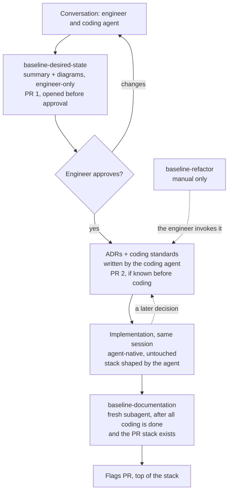

# The thin baseline, packaged as installable skills

**Design** · 2026-11-25 · status: **decisions approved by the Software Engineer in conversation on 2026-11-25; the calls in section 8 are the writer's.** Not committed.

This design replaces design 3 (tooling) and revises design 1 (the standard). Where it contradicts either, this one wins.

## 1. Intent and the why

The Software Engineer wants the baseline to work with any coding agent (Claude Code, Codex, Copilot and others), to be installed once, set up in any repo, and updated later.

The baseline becomes thin. It steers agent-written code through exactly two documents, **ADRs** and **coding standards**. Everything else it produces is documentation, and it controls that documentation tightly (format and content). It never touches how an agent implements code.

Why: agents write most of the code, so the only things that must steer them are the decisions and rules the engineer approved. Documents are the engineer's control surface over agent-written code. Reuse across repos, no lock-in to one tool and updates that propagate are the drivers already recorded in ADR 0003.

## 2. Goals, non-goals, anti-goals

**Goals**
- G1. Any agent that reads Agent Skills (`SKILL.md`) and `AGENTS.md` can run the baseline.
- G2. One package of four skills, installed with one command.
- G3. A repo can be initialised from the package and later updated through checked-in migration scripts that the agent runs.
- G4. ADRs and coding standards are the only steering documents. The coding agent writes them, in the same session, when the decision is made. They are living: edited, rewritten or deleted in place.
- G5. Across all documents: diagrams and snippets first, tight text, much less volume.
- G6. One course, organised by end-to-end flows, specific to the repo.
- G7. A small CI check for the three things a script can verify.

**Non-goals**
- Controlling implementation: no size rule (the old ~400-line guide goes), no stack-shape rules, no rule that a PR holds one kind of change.
- Multi-level review of baseline documentation: no ADR-draft review, no guard rail, no re-verify loop.
- Whole-language tutorials, and a separate language tier or stack tier of the course.
- Any mechanical check beyond G7 (ADR rules, PR-kind rules, stack gate, mixed-kind notice, truth checks, nightly jobs all go).
- Running `baseline-refactor` automatically.
- Publishing beyond the GitHub repository URL (a marketplace listing, per-agent manifests). Nothing is merged or deployed unless the engineer asks.

**Anti-goals**
- Steering code through anything other than ADRs and coding standards.
- A document that describes what was meant instead of what was done.

## 3. The flow

*The baseline touches only the boxes around implementation. The dotted arrows send every new decision back to PR 2.*

**`baseline-desired-state`.** Written at the end of the questions, at the point where the agent would otherwise wait for approval before coding. A concise summary of the conversation with diagrams: the end state the engineer reads and approves. It is engineer-only, replaces nothing a skill already writes (a spec, a plan), and is a point-in-time snapshot that is allowed to go stale and is never maintained. The PR that holds it opens before approval. It also decides which ADRs and standards the conversation already settles, if any.

**PR 2, the decisions PR.** The coding agent (same session, not a subagent) writes those ADRs and standards from the templates in the repo. The engineer reviews them, then the agent implements. A decision that comes later, during coding or after, is added to PR 2 or amended there; the code PRs above are rebased and the agent says what changed.

**Implementation.** The baseline adds only the ADRs and standards as context. When to open PRs, how to cut slices, frontend before backend before database: the implementing agent decides.

**`baseline-documentation`.** A fresh subagent (a fresh session where the agent has no subagents), started when the engineer says the back-and-forth is over, all coding is done and the PR stack exists. It reads the code at the tip, the ADRs and standards, and `baseline.yml`; not the conversation and not the desired-state file. It documents what was done and nothing else: no review layers, no verify loops. Anything it wants to flag goes in a flags folder, checked in on a dedicated PR at the top of the stack.

**`baseline-refactor`.** Manual: the engineer invokes it or asks the agent to. It reviews the branch against the ADRs and standards and, per violation, decides whether the standard or the code should change. If a standard changes, that goes in the first PR. The rewrite is then a separate task: the updated standard is given to the agent, which brings the code into line.

## 4. ADRs and coding standards

- **ADR.** The decision, as the desired output, in tight text with a diagram or snippet where it helps. The alternatives and why-not live in the course, not here. An ADR is written for a decision of impact (a new technology or dependency, a data model or public interface, a security or trust boundary, the deployment topology, anything hard to reverse).
- **Coding standard.** A blanket rule with very limited exceptions: a clear statement of the end result plus mnemonic snippets where they apply. Example: "C# payloads and contracts are records, not classes."
- A standard can come from the pre-coding conversation or from a later one (see PR 2 above).
- **Living documents.** Edit, rewrite or delete in place. Git history is the record. Removed: append-only, the `Superseded by` status, the "no Accepted ADR is rewritten" check, the docs agent's guard rail and numbering step.

## 5. The package

Four skills in one repo, installed together by one command. Each `SKILL.md` is a short router (Agent Skills limits: under 500 lines, `name` up to 64 characters lowercase with hyphens, `description` up to 1,024 characters, references one level deep, scripts non-interactive with `--help` and `--dry-run`).

| Skill | Holds |
|---|---|
| `baseline-desired-state` | The desired-state template, the rules for deciding which ADRs and standards a conversation settles |
| `baseline-documentation` | The formats and required sections of every document it writes (README, architecture reference, feature docs, deployment docs, reference pages, the course), the flags rule |
| `baseline-refactor` | The review-and-rewrite instructions |
| `baseline-init` | The intake, the kit (files copied into a repo), the migration runner and migrations, the check script |

**What lives where (split by who needs it when).** Skills load when the agent chooses them; `AGENTS.md` is always loaded. So what steers every session lives in the repo, and what only a skill needs lives in the skill.

| In the repo after `baseline-init` | In the skills |
|---|---|
| `AGENTS.md` with a marked baseline block: run desired-state before waiting for approval to code; read `docs/adr/` and `docs/standards/` before generating code; run documentation after all coding; never run refactor unprompted | Documentation formats (everything except the required-sections list), the refactor instructions, the intake |
| `baseline.yml` (the pinned `baseline_version` and the paths the check needs) | Migrations and the migration runner |
| `docs/adr/` and `docs/standards/`, each with its template | The kit: the files init copies into the repo, the check script among them |
| CI workflow, check script and the required-sections list the check reads | |

The ADR and standard templates must be in the repo because decisions come up mid-coding, when no baseline skill is active. The spec does not define sharing files between skills, so skills share nothing: shared formats live in the repo. The required-sections list is shared this way: `baseline-documentation` writes to it and the check enforces it.

**One version.** All four skills carry the same version in `metadata.version`, bumped by one script (superpowers does the same across its manifests). `baseline.yml` records the version the repo follows.

**Install.** From the GitHub repository URL, which the engineer decided is enough for now (2026-11-26): `npx skills add <owner>/<repo>` or `gh skill install <owner>/<repo>`, at project level and committed, so CI and teammates run the same pinned version. The repository is private today, so installing needs read access to it. A marketplace listing or per-agent plugin manifests (as superpowers ships) can follow later.

## 6. Init, update and the check

**Init.** The intake, then the repo-resident files from the table above, with the version recorded in `baseline.yml`. Baseline-owned files carry a version marker.

**Update, in two steps.** The package manager updates the skills. `baseline-init` in update mode then brings the repo from its `baseline_version` to the installed version:

1. For each version in between, in order, run that version's migration with `--dry-run`. It prints exactly what moves or changes.
2. The engineer sees it and approves. The agent then applies it.
3. Baseline-owned files (the `AGENTS.md` block, the CI workflow, the check script) are replaced. A local edit to one is shown, and the engineer decides to keep it as an override or discard it.
4. The result opens as a normal set of PRs for review. `baseline_version` moves last.

A migration is a deterministic script with a before-and-after fixture test. Anything that cannot be a script is written instructions that the agent follows.

**Rules**
- A migration may move or change project-owned files (standards, `baseline.yml`, ADRs, project docs) because the skill defines their layout, but only after the engineer sees the dry run and approves.
- A declined migration stops the update at that version. No override, no skipping.

**The check.** One script, run in CI on every PR; a failure blocks the PR. It verifies three things: required sections are present, Mermaid diagrams parse and render, links resolve. Python 3.9+ with the standard library only; Node with a pinned renderer, used only to render Mermaid. Nothing else is checked.

## 7. The course

One very detailed course organised by end-to-end flows. There is no language tier and no stack tier. Each flow chapter teaches the language and framework ideas it meets, at the point it meets them. Duplication across flows is accepted: the context of a `for` loop differs from flow to flow, and reading every chapter teaches every concept the code uses. Scope stays strict: only what the codebase uses; whole-language tutorials are out. Chapters keep the integration between components and languages in view.

Unlike ADRs and standards, the course also shows the alternatives and why this approach was chosen. The docs subagent may give best-guess reasons.

"Detailed" means nothing the code uses goes untaught. It does not mean long prose: diagrams and snippets first.

## 8. Decisions and calls

**Decisions the engineer made**

| # | Decision | Pick | Other options |
|---|---|---|---|
| D1 | Where content lives | Split by who needs it when | Everything in the repo; everything in the skills |
| D2 | Package shape | Several skills in one package | One skill with modes |
| D3 | Course | One course by flows | Three tiers with an integration part in each lesson |
| D4 | Mechanical checks | A small CI check | None |
| D5 | A declined migration | Stops the update at that version | Record an override and carry on |
| D6 | Migrations touching project-owned files | Allowed, after the engineer approves | Baseline-owned files only |
| D7 | A later ADR or standard | Into PR 2 at the bottom, code PRs rebased | A PR at the top, below the docs |
| D8 | Build order | Skeleton first | Content first |

**Calls the writer made (correct any)**
- C1. The names `baseline-desired-state`, `baseline-documentation`, `baseline-refactor`, `baseline-init`. The engineer wrote "desired-output" once and "desired-state" once; this design uses desired-state.
- C2. Update and adopt are modes of `baseline-init`. Adopt (an existing repo) runs init, then `baseline-documentation` on the current code.
- C3. Merge, deploy and publish still wait for the engineer's ask, even though PRs now open as the work goes.
- C4. `baseline-documentation` does not use the desired-state file as an input.
- C5. The documentation families stay (README, architecture reference, feature docs, deployment docs, reference pages, course), each cut to diagrams and snippets.
- C6. `baseline.yml` shrinks to `baseline_version` and the paths the check needs. `artifact_map` and `stack_folders` go, because nothing reads them once PR kinds are no longer rules.
- C7. The intake and reader profile stay: the intake asks the reader-profile questions as today and nothing more.
- C8. No ADR status field; the PR review is the approval. ADRs are numbered in order at creation.
- C9. A guessed reason in the course is labelled "inferred".
- C10. The kit lives inside `skills/baseline-init/assets/`.
- C11. The first commit of a brand-new repo goes straight to `main`; every later change is a PR.
- C12. The skeleton is tried in Claude Code and Codex first, Copilot after.
- C13. The baseline repo keeps ordinary Agent Skills layout: `skills/<skill-name>/SKILL.md`.
- C14. Scripts are Python 3.9+ using only the standard library, so they need no installer (3.9 is what stock macOS ships). The requirement is recorded in each skill's `compatibility` field.
- C15. GitHub stays the venue. The baseline needs only that each PR is based on the one below it; `gh stack` or plain branches is the agent's call.
- C16. Desired-state files stay in the repo once merged, are never maintained, and can be deleted.
- C17. `CLAUDE.md` stays a pointer to `AGENTS.md`. Other agents read `AGENTS.md` directly (Gemini CLI needs its context-file setting; not verified).
- C18. The required-sections list lives in the repo beside the check script (see section 5).

## 9. The first deliverable: the skeleton

Smallest working path: `baseline-init` (init mode, plus an update mode that runs migrations with none shipped yet), `baseline-desired-state`, the three templates (desired-state, ADR, standard), the `AGENTS.md` block and `baseline.yml`.

Proof: install it into a throwaway repo with `npx skills add` from a local path, then in Claude Code and Codex:
1. The four-skill package installs and each agent lists the skills.
2. Init produces the repo files.
3. After a question-and-answer session the agent writes the desired-state file and waits for approval.
4. A settled decision becomes an ADR or standard from the template.

**Not verified until tried:** that each agent follows the `AGENTS.md` routing; that `npx skills add` carries `assets/` and `scripts/` through intact; Copilot's skills path (the `skills` CLI lists `.agents/skills/`, GitHub's docs say `.github/skills/`); whether `gh skill` handles a multi-skill repo. Only the Agent Skills spec and the `skills` CLI docs were read; nothing has been installed. The `skills` CLI sends telemetry unless `DISABLE_TELEMETRY` is set.

## 10. What changes in this repo (last, after the package works)

`standard/` is retired. Its documentation formats move into `baseline-documentation`; the rest is dropped. `AGENTS.md` and the six playbooks in `docs/agents/` are rewritten around the new flow. These stop being rules: constraint C6 (maximum detail), goals G2 (complete and deep), G4 (three tiers) and G6 (options explored in every ADR), the one-kind-per-PR rule, the size guide, the docs agent's ADR review and re-verify loop, and 8 of the 11 check groups. The 35 ADRs (all still Proposed) and the existing `docs/` are brought into the new shape by the same tools.

## 11. Left to the builder, and still open

**Builder:** file names and paths (the desired-state files, the flags folder, the migrations folder), template wording, script internals, how CI finds the check script, the version-bump script, ADR numbering, the version marker and the format of the required-sections list.

**Open for the engineer:** which agents they can run for the skeleton test (Claude Code works here; Codex and Copilot need their own accounts). Settled on 2026-11-26: the package is installed from the GitHub repository URL.
