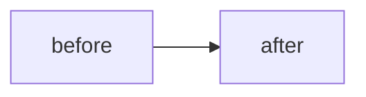

# Desired state: <topic>
<!-- Engineer-only snapshot. It may go stale. Diagrams and snippets first, little prose. -->

## End state
<!-- Three to six bullets: what exists when the work is done. -->

## Diagram

## Decisions to record
<!-- One line each, starting "ADR:" or "Standard:". Write "None" when the conversation settled nothing. -->

## Not in scope
<!-- What this work deliberately leaves out. -->
