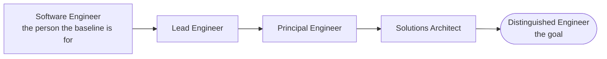
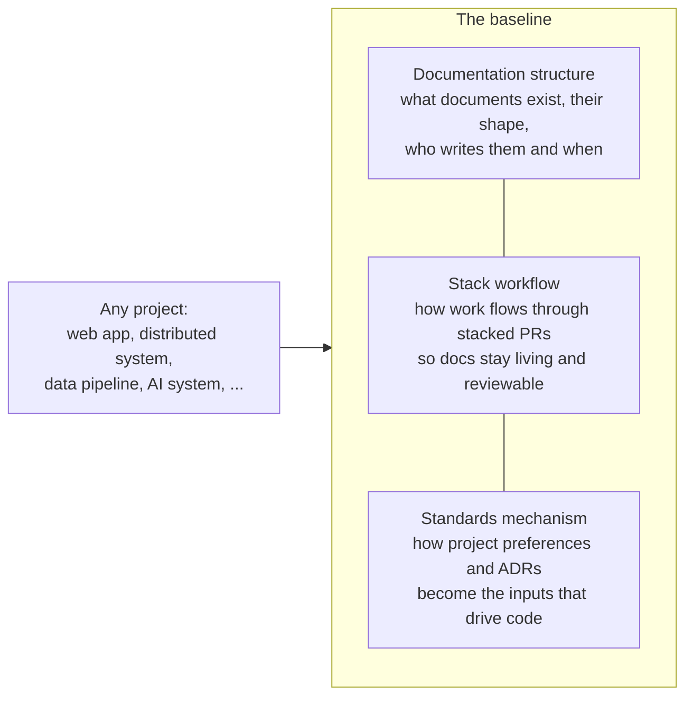

# Why and scope

This file opens the standard. It says who the baseline is for and why it exists, what the baseline is, what success looks like and the principle that outranks every other. It then lists the goals, non-goals, anti-goals and constraints that frame the rest of the standard. Each of those has an id, so that a rule, a decision record or a review can cite it, and each has its reason beside it.

A few words appear here before the standard defines them in full, so the ones that a reader new to stacked pull requests needs at once are explained now. `02-vocabulary.md` defines every term of the standard, and `03-stack-model.md` explains the stack.

- A **stack** is an ordered series of pull requests (PRs), each based on the one below it and merged from the bottom up. A stack holds three kinds of PR. A **thinking PR** holds the prescriptive documents, the ones that say what will be built or how work is done: the spec, the plan, decision records, standards, the reader profile and the playbooks. A **code PR** holds code and tests. A **description PR** holds the descriptive documents, the ones that say only what exists at the tip of the code, the **tip** being the last commit of the stack.
- A **slice** is a logical group of code that becomes one code PR, and the **docs section** is the group of description PRs at the top of the stack. The **docs agent**, a fresh agent that works from the finished code, writes the docs section.
- An **ADR** is an architecture decision record: one file for one decision, with the options that were explored.
- A **skill** is a packaged set of instructions that an agent follows for one kind of work, and superpowers is a set of skills.

## Who it is for

The baseline is for the **Software Engineer**: a professional engineer who works alone on ventures with large capital behind them. They take on the most technically demanding problems, for example a distributed NoSQL database modelled in TLA+ and implemented in Rust, multi-device synchronization engines, event-streaming data movement between databases, multi-agent AI systems and web back ends. AI agents write most of the code. Each project names its Software Engineer in its `AGENTS.md`.

The people who join a project later vary in skill and number, so each project records who its documents are written for in its reader profile (`04-reader-profile.md`). The profile is also the bar the Software Engineer hires against.

## The why

The Software Engineer's goal is to behave as a **Distinguished Engineer**, and to get there by taking on, rung by rung, the responsibilities of the Lead Engineer, the Principal Engineer and the Solutions Architect. The baseline is how one person who directs agents, rather than writing most of the code, can carry those responsibilities on real projects. Every document, rule and workflow of the standard exists to make one of them possible, and a decision about the baseline is judged against that.

*The Software Engineer climbs one rung at a time to the Distinguished Engineer, the goal at the rounded end of the chain, and keeps carrying each rung's responsibilities on the way.*

Each rung is a responsibility that the Software Engineer takes on, and the baseline gives them what they need to carry it.

| Rung | The responsibility the Software Engineer takes on | What the baseline gives them to carry it |
|---|---|---|
| **Software Engineer** | Turns a problem into working software, here by directing agents and reading, running and checking what they produce. | The architecture reference, the file map and the guided course, so they can read what was built; the evidence rules, so every claim is checked. |
| **Lead Engineer** | Leads delivery: slices the work, orders it, keeps each step reviewable and makes sure it ships working. | The stack model (spec, plan, slices, docs section), the stack table and PR descriptions that teach. |
| **Principal Engineer** | Owns technical quality across the codebase: the standards the code follows and the hard technical calls. | ADRs with the options explored, `docs/standards/` and the monthly line-by-line read of the documents. |
| **Solutions Architect** | Owns how the whole system fits together and fits its purpose: structure, boundaries, contracts between parts, deployment and operation, and the trade-offs among them. | The architecture reference, the deployment docs, the system chapters of the course, and ADRs on topology, trust boundaries and contracts. |
| **Distinguished Engineer** | Sets technical direction beyond one project and makes the people and agents around them better. | The guided course, the reader profile as the hiring bar, and the baseline itself, reused in every project. |

The last item of "What success looks like" says how the Software Engineer can tell from the documents whether each rung is being carried.

### The problem

When agents write the code, humans keep control only if they can understand the system well enough to read it, review it and challenge it. Documentation is that control surface. The practices that make documentation good existed in pieces, each in a different project of the Software Engineer's: a tutorial whose code excerpts a script checks, a living architecture document with append-only decision records, a stacked-PR workflow with teaching PR descriptions, and a spec with goals and anti-goals. No one project had the whole set, and none of it was reusable. The baseline is that whole set, made reusable.

## What the baseline is

The baseline is three things, applied to any project regardless of its stack, kind or goal.

*One baseline of three parts serves every kind of project, and what differs between projects is what the documents say, which the docs agent works out from the code.*

1. **Documentation structure.** What documents exist, their shape, who writes them and when. The prescriptive documents are written before or alongside the work, and the descriptive documents are written after the build by the docs agent, from the finished code.
2. **Stack workflow.** How work flows through stacked PRs so that the documents stay living and reviewable: the thinking first, then the code, then the documents that describe what was built, each in PRs of its own kind (`03-stack-model.md`).
3. **Standards mechanism.** How a project's preferences and its ADRs become the inputs that drive code. A preference becomes a standard only when the Software Engineer approves it.

## What success looks like

The baseline has succeeded when these six things are true.

1. A new project gets a complete document set that takes a reader at the stated level from zero to contributing, with the architecture always fully documented.
2. A reader who reviews a stack reads the thinking first (spec, plan, decisions), then the code, then the documents that describe what was built.
3. Every factual claim in a descriptive document was checked against the code or a real run, and anything that could not be checked says so.
4. The monthly line-by-line read by the team and architects finds documents that match the code.
5. The repository itself is a teaching and review resource that the team can use to learn the approach and contribute to it.
6. The Software Engineer can tell from the documents alone whether each rung of the ladder is being carried: delivery (the stacks), technical standards (ADRs and `docs/standards/`), the system as a whole (architecture and deployment), and teaching others (the course).

## The principle that outranks all others

**The reader's skill level shapes the documents only. It never reduces the scope, scale, vision, architecture or technical quality of the implementation. Every project is built to the maximum standard, idiomatic to its stack, and shaped by the problem, not by the reader.**

Because: the reader profile describes the team the documents are written for, and it is also the bar the Software Engineer hires against. It is therefore an input to the documents and never to what is built: its levels decide only which basics a document explains (`04-reader-profile.md`).

## Goals

The baseline has ten goals. Each row gives the goal's id, the goal and the reason for it.

| # | Goal | Because |
|---|---|---|
| G1 | The Software Engineer can act as a Distinguished Engineer: carry the Lead Engineer's, Principal Engineer's and Solutions Architect's responsibilities on real projects while agents write most of the code (the ladder under "The why"). | It is the purpose of the baseline. Every document, rule and workflow exists to make one of those responsibilities possible, and a decision about the baseline is judged against it. |
| G2 | One documentation structure for every project, complete and deep, with extensive diagrams in every document. | When agents write the code, humans keep control only if they can understand the system well enough to read it, review it and challenge it, and documentation is that control surface. The baseline does not change by kind of project: what differs is what the documents say. |
| G3 | Documents that live: they change in the same stack as the code and are verified against it. | When a team reads line by line, one wrong sentence costs more than a missing one, so a document that changes in the same stack as the code, and is checked against it, cannot drift from it. |
| G4 | A guided course in three tiers (language, stack, system) that builds engineers and systems thinkers, scoped to what the codebase uses and taught to full depth. | The people who join later vary in skill and number, and making the people around them better is the Distinguished Engineer's responsibility. The course is how the codebase teaches them. |
| G5 | A stack workflow in which every kept artifact gets its own reviewable PR, and thinking, code and description go in separate PRs because each is easier to review on its own. | A reviewer reads the thinking first, then the code, then the documents that describe what was built, and keeping each step reviewable is the Lead Engineer's responsibility. |
| G6 | Decision records that show the options explored, written when the decision is made. | "Options explored" is the Software Engineer's bar for a decision record, and a record written after the decision would justify the pick instead of showing the options as they stood (A4). |
| G7 | A standards mechanism that turns the Software Engineer's approved preferences into the documents that drive code. | Standards and ADRs are the only documents that drive code, so when generated code is wrong the fix belongs in them and not in a patch to the code. Only the Software Engineer's approval writes a standard, so nothing is inferred silently. |
| G8 | Superpowers and any other skill run exactly as written and put their documents wherever they put them. The baseline adds the documents it needs on top and arranges the PRs around whatever the skills produce. | The baseline sits beside the skills and changes nothing about how they work, so it never decides where a skill writes: it reads those paths and arranges the PRs around them. |
| G9 | The baseline repository documents itself to its own standard and is a good source for the team to learn from. | The repository is itself a teaching and review resource that the team uses to learn the approach and contribute to it (see "What success looks like"), so it has to show the approach at work. |
| G10 | Projects can adopt a newer baseline version through a reviewable update. | An update that arrives as an ordinary stack, in PRs of one kind each, can be reviewed like any other change, which makes it safe and testable. |

## Non-goals

A non-goal is something the baseline does not do. Each row gives the id, what is not the baseline's job and the reason.

| # | Not the baseline's job | Because |
|---|---|---|
| N1 | Security, dependency, privacy, vulnerability, verification and release policy. These are per-project standards that grow over time. | They depend on a project's kind and goal, which the baseline cannot know (C7), and they change as the project does, so each project records them in `docs/standards/` as its own approved preferences. |
| N2 | Per-kind overlays (web, distributed, AI, and so on) or per-stack slicing recipes. The agent groups work logically; preferences accumulate in `docs/standards/`. | The baseline does not change by kind of project, since what differs is what the documents say, and a recipe per kind or per stack would be rigid (A1). |
| N3 | Coding style. It is recorded as approved project standards, never imposed. | A coding preference is the Software Engineer's, approved one rule at a time (G7), and the baseline cannot know it in advance (C7). |
| N4 | Whole-language curricula. A course like `learn-rust` is a separate product that a project's course can link to. | A project's course teaches its own codebase, scoped to what the code uses (G4), so a whole-language curriculum, such as the Software Engineer's `learn-rust` course, is a different product, which a project's course links to. |
| N5 | A hosted documentation site or PDF export. GitHub is the only reading venue for now; a site may come later. | GitHub is the venue (C2), and the documents stay GitHub-flavoured Markdown plus Mermaid, so a site can be built later without a rewrite. |
| N6 | Teaching the Software Engineer a language. The courses teach the codebase; language curricula are separate. | The courses teach a project's codebase to the people who join it (G4), and a language curriculum is a separate product (N4). |
| N7 | Deciding where a skill writes its documents, or editing, steering or reformatting them. | The skills run untouched (C4): the baseline reads the paths a skill writes to and arranges the PRs around them. |

## Anti-goals

An anti-goal is a failure even if everything "works". Each row gives the id, the failure and why it counts as one.

| # | Failure | Because |
|---|---|---|
| A1 | **Rigidity.** A rule or check that cannot know the project's kind or goal. | The baseline is the same for every kind of project, so a rule that depends on the kind or the goal belongs to the project's standards (C7), and a baseline rule that assumed one would be wrong for the others. |
| A2 | **Documenting the plan.** A descriptive document that says what was meant instead of what exists. | A reader takes a descriptive document as what exists, and when a team reads line by line, one wrong sentence costs more than a missing one. This is why a fresh agent writes the descriptive documents from the finished code: the agent that built the code tends to document what it meant. |
| A3 | **Level shaping code.** Simpler code, smaller scope or weaker architecture because the reader is a beginner. | The reader profile describes the team the documents are written for, not what the project needs, so a level answers how much a document explains and never what is built (the principle above). |
| A4 | **Backfilled rationale.** An ADR whose options were written after the decision to justify it. | A decision record is worth having because it shows the options as they stood when the decision was made, and options written afterwards to justify the pick do not. This is why a draft is written at decision time and the docs agent may not rewrite it (`11-adrs.md`). |
| A5 | **Analogy leaking into the idiomatic explanation.** A comparison that replaces, rather than sits beside, the stack-native explanation. | The documents teach a technology as it is, and the code stays idiomatic to the stack either way, so a comparison with a known stack appears only in a marked aside that says where the analogy breaks and that a reader can skip or delete. |
| A6 | **Unverified claims.** A statement about behaviour, output, numbers or performance that nobody ran or measured and that is not marked "not verified". | When a team reads line by line, one wrong sentence costs more than a missing one, and a statement that nobody checked can be wrong without anyone knowing. |
| A7 | **Rebase conflicts on shared files.** Hand-edited indexes, counts or tables that every PR in a stack touches. | A file that every PR in a stack edits conflicts at every rebase of the stack, so indexes are generated and never hand-edited. |
| A8 | **Colour as the only carrier of meaning**, or a diagram that is unreadable in dark or light theme. | The Software Engineer reads in dark, other readers use light, and exports and printouts are light too. Hard-coded colours are what break a diagram in one theme, so meaning is carried by shape, label and line style, and colour only adds emphasis. |
| A9 | **Overreach on skills.** Dictating where a skill writes, or editing a spec, plan or other skill-produced document to fit the baseline. A skill may revise its own documents in a later loop; the baseline only asks that the revision be opened as its own PR (rule 8 in `03-stack-model.md`). | The skills run untouched (C4), so a document that a skill produced stays as the skill produced it. |

## Constraints

A constraint is a fixed limit that the standard works within. Each row gives the id, the constraint and the reason for it.

| # | Constraint | Because |
|---|---|---|
| C1 | **One repository per project, no exceptions.** Anything that must be published separately (an SDK, say) is a folder in the repo that CI publishes as a package. | A stack cannot span repositories, and in one repository an agent sees the whole product. |
| C2 | **GitHub is the venue.** Documents are GitHub-flavoured Markdown plus Mermaid, readable on GitHub in dark and light themes; the Software Engineer reads in dark. | Stacked PRs are a GitHub feature (C3), GitHub renders Markdown and Mermaid natively, and GitHub is the only reading venue for now (N5). |
| C3 | **Stacked PRs through `gh stack`**, the GitHub CLI extension for stacked PRs, and GitHub's native stacked pull requests. GitHub's documented rules: a stack is two or more PRs in the same repository, merged bottom-up, with linear history, and required checks are evaluated for every PR in the stack. The feature is in public preview. These are the rules as GitHub documents them, and they have not yet been confirmed against GitHub's actual behaviour. | The stack workflow (G5) needs PRs that build on each other and are merged in order, and a native stack is what GitHub merges from the bottom up with required checks on every PR, as it documents. |
| C4 | **The skills run untouched.** Superpowers and any other skill are never edited and are not told where to write: a skill's spec, plan and other artifacts stay wherever the skill puts them. The baseline's instructions to agents cover how those artifacts are arranged into PRs, which documents are added on top, and what to skip at the execution seams (`21-skills-seams.md`). | The baseline sits beside the skills and changes nothing about how they work, so what a skill produces stays as the skill produced it. |
| C5 | **The primary agent harness is Claude Code**; the standard itself is plain Markdown and does not depend on it. | The baseline's own skills are a Claude Code plugin, so Claude Code is where they run, and the standard works without them, so no project is locked in to one tool. |
| C6 | **Detail is always maximum.** There is no length budget on documents; completeness is judged against each document's shape, not by size. | A reader's level decides only which basics a document explains (the principle above), and humans keep control of agent-written code only if they can understand the system, so a length budget would cut what they need to understand it. |
| C7 | **The Software Engineer decides what the baseline cannot know.** Where a rule would depend on the project's kind or goal, it moves to the project's standards. | The baseline is the same for every kind of project and cannot know a project's kind or goal (A1), so what depends on them is the project's call. |
