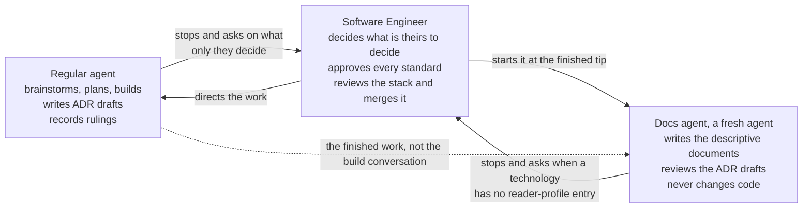

# Vocabulary and roles

This file fixes the words the standard uses and says who takes part in the work. Every other file of the standard assumes them, so a word is used in one sense throughout. "Roles" says who does what, and "Terms" defines each word. [01-why-and-scope.md](01-why-and-scope.md) says why the baseline exists and for whom, and `03-stack-model.md` sets the rules of the stack.

## Roles

Three roles take part in the work: the Software Engineer decides, the regular agent builds, and the docs agent writes the descriptive documents from what was built. Work is delivered as a **stack** of pull requests (PRs), an ordered series in which each PR is based on the one below it and merged from the bottom up. A stack holds three kinds of PR: a **thinking PR** holds the prescriptive documents, a **code PR** holds code and tests, and a **description PR** holds the descriptive documents. "Terms" below defines each of these words in full.

*The Software Engineer sits between the two agents, and both stop and ask the Software Engineer; the dotted line shows that the docs agent works from the finished work and never from the build conversation.*

- **The Software Engineer** is the person who decides, and the person the baseline is built for. They decide what only they can decide, and an agent that reaches such a choice stops and asks. The list is: what to build and why; anything that changes how work is done; merging a stack, deploying, releasing and store submissions; anything that persists or ships and cannot be undone; accepting or rejecting an ADR (the merge of the stack is the acceptance) and what to do with a finding that cannot be fixed, such as dismissing an alert or accepting a risk; and changing the reader profile. Because: the Software Engineer is the one who decides, and the agents decide everything else and record it as rulings, so the Software Engineer still sees every decision that was taken for them. They also approve every standard (`19-standards-mechanism.md`), start the docs agent and review the whole stack before it is merged. `20-working-rules.md` lists what they decide, with the reason for each call where the standard gives one.
- **The regular agent** is the agent that works on a task: it brainstorms, plans, builds and writes ADR drafts, and it may use any skill. It decides, without stopping, the calls that are not on the Software Engineer's list, such as the order of work, names and how the stack is grouped, and records each such decision as a ruling. Because: the skills that carry out a plan run continuously, so stopping for every such call would stall the build, and the Software Engineer still sees each ruling, with what it costs if wrong, when they review the stack.
- **The docs agent** is a fresh agent, started from the finished tip of the stack, that writes the descriptive documents from the finished code and reviews the ADR drafts. It never changes code, and it stops and asks the Software Engineer when a technology has no entry in the reader profile. Because: the agent that built the code tends to document what it meant and cannot tell when the code does not say it, so a fresh agent writes the documents; a description PR is read for whether it matches the code, so a code change hidden in one would not be reviewed as code; and without an entry the docs agent cannot know how much of the technology the reader already knows. `18-docs-agent.md` sets its rules, each with its reason.

## Terms

Each term below means the same thing in every file of the standard, and the terms are in alphabetical order.

| Term | Meaning |
|---|---|
| **ADR** | An architecture decision record: one file for one decision, with the options that were explored. |
| **ADR draft** | An architecture decision record that the regular agent writes at decision time, before the docs agent reviews it. |
| **`AGENTS.md`** | The short instruction file at the root of a repository, the primary instruction for working in it. It names the Software Engineer and points to the playbooks (`15-agents-md-and-playbooks.md`). |
| **Artifact map** | The part of `baseline.yml` that records the paths where skills write their documents (spec, plan and other), so that the kind of a PR can be inferred from the paths it touches. It records where a skill writes and never tells a skill where to write (`05-project-layout.md`). |
| **Baseline** | The Software Engineer's reusable foundation for every software project: how it is documented, how its work is delivered, and how the rules that shape its code are recorded. |
| **Baseline-owned file** | A file that the baseline copies into a project, such as a playbook, the CI workflow, a marked block in `AGENTS.md` or the PR template. It carries a marker with the baseline version and is replaced on update. Its counterpart is the project-owned file (`05-project-layout.md`). |
| **Checker** | The tool that checks a project's documents and PRs against the standard, locally and in CI (`22-tooling-requirements.md`). What the standard says the checker or CI does is a requirement on the tooling, and not a statement that any repository runs it today. |
| **Descriptive document** | Says only what exists at the tip of the code: features, architecture, the course, deployment, the README and the reference pages. Written after the build. |
| **Doc family** | One of the groups of descriptive documents that the docs agent writes: the feature docs, the architecture reference, the guided course, the deployment docs, the README and the reference pages. |
| **Docs agent** | A fresh agent that writes the descriptive documents from the finished code. |
| **Docs owed** | The auto-generated list on a code PR of what the docs section will cover. |
| **Docs section** | The group of description PRs at the top of a stack. The docs agent writes it, and it is last because the documents describe what was built. |
| **Execution skill** | A skill that carries out a plan task by task. In superpowers they are `subagent-driven-development` and `executing-plans`. |
| **Kept skill artifact** | A document that a skill produced and that stays in the repository, such as the spec that `brainstorming` produces or the plan that `writing-plans` produces. |
| **Knowledge area** | A subject that a project depends on, such as distributed systems, formal specification or event streaming. The reader profile records a level for each. |
| **Playbook** | A guide in `docs/agents/` that gives the rules of one subject with the reason beside every rule. The playbooks are baseline-owned files (`15-agents-md-and-playbooks.md`). |
| **Pointer** | A branch name that points at one commit of a linear history. The branches of a stack are cut as pointers (`03-stack-model.md`). |
| **Prescriptive document** | Says what will be built or how work is done: the spec, the plan, ADRs, standards, the playbooks and the reader profile. Written before or alongside the work. |
| **Project** | One product in one repository. |
| **Project-owned file** | A file that an update of the baseline never touches: the reader profile, the standards, the ADRs and all the documents (`05-project-layout.md`). |
| **Reader profile** | The project's recorded target reader level per technology and per knowledge area (`04-reader-profile.md`). |
| **Regular agent** | The agent that works on a task: it brainstorms, plans, builds and writes ADR drafts. It may use any skill. |
| **Ruling** | A decision that an execution skill or an agent took on the Software Engineer's behalf, without stopping to ask, recorded as `Ruling: what, why, cost if wrong`. Every ruling is listed under "Rulings I made" in the description of a code PR. |
| **Skill** | A packaged set of instructions that an agent follows for one kind of work, such as `brainstorming` or `writing-plans`. Superpowers is a set of skills. A skill writes its documents wherever it writes them, and the baseline never tells it where. The baseline's own skills, a Claude Code plugin that is to provide its commands, are part of its tooling (`22-tooling-requirements.md`). |
| **Slice** | A logical group of code that becomes one code PR. |
| **Software Engineer** | The person who decides, named in the project's `AGENTS.md`, and the person the baseline is built for: an engineer working toward Distinguished Engineer by taking on the responsibilities of the Lead Engineer, the Principal Engineer and the Solutions Architect ([01-why-and-scope.md](01-why-and-scope.md)). When the team grows, areas may have their own deciders. |
| **Stack (of PRs)** | An ordered series of PRs, each based on the one below it and merged from the bottom up, delivered with `gh stack`, the GitHub CLI extension for stacked PRs (`03-stack-model.md`). Not to be confused with a technology stack, which this standard calls a technology or a stack folder. |
| **Stack folder** | A folder of a project's repository that holds the code of one technology stack, such as a front end or a back end. `baseline.yml` lists the stack folders. It is not a stack of PRs. |
| **Stack table** | The table at the top of every PR description that shows the whole stack: each PR's kind, link and one-line purpose (`14-pr-descriptions.md`). |
| **Standard (lowercase, project)** | An approved preference in `docs/standards/` that drives code generation. It belongs to a project, and it is not the standard, which is the text of the baseline. |
| **Technology** | A language or framework that a project uses. The reader profile records a level for each technology. |
| **The standard** | The text of the baseline, plain Markdown in the files of the `standard/` folder: what documents every project has, what shape each has, who writes them and when, how they stay true, and how work flows through pull requests. |
| **Thinking / code / description PR** | The three kinds of PR (`03-stack-model.md`). A thinking PR holds the prescriptive documents, a code PR holds code and tests, and a description PR holds the descriptive documents. |
| **Tip** | The last commit of the stack. The **finished tip** is the tip once the building is done. |
