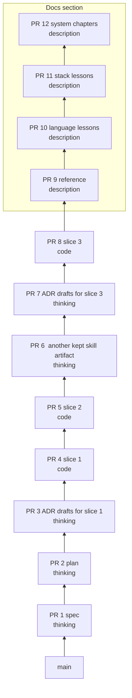
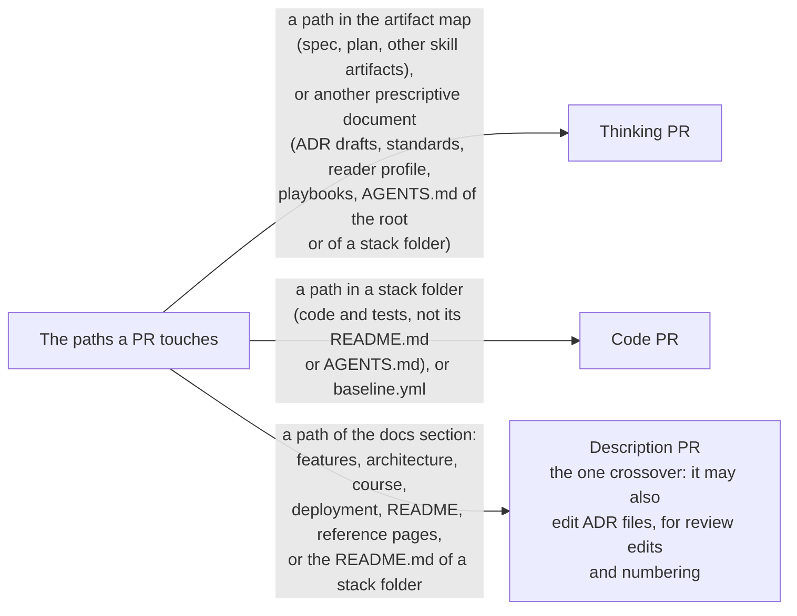
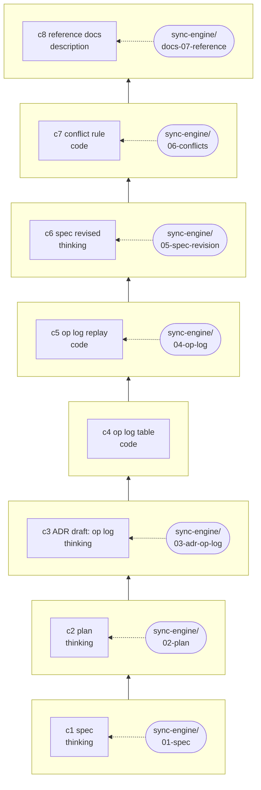

# The stack model

This file defines how a project delivers its work: as one **stack** of pull requests (PRs). A stack is an ordered series of PRs in which each PR is based on the one below it, so that each PR shows only its own change, and the series is merged from the bottom up. The file gives the picture of a stack, the three kinds of PR that a stack holds, how the kind of a PR is decided, what happens when something changes later, and the thirteen rules and the seven conventions that make a stack.

[02-vocabulary.md](02-vocabulary.md) defines the words used here, and the ones that a reader new to stacked PRs needs at once are explained where they first appear. [01-why-and-scope.md](01-why-and-scope.md) says why the stack workflow exists. The playbook [stacks.md](../docs/agents/stacks.md) states the same rules as instructions to an agent, with the commands. Each rule below is followed by `Because:` and its reason.

## The picture

Every piece of work is delivered as one stack. Thinking goes below the code it governs, building goes in the middle, and descriptions of what was built go on top. Because: a reviewer reads the thinking first, then the code, then the documents that describe what was built, and the descriptions sit on top because they describe the final built state.

A stack holds three kinds of PR. A **thinking PR** holds the prescriptive documents, the ones that say what will be built or how work is done: the spec, the plan, decision records (ADRs), standards, the reader profile and the playbooks. A **code PR** holds code and tests. A **description PR** holds the descriptive documents, the ones that say only what exists at the tip of the code, the **tip** being the last commit of the stack. The docs agent, a fresh agent that works from the finished code, writes them.

Four more words appear in the picture. A **slice** is a logical group of code that becomes one code PR. An **ADR draft** is a decision record that the regular agent, the agent that brainstorms, plans and builds, writes at the time of a decision, before the docs agent reviews it and gives it a number. A **kept skill artifact** is a document that a skill produced and that stays in the repository, such as a spec or a plan. The **docs section** is the group of description PRs at the top of the stack.



*Merging goes bottom-up from `main`: thinking sits below the code it governs, and the docs section sits on top because it describes the final built state.*

The picture is one example, and how many slices and kept artifacts a stack has depends on the work. PRs 1 and 2 are the spec and the plan, each committed as produced. PRs 3 and 7 are ADR drafts, which a slice has only where a decision of impact was made (`11-adrs.md` lists the criteria), and PR 6 is another kept skill artifact, placed where it was produced. PRs 4, 5 and 8 are slices of code. PRs 9 to 12 are the docs section: the reference documents (the architecture reference, the feature docs, the deployment docs, the README, the file map, the glossaries and the review of the ADR drafts), the language lessons, the stack lessons and the system chapters.

### A stack on GitHub

A PR is based on a branch, and an ordinary PR is based on `main`. In a stack, the first PR is based on `main`, the second is based on the first PR's branch, the third on the second's, and so on to the top. This chain of bases is why each PR shows only the changes it adds on top of the PR below. The PR nearest `main` is the **bottom** of the stack, the last PR is the **top**, and a PR is merged only after the ones below it.

GitHub has a native feature for stacked PRs, in public preview. Its documented rules are that a stack is two or more PRs in the same repository, merged bottom-up, with linear history, and that required checks are evaluated for every PR in the stack. These are the rules as GitHub documents them, and they have not yet been confirmed against GitHub's actual behaviour. The rules below that rest on them say so where they do.

### The tool: `gh stack`

`gh stack` is the GitHub CLI extension for stacked PRs, so it runs as a subcommand of `gh`. The feature it drives is in public preview, so the tool's own help is the authority when a command behaves differently from what is written here: `gh stack --help` lists the commands, and `gh stack <command> --help` explains one. The commands described in this file are taken from the help of version 0.3.0, and how they behave against GitHub has not yet been confirmed, apart from the check of `gh stack link` over branches cut as pointers, which is reported below.

The command that registers a stack on GitHub from branches made with plain git is `gh stack link`. It takes the names of branches in stack order, bottom to top, and does four things:

1. It pushes every branch to the remote in one atomic push, so that all of them update or none does.
2. It opens a PR for each branch that has none, based on the branch below it. The first is based on the repository's default branch, and `--base <branch>` changes that. A branch that already has a PR keeps it.
3. It creates the stack on GitHub, or adds the new PRs to the stack they already belong to. It never removes a PR that is in a stack.
4. With `--open`, it marks the PRs ready for review, so that none is left as a draft.

It keeps no local record of the stack, so it works on branches made with plain git, and a stack needs at least two branches. A stack of three branches is made like this, where `sync-engine` is the made-up topic of the stack:

```bash
gh stack link sync-engine/01-spec sync-engine/02-plan sync-engine/03-op-log --open
```

Branches cut as pointers into one linear history linked cleanly with `gh stack link` when this was checked on 2026-11-18, with `gh stack` 0.3.0, in a throwaway repository (rule 12).

`gh stack --help` lists other commands too. Most of them, such as `add`, `submit`, `sync` and `rebase`, work from a record of the stack that `gh stack` keeps on the local machine. A stack made with plain git has no such record unless `gh stack init` adopts its branches, which its help says it does for existing branches. The branches of a stack in this baseline are pointers made with plain git (rule 12). The playbook [stacks.md](../docs/agents/stacks.md) says which commands the baseline uses and shows them in use.

## The three PR kinds

Each PR holds one kind of change, because each kind is reviewed in a different way: thinking is read for intent and soundness, code for correctness, and description for whether it matches the code. The last column of the table says what is kept out of each kind, for easier review.

| Kind | Holds | Kept out, for easier review |
|---|---|---|
| **Thinking** | The spec, the plan, ADR drafts, any other kept skill artifact, standards updates, the reader profile, the baseline-owned playbooks. Committed as produced. | Code. |
| **Code** | Code and tests. Docstrings and comments count as code. | Any of the project's doc families. |
| **Description** | The docs section: reference docs, lessons, system chapters, reference pages, and the docs agent's review edits to ADRs. | Code. If writing a document exposes a bug or unclear code, the fix goes in the code PR it belongs to and the docs are rebased and re-verified. |

A **doc family** is one of the groups of descriptive documents that the docs agent writes: the feature docs, the architecture reference, the guided course, the deployment docs, the README and the reference pages. The baseline-owned playbooks are the playbooks that the baseline copies into a project and replaces on update.

**Keep each PR to one kind.** This is a convention, and a PR that mixes kinds is not wrong. Because: each kind is easier to review on its own. A reviewer reads thinking for intent and soundness, code for correctness, and description for whether it matches the code, so a PR of one kind can be read one way from top to bottom, and a mixed PR is only harder to review. The baseline therefore asks that the kinds be separated when PRs are opened, and it never fails a mixed PR: its checker gives a mixed PR a notice that lists its files by kind and says where the PR could be split, and the notice never blocks the PR (`22-tooling-requirements.md`).

## How the kind is decided

The kind is inferred from the paths a PR touches, using the artifact map in `baseline.yml`, so no naming rule is needed. `baseline.yml` is the project's baseline configuration, at the root of its repository. Its **artifact map** lists the paths where skills write their spec, their plan and their other documents, and it holds the superpowers paths, `docs/superpowers/specs/**` and `docs/superpowers/plans/**`, by default. Its **stack folders** list the folders that hold code, with the two exceptions that the rule under the diagram gives.



*The kind of a PR is read off the paths it touches, so no naming rule is needed, and the one crossover is that a description PR may edit ADR files.*

**A stack folder's own `README.md` is description, its own `AGENTS.md` is thinking, every other path in a stack folder is code, and `baseline.yml` is code.** Because: the standard counts a stack folder's `README.md` among the descriptive documents and its `AGENTS.md` among the prescriptive ones (`05-project-layout.md`), so a change to either has the kind of its document, and the update's code group moves `baseline_version` in `baseline.yml` (`22-tooling-requirements.md`).

The artifact map records where the skills write and never tells a skill where to write. Because: the skills run untouched, so the baseline cannot choose where they write, and it reads the paths and arranges the PRs around them. A project that uses another tool adds that tool's paths to the map, so that swapping or adding a tool means editing the mapping and never the baseline (`05-project-layout.md` describes `baseline.yml`).

**The one permitted crossover:** a description PR may edit ADR files, for the docs agent's review edits and its numbering of ADR drafts. Because: the review and the numbering are the docs agent's work, and they are made after the build, when the docs section is written.

## When something changes later

A skill may revise its own spec or plan in a later loop, and a code change may call for a document change. Nothing forbids either. When the PRs are opened, the change goes in its own PR of the matching kind, at the point in the stack where it happened (rule 8 below).

- A revision of a spec or a plan is a thinking PR, placed below the code that needed it, so that the reviewer reads the changed thinking first. If the revision changes a decision, a new ADR draft goes with it.
- A document change that a code change calls for goes in a PR of the kind that document has. A standards update or a playbook change is a thinking PR, and a descriptive document is the docs agent's, in the docs section.

Because: the baseline never stops a skill and never edits what a skill produced, so a later revision is neither prevented nor folded into another PR. Each PR stays one kind, and the reviewer reads the changed thinking before the code that needed it.

## The rules of the stack

Thirteen rules govern a stack. Three words need a gloss before the rules use them. A **ruling** is a decision that an agent takes on the Software Engineer's behalf, without stopping to ask, and records as `Ruling: what, why, cost if wrong`. The **stack table** is the table of the whole stack at the top of every PR description, with each PR's kind, link and one-line purpose. The **execution skills** are the skills that carry out a plan task by task; in superpowers they are `subagent-driven-development` and `executing-plans`.

1. **The spec is PR 1.** When brainstorming finishes and the Software Engineer approves the spec, the spec is committed on the stack's first branch, untouched. Because: thinking goes below the code it governs, so the reviewer reads the intent first, and the spec stays as the skill produced it and the Software Engineer approved it.
2. **The plan is PR 2.** When the plan is written, it is committed on the next branch, untouched. Because: the plan is thinking too and goes below the code it governs, and PR 2 stays as first written even if the plan is revised later (rule 8).
3. **PRs 1 and 2 are opened immediately.** Where the project's `AGENTS.md` or the conversation asks for the Software Engineer's yes before anything is opened, they are opened once the Software Engineer has said yes. Because: they contain only documents, nothing merges early, and the Software Engineer can read and comment while the build runs.
4. **ADR drafts are small PRs of their own**, one per slice that has any, directly beneath the first slice that depends on them. Because: the reviewer reads the thinking first, and each PR stays one kind.
5. **Any other kept artifact a skill produces gets its own PR**, as produced, in the order produced, below the code it governs. An artifact produced mid-build sits between the slices around it. The skill decides where the file is written, and the artifact map only records the path. Scratch files (a skill's own working files, such as an execution ledger, briefs and review packages) are git-ignored and never a PR. Because: every kept artifact can then be reviewed on its own, the skills run untouched so they decide where they write, and scratch files are working material of a run and not artifacts to keep.
6. **The agent decides how code is grouped into logical slices.** The grouping appears in the stack table at the top of every PR description, so the reviewer sees the shape before reading any code. There is no approval step for the layout. Because: the plan stays untouched, so it carries no layout, and how the stack is grouped is one of the calls the agents decide and record as a ruling. The stack table shows the Software Engineer the result before any code.
7. **The docs section is last**, in reading order from foundational to integrated: reference, language lessons, stack lessons, system chapters. The docs agent writes it (`18-docs-agent.md`). Because: the documents describe what was built, so they sit on top of the final built state, and a reader moves from the foundation to the integrated whole.
8. **Plan and spec edits made during the build get their own PR.** A skill may revise its spec or plan in a later loop, and nothing stops it. When the stack is cut, the revision becomes its own thinking PR at the point in the stack where it happened, below the code that needed it, so the reviewer reads the changed thinking first. PR 2 stays as first written. A change to a decision is also a new ADR draft, not only a spec edit. Because: the reviewer reads the changed thinking first and then the code that needed it, the skill is neither stopped nor edited, and a decision is recorded in an ADR, so a spec edit alone would leave that record unchanged.
9. **Code PRs carry an "Implements" line** linking the spec, the plan and the ADRs they follow, and the docs link back to the PRs. Because: a future reader can then follow why, how and what through the history.
10. **The whole stack, docs section included, is approved first and then merged bottom-up in one sitting.** Nothing merges, deploys or publishes unless the Software Engineer asks. Because: the docs section describes what the lower PRs built, so the stack is complete only with it, and GitHub merges a stack from the bottom up, as it documents. Merging ships the work, and the merge of a stack is also the acceptance of its ADRs, so it is the Software Engineer's call.
11. **A change with no spec stays a single code PR.** If it affects documents, that is, if a descriptive document says something the change makes untrue or incomplete, it becomes a two-PR stack: the code PR, then a description PR from the docs agent, and the "Docs owed" list of the code PR says what the description PR will cover. A change with no documentary impact needs no description PR. Because: this keeps each PR to one kind, which is what makes it quick to review, and a single PR that carried its own docs would put two kinds in it.
12. **The stack's branches are cut as pointers into the linear commit history** that the execution skills produce, at the slice boundaries the agent chose. No re-commit and no edit to the plan is needed. If a commit mixes kinds, or a thinking commit sits inside a slice, the agent splits or moves it when cutting; keeping each commit to one kind makes the cut pointer-only. Because: the execution skills commit task by task on one branch and run untouched, so the stack has to be made from the history they produce, and a pointer leaves that history exactly as produced. Branches cut this way linked cleanly with `gh stack link` when this was checked on 2026-11-18, with `gh stack` 0.3.0, in a throwaway repository.
13. **Every PR leaves the repository working:** it builds, and the project's own checks pass. What those checks are is the project's decision. Because: GitHub documents that required checks are evaluated for every PR in a stack, and a stack is merged from the bottom up, so each PR has to stand on its own. What the checks are is left to the project because verification is a per-project standard and not the baseline's (non-goal N1 in [01-why-and-scope.md](01-why-and-scope.md)).

### Cutting the stack from linear history

The execution skills commit task by task on one branch, called here the **build branch**, so its commits form one line with no merges and no side branches. A **pointer** is a branch name that points at one commit of that line. Cutting the stack means making one pointer per PR, with `git branch <name> <commit>`, at the slice boundaries the agent chose. The PR for a pointer holds the commits after the pointer below it, up to its own commit. No commit is copied, re-made or edited, and the plan is not touched.

The diagram shows a linear history of eight commits, seven made during the build and the last made by the docs agent on top of the finished tip, cut into seven PRs. Each commit holds one kind, which is what lets a pointer alone make the cut.



*Each branch name points at the last commit of its PR, so `04-op-log` holds c4 and c5, and the spec revision, c6, has a pointer of its own below the code, c7, that needed it.*

A cut works only if each commit holds one kind and the thinking sits below the code it governs. When a commit mixes kinds, the agent splits it. When a thinking commit sits inside a slice, or comes after the code that needed it, the agent moves it below that code. Both happen before any pointer is made. The playbook [stacks.md](../docs/agents/stacks.md) gives the steps of a cut and the checks that go with it.

## Conventions

Seven conventions complete the stack model. Each is a rule, with its reason beside it.

| Convention | Rule | Because |
|---|---|---|
| **Branch names** | `<topic>/<nn>-<slug>`, numbered in stack order, for example `sync-engine/01-spec`, `sync-engine/02-plan` and `sync-engine/03-op-log`. Description branches are `<topic>/docs-<nn>-<slug>`, numbered in stack order like the rest. | The number gives the stack order at a glance, and the `docs-` prefix marks a description PR. |
| **Commits** | Conventional prefixes (`feat(scope):`, `fix(scope):`, `docs:`, `test:`, `refactor:`), small and logical, and the message says why. Plan tasks keep the commit messages the plan gives them. | The history is cut into PRs later, and keeping each commit to one kind makes the cut pointer-only (rule 12). The message says why so that a future reader can follow the history, and the plan stays as produced. |
| **Attribution** | Never add an attribution line to a commit message or a PR description: no co-author trailer and no "generated with" line. Claude Code adds such lines by default, so `AGENTS.md` states the rule explicitly. | The Software Engineer does not want them, and because Claude Code adds them by default, the rule has to be stated. |
| **One idea per PR** | A refactor or a move goes in its own PR, apart from any behaviour change. | Each diff can then be read for what it is. |
| **Size guide** | About 400 changed lines for a code PR, not counting tests and generated files. Thinking and description PRs are exempt. | A code PR is read for correctness, so it has to stay small enough to review properly. Thinking and description PRs are read for intent and soundness, and for whether they match the code, so the guide does not apply to them. |
| **Stack tooling** | `gh stack`. The stack is registered as a native GitHub stack and its PRs are marked ready. A repair that rewrites pushed history waits for the Software Engineer's yes. A cross-cutting fix goes in as a new PR on top. | A native stack is what GitHub merges bottom-up with required checks on every PR, as it documents, and a draft is not ready for the review that the stack exists for. A rewrite of pushed history replaces commits that the Software Engineer may be reading, and a fix on top leaves every PR below as they read it. |
| **Everything is a PR** | The one exception is the very first commit of a new repository (the bootstrap), since there is nothing yet to branch from. The foundation itself (CI, the document skeleton, the first code) is then its own stack. | A PR needs something to be based on, and a new repository has nothing before its first commit. |
