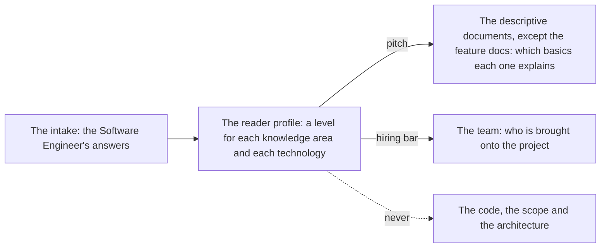
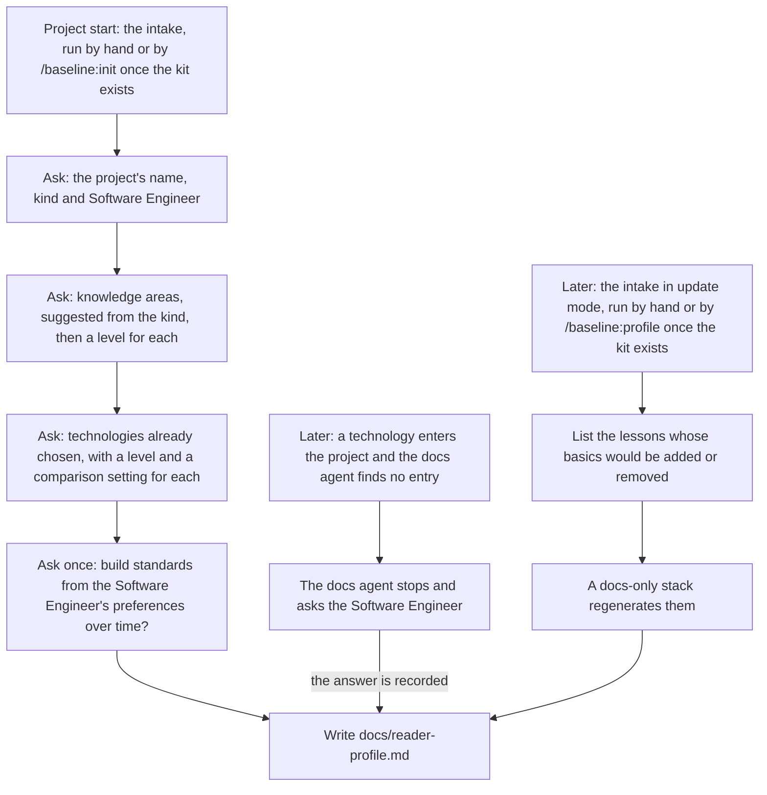
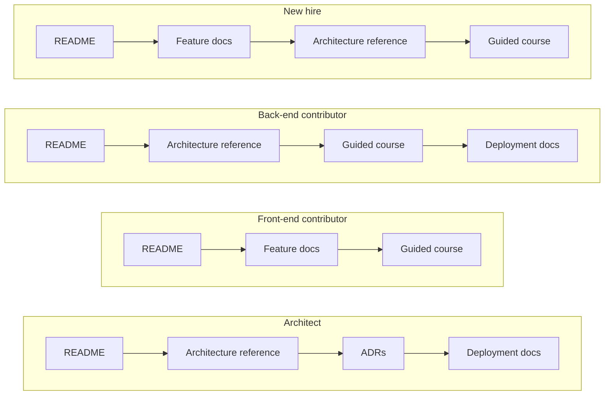

# The reader profile

This file defines the reader profile, the record of who a project's documents are written for, and the intake, the set of questions that creates the profile when a project starts. It says why the profile exists, what the intake asks, when it runs, what the saved file looks like and what the docs agent generates from it. [01-why-and-scope.md](01-why-and-scope.md) sets the principle that the reader's level shapes the documents only, and [02-vocabulary.md](02-vocabulary.md) defines the terms used here. `05-project-layout.md` shows where the profile sits in a project.

A few words appear here before the standard defines them in full, so the ones that a reader new to stacked pull requests needs at once are explained now. A **stack** is an ordered series of pull requests (PRs), each based on the one below it and merged from the bottom up. A stack holds three kinds of PR. A **thinking PR** holds the prescriptive documents, the ones that say what will be built or how work is done: the spec, the plan, decision records (ADRs), standards, the reader profile and the playbooks. A **code PR** holds code and tests. A **description PR** holds the descriptive documents, the ones that say only what exists at the tip of the code, the **tip** being the last commit of the stack. The **docs agent** is a fresh agent that works from the finished code and writes the descriptive documents. [03-stack-model.md](03-stack-model.md) explains the stack and its three kinds in full. Each rule below is followed by `Because:` and its reason.

## Purpose

The intake records **who the documents are written for**, and `docs/reader-profile.md` holds the answers. The answers do two jobs. They set how the documents are pitched, and they are the bar that the Software Engineer hires against: "average in Rust, advanced in distributed systems" says both how a document explains Rust and who is brought onto the project.



*The profile reaches the documents and the team, and the dotted line shows that it never reaches what is built.*

**Record the target team, and not the Software Engineer's own skill.** Because: the answers are also the bar the Software Engineer hires against, so they have to describe the team that the project wants.

**Let the profile change the documents only, and never the implementation.** The levels decide how much a document explains, and they never reduce the scope, the scale, the architecture or the technical quality of what is built. Because: every project is built to the maximum standard, idiomatic to its stack and shaped by the problem, not by the reader. The profile describes the team that the documents are written for and not what the project needs, so a level can answer how much a document explains and never what is built (anti-goal A3 in [01-why-and-scope.md](01-why-and-scope.md)).

**Pitch every descriptive document from the profile, except the feature docs.** The feature docs are always in plain language, whatever the profile says. Because: the feature docs are written for non-technical readers in and around the company and for engineers who want the "what" before the "how", so a level in a technology does not apply to them (`06-feature-docs.md`).

## What is asked

The intake asks for a level for each **knowledge area**, a subject that the project depends on, such as distributed systems, formal specification or event streaming, and for each **technology**, a language or a framework that the project uses. A level is one of three.

| Level | Meaning |
|---|---|
| **Beginner** | New to it. Explain from the first line of syntax. |
| **Average** | Comfortable programming. Skip basic syntax and constructs (loops, variables); still explain idioms, framework conventions and sharp edges. |
| **Advanced** | Fluent. Explain only what is specific to this project or non-obvious. |

**The levels decide only which basics get explained.** Detail is always at its maximum and the architecture is always fully documented: an average reader needs no loop explained, and still needs the architecture of the code specified. Because: humans keep control of code that agents write only if they can understand the system well enough to read it, review it and challenge it, and a document that left out part of the architecture because its reader was advanced would take that away (constraint C6 in [01-why-and-scope.md](01-why-and-scope.md)).

**For each technology, also ask whether to compare it with a known stack, and which one, or to treat it as brand new.** A knowledge area has a level and no comparison setting. A comparison appears only in a marked aside, "Coming from X", where X is the stack that was named. The aside says where the analogy breaks and never replaces the explanation that is native to the technology, and the code stays idiomatic to the stack either way. Because: the documents teach a technology as it is, so a comparison that replaced the native explanation would leak the analogy into it (anti-goal A5 in [01-why-and-scope.md](01-why-and-scope.md)), while a marked aside sits beside the explanation, says where the analogy fails and can be skipped or deleted. A lesson carries the aside among its pitfalls (`08-course-lessons.md`).

## When it runs

The profile is written when a project starts and changed later in two ways, and the diagram shows all three. Two commands that the kit will provide run the intake: `/baseline:init` at project start and `/baseline:profile`, which runs the intake in update mode, later (the part before the colon is the name of the Claude Code plugin that provides the command). The **kit** is the part of the baseline that is copied into a new project, and it is not built yet, so until it exists the intake is run by hand, as "At project start" says. The diagram also uses one more term: a **docs-only stack** is a stack made only of description PRs.



*Three ways in lead to the one file, and the docs agent's way in goes through a question to the Software Engineer first.*

### At project start

The intake asks, in this order:

1. The project's name, its kind (for example a web app, a distributed system, a data pipeline or an AI system) and the Software Engineer.
2. The knowledge areas. The intake suggests some from the kind of project, the Software Engineer adds or removes, and then gives a level for each.
3. The technologies already chosen, with a level and a comparison setting for each.
4. Once, whether to build standards from the Software Engineer's preferences over time. A yes creates an empty `docs/standards/` folder with a README that explains how it fills, and a no means there is no folder (`19-standards-mechanism.md`).

It then writes `docs/reader-profile.md` from the answers.

**Run the intake at the start of every project, before the documents are written.** Because: the profile is a prescriptive input to the documents, so it comes before them, and a technology with no entry stops the docs agent.

**Run the intake by hand until the kit exists.** `/baseline:init` and `/baseline:profile` are commands that the kit will provide, and the kit is not built yet. Until it is, the same questions are put to the Software Engineer in the same order and the file is written from their answers. The baseline's own profile, [docs/reader-profile.md](../docs/reader-profile.md), was made this way. Because: the standard is plain Markdown and works without the kit, so no project is locked in to one tool.

### When a technology has no entry

**When a technology has no entry in the profile, the docs agent stops writing that technology's course and asks the Software Engineer.** It carries on with everything that does not need the answer, and the entry is then recorded in the header, as every change to the header is, in a thinking PR ("The saved file" says how). Because: without an entry the docs agent cannot know how much of the technology the reader already knows, and a guessed level either repeats what the reader knows or leaves out what they need.

### When the profile changes

The Software Engineer decides every change to the profile, and "The saved file" says how a change is made. The intake in update mode lists the lessons whose basics the change would add or remove, and a docs-only stack regenerates them. Until the kit exists, update mode is run by hand in the same way.

**Regenerate what depends on the header after every change to it:** the lessons whose basics change and the generated sections of the profile. The change to the header is a thinking PR, and the regeneration sits on top of it. Because: documents pitched at the old level contradict the new header until they are regenerated, and the reviewer then reads the changed profile before the documents that follow from it.

## The saved file

`docs/reader-profile.md` is readable by people and carries the answers in a machine-readable header. The header is a block of YAML between two `---` lines at the very start of the file, the convention known as front matter. It keeps the answers as data that a program can read, in the same file as the text that a person reads. Because: the docs agent reads the answers from the header to decide which basics each document explains, and the baseline's checks compare the header with the technologies that the code uses (`22-tooling-requirements.md`), so the answers have to be data and not prose.

An example, for a made-up project and a made-up Software Engineer:

```yaml
---
project: example-app
software_engineer: Alex Example
standards_enabled: true
knowledge_areas:
  - name: distributed systems
    level: advanced
  - name: event streaming
    level: beginner
technologies:
  - name: Rust
    level: average
    compare_with: Go
  - name: TypeScript
    level: advanced
    compare_with: none
---
```

The header has five keys.

| Key | What it holds |
|---|---|
| `project` | The project's name. |
| `software_engineer` | The name of the person who decides. |
| `standards_enabled` | `true` or `false`: the answer to the intake's one question about standards. |
| `knowledge_areas` | A list. Each entry has a `name` and a `level`. |
| `technologies` | A list. Each entry has a `name`, a `level` and a `compare_with`. |

A `level` is `beginner`, `average` or `advanced`. A `compare_with` is the name of a stack that the reader knows, or `none`, which means that the technology is treated as brand new and no document carries a "Coming from X" aside for it. Here `none` is a plain word and not YAML's empty value.

**Give every knowledge area and every technology an entry, with all of its fields.** Because: without an entry the docs agent cannot know how much of the technology the reader already knows, and a guessed level either repeats what the reader knows or leaves out what they need.

Below the header the file is text for people: it explains the header, and it holds the sections that the docs agent generates from it ("What is generated from it"). The baseline follows its own standard, so its profile is a real example of the format: [docs/reader-profile.md](../docs/reader-profile.md).

### Changing the file

**The Software Engineer decides every change to the header.** An agent that thinks a level is wrong proposes the change and asks, and it does not edit the header. Because: the levels say who the documents are for and who is hired, and both are the Software Engineer's call.

**A change to the header is a thinking PR.** Because: the profile is a prescriptive input that decides how every descriptive document is pitched, so it is read for intent and soundness before any document is regenerated from it, and apart from code and descriptions. Git keeps the history of the profile, so the file holds only the current answers.

## What is generated from it

From the header, the docs agent generates three sections inside the same file, `docs/reader-profile.md`.

| Section | What it holds |
|---|---|
| Who can contribute | The hiring bar, per technology and per knowledge area, stated in words from the levels in the header. |
| Prerequisites | What a reader must know before the first chapter. |
| Reading paths by role | For each role, for example a front-end contributor, a back-end contributor, an architect or a new hire, which documents to read and in what order. The section carries the reading-path map, a diagram of the paths. |

**The docs agent writes the three sections when it writes the docs section, and regenerates them when the header changes.** The **docs section** is the group of description PRs at the top of a stack. Because: the sections are generated from the header, so a section generated from an older header misstates who the documents are for.

**Do not edit the generated sections by hand, and the docs agent never edits the header or the text that explains it unless the Software Engineer has decided the change.** Because: the header is the Software Engineer's answer and changing it is their call, while the sections are generated from it, so a hand edit of them is replaced.

**The generated sections ride in the docs agent's description PR.** The profile otherwise belongs to the thinking kind, so this is a thinking file edited in a description PR, and a PR that mixes kinds is allowed. The baseline's checks give such a PR only a notice, which lists its files by kind and says where the PR could be split, and the notice never blocks it. Because: the sections are generated by the docs agent when it writes the docs section, so they belong with its other work, and mixing kinds is not wrong, only harder to review, which is what the notice is for.

**Draw the reading paths as a map.** The reading-path map is the reader profile's minimum diagram (`16-diagrams.md` sets the minimum for every document). Because: a diagram answers a question that the text cannot answer as well, and this one answers a question that a new reader asks early: which documents to read, and in what order, for their role.

The map below is made up, to show the form. The roles and the paths are for the docs agent to work out for each project.



*Each role reads the documents in its own order, and in this made-up map only the architect's path takes in the ADRs.*
