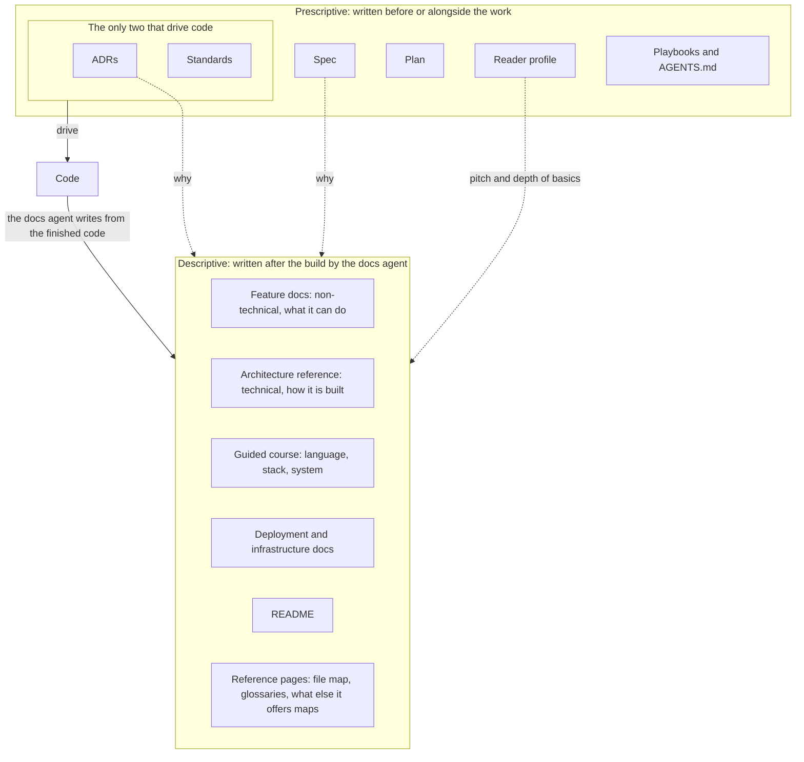
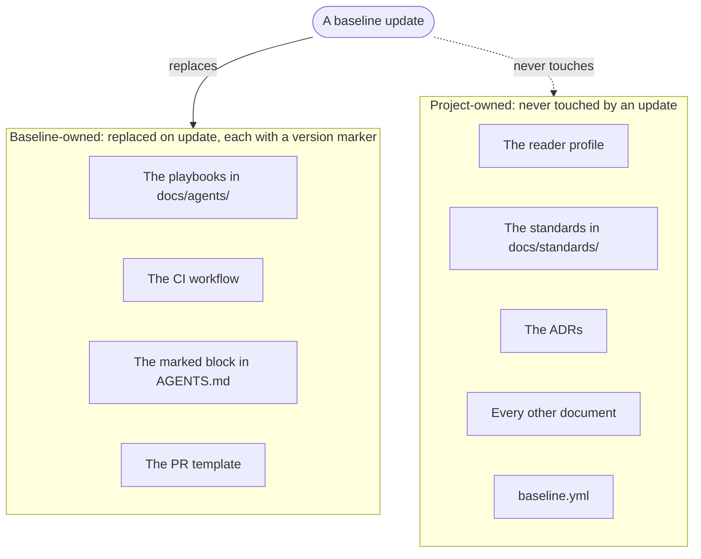
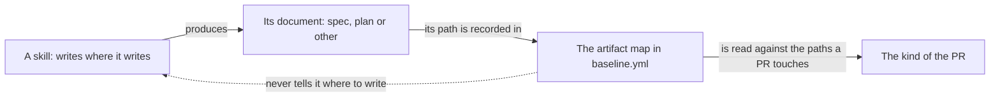

# Project layout

This file says where everything lives in a project. It sorts the documents by when they are written, gives the folder layout, describes `baseline.yml`, the project's configuration of the baseline, says which files belong to the baseline and which to the project, and so what an update may touch, and ends with the artifact map, the part of `baseline.yml` that records where skills write their documents. [01-why-and-scope.md](01-why-and-scope.md) says why the baseline exists, [02-vocabulary.md](02-vocabulary.md) defines the terms used here, [03-stack-model.md](03-stack-model.md) sets the rules of the stack, and [04-reader-profile.md](04-reader-profile.md) describes the reader profile, one file of the layout. The playbook [docs-agent.md](../docs/agents/docs-agent.md) lists where each document lives from the docs agent's side.

A few words appear here before the standard defines them in full. A **prescriptive document** says what will be built or how work is done, and it is written before or alongside the work. A **descriptive document** says only what exists at the tip of the code, the **tip** being the last commit of a stack, and it is written after the build by the **docs agent**, a fresh agent that works from the finished code. Work is delivered as a **stack** of pull requests (PRs), an ordered series in which each PR is based on the one below it and merged from the bottom up. A stack holds three kinds of PR: a **thinking PR** holds the prescriptive documents, a **code PR** holds code and tests, and a **description PR** holds the descriptive documents. A **skill** is a packaged set of instructions that an agent follows for one kind of work, and superpowers is a set of skills. The **kit** is the part of the baseline that is copied into a new project. A **stack folder** is a folder of the project's repository that holds the code of one technology stack, such as a front end or a back end, and it is not a stack of PRs. Each rule below is followed by `Because:` and its reason.

## The folder layout

Every project has the layout below, whatever its kind, stack or goal. Because: the baseline is one documentation structure for every project (goal G2 in [01-why-and-scope.md](01-why-and-scope.md)), so what differs between projects is what the documents say, and not where they live.

### The document map

The document map sorts the documents by when they are written, and its lines show what points to what.



*Only the boxed ADRs and standards drive the code, and every descriptive document comes after the code, with the dotted lines carrying the why and the pitch into them.*

The prescriptive documents are the spec, the plan, the ADRs (architecture decision records), the standards, the reader profile, the playbooks and `AGENTS.md`. The descriptive documents are the six **doc families**, the groups of descriptive documents that the docs agent writes: the feature docs, the architecture reference, the guided course, the deployment docs, the README and the reference pages.

ADRs and standards are the only documents that drive code, which is why they alone are boxed and have a line to the code. Code is generated with them in mind, and when generated code is wrong, the fix goes to them and not to a patch of the code (`19-standards-mechanism.md`). Three rules follow from the rest of the document map.

**Write the descriptive documents after the build, from the finished code.** Because: a descriptive document says only what exists at the tip of the code, so it can be written only when the code is finished, and the agent that built the code tends to document what it meant, which is why a fresh agent, the docs agent, writes them.

**Take a descriptive document's reasons from the spec and the ADRs, and its pitch from the reader profile.** These are the dotted lines. Because: the code says what exists and cannot say why it is as it is, so the reasons come from the spec and the ADRs, and the levels in the reader profile decide which basics a document explains. The feature docs are the one exception to the pitch, since they are always in plain language (`06-feature-docs.md`).

**Leave the spec and the plan as the skills produced them.** They are produced by skills, so they are not documents of the baseline: the baseline sets no shape for them and records only where they are, in the artifact map below. Because: the skills run untouched (constraint C4 in [01-why-and-scope.md](01-why-and-scope.md)), so what a skill produced stays as the skill produced it.

### The tree

The tree shows where each document lives. A name in angle brackets is a placeholder, `NN` stands for a number that gives a file its place in the order, `NNNN` stands for the number of an ADR, and a folder is listed with the files it holds.

```text
<project>/
  README.md   AGENTS.md   CLAUDE.md   baseline.yml
  docs/
    reader-profile.md
    features/        README.md, access.md, glossary.md, <feature>.md
    architecture/    README.md (generated index), NN-<area>.md
    course/
      README.md               (generated index of the course)
      languages/<language>/   README.md (what else it offers), NN-<lesson>.md
      stacks/<stack>/         README.md (what else it offers), NN-<lesson>.md
      system/                 NN-<flow-or-concern>.md
      reference/              file-map.md, glossary.md  (generated)
    adr/             draft-<slug>.md -> NNNN-<slug>.md, README.md (generated index)
    deploy/          README.md, NN-<area>.md
    standards/       (only if opted in) README.md, <topic>.md
    agents/          baseline-owned playbooks
    superpowers/     specs/ and plans/  (tool-owned, untouched)
  <stack folders>/   code, each with its own README.md and AGENTS.md
```

The root, `<project>/`, is the project's repository: one repository for each project, with no exceptions. Because: a stack cannot span repositories, and in one repository an agent sees the whole product (constraint C1 in [01-why-and-scope.md](01-why-and-scope.md)). Anything that must be published separately, an SDK for example, is a folder of that repository that CI publishes as a package.

### What each part holds

| Path | What it holds | Where the standard says more |
|---|---|---|
| `README.md` | The front door of the repository: a new developer's first hour. | `13-project-readme.md` |
| `AGENTS.md` | The short instruction file, and the primary instruction for working in the repository. It names the Software Engineer, gives the core rules with their reasons and points to the playbooks. A marked block of it is baseline-owned. | `15-agents-md-and-playbooks.md` |
| `CLAUDE.md` | A two-line pointer to `AGENTS.md`. | `15-agents-md-and-playbooks.md` |
| `baseline.yml` | The project's baseline configuration. | "baseline.yml" in this file |
| `docs/reader-profile.md` | Who the documents are written for: a machine-readable header with the answers of the intake, the text that explains it and three sections that the docs agent generates. | [04-reader-profile.md](04-reader-profile.md) |
| `docs/features/` | What the product can do, in plain language and with no code or file paths: an overview (`README.md`), the Users and access page (`access.md`), a plain-language glossary (`glossary.md`) and one page for each feature (`<feature>.md`). | `06-feature-docs.md` |
| `docs/architecture/` | How the system is built, as it is now: a generated index (`README.md`) and one file for each area (`NN-<area>.md`). | `07-architecture-reference.md` |
| `docs/course/README.md` | The course index: the generated index of the guided course. | `17-evidence-and-truth.md`, in its rule 9 |
| `docs/course/languages/<language>/` and `docs/course/stacks/<stack>/` | The lessons of the guided course for one language or one technology stack (`NN-<lesson>.md`), and a `README.md` that is the "what else it offers" map, a short page that shows the boundary of the course. | `08-course-lessons.md` for the lessons, `10-course-reference-pages.md` for the map |
| `docs/course/system/` | The system chapters of the guided course: one for each end-to-end flow and one for each concern that cuts across the stacks (`NN-<flow-or-concern>.md`). | `09-course-system-chapters.md` |
| `docs/course/reference/` | The file map and the technical glossary, both generated (`file-map.md` and `glossary.md`). | `10-course-reference-pages.md` |
| `docs/adr/` | The ADRs, one file for each decision. A draft is named `draft-<slug>.md` until the docs agent numbers it as `NNNN-<slug>.md`, and `README.md` is a generated index. | `11-adrs.md` |
| `docs/deploy/` | How the system runs in the real world: a `README.md` and one file for each area (`NN-<area>.md`). | `12-deployment-docs.md` |
| `docs/standards/` | The project's standards, only if the project opted in: a `README.md` that explains how the folder fills, and one file for each topic (`<topic>.md`). | `19-standards-mechanism.md` |
| `docs/agents/` | The playbooks, which are baseline-owned. | `15-agents-md-and-playbooks.md` |
| `docs/superpowers/` | The specs and plans that the superpowers skills write (`specs/` and `plans/`), tool-owned and left untouched. | `21-skills-seams.md` |
| `<stack folders>/` | The code: one folder for each technology stack, each with its own `README.md` and `AGENTS.md`. | `13-project-readme.md` for the README, `15-agents-md-and-playbooks.md` for `AGENTS.md` |

The descriptive documents are the README, the stack folders' READMEs and everything under `docs/features/`, `docs/architecture/`, `docs/course/` and `docs/deploy/`. The prescriptive documents are the reader profile, `AGENTS.md`, the stack folders' `AGENTS.md` files, the ADRs, the standards, the playbooks, and the specs and plans under `docs/superpowers/`.

**Do not edit a generated file by hand.** The tree marks the generated files: the course index, the index of the architecture reference, the index of the ADRs, and the file map and the glossary under `docs/course/reference/`. Because: a file that every PR in a stack edits conflicts at every rebase of the stack, so indexes are generated and never hand-edited (anti-goal A7 in [01-why-and-scope.md](01-why-and-scope.md)). In a repository whose generators do not exist yet (only the baseline's own, during its first stacks), the docs agent writes the indexes in the format the generators will produce, as the single writer of its stack (`17-evidence-and-truth.md`). That file names the indexes in its rule 9.

**Create `docs/standards/` only if the project opted in.** The intake asks once whether to build standards from the Software Engineer's preferences over time, and a no means there is no folder. An agent does not create the folder itself. Because: the answer is part of the reader profile, and changing the reader profile is the Software Engineer's call.

**Leave `docs/superpowers/` as the skills wrote it.** It is where the superpowers skills write by default, and it is the default of the artifact map. A project that uses another tool has that tool's folder instead. Because: the skills run untouched, so the baseline never tells a skill where to write and never edits what a skill produced (constraint C4 in [01-why-and-scope.md](01-why-and-scope.md)).

**Keep a stack folder's `AGENTS.md` short, with the commands and the layout of that stack, and fill it in when the stack is introduced. Put coding preferences in `docs/standards/` and not there.** Because: a standard records its reason, scope, date and source, and its scope can be one stack folder, so a preference for one stack still has its home in `docs/standards/` (`19-standards-mechanism.md`).

## baseline.yml

`baseline.yml` is the project's baseline configuration: a YAML file at the root of the repository. The example below is for a made-up project with a front end in `web/` and a back end in `api/`.

```yaml
baseline_version: 0.1.0
standards_enabled: true
artifact_map:
  spec: ["docs/superpowers/specs/**"]
  plan: ["docs/superpowers/plans/**"]
  other: []
# Folders whose changes are code for PR-kind purposes, apart from each folder's own README.md and AGENTS.md
stack_folders: [web, api]
```

It holds at least four keys.

| Key | What it holds | What it is for |
|---|---|---|
| `baseline_version` | The pinned version of the baseline that the project follows. | The update starts from it: it reads the pinned version, compares the owned files with their pristine copies, the files as the baseline shipped them, and runs the migrations that each release ships for the versions in between (`22-tooling-requirements.md`). The update's code group then moves it to the new version. |
| `artifact_map` | The paths where skills write their documents, in three lists: `spec`, `plan` and `other`. | The kind of a PR is inferred from the paths it touches, and the map says which paths are the skills' ("The artifact map" below). |
| `stack_folders` | The folders of the repository that hold the project's code, one for each technology stack. | The kind of a PR is inferred from the paths it touches, and the stack folders are the folders whose changes are code, apart from a stack folder's own `README.md`, a description path, and its own `AGENTS.md`, a thinking path ([03-stack-model.md](03-stack-model.md)). |
| `standards_enabled` | `true` if the project builds standards from the Software Engineer's preferences over time, otherwise `false`. | It records the intake's answer to its one question about standards, which the header of the reader profile records too ([04-reader-profile.md](04-reader-profile.md)). Neither record wins over the other, because both record that one answer, and how a difference between them is reported is for the tooling's design to settle. |

A path such as `docs/superpowers/specs/**` runs from the root of the repository and ends in `**`, which stands for everything below that folder. `stack_folders` lists the folders themselves, with no pattern. The baseline's own repository is a real example of the format: [baseline.yml](../baseline.yml). A change to `baseline.yml` is a code change ([03-stack-model.md](03-stack-model.md) gives the reason).

These four keys are the least that a `baseline.yml` holds. Because: the standard fixes only what the tooling must do and leaves how the tooling is built to the tooling, so the tooling may add keys of its own.

## Baseline-owned and project-owned files

Every file that the kit copies into a project is either baseline-owned or project-owned. A **baseline-owned file** carries a marker with the baseline version and is replaced on update. A **project-owned file** is never touched by an update.



*An update reaches only the baseline-owned files: the solid arrow replaces them, and the dotted arrow stops at the project-owned files, which include the standards and `baseline.yml`.*

| Ownership | Which files | What an update does |
|---|---|---|
| Baseline-owned | The playbooks (`docs/agents/`), the CI workflow, a marked block in `AGENTS.md` and the PR template. Each carries a marker with the baseline version. | Replaces them. |
| Project-owned | The reader profile, the standards, the ADRs and every other document, and the project's own configuration, `baseline.yml`. | Never touches them. |

### What an update may touch

**An update replaces baseline-owned files and never touches project-owned files.** Because: an update that could replace what the project wrote would erase it, so the split fixes in advance which files an update may replace and which it may not, and that is what makes an update safe and testable.

**The update itself never touches a project-owned file, and the stack that it opens carries two changes to project-owned things, each in a PR that the Software Engineer reviews like any other.** The code group moves `baseline_version` in `baseline.yml`, and the description PRs, which exist only if the new standard makes existing documents non-compliant, are the docs agent's own change to the project's documents (`22-tooling-requirements.md` has the update flow). Because: that keeps "never touches" true of the update itself, since what the update replaces is baseline-owned only, and the project's own files change only in PRs that the Software Engineer reviews like any other.

**Every baseline-owned file carries a marker with the baseline version.** The standard fixes that the marker exists and names the version, and leaves its form to the tooling. Because: an update compares each owned file with its pristine copy, and the marker tells it which version the file came from.

**Only the marked block of `AGENTS.md` is baseline-owned.** The rest of the file is the project's, and an update leaves it as it is. Because: the marker is what tells an update which lines belong to the baseline, so an update replaces that block and nothing else in the file.

**A project-specific wish lives in `docs/standards/` or in `baseline.yml`, and never in a baseline-owned file.** Because: an update replaces the baseline-owned files, so a wish written in one would be lost at the next update, while the standards and the project's own configuration are the project's, and an update never touches them.

**When a baseline-owned file has been edited in the project, the update shows the edit to the Software Engineer, who decides whether to keep it as an override or to discard it.** Because: a change to a baseline-owned file changes how work is done, and anything that changes how work is done is the Software Engineer's call.

`22-tooling-requirements.md` has the whole update flow.

## The artifact map

The **artifact map** is the `artifact_map` key of `baseline.yml`. It records the paths where skills write their documents, so that the kind of a PR can be inferred from the paths it touches. It has three lists: `spec` holds the paths of the spec, `plan` the paths of the plan, and `other` the paths of any other **kept skill artifact**, a document that a skill produced and that stays in the repository. It defaults to the superpowers paths, `docs/superpowers/specs/**` for the spec and `docs/superpowers/plans/**` for the plan, with `other` empty.

A project that adds a tool adds that tool's paths. This made-up example adds a tool that writes design notes:

```yaml
artifact_map:
  spec: ["docs/superpowers/specs/**"]
  plan: ["docs/superpowers/plans/**"]
  other: ["docs/design-notes/**"]
```



*The path runs from the skill's document into the map and on to the kind of the PR, and the only arrow back to the skill is dotted and says that the map never tells it where to write.*

**The map records where skills write, and it never tells a skill where to write.** Because: the skills run untouched, so the baseline cannot choose where a skill writes. It reads the paths that the skills use and arranges the PRs around them.

**Swapping or adding a tool means editing the map, and never the baseline.** When another skill produces a kept document, record the path it writes to under `other`. When a tool takes over writing the spec or the plan, change the paths under `spec` or `plan`. Because: the map is how the kind of a PR is inferred, so it records where a skill wrote, and the baseline stays the same whichever tools a project uses. [stacks.md](../docs/agents/stacks.md) says how an agent records the path of a new tool.

**A PR that touches a path in the map is a thinking PR.** Because: the kind of a PR is inferred from the paths it touches, so no naming rule is needed, and a path in the map is a skill's spec, plan or other kept artifact, which is thinking ([03-stack-model.md](03-stack-model.md) shows how the kind is decided).

**List kept artifacts only.** A skill's scratch files, such as an execution ledger, briefs and review packages, are git-ignored and never a PR, so they are not in the map. Because: scratch files are working material of a run and not artifacts to keep.

Agents use the map too. The docs agent finds the spec under `spec`, and the plan, which it never reads, under `plan` ([docs-agent.md](../docs/agents/docs-agent.md)). `21-skills-seams.md` lists the seams between the baseline and the skills.
