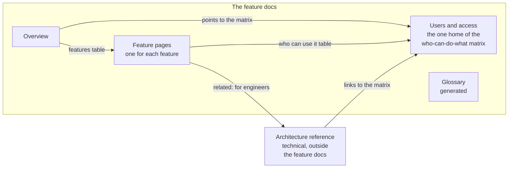
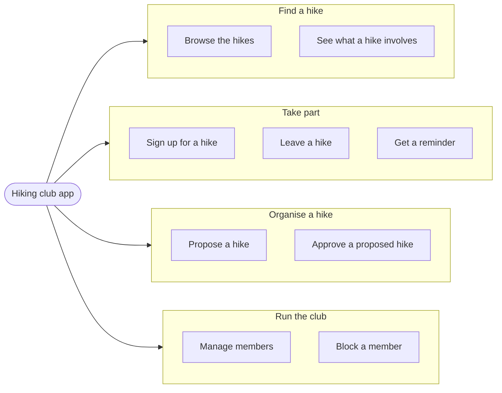
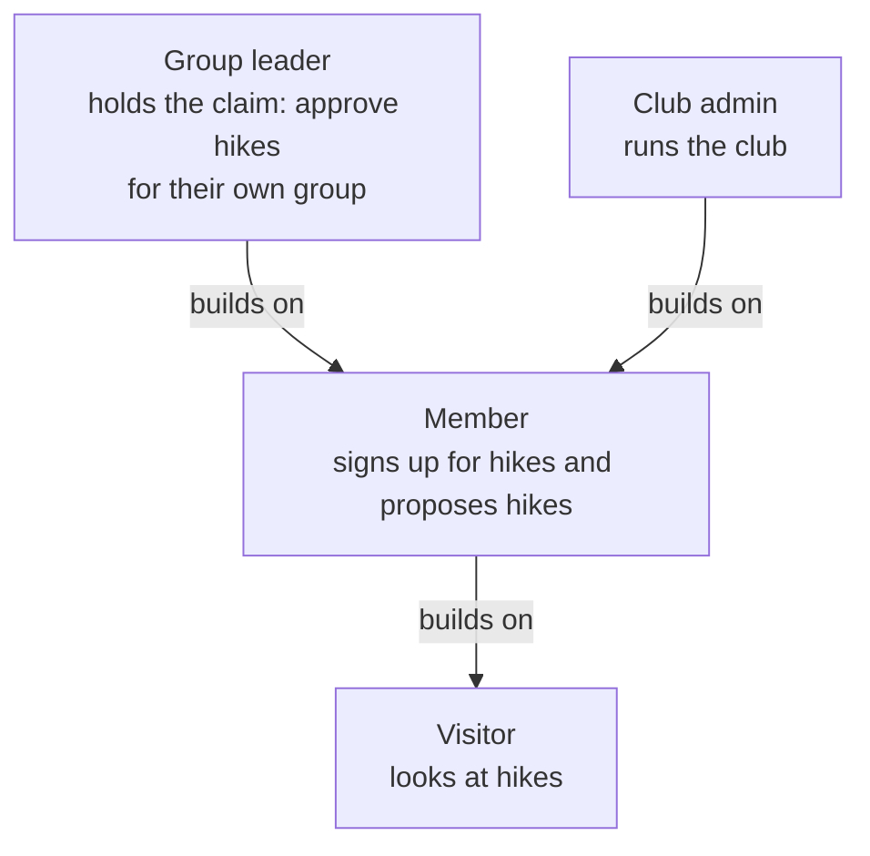
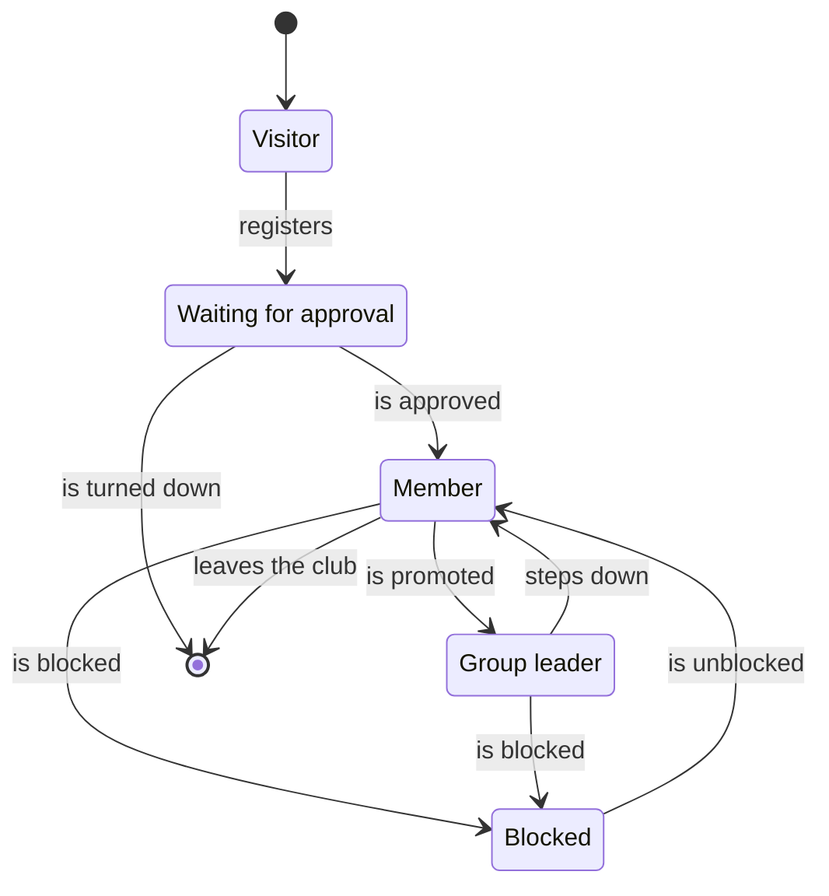
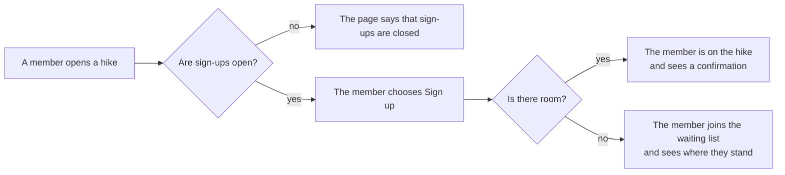
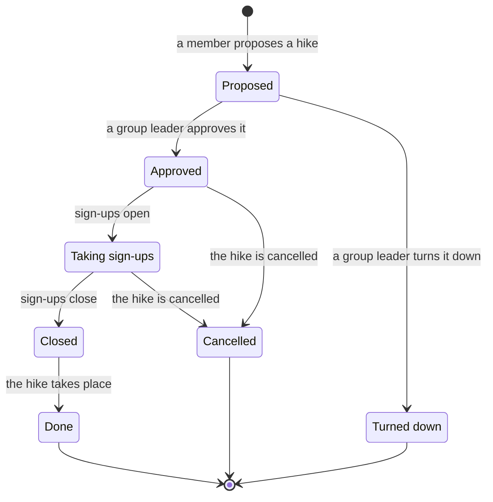
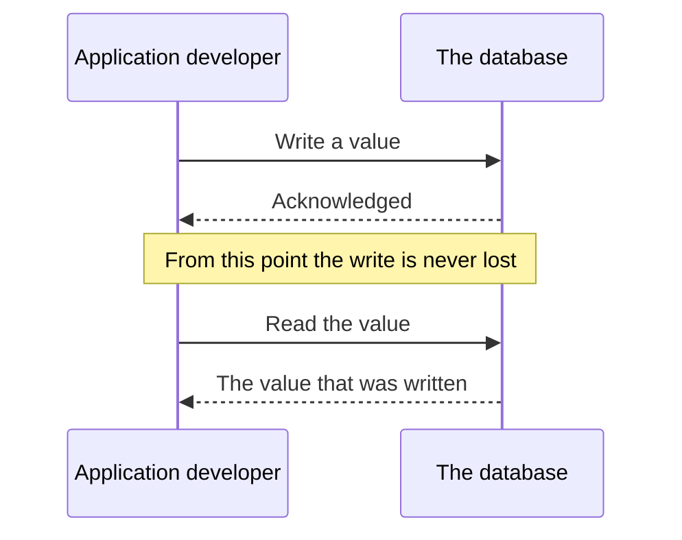

# Feature docs

This file sets the standard for the feature docs, the non-technical document of a project: what the application can do, from the point of view of whoever interacts with it. It says who the feature docs are for, what the folder holds, what the overview page, the Users and access page and each feature page contain, how a system with no screen is described and what evidence the docs agent captures from the running system. [01-why-and-scope.md](01-why-and-scope.md) says why the baseline exists, [02-vocabulary.md](02-vocabulary.md) defines the terms used here, [03-stack-model.md](03-stack-model.md) sets the rules of the stack, [04-reader-profile.md](04-reader-profile.md) describes the reader profile and [05-project-layout.md](05-project-layout.md) says where the feature docs live. The technical counterpart of the feature docs is the architecture reference (`07-architecture-reference.md`), and the playbook [docs-agent.md](../docs/agents/docs-agent.md) says how the docs agent writes both.

A few words appear here before the standard defines them in full. The **docs agent** is a fresh agent, started from the finished code, that writes the descriptive documents, the ones that say only what exists at the **tip**, the last commit of a stack. Work is delivered as a **stack** of pull requests (PRs), an ordered series in which each PR is based on the one below it and merged from the bottom up. A stack holds three kinds of PR: a **thinking PR** holds the prescriptive documents, the ones that say what will be built or how work is done, a **code PR** holds code and tests, and a **description PR** holds the descriptive documents, so the docs agent's feature docs go in description PRs. The **docs section** is the group of description PRs at the top of the stack. [03-stack-model.md](03-stack-model.md) explains the stack and its three kinds in full. Each rule below is followed by `Because:` and its reason.

## Purpose and audience

The feature docs are the **non-technical** document of a project: what the application can do, from the point of view of whoever interacts with it. They describe only what is built, and they contain no code and no file paths. They are a folder, `docs/features/`, that the docs agent writes from the running system, with evidence captured from it: screenshots for screens and interaction transcripts for things with no screen.

The readers are non-technical readers in and around the company, such as the team, product, investors, support and partners, and engineers who want the "what" before the "how". The feature docs are not a customer help centre.

**Write the feature docs in plain language, whatever the reader profile says.** Because: they are written for non-technical readers and for engineers who want the "what" before the "how", so a level in a technology does not apply to them, and the reader profile never affects them ([04-reader-profile.md](04-reader-profile.md)).

**Put no code and no file paths in the feature docs.** Because: they are the non-technical half of a project's documents and the architecture reference is the technical half, so a reader who wants the "what" does not meet the "how" until a page points to the architecture reference for it.

**Describe only what is built.** Because: a descriptive document says only what exists at the tip, so plans and "coming later" live in the spec and the plan and never in the feature docs.

**Let the docs agent write the feature docs, from the finished tip and from the running system.** Because: the agent that built the code tends to document what it meant and cannot tell when the code does not say it, and output is captured by running the system and never written from memory. The docs agent writes the feature docs in the reference PR, the first description PR of the docs section, with the other reference documents. In a later stack it extends the feature docs with what that stack added and updates the pages that the new code makes untrue or incomplete ([docs-agent.md](../docs/agents/docs-agent.md)).

### What the folder holds

The folder holds four kinds of page. The table gives each one's place in a project ([05-project-layout.md](05-project-layout.md)) and where this file says more about it.

| Page | Where it lives | What it holds | Where this file says more |
|---|---|---|---|
| Overview | `docs/features/README.md` | What the product is and who uses it, a map of what it can do and a table of its features. | "The overview page" |
| Users and access | `docs/features/access.md` | Who can do what: the kinds of user, the roles, the conditions that change rights, how access is gained, changed and lost, and the who-can-do-what matrix. | "The Users and access page" |
| Glossary | `docs/features/glossary.md` | The plain-language glossary of the product's terms. It is a generated reference page, so it is never edited by hand (`10-course-reference-pages.md` says how it is produced). | "Evidence" |
| One page for each feature | `docs/features/<feature>.md` | What one feature is, who can use it, what a person can do, its journeys, its rules, what happens when things go wrong, its limits today and what is related. | "Each feature page" |

The diagram shows how the pages point to each other, and where the who-can-do-what matrix lives.



*Three arrows end on the Users and access page, and the one thing to notice is that it is the only page marked as the home of the who-can-do-what matrix.*

### The diagrams the feature docs require

Three kinds of page carry required diagrams. Each is described where its page is described, and the table lists them in one place. The baseline's rules for diagrams apply to every one of them: a caption that says what the diagram shows and the one thing to notice, and labels that use the project's glossary terms (`16-diagrams.md`).

| Page | Required diagrams | Where this file says more |
|---|---|---|
| Overview | The capability map. | "The overview page" |
| Users and access | How roles relate, the access state diagram and the access journeys. | "The Users and access page" |
| Each feature page | At least two: a journey, and a state or flow diagram. | "Each feature page" |

## The overview page

The overview page is the front of the folder, `docs/features/README.md`. It tells a reader what the product is, shows everything it can do on one map, lists the features with a link to each and sends the reader to the Users and access page for who can do what. The examples in this file use a made-up app for a hiking club, in which members propose hikes and sign up for them, group leaders approve proposed hikes and an admin runs the club. The table gives the five parts of the overview page, in order, with the reason for each.

| Part | What it holds | Because |
|---|---|---|
| What the product is and who uses it | A statement, in plain words, of what the product is and of the people and other users who use it. | Every other page describes one part of the product, so this is the page that says what the whole product is and who it is for. |
| A capability map | A diagram that groups everything the product can do by what people are trying to achieve. | A map answers at a glance what a table of features cannot show as well: how all the capabilities fall under what people want to do. |
| A table of the features | One row for each feature: the feature, who it is for and a link to its page. | It is the way into the feature pages: a reader who knows what they want to do finds the page and sees whether it is for them. |
| The who-can-do-what matrix | A pointer to the matrix, which lives only on the Users and access page. The overview holds no copy of it. | Roles apply to every feature, so one page prevents repetition, and the matrix is held on that page. |
| Pointers to the access page | Links to the Users and access page for the kinds of user, the roles and claims, and how access is gained, changed and lost. | Roles apply to every feature, so the overview sends the reader to the one page that holds them. |

**Group the capability map by what people are trying to achieve, and not by how the product is built.** Because: the feature docs explain the system from the point of view of whoever interacts with it, so the map is drawn in the goals of those people.

**Show everything the product can do on the map.** Because: the map is a reader's picture of the whole product, so a capability left off it is one that a reader who starts here does not find.

The capability map of the made-up hiking club app:



*The map groups what the app can do under four goals, and the one thing to notice is that each group is named for what a person wants to achieve, such as Take part, and not for a screen or a module.*

The table of features of the same app has one row for each feature. In a real page the last column is a link to the feature's page.

| Feature | Who it is for | Page |
|---|---|---|
| Hikes | Anyone who wants to find a hike, and members who propose one | The Hikes page |
| Sign-ups | Members | The Sign-ups page |
| Approvals | Group leaders and the club admin | The Approvals page |
| Reminders | Members, and the reminder service that sends them | The Reminders page |

## The Users and access page

The Users and access page is `docs/features/access.md`. It holds everything about who can do what, once, for the whole product.

**Keep the roles, the claims and the conditions on this page, and let the feature pages name them and link here.** Because: roles apply to every feature, so one page prevents repetition.

The page has six parts, and a subsection below takes each in turn.

### The kinds of user

A **principal** is whoever or whatever can act in the system: a person, a service, a device or an agent. The page describes the kinds of user as principals. The word is the standard's own term for the model, and the page itself stays in plain language like every other page of the feature docs, so it can say "kinds of user" and name each one.

**Describe the kinds of user as principals.** Because: that way the page also covers users who are not people, and they have rights too, for example an agent's tool permissions.

| Kind of principal | An example in the made-up hiking club app |
|---|---|
| A person | A member, a group leader or the club admin. |
| A service | The reminder service, which messages members before a hike. |
| A device | The tablet at the trailhead, which checks members in. |
| An agent | The planning assistant, which may search hikes and draft proposals and may use no other tool: its tool permissions are its rights. |

### The roles and the claims that refine them

A **role** is a named bundle of ability, such as Member. A **claim**, or **permission**, refines a role by saying more exactly what the principals that hold it may do, for example "can approve hikes for their own group".

**Name every role, say what it bundles and list the claims that refine it.** Because: roles apply to every feature, so a feature page can name a role and rely on this page for what the role means.

The first of the page's diagrams shows how the roles relate:



*Each arrow points from a role to the role it builds on, and the one thing to notice is that the group leader differs from a member by a single claim.*

### The conditions that change rights

The same role can do different things in different circumstances. Four conditions change rights, and the page says, in plain words, which of them apply to the product and which rights each one changes. A **tenant** is the group, organisation or customer whose share of the product a thing belongs to.

| Condition | What it changes | An example in the made-up hiking club app |
|---|---|---|
| Status | What a principal may do while it is in a given state. | A blocked member cannot sign up for a hike. |
| Ownership | What a principal may do with a thing that is its own. | Only the member who proposed a hike may change the proposal. |
| Tenant | What a principal may do within one group, organisation or customer. | A group leader approves hikes only for their own group. |
| Time | What a principal may do before or after a moment. | Members can sign up only until sign-ups close. |

**State, in plain words, which conditions change which rights.** Because: the same role can do different things depending on status, ownership, tenant or time, so a right stated without its condition would be wrong whenever a condition applies, and one wrong sentence costs more than a missing one.

### How access is gained, changed and lost

Access is not fixed: a person registers, is approved, is promoted and may be blocked. The page describes the same changes for every kind of principal that the product has.

**Describe how every kind of principal gains, changes and loses access, and draw it as a state diagram.** Because: a state diagram shows, for each state, what can happen next, which the text cannot show as well.

A state identifier in Mermaid cannot contain spaces, so a state that has a plain-language name of several words is declared with `state "Waiting for approval" as Waiting`, and the diagram then shows the plain words. The access state diagram of the made-up hiking club app:



*The diagram shows how a person gains, changes and loses access in the made-up club, and the one thing to notice is that a blocked person comes back only as a Member, never directly as a Group leader.*

### The who-can-do-what matrix

The matrix is a table with one row for each capability and one column for each role or claim. A cell says whether the role or claim can do it, and may say in plain words under which condition.

**Keep the matrix on the Users and access page only, and let the other pages link to it.** Because: roles apply to every feature, so one page prevents repetition, and the matrix lives once, here. The architecture reference links to it and maps each of its rows to the policy that enforces it and the test that proves it (`07-architecture-reference.md`). A feature page carries only its own small table of who can use that feature, and that table links back to this page ("Each feature page").

**Write one row for each capability.** Because: the architecture reference maps each row of the matrix to a policy and a test, so a row has to be one thing that can be enforced and tested.

The matrix of the made-up hiking club app:

| Capability | Visitor | Member | Group leader | Club admin |
|---|---|---|---|---|
| Browse hikes | Yes | Yes | Yes | Yes |
| Sign up for a hike | No | Yes, unless blocked and until sign-ups close | On the same terms as a member | On the same terms as a member |
| Propose a hike | No | Yes | Yes | Yes |
| Change a proposed hike | No | Their own proposals only | Their own proposals only | Any proposal |
| Approve a proposed hike | No | No | Yes, for their own group only (the claim) | Yes |
| Block a member | No | No | No | Yes |

### The diagrams of the page

**Draw three diagrams on the page: how roles relate, the access state diagram and the access journeys.** Because: each answers a question that the text cannot answer as well. The first shows which role builds on which, the second shows what can happen to a principal's access from each state, and the third shows what a person goes through to gain, change or lose access.

The first two are shown above. An access journey is drawn the way a feature journey is, step by step, for one way of gaining, changing or losing access, such as registering and being approved. "Each feature page" shows a journey diagram.

## Each feature page

A feature page is `docs/features/<feature>.md`, one for each feature. It has eight parts, in this order, and the list gives each part with the reason for it.

1. **What it is and why it exists.** Say what the feature is and why it exists, in the user's terms. Because: the feature docs explain the system from the point of view of whoever interacts with it, so a feature is described by what it gives that person and not by how it is built.
2. **Who can use it.** A small table of which roles or claims can do what within this feature, under which conditions, with a link to the Users and access page. Because: roles apply to every feature, so one page prevents repetition: the access page says what each role and claim is, and this table says only what they mean for this feature.
3. **What a person can do.** A list of the capabilities that the feature gives. Because: the feature docs say what the application is capable of, and this list says it for one feature.
4. **Journeys.** Each main journey, step by step, with a journey or flow diagram and with evidence captured from the running system. Because: a journey is how a person reaches a capability, so it shows the feature from the person's side, and the evidence shows that the steps were run and not imagined.
5. **The rules a person experiences.** The limits, statuses and notifications that a person meets, in plain words, with a plain-language state diagram. Because: a status changes what a person can do next, and a state diagram shows from each status what can happen next, which the text cannot show as well.
6. **When things go wrong.** What the person sees in the edge cases, such as being offline, conflicts, duplicates and errors, and what they can do next. Because: a reader needs to know what to expect away from the happy path, and the docs agent reports what the running system does there, not what it should do.
7. **Limits today.** What the feature does not do, stated as fact and never as a plan. Because: a descriptive document says only what exists at the tip, and plans and "coming later" live in the spec and the plan.
8. **Related.** The neighbouring features, and a pointer for engineers to the matching architecture and course pages. Because: the readers include engineers who want the "what" before the "how", and this is where a page hands them on to the "how".

**Keep the eight parts, in this order, on every feature page.** Because: the team reads line by line, so each document has a shape that they can rely on.

**Name, directly under the title of a page, the commit that the page was verified against.** Because: versions are pinned in each document's header, so the reader knows which version of the system the screenshots and transcripts of the page come from.

### The two diagrams of every feature page

**Draw at least two diagrams on every feature page: a journey, and a state or flow diagram.** Part 4 carries the journey and part 5 carries the state diagram. Because: this is the minimum for a feature page in the baseline's rules for diagrams (`16-diagrams.md`), and each diagram answers a question that the text cannot answer as well: the journey, what the person does and sees step by step, and the state diagram, what can happen from each status.

The two diagrams below are for the made-up hiking club app. The first is the journey of the Sign-ups page: it branches twice, and each branch ends in something the person sees.



*The journey of signing up for a hike branches on whether sign-ups are open and on whether there is room, and the one thing to notice is that every branch ends in something the person sees.*

The second is from the Hikes page, where the rules a person experiences include the statuses of a hike, drawn in plain words:



*A hike moves through Proposed, Approved, Taking sign-ups, Closed and Done, and the one thing to notice is that Cancelled can be reached from two statuses while Turned down can be reached only from Proposed.*

### A feature page as a skeleton

This skeleton shows the title, the line that names the verified commit, and the eight parts as headings, in order. The text in square brackets says what each part holds.

```markdown
# Sign up for a hike

*Verified against commit abc1234.*

## What it is and why it exists

[What the feature is and why it exists, in the user's terms.]

## Who can use it

| Who | Can do | Under which conditions |
|---|---|---|
| [A role or a claim] | [What it can do within this feature] | [The conditions, in plain words] |

[A link to the Users and access page.]

## What a person can do

- [One capability on each line.]

## Journeys

[Each main journey, step by step, with a journey or flow diagram and the evidence captured from the running system.]

## The rules a person experiences

[The limits, statuses and notifications, in plain words, with a plain-language state diagram.]

## When things go wrong

[What the person sees in the edge cases, and what they can do next.]

## Limits today

[What the feature does not do, as fact.]

## Related

[The neighbouring features, and a pointer for engineers to the matching architecture and course pages.]
```

### A part that does not apply

**Keep a part that does not apply to a feature, and write one line: `Not applicable: why`.** Because: the reader then sees that the part was considered, and nothing is invented to fill it.

## Systems with no screen

Some systems have no screen: a distributed database, a sync engine, a data pipeline or an agent. They still have users and capabilities, so they still get feature pages with the same eight parts. What changes is who the person is, what a journey is and how a guarantee is said.

**Say who "the person" is.** The person is whoever uses the system, such as an application developer, an operator, a device or an end user. Because: the parts of a feature page ask who can use the feature and what a person can do, and a system with no screen still has users, so the questions keep their meaning once the person is named.

**Write the journeys as interactions.** An interaction is one thing that the person does with the system and what comes back, such as a write, a sync session or an agent run. Part 4 of the feature page describes each main interaction step by step, with a diagram, where a feature with a screen describes a journey. Because: with no screen there is no walk through screens to describe, and an interaction is what the person does and receives.

**State the guarantees in plain words**, for example "a write is never lost once acknowledged". Because: the readers are non-technical, so a guarantee has to be said in words that a reader can rely on without knowing how the system keeps it. The architecture reference holds the technical side: its data section holds the consistency model and its concurrency and failure model section holds the ordering and delivery guarantees and the invariants (`07-architecture-reference.md`).

**Back every guarantee with evidence, or mark it "not verified".** Because: one wrong sentence costs more than a missing one, and a guarantee is a sentence that a reader relies on, so a guarantee that the docs agent could not check says so in a "not verified" note.

In Mermaid, `Note over D,S` puts a note across both participants of a sequence diagram, which is how the diagram below says where the guarantee starts. It shows the interaction of a made-up key-value database, as the messages between the person and the system:



*A system with no screen is drawn as the messages between the person and the system, and the one thing to notice is that the guarantee, said in plain words, begins at the acknowledgement.*

## Evidence

The feature docs are written from the running system, and the evidence is captured from it: a screenshot for a screen and an interaction transcript for a thing with no screen. The evidence belongs with the journeys of part 4 and with whatever a page says about what a person sees or gets back, as in part 6. Because: output is captured by running it and never written from memory, and the docs agent exists to guard "what was built, not what was meant".

### Screenshots

**Capture each screenshot from the running system.** Never mock one up or draw one. Because: a screenshot that was not captured is output written from memory.

**Capture screenshots in dark by default.** Because: the Software Engineer reviews in dark, so a screenshot captured in dark is the one that they read as they review.

What data a screenshot may show is not a rule of the baseline. The baseline sets no privacy policy (non-goal N1 in [01-why-and-scope.md](01-why-and-scope.md)), because privacy policy depends on the project's kind and goal, which the baseline cannot know (constraint C7 in the same file). It is the project's decision, recorded in `docs/standards/` where the project has that folder.

### Interaction transcripts

**For a thing with no screen, capture an interaction transcript from the running system.** A transcript records what the person sent and what the system answered, in order, as it was captured. It is evidence of an interaction and not an excerpt of the project's code: it shows what crossed between the person and the system and nothing of how the system is built. Because: output is captured by running it, and a transcript is the evidence for what has no screen to capture.

**Record the seed, the model and the versions of a transcript that is not deterministic, or mark it illustrative.** The output of an agent run, such as a model's answer, is not deterministic. Because: the reader cannot repeat it without them, and an unmarked sample reads as a promise.

### The evidence rules

**Apply every evidence rule to the feature docs.** `17-evidence-and-truth.md` lists the eleven rules, and each applies to every document that the docs agent writes. Because: the team reads line by line, so one wrong sentence costs more than a missing one. The table has a row for each rule, in the order of that file, and says what the rule asks of the feature docs.

| Evidence rule | What it asks of the feature docs |
|---|---|
| Say only what exists at the tip. | A page says what the feature does today. Its "Limits today" part says what the feature does not do, as fact, and no page holds a plan or a "coming later". |
| Quote code verbatim. | Does not apply: the feature docs contain no code. |
| Capture output by running it. | Every screenshot and every transcript is captured from the running system. |
| Pin the versions in each document's header. | A page names, directly under its title, the commit that it was verified against. |
| Measure performance claims. | A claim about how fast something is has its benchmark in the repository or a cited source. |
| Say what you could not verify, in a "not verified" note. | A journey, an edge case or a guarantee that could not be run is named in a "not verified" note on the page. |
| Measure the numbers you quote. | A limit, a count or a time that a page states is measured from the running system and never typed from memory. |
| Record the seed, the model and the versions of output that is not deterministic, or mark it illustrative. | A transcript of an agent run carries them or says that it is illustrative. |
| Never hand-edit a generated index. | The glossary is generated, so no one edits it by hand. |
| Keep a section that does not apply as one line, `Not applicable: why`. | A part of a feature page that does not apply to a feature stays, as one line. |
| In a repository whose generators do not exist yet (only the baseline's own, during its first stacks), write the indexes yourself, in the format that the generators will produce, as the single writer of your stack. | In such a repository, the docs agent writes the glossary in that way. |

**Where there is nothing to run, as in a product made only of Markdown, the written text is the evidence.** Because: nothing can be captured by running it, and the written text is then the only source of what exists.
