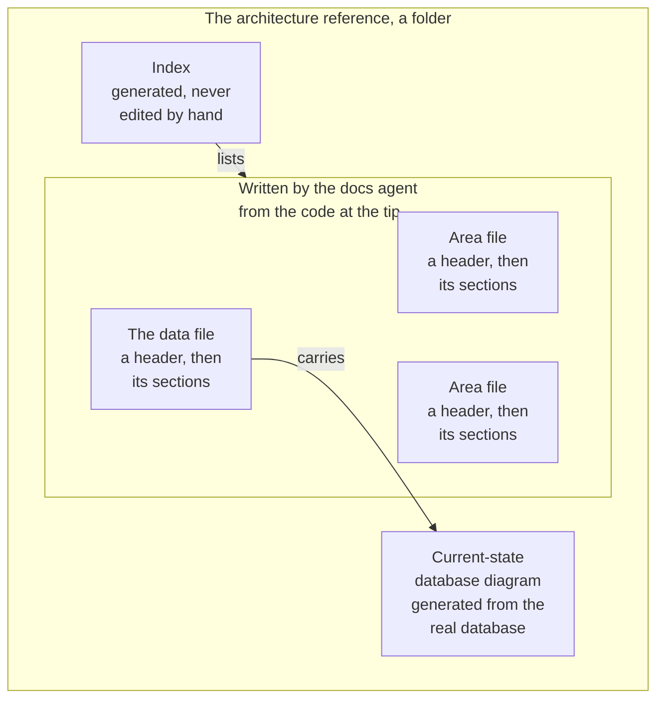
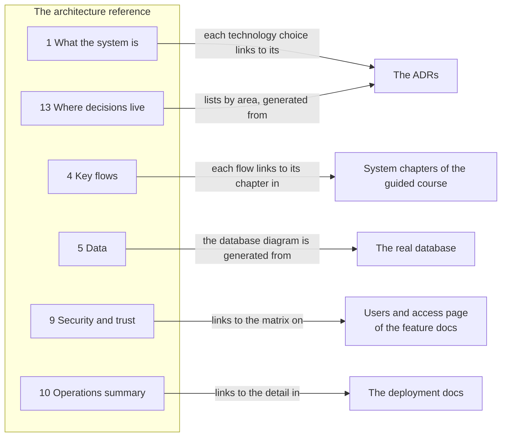
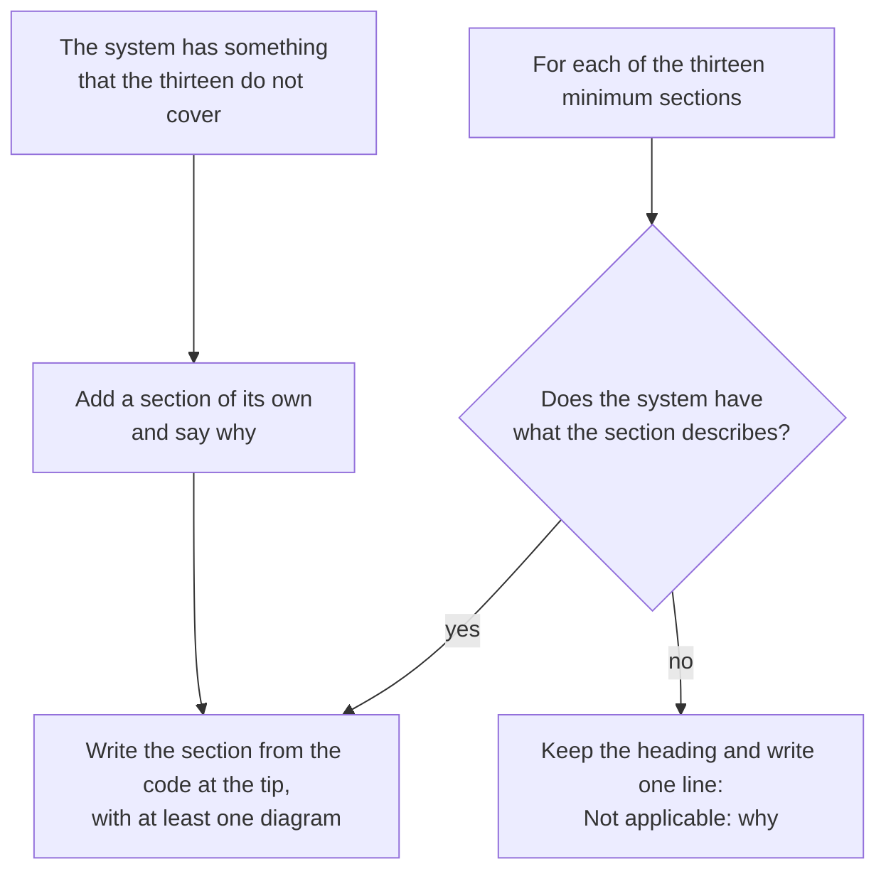

# Architecture reference

This file sets the standard for the architecture reference, the technical document of a project: the system as it is now, with no history and no plans. It says what the reference is and how it is shaped, what the header of each of its files holds, what its thirteen minimum sections are, how the docs agent adds the sections that a system needs and what a section looks like when it does not apply. [01-why-and-scope.md](01-why-and-scope.md) says why the baseline exists, [02-vocabulary.md](02-vocabulary.md) defines the terms used here, [03-stack-model.md](03-stack-model.md) sets the rules of the stack, [04-reader-profile.md](04-reader-profile.md) describes the reader profile that pitches the reference, [05-project-layout.md](05-project-layout.md) says where the reference lives and [06-feature-docs.md](06-feature-docs.md) sets its non-technical counterpart, whose Users and access page holds the matrix that the reference links to. The playbook [docs-agent.md](../docs/agents/docs-agent.md) says how the docs agent writes the reference.

A few words appear here before the standard defines them in full. The **docs agent** is a fresh agent, started from the finished code, that writes the descriptive documents, the ones that say only what exists at the **tip**, the last commit of a stack. Work is delivered as a **stack** of pull requests (PRs), an ordered series in which each PR is based on the one below it and merged from the bottom up. A stack holds three kinds of PR: a **thinking PR** holds the prescriptive documents, the ones that say what will be built or how work is done, a **code PR** holds code and tests, and a **description PR** holds the descriptive documents, so the docs agent's reference goes in description PRs. The **docs section** is the group of description PRs at the top of the stack. An **ADR** is an architecture decision record: one file for one decision, with the options that were explored. A **ruling** is a decision that an agent takes on the Software Engineer's behalf, without stopping to ask, and records as `Ruling: what, why, cost if wrong`. [03-stack-model.md](03-stack-model.md) explains the stack and its three kinds in full. Each rule below is followed by `Because:` and its reason.

## Purpose and shape

The architecture reference is the technical document of a project: the system as it is now, with no history and no plans. It is how an engineer reads what was built and how it fits together. [01-why-and-scope.md](01-why-and-scope.md) names it as what lets the Software Engineer read what was built, and, with the deployment docs and the system chapters of the guided course, as what carries the Solutions Architect's responsibility for how the whole system fits together and fits its purpose. The docs agent writes it from the finished tip, in the reference PR, the first description PR of the docs section. In a later stack it updates the files that the new code makes untrue or incomplete ([docs-agent.md](../docs/agents/docs-agent.md)).

**Describe the system as it is now, and leave out its history and its plans.** Because: a descriptive document says only what exists at the tip, so plans live in the spec and the plan and never in the reference, and the reasons for the shape of the system live in the ADRs, which the reference links to.

**Pitch the reference from the reader profile, and write it at full detail.** Because: the levels in the reader profile decide only which basics a file explains, and the architecture is always fully documented, since humans keep control of code that agents write only if they can understand the system well enough to read it, review it and challenge it ([04-reader-profile.md](04-reader-profile.md); constraint C6 in [01-why-and-scope.md](01-why-and-scope.md)).

**Make the reference a folder, with one file for each area and a generated index.** The folder is `docs/architecture/`: `README.md` is the generated index, and every other file is `NN-<area>.md`, where `NN` is the number that gives the file its place in the order ([05-project-layout.md](05-project-layout.md)). Because: a line-by-line read and a PR review stay manageable. The cost is more files, and an index that is generated.

**Never edit the index by hand.** Because: a file that every PR in a stack edits conflicts at every rebase of the stack, so indexes are generated and never hand-edited (anti-goal A7 in [01-why-and-scope.md](01-why-and-scope.md)). `17-evidence-and-truth.md` gives the rule, and the exception for a repository whose generators do not exist yet.

**Let the docs agent decide the areas, and which of the thirteen minimum sections each file holds, and record the decision as a ruling.** An **area** is a part of the system or a concern that gets a file of its own. The standard fixes the sections and does not fix how they are spread over the files. Because: the areas depend on the system, and the baseline is the same for every kind of project and cannot know them in advance (anti-goal A1 in [01-why-and-scope.md](01-why-and-scope.md)).

**Check every sentence against the code, and apply every evidence rule.** Because: the reference is read line by line, and one wrong sentence costs more than a missing one. A diagram that names a real file, module or class puts the name in backticks, and CI checks that it exists, so that diagrams stay true as the code moves (`16-diagrams.md`).

The diagram shows what the folder holds, and which parts of it are generated and which are written. The data file is the file that holds the data section, and "The thirteen minimum sections" says what it carries.



*The index and the current-state database diagram are generated, and the one thing to notice is that only the area files, grouped in the middle, are written by the docs agent.*

## The file header

Each file of the folder starts with a header that says what the file covers, which commit it was verified against and how long it takes to read. The header is a block of YAML front matter, the convention that [04-reader-profile.md](04-reader-profile.md) explains, so that the three facts are data that a program can read, in the same file as the text that a person reads. An example, for a made-up file:

```yaml
---
scope: "The data model, who owns and writes each piece of data, how the schema evolves and the current-state database diagram."
verified_against: { commit: abc1234 }
reading_time_min: 25
---
```

The header has three keys. **Give every file a header with these three keys.** The last column of the table gives the reason for each.

| Key | What it holds | Because |
|---|---|---|
| `scope` | One or two sentences on what the file covers. | The reference is one file for each area, so a reader and a reviewer need to see at the top what the file is about. |
| `verified_against` | The commit that the file was verified against, as `commit`. | A descriptive document says only what exists at the tip, so the reader needs to know which commit the file was checked against, and versions are pinned in each document's header. |
| `reading_time_min` | The time to read the file, in minutes. | The folder form exists so that a line-by-line read stays manageable, and the reading time tells a reader or a reviewer what they are starting. |

**Update the commit when the file is verified again against a later commit.** Because: the header says which commit the file was verified against, and an older commit would claim a check that was not made.

**Work the reading time out from the length of the file.** Because: the numbers that a document quotes are measured and never typed from memory.

## The thirteen minimum sections

The architecture reference has thirteen minimum sections. The table gives each one's number, name and contents.

| # | Section | Contents |
|---|---|---|
| 1 | What the system is | The purpose in a paragraph, the technology choices each linked to its ADR, and the few quality goals that drive the design. |
| 2 | The big picture | A context diagram (users and external systems) and a container diagram (deployable units, datastores and the protocols between them). |
| 3 | Components | The dependency direction between modules and the rule that keeps it so, a module map, each module's responsibility. |
| 4 | Key flows | A sequence diagram for each major flow, matching the system course's chapters and linked to them. |
| 5 | Data | The data model, who owns and writes each piece of data, how schemas evolve, the data lifecycle, the consistency model. **Includes the current-state database diagram**, which is generated (`16-diagrams.md` has the rules for database diagrams). |
| 6 | State machines | Every status and workflow drawn as a state diagram. |
| 7 | Interfaces and contracts | APIs, events, schemas and wire formats, plus the versioning policy and the error model. |
| 8 | Concurrency and failure model | Threading or async model, ordering and delivery guarantees, idempotency, retries and timeouts, failure modes, the invariants. |
| 9 | Security and trust | A trust-boundary diagram, authentication and authorization (how roles and claims are represented, issued, checked and enforced, with a table from each row of the access matrix to the policy that enforces it and the test that proves it), secrets, data protection. |
| 10 | Operations summary | Logs, metrics, traces and targets, linking to the deployment docs for the detail. |
| 11 | Quality | Performance budgets with measured numbers, and the testing strategy. |
| 12 | Known limits | What the system does not do, and the rough edges found while documenting it. |
| 13 | Where decisions live | The ADRs by area, generated. |

The sections are minimums: a reference may have more ("Adding sections" says how), and it never has fewer.

**Cover all thirteen sections in every architecture reference, whatever the kind of project: write the section, or keep it as one line, `Not applicable: why`.** Because: the reader then sees that each section was considered, and nothing is invented to fill a section that does not apply. The checker verifies the required sections and the minimum number of diagrams of every document type that is present (`22-tooling-requirements.md`).

**Write each section that applies from the code at the tip, and give every architecture file at least one diagram for each such section.** Because: the minimum for an architecture file is one diagram for each section, and each diagram has to answer a question that the text cannot answer as well: the minimum keeps the count high, and the question keeps it honest (`16-diagrams.md`).

### The diagrams that the table names

The table names a diagram for five of the thirteen sections. Every other section draws the diagram that answers a question that its text cannot answer as well, and any section may draw more than one.

| Section | The diagram that the table names |
|---|---|
| 2 The big picture | A context diagram of the users and the external systems, and a container diagram of the deployable units, the datastores and the protocols between them. |
| 4 Key flows | A sequence diagram for each major flow. |
| 5 Data | The current-state database diagram. |
| 6 State machines | A state diagram for every status and every workflow. |
| 9 Security and trust | A trust-boundary diagram. |

### Where the sections link

Six sections reach outside the reference. Five of them point to a document that holds what the reference does not, and the data section is generated from the real database. The diagram shows where each one ends, and the rules and the subsections that follow give the reason for each.



*Six sections reach outside the reference, and the one thing to notice is that the arrow from Security and trust ends on the feature docs' Users and access page, where the matrix lives, so the reference links to the matrix and does not copy it.*

**Link each technology choice in "What the system is" to the ADR that records it.** Because: the code says what exists and cannot say why it is as it is, so the reasons are in the ADRs, which hold the options that were explored ([05-project-layout.md](05-project-layout.md)).

**Match each major flow in "Key flows" to a chapter of the system course, and link to it.** Because: the system course has a chapter for each end-to-end flow (`09-course-system-chapters.md`), so a reader can go from the diagram of a flow to the chapter that teaches it.

**Summarise the operations in "Operations summary", and link to the deployment docs for the detail.** Because: the deployment docs describe how the system runs in the real world (`12-deployment-docs.md`), so the detail has one home and the reference holds the summary.

**Never edit "Where decisions live" by hand.** The table says that it is generated. Because: a generated list is never hand-edited, since a file that every PR in a stack edits conflicts at every rebase of the stack (anti-goal A7 in [01-why-and-scope.md](01-why-and-scope.md)).

### The data section and the current-state database diagram

**Generate the current-state database diagram from the real database, and never draw it by hand.** The file that holds the data section is the data file, and it carries an entity-relationship diagram of the current schema, split by area when the schema is large. CI runs the migrations, reads the schema and renders the diagram, regenerates it on every PR and fails the PR when the committed diagram differs. A store that is not relational follows the same idea, with the diagram built from its schema definitions. The generator is the project's decision, because it depends on the database. Because: a diagram drawn by hand cannot be verified against the schema, while one that CI regenerates on every PR cannot drift from the schema without the PR failing. `16-diagrams.md` has the rules for database diagrams.

### The security section and the access matrix

**Link to the access matrix and never copy it, and map each of its rows to the policy that enforces it and the test that proves it.** Because: the matrix lives only in the feature docs ([06-feature-docs.md](06-feature-docs.md)), and the two views of access, who can do what and how that is enforced, must not drift apart. A table from each row to its policy and its test is how the reference documents enforcement.

The table below is for the made-up hiking club app of [06-feature-docs.md](06-feature-docs.md). In a real reference each cell names the real policy or the real test, in backticks.

| Row of the matrix | The policy that enforces it | The test that proves it |
|---|---|---|
| Approve a proposed hike: a group leader, for their own group only | The check that the leader's group is the hike's group, made before an approval is saved | A test that a leader's approval of another group's hike is refused |
| Sign up for a hike: a member, unless blocked and until sign-ups close | The check of the member's status and of the closing time, made before a sign-up is saved | A test that a blocked member's sign-up is refused, and a test that a sign-up after the closing time is refused |

### Numbers, limits and what could not be verified

**Measure the numbers in "Quality".** The performance budgets carry numbers that were measured, with the benchmark in the repository or a cited source. Because: a performance claim that nobody measured is an unverified claim.

**State what the system does not do as fact, and never as a plan.** "Known limits" holds what the system does not do today and the rough edges found while documenting it. Because: a descriptive document says only what exists at the tip.

**Say what could not be verified, in a "not verified" note.** Because: a statement that nobody ran or measured, and that is not marked "not verified", is a failure even when everything else works.

## Adding sections

The thirteen sections are minimums, and a system may need more. For example, a system may need a consistency model, an agent topology or a protocol specification.

**Add a section for whatever the system has that the thirteen do not cover, and say why, under the heading of the section.** Because: the baseline is the same for every kind of project and cannot know what a system needs, so the thirteen are the least that every reference holds and the system decides the rest (goal G2 and anti-goal A1 in [01-why-and-scope.md](01-why-and-scope.md)). The reason tells the reader what the section is for, and lets a reviewer check that it describes something that the system has, which is all a descriptive document may describe.

**Treat an added section like a minimum section.** It says only what exists at the tip, it has at least one diagram, and the evidence rules apply to it. Because: the minimum for an architecture file is one diagram for each section, and the evidence rules apply to every document that the docs agent writes.

**Do not add a section for something that the system does not have.** Because: a descriptive document says only what exists at the tip, and a section that describes a plan breaks that rule.

## When a section does not apply

A minimum section that does not apply to a system stays in the reference as one line, `Not applicable: why`, where `why` is the reason.

**Keep a section that does not apply, as one line that starts with `Not applicable:` and gives the reason in the rest of the sentence.** The line sits directly under the heading of the section. Because: the reader then sees that the section was considered, and nothing is invented to fill it.

An example, for a made-up command-line tool that keeps nothing between runs:

```markdown
## Data

Not applicable: the tool keeps nothing between runs, so it has no data model, no schema and no consistency model.
```

**Give the reason as a fact about the system as it is.** Because: a descriptive document says only what exists at the tip, so a reason such as "not yet" or "planned for later" is a plan, and plans live in the spec and the plan.

**Let the one line be the whole section.** It has no diagram. Because: the rule leaves the section as one line so that nothing is invented to fill it, and there is nothing to draw for a thing that the system does not have.

**Do not use the line for a section that applies but could not be fully checked.** Write the section, and add a "not verified" note for what could not be checked. Because: `Not applicable` says that the system has nothing of the kind, while "not verified" says that it has and that the claim was not checked, and the two statements are different.

The flow below shows what happens to each minimum section and to a need that no section covers:



*Each minimum section is either written or kept as one line, and the one thing to notice is that an added section joins the written path, with at least one diagram.*
