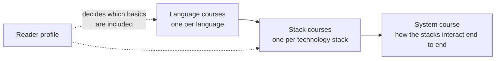
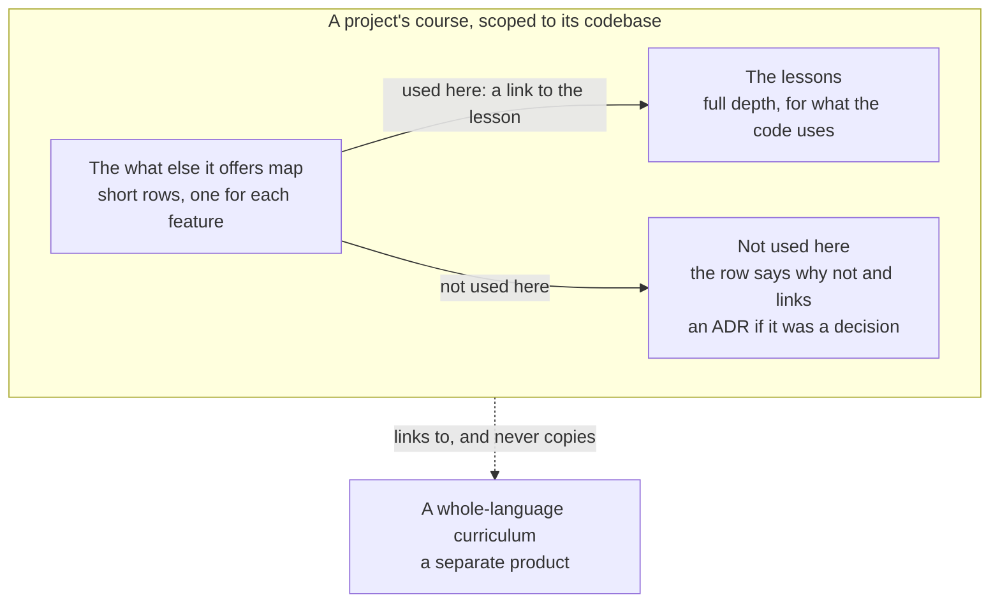
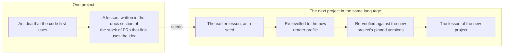
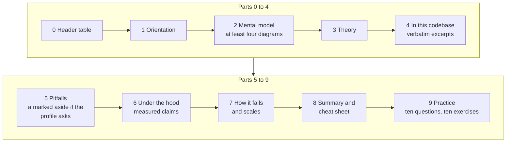
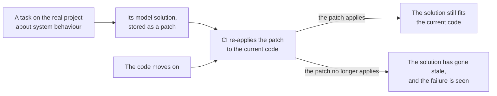

# Course lessons

This file sets the standard for the lessons of the guided course, the part of a project's documents that teaches its codebase to the people who join it. It says what the course is for and how it is built in three tiers, what the course covers and what it leaves to other products, which ten parts every language lesson and every stack lesson has, what the header of a lesson holds and what practice a lesson ends with. [01-why-and-scope.md](01-why-and-scope.md) says why the baseline exists, [02-vocabulary.md](02-vocabulary.md) defines the terms used here, [03-stack-model.md](03-stack-model.md) sets the rules of the stack, [04-reader-profile.md](04-reader-profile.md) describes the reader profile that pitches the lessons, [05-project-layout.md](05-project-layout.md) says where the lessons live, and [06-feature-docs.md](06-feature-docs.md) and [07-architecture-reference.md](07-architecture-reference.md) set the two other descriptive documents that the course sits beside. The third tier, the system chapters, is set in `09-course-system-chapters.md`, and the three reference pages in `10-course-reference-pages.md`. The playbook [docs-agent.md](../docs/agents/docs-agent.md) says how the docs agent writes the course.

A few words appear here before the standard defines them in full. The **docs agent** is a fresh agent, started from the finished code, that writes the descriptive documents, the ones that say only what exists at the **tip**, the last commit of a stack. Work is delivered as a **stack** of pull requests (PRs), an ordered series in which each PR is based on the one below it and merged from the bottom up. A stack holds three kinds of PR: a **thinking PR** holds the prescriptive documents, the ones that say what will be built or how work is done, a **code PR** holds code and tests, and a **description PR** holds the descriptive documents, so the docs agent's lessons go in description PRs. The **docs section** is the group of description PRs at the top of the stack. An **ADR** is an architecture decision record: one file for one decision, with the options that were explored. [03-stack-model.md](03-stack-model.md) explains the stack and its three kinds in full.

The word stack has a second use that the course needs. A **technology stack** is one part of a system, such as a front end or a back end, and its code lives in a **stack folder** of the repository. It is not a stack of PRs. This file says "stack of PRs" for the first and "technology stack" for the second, and the second tier of the course, the stack lessons, teaches a technology stack. A **technology** is a language or a framework that a project uses. Each rule below is followed by `Because:` and its reason.

## Purpose

The guided course is as important as the architecture reference. Its purpose is to build engineers and systems thinkers: people who think critically and technically, and not people who only use a language. Its first two tiers are made of lessons, one course for each language and one for each technology stack, and they teach the codebase of a project to the people who join it.

**Write every lesson to build an engineer and a systems thinker, and not a user of a language.** Because: the people who join a project later vary in skill and number, and making the people around them better is the Distinguished Engineer's responsibility, for which the guided course is what the baseline gives the Software Engineer: the course is how the codebase teaches them (goal G4 and "The why" in [01-why-and-scope.md](01-why-and-scope.md)).

**Let the docs agent write the lessons, from the finished tip, in the docs section.** A lesson is a descriptive document, so it says only what exists at the tip: it teaches the ideas that the code uses, and plans and "coming later" live in the spec and the plan and never in the course. Because: the agent that built the code tends to document what it meant and cannot tell when the code does not say it, and a descriptive document that says what was meant instead of what exists is a failure even when everything else works ([docs-agent.md](../docs/agents/docs-agent.md)).

**Write every lesson at full detail.** Because: detail is always at its maximum and there is no length budget on documents, since humans keep control of code that agents write only if they can understand the system well enough to read it, review it and challenge it (constraint C6 in [01-why-and-scope.md](01-why-and-scope.md)).

## The three tiers

The course has three tiers: one course for each language that the code uses, one for each technology stack, and one for how the stacks work together end to end. The table says where each tier lives and which description PR holds it ([05-project-layout.md](05-project-layout.md) has the whole layout, and [docs-agent.md](../docs/agents/docs-agent.md) the order of the PRs).

| Tier | What it is | Where it lives | The description PR that holds it |
|---|---|---|---|
| Language | One course for each language that the code uses. | `docs/course/languages/<language>/` | The language lessons |
| Stack | One course for each technology stack, such as a front end or a back end. | `docs/course/stacks/<stack>/` | The stack lessons |
| System | One course for how the stacks work together end to end: a chapter for each end-to-end flow and one for each concern that cuts across the stacks. | `docs/course/system/` | The system chapters |

The first two tiers are made of lessons, which have the anatomy that this file sets. The third tier is made of system chapters, which have an anatomy of their own (`09-course-system-chapters.md`). The diagram shows the tiers and, outside them, the reader profile.



*The tiers run from language to technology stack to the whole system, and the one thing to notice is that the reader profile sits outside that chain and reaches the language and stack tiers by dotted arrows that say it decides which basics are included.*

**Write the course in three tiers, and write the tiers in this order: language, then stack, then system.** Because: the course is a guided course in three tiers that builds engineers and systems thinkers (goal G4 in [01-why-and-scope.md](01-why-and-scope.md)), and the docs section is written in reading order from foundational to integrated, so that a reader moves from the foundation to the integrated whole (rule 7 in [03-stack-model.md](03-stack-model.md)).

**Let the reader profile decide how much basic material a lesson includes, and never how deep the lesson goes.** The **reader profile** is the project's record of who its documents are written for, with a level for each technology and each knowledge area. For a beginner a lesson explains from the first line of syntax, for an average reader it skips basic syntax and constructs such as loops and variables and still explains idioms, conventions and sharp edges, and for an advanced reader it explains only what is specific to the project or non-obvious ([04-reader-profile.md](04-reader-profile.md)). Because: the levels decide only which basics get explained, and the reader's level shapes the documents only, so it never reduces the depth of a lesson or what was built.

**Write a technology's lessons only when the reader profile has an entry for it.** When a technology has no entry, the docs agent stops writing that technology's course and asks the Software Engineer, and it carries on with everything that does not need the answer ([04-reader-profile.md](04-reader-profile.md)). Because: without an entry the docs agent cannot know how much of the technology the reader already knows, and a guessed level either repeats what the reader knows or leaves out what they need. The standard requires the checker to verify, over the whole change of the stack, that every new technology has a reader-profile entry and its course files (`22-tooling-requirements.md`).

## Scope

The course is scoped to the codebase, at full depth. Five rules say what that means.

**Scope the course to the codebase, and teach every language and framework idea that the code uses to the deepest level: the theory, the pitfalls, the practice and what the machine does.** Because: the course builds engineers and systems thinkers and not people who only use a language, and detail is always at its maximum, so what the code uses is taught in full (goal G4 and constraint C6 in [01-why-and-scope.md](01-why-and-scope.md)).

**Write each lesson in the docs section of the stack of PRs that first uses the idea.** In a later stack of PRs, write lessons only for the ideas that the code uses for the first time, and update the lessons that the new code makes untrue or incomplete ([docs-agent.md](../docs/agents/docs-agent.md)). Because: each stack's docs section extends the documents with what that stack added, and a descriptive document says only what exists at the tip, so a lesson on an idea that the code does not use yet would describe something that does not exist.

**Give each language and each technology stack a short "what else it offers" map.** Because: a reader then sees the boundary of the course and why other options were not used. `10-course-reference-pages.md` sets what the map holds, and the diagram shows where it sits beside the lessons.



*The map's rows lead either to a lesson or to a reason, the lessons go to full depth only on what the code uses, and the one thing to notice is that the whole-language curriculum sits outside the course, reached only by a link.*

**Keep a whole-language curriculum a separate product, and link to it from the course; never copy it into the course.** Because: a project's course teaches its own codebase, scoped to what the code uses, so a whole-language curriculum, such as the Software Engineer's `learn-rust` course, is a different product, which a project's course links to (non-goals N4 and N6 in [01-why-and-scope.md](01-why-and-scope.md)).

**Let the lessons of one project seed the next project in that language, and re-level a seed to the new reader profile and re-verify it against the new project's pinned versions before it becomes a lesson of the new project.** Because: the reader profile belongs to a project, and its levels decide which basics a lesson includes, and versions are pinned in each document's header, so a lesson that still named the earlier project's versions would claim a check that was not made.



*A lesson written for one project seeds the next project in that language, and the one thing to notice is that the seed passes through two steps, re-levelling and re-verifying, before it is a lesson of the new project.*

## Lesson anatomy

Every language lesson and every stack lesson has the same ten parts, in this order. The table gives each part's number, name and contents, and its last column says where this file says more: part 0 is the header table, and parts 1 to 9 are the body of the lesson.

| # | Part | Contents | Where this file says more |
|---|---|---|---|
| 0 | Header table | What you will learn, what you should already know, reading time, the files in this codebase it covers, the versions it was verified against, and the terms it introduces. | "The lesson file header" |
| 1 | Orientation | Why this idea matters in this system, where it shows up, and what you will be able to do afterwards. | "Parts 1 to 3" |
| 2 | Mental model | At least four diagrams: the concept, the data or ownership flow, a sequence or state view, and where it sits in this codebase. | "Parts 1 to 3" |
| 3 | Theory | The idea stated precisely with the reasoning behind its design, not just the syntax. The reader profile decides how much basic material is included; the depth never changes. | "Parts 1 to 3" |
| 4 | In this codebase | Verbatim excerpts of the real code, checked by a script, walked through line by line with captured output. | "Part 4" |
| 5 | Pitfalls | The common mistakes, the errors you will actually see and how to read them. When the profile asks for comparisons, a marked "where the analogy breaks" aside goes here. | "Part 5" |
| 6 | Under the hood | What the machine does (memory, scheduling, I/O, the network), with a measurement behind every performance claim. | "Parts 6 and 7" |
| 7 | How it fails and scales | Failure modes, concurrency hazards, scale limits, and what to measure. | "Parts 6 and 7" |
| 8 | Summary and cheat sheet | One page, further reading, and a note on what was verified and what was not. | "Part 8" |
| 9 | Practice | The practice standard below. | "The practice standard" |

### Keeping the parts

**Keep the ten parts, in this order, in every lesson.** Because: the team reads line by line, so each document has a shape that they can rely on, and the docs agent follows the anatomies of the documents ([docs-agent.md](../docs/agents/docs-agent.md)).



*A lesson runs through ten parts, from the header table to the practice, and the one thing to notice is that part 2, the mental model, is marked as the part that holds at least four diagrams.*

### Parts 1 to 3

Part 1 says why the idea matters in this system, where it shows up and what the reader will be able to do afterwards. Part 2 holds at least four diagrams, which is also the minimum for a whole lesson, and part 3 states the idea itself.

The four diagrams of part 2 are the four views in the table.

| View | What it draws |
|---|---|
| The concept | The idea itself. |
| The data or ownership flow | How the data moves, or who owns what. |
| A sequence or state view | What happens in what order, or which states the idea moves through. |
| Where it sits in this codebase | Where the idea shows up in the code of this project. |

**Draw at least four diagrams in part 2, one for each of the four views.** Because: this is the minimum for a lesson in the baseline's rules for diagrams, and each diagram has to answer a question that the text cannot answer as well: the minimum keeps the count high, and the question keeps it honest (`16-diagrams.md`).

**Put the name of a real file, module or class in backticks when a diagram names one.** The standard requires CI to check that it exists. Because: diagrams then stay true as the code moves (`16-diagrams.md`).

**In a lesson about the database, embed the relevant slice of the current-state database diagram, and never draw one by hand.** Because: that diagram is generated from the real database, since CI runs the migrations, reads the schema and renders it, so a slice of it cannot drift from the schema, while a diagram drawn by hand cannot be verified against the schema (`16-diagrams.md`; [07-architecture-reference.md](07-architecture-reference.md) says how the diagram is generated).

**State the idea precisely in part 3, with the reasoning behind its design, and not only its syntax.** Because: the course builds people who think critically and technically, and not people who only use a language.

### Part 4

Part 4 shows the idea at work in the real code.

**Quote the code verbatim, as a captioned excerpt of the file it names that a script checks, and mark a gap as an ellipsis.** Because: a reader can then trust every quoted line, since a script has compared it with the file.

**Walk through each excerpt line by line, with output captured by running the code.** Because: output that nobody ran is an unverified claim.

**Name the standard that shaped the code that an excerpt shows.** Because: standards and ADRs are the only documents that drive code, so a standard may have shaped what an excerpt shows, and a lesson that shows such code says so ([standards.md](../docs/agents/standards.md) and the [README of the standards folder](../docs/standards/README.md) say how the docs agent cites a standard).

### Part 5

Part 5 holds the common mistakes, the errors that the reader will actually see and how to read them. An error message is output, so an error that part 5 quotes is captured by running the code that causes it, as the evidence rule on output asks (`17-evidence-and-truth.md`). This is not a rule of its own.

**Put a comparison with a known stack only in a marked aside, and only when the reader profile names a stack to compare with for the technology.** The aside is marked "Coming from X", where X is the named stack. It says where the analogy breaks, and it never replaces the explanation that is native to the technology. Where the profile says `none` for the technology, the lesson has no aside. Because: the documents teach a technology as it is, so a comparison that replaced the native explanation would leak the analogy into it (anti-goal A5 in [01-why-and-scope.md](01-why-and-scope.md)), while a marked aside sits beside the explanation, says where the analogy fails and can be skipped or deleted ([04-reader-profile.md](04-reader-profile.md)). The code stays idiomatic to the technology either way.

This is one way to write the aside, for a made-up lesson on a Rust idea in a project whose profile says to compare Rust with Go. The text in square brackets says what each paragraph holds.

```markdown
> **Coming from Go.** [What the Go idea is, and what it has in common with this one.]
>
> **Where the analogy breaks.** [How this idea differs, so that the comparison does not mislead.]
```

### Parts 6 and 7

Part 6 says what the machine does: memory, scheduling, I/O and the network. Part 7 says how the idea fails and scales: its failure modes, its concurrency hazards, its scale limits and what to measure.

**Put a measurement behind every performance claim in part 6, and measure the numbers that part 7 quotes for scale limits.** Keep the benchmark in the repository, or cite a source. Because: a performance claim that nobody measured is an unverified claim, a benchmark lets the reader repeat the measurement, and the numbers that a document quotes are measured and never typed from memory.

### Part 8

**Say in part 8 what was verified and what was not, and put whatever could not be verified in a "not verified" note.** Because: a statement that nobody ran or measured and that is not marked "not verified" is a failure, even when everything else works.

### A part that does not apply

**Keep a part that does not apply to a lesson, and write one line: `Not applicable: why`.** Because: the reader then sees that the part was considered, and nothing is invented to fill it. The line gives the reason as a fact about the idea or the code as they are, and a reason such as "not yet" is a plan, which a descriptive document does not hold.

### The evidence rules in a lesson

**Apply every evidence rule to a lesson.** `17-evidence-and-truth.md` lists the eleven rules, and each applies to every document that the docs agent writes. Because: the team reads line by line, so one wrong sentence costs more than a missing one. Several of the rules have a home in the parts: the excerpts of part 4 are verbatim and checked, the output of part 4 and the errors of part 5 are captured by running, the claims and numbers of parts 6 and 7 are measured, and part 8 says what could not be verified. The header pins the versions, as "The lesson file header" says.

## The lesson file header

Part 0 of a lesson is its header table, and the lesson file header is the machine-readable part of that header. It is a block of YAML front matter: the block between two `---` lines at the very start of the file, the convention that [04-reader-profile.md](04-reader-profile.md) explains. Front matter keeps data in the same file as the text, so a program can read the data from the file that a person reads. The file map and the glossaries are produced by reading the `files` and the `terms` of every lesson's header (`10-course-reference-pages.md`), which is why the header is data and not prose. Its six keys are the six things that part 0 lists, each as data. This is the header, with placeholders that the next paragraphs explain.

```yaml
---
learn: "one line"
prerequisites: [lessons/ids]
reading_time_min: 40
files: [path/in/repo, ...]
terms:
  - term: "idempotent"
    definition: "plain definition"
verified_against: { commit: abc1234, versions: { rust: "1.99.1" } }
---
```

The table gives each key, what it holds and what it is for.

| Key | What it holds | What it is for |
|---|---|---|
| `learn` | One line on what the reader will learn from the lesson. | It is the "what you will learn" item of part 0. |
| `prerequisites` | The ids of the lessons that the reader should already know. | It is the "what you should already know" item of part 0. It is not the prerequisites section of the reader profile, which says what a reader must know before the first chapter ([04-reader-profile.md](04-reader-profile.md)). |
| `reading_time_min` | The time to read the lesson, in minutes. | It is the "reading time" item of part 0, and it means what it means in the header of an architecture file ([07-architecture-reference.md](07-architecture-reference.md)). |
| `files` | A list of the paths of the files in this codebase that the lesson covers. | It is the "files in this codebase it covers" item of part 0, and the file map's lesson column comes from it. |
| `terms` | A list with one entry for each term that the lesson introduces: the `term`, and its `definition` in plain words. | It is the "terms it introduces" item of part 0, and the glossaries are assembled from the terms that the lessons declare. |
| `verified_against` | The `commit` that the lesson was verified against, and the `versions` that it was verified against: a map from the name of a technology to its version. | It is the "versions it was verified against" item of part 0. The commit means what it means in the header of an architecture file, and a lesson adds the versions. |

In the example, `[lessons/ids]` stands for a list of the ids of lessons and `[path/in/repo, ...]` for a list of paths of files in the repository. The example mixes two ways of writing YAML. A list in square brackets and a map in braces, as in `prerequisites`, `files` and `verified_against`, are written inline, on one line. `terms` is written in block form, with one `-` for each entry and the entry's two keys beneath it. The text that people read is in quotes, and so is the version. A quoted value is always a string, while YAML reads an unquoted `1.10` as the number 1.1, so a version is written as a string.

**Give every lesson a header with these six keys.** Because: the file map's lesson column comes from each lesson's `files`, and the glossaries are assembled from the terms that each lesson declares in its header, so that no shared file is edited by every PR. A program has to read those keys, so they are data and not prose. Versions are pinned in each document's header as well.

**Update the commit and the versions when the lesson is verified again.** Because: the header says which commit and which versions the lesson was verified against, and older ones would claim a check that was not made.

**Work the reading time out from the length of the lesson.** Because: the numbers that a document quotes are measured and never typed from memory.

The skeleton below shows a lesson file from its first line: the header, the title, the header table and the other nine parts as headings, in order. It is for a made-up lesson of the hiking club app of [06-feature-docs.md](06-feature-docs.md). A placeholder in the header is a name in angle brackets, and the text in square brackets below the header says what each part holds. The layout is an illustration: the parts and their order are what the standard fixes.

```markdown
---
learn: "<one line on what the reader will learn>"
prerequisites: [<the ids of the lessons that the reader should already know>]
reading_time_min: <minutes>
files: [<the paths of the files that the lesson covers>]
terms:
  - term: "<a term that the lesson introduces>"
    definition: "<its definition, in plain words>"
verified_against: { commit: <short commit hash>, versions: { <technology>: "<version>" } }
---

# Making a sign-up safe to repeat

| Item | What it says |
|---|---|
| What you will learn | [The same as learn.] |
| What you should already know | [The same as prerequisites.] |
| Reading time | [The same as reading_time_min.] |
| Files in this codebase | [The same as files.] |
| Versions verified against | [The same as verified_against.] |
| Terms introduced | [The same as terms.] |

## Orientation

[Why the idea matters in this system, where it shows up and what the reader will be able to do afterwards.]

## Mental model

[At least four diagrams: the concept, the data or ownership flow, a sequence or state view, and where the idea sits in this codebase.]

## Theory

[The idea, stated precisely, with the reasoning behind its design.]

## In this codebase

[Verbatim excerpts of the real code, walked through line by line, with captured output.]

## Pitfalls

[The common mistakes, the errors the reader will see and how to read them, and a marked aside if the profile asks for comparisons.]

## Under the hood

[What the machine does, with a measurement behind every performance claim.]

## How it fails and scales

[Failure modes, concurrency hazards, scale limits and what to measure.]

## Summary and cheat sheet

[One page, further reading, and a note on what was verified and what was not.]

## Practice

[Ten theory questions and ten programming exercises.]
```

## The practice standard

Part 9 of every lesson is its practice, and the practice standard sets what it holds: ten theory questions and ten programming exercises. Everything in it is anchored in this codebase: its real code, traces, diagrams and failure modes.

**Anchor every question and every exercise in the codebase of the project.** Because: the course is scoped to what the codebase uses and builds engineers and systems thinkers (goal G4 in [01-why-and-scope.md](01-why-and-scope.md)), so the practice works on the same real code, traces, diagrams and failure modes that the lesson teaches.

**Give every lesson ten theory questions and ten programming exercises, in the mixes below.** Because: the team reads line by line, so each document has a shape that they can rely on.

### The ten theory questions

The ten questions are of four kinds, in the mix of the table.

| Kind | How many | What it asks |
|---|---|---|
| Predict | 3 | The outcome of code and of system behaviour, including "will this compile or run, and why not?". |
| Diagnose | 3 | Given a trace, a log or a diagram, find the cause. |
| Design trade-offs | 2 | Argue a decision against constraints. |
| Systems reasoning | 2 | Scale, failure, ordering, concurrency and invariants. |

**Give each theory question a worked answer that shows the reasoning and names the common wrong answers.** Because: the course builds people who think critically and technically, and not people who only use a language.

A question and its worked answer, for a made-up lesson of the hiking club app, in the form that the standard asks for:

```markdown
**Question 2 (predict).** The back end stores a sign-up only when none exists yet for that member and that hike, and it answers every repeat of the request with the same confirmation. A member's browser sends the same sign-up request twice, because the first answer was slow. How many sign-ups are stored, and what does the member see?

**Worked answer.** One sign-up is stored, and the member sees the same confirmation twice. The second request finds the sign-up that the first one stored, so it stores nothing and answers as the first did. The operation is idempotent: doing it twice leaves the same result as doing it once.

**Common wrong answers.** "Two sign-ups", which treats each request as if it were handled on its own. "An error on the second request", which treats a repeat as a mistake, while here it is answered like the first request.
```

### The ten programming exercises

The ten exercises are three warm-up, four core and three stretch. Some are small isolated drills that fail until they are solved, and each drill names the idea in the codebase that it prepares for. Others are tasks on the real project about system behaviour and not syntax, for example:

- make an operation safe under retries;
- find a race and prove the fix with a test;
- add backpressure;
- survive a dependency outage;
- work out which invariant a change breaks.

**Test the solution of every exercise.** Because: a statement about behaviour that nobody ran and that is not marked "not verified" is an unverified claim (anti-goal A6 in [01-why-and-scope.md](01-why-and-scope.md)), and a tested solution is one that was run.

**Leave to the project what "tested" means for each technology.** It can be a test run, a model-checker run or a recorded evaluation. Because: the baseline is the same for every kind of project and cannot know in advance how a technology is best tested, so what depends on it moves to the project (anti-goal A1 and constraint C7 in [01-why-and-scope.md](01-why-and-scope.md)).

**Store the model solution of a task on the real project as a patch that CI re-applies to the current code.** Because: the solution then cannot silently go stale.



*CI re-applies the model solution of a task on the real project to the current code, and the one thing to notice is that a patch that no longer applies is seen as a failure, so the solution cannot go stale silently.*

### Comparisons in the practice

**In the practice, show a comparison with a known stack only as a marked aside, and only when the reader profile asks for it.** Because: a comparison that replaced the explanation native to the technology would leak the analogy into it (anti-goal A5 in [01-why-and-scope.md](01-why-and-scope.md)), as "Part 5" says.
