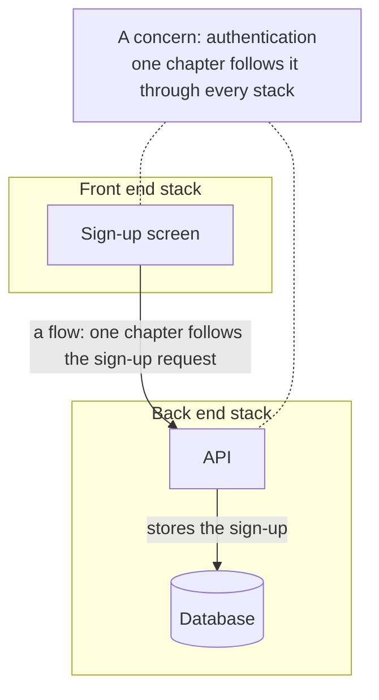
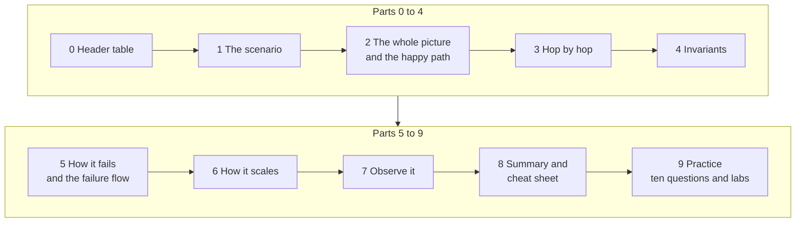
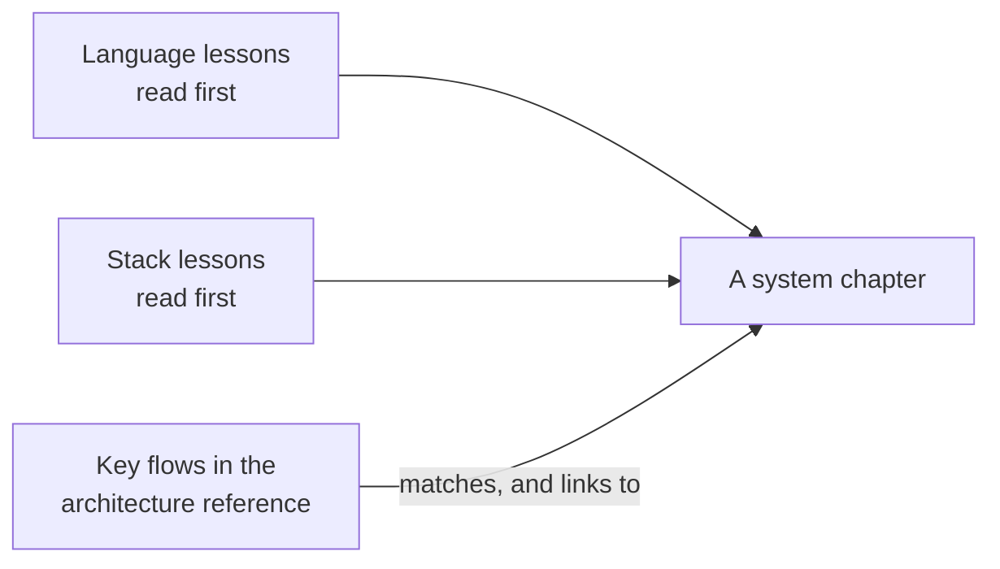
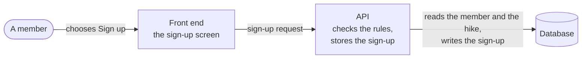
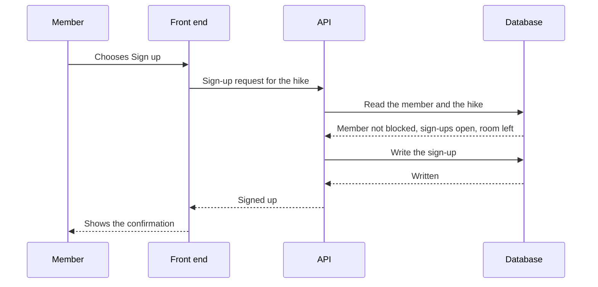
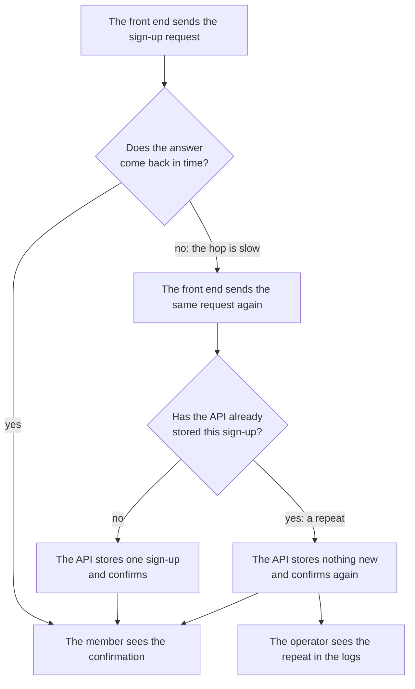

# Course system chapters

This file sets the standard for the system chapters of the guided course, its third tier: one chapter for each end-to-end flow of a system and one for each concern that cuts across its technology stacks. It says what a system chapter is for, which ten parts every chapter has, what the four kinds of lab are and what practice a chapter ends with. [01-why-and-scope.md](01-why-and-scope.md) says why the baseline exists, [02-vocabulary.md](02-vocabulary.md) defines the terms used here, [03-stack-model.md](03-stack-model.md) sets the rules of the stack, [04-reader-profile.md](04-reader-profile.md) describes the reader profile that pitches the course, [05-project-layout.md](05-project-layout.md) says where the chapters live, [07-architecture-reference.md](07-architecture-reference.md) sets the key flows that the chapters match, and [08-course-lessons.md](08-course-lessons.md) sets the first two tiers of the course, the lessons, and the practice standard that the practice of a chapter builds on. The three reference pages are set in `10-course-reference-pages.md`. The playbook [docs-agent.md](../docs/agents/docs-agent.md) says how the docs agent writes the course.

A few words appear here before the standard defines them in full. The **docs agent** is a fresh agent, started from the finished code, that writes the descriptive documents, the ones that say only what exists at the **tip**, the last commit of a stack. Work is delivered as a **stack** of pull requests (PRs), an ordered series in which each PR is based on the one below it and merged from the bottom up. A stack holds three kinds of PR: a **thinking PR** holds the prescriptive documents, the ones that say what will be built or how work is done, a **code PR** holds code and tests, and a **description PR** holds the descriptive documents, so the docs agent's system chapters go in a description PR. The **docs section** is the group of description PRs at the top of the stack. [03-stack-model.md](03-stack-model.md) explains the stack and its three kinds in full.

The word stack has a second use that the course needs. A **technology stack** is one part of a system, such as a front end or a back end, and its code lives in a **stack folder** of the repository. It is not a stack of PRs. This file says "stack of PRs" for the first and "technology stack" for the second, and a system chapter follows a flow or a concern across the technology stacks. Each rule below is followed by `Because:` and its reason.

## Purpose

A system chapter belongs to the third tier of the guided course, the tier for how the technology stacks work together end to end. The language lessons and the stack lessons teach one language or one technology stack each ([08-course-lessons.md](08-course-lessons.md)), and a system chapter takes the whole system as its subject. The system chapters are also what the baseline gives the Software Engineer, with the architecture reference and the deployment docs, to carry the Solutions Architect's responsibility for how the whole system fits together and fits its purpose ([01-why-and-scope.md](01-why-and-scope.md)).

**Write one chapter for each end-to-end flow and one for each cross-cutting concern.** The table says what each is, with examples. Because: the third tier is the course for how the technology stacks work together end to end, and a flow that crosses the technology stacks and a concern that cuts across them are what it teaches.

| Kind of chapter | What it follows | Examples |
|---|---|---|
| An end-to-end flow | One real thing that happens in the system, from where it starts to the last component that it touches. | In the made-up hiking club app of [06-feature-docs.md](06-feature-docs.md), a member signs up for a hike. |
| A cross-cutting concern | Something that cuts across the technology stacks. | Authentication across stacks, data consistency, error handling, the deploy pipeline and security boundaries. |

The diagram shows one flow and one concern in the made-up hiking club app, and where each of them crosses the boundary between two technology stacks.

*A flow and a concern each get one chapter, and the one thing to notice is that both cross the boundary between the front end stack and the back end stack: the flow along an arrow, and the concern by touching both sides.*

**Write a chapter for each major flow that the "Key flows" section of the architecture reference draws.** Because: the system course has a chapter for each end-to-end flow, so a reader can go from the diagram of a flow in the architecture reference to the chapter that teaches it ([07-architecture-reference.md](07-architecture-reference.md)).

**Write the system chapters last in the docs section, after the lessons.** Their files live in `docs/course/system/`, one file for each flow or concern, named `NN-<flow-or-concern>.md` ([05-project-layout.md](05-project-layout.md)). Because: the docs section is written in reading order from foundational to integrated, so that a reader moves from the foundation to the integrated whole (rule 7 in [03-stack-model.md](03-stack-model.md)).

**Let the docs agent write the chapters from the finished tip and from the running system.** A chapter is a descriptive document, so it says only what exists at the tip, and plans and "coming later" live in the spec and the plan and never in the course. Because: the agent that built the code tends to document what it meant and cannot tell when the code does not say it, and output is captured by running the system and never written from memory ([docs-agent.md](../docs/agents/docs-agent.md)).

**Pitch every chapter from the reader profile, and write it at full detail.** Because: the levels in the reader profile decide only which basics a document explains, and detail is always at its maximum, since humans keep control of code that agents write only if they can understand the system well enough to read it, review it and challenge it ([04-reader-profile.md](04-reader-profile.md); constraint C6 in [01-why-and-scope.md](01-why-and-scope.md)).

## System chapter anatomy

Every system chapter has the same ten parts, in this order. The table gives each part's number, name and contents, and its last column says where this file says more: part 0 is the header table, and parts 1 to 9 are the body of the chapter.

| # | Part | Contents | Where this file says more |
|---|---|---|---|
| 0 | Header table | What you will learn, which language and stack lessons to read first, reading time, the files across all stacks it covers, the versions it was verified against. | "Part 0" |
| 1 | The scenario | One real thing that happens, in plain words. | "Parts 1 and 2" |
| 2 | The whole picture | A diagram of every component the scenario touches, then a sequence diagram of the happy path across them. | "Parts 1 and 2" |
| 3 | Hop by hop | For each step between components: the real code on both sides (verbatim, checked), the contract between them (format or schema, versions, timeouts, retries, ordering, idempotency, authentication), and captured real output. | "Part 3" |
| 4 | Invariants | What must always be true across the whole flow, who enforces each, where it is tested. | "Part 4" |
| 5 | How it fails | For every hop: what happens when it is slow, down, duplicated, reordered or lying; what the operator sees in logs, metrics and traces; how it recovers. | "Part 5" |
| 6 | How it scales and what breaks first | The bottleneck, with measured numbers. | "Parts 6 to 8" |
| 7 | Observe it | The commands to run it locally and follow the scenario through logs and traces, with captured output. | "Parts 6 to 8" |
| 8 | Summary and cheat sheet | One page, further reading, what was verified and what was not. | "Parts 6 to 8" |
| 9 | Practice | 10 theory questions weighted toward systems reasoning, plus labs: run it, break it on purpose, trace what happened, fix it, each with a checkable outcome. | "Labs" and "Practice for system chapters" |

### Keeping the parts

**Keep the ten parts, in this order, in every chapter.** Because: the team reads line by line, so each document has a shape that they can rely on, and the docs agent follows the anatomies of the documents ([docs-agent.md](../docs/agents/docs-agent.md)).

*A chapter runs through ten parts, from the header table to the practice, and the one thing to notice is that the three diagrams that every chapter must have are marked on parts 2 and 5.*

### Part 0

Part 0 is the header table of the chapter. It names the language and stack lessons that the reader should read first, the files across all stacks that the chapter covers and the versions that it was verified against, and it gives what the reader will learn and the reading time.

**Name in part 0 the language and stack lessons to read first.** Because: the course runs from the language to the technology stack to the system, so a chapter comes after the lessons that it builds on ([08-course-lessons.md](08-course-lessons.md)).

**Pin in part 0 the versions that the chapter was verified against.** Because: versions are pinned in each document's header, so that the reader knows which versions the document was verified against.

**Work the reading time out from the length of the chapter.** Because: the numbers that a document quotes are measured and never typed from memory.

*A chapter comes after the lessons that it names in part 0, and the one thing to notice is that a key flow of the architecture reference points to its chapter, so a reader can go from the diagram of a flow to the chapter that teaches it.*

### Parts 1 and 2

Part 1 is the scenario: one real thing that happens, in plain words. Part 2 is the whole picture of it, in two diagrams: a diagram of every component that the scenario touches, and then a sequence diagram of the happy path across them. The examples below are for a made-up chapter of the hiking club app, "A member signs up for a hike". Its scenario in plain words: a member opens a hike when sign-ups are open and there is room, chooses Sign up and sees a confirmation. The front end sends the request to the API, the API checks the rules and stores the sign-up in the database, and the confirmation travels back.

**Draw in part 2 a diagram of every component that the scenario touches, and then a sequence diagram of the happy path across them.** Because: these are two of the three diagrams that a system chapter must have in the baseline's rules for diagrams (`16-diagrams.md`), and each has to answer a question that the text cannot answer as well: the minimum keeps the count high, and the question keeps it honest.

The whole picture of the made-up chapter:

*The whole picture names every component that the sign-up scenario touches, and the one thing to notice is that the front end reaches the database only through the API.*

The happy path of the same scenario:

*The happy path runs from the member's choice to the confirmation, and the one thing to notice is that the API reads before it writes, so the rules are checked before anything is stored.*

### Part 3

Part 3 follows the scenario hop by hop. A **hop** is one step of the scenario from one component to another, and the two components are its two sides: the one that sends and the one that receives.

**For every hop, show the real code on both sides as verbatim excerpts that a script checks, state the contract between the two sides, and show captured output.** Because: a reader can then trust every quoted line, since a script has compared it with the file, and output that nobody ran is an unverified claim. The contracts between the parts are among what the Solutions Architect owns, and the system chapters are among what the baseline gives the Software Engineer to carry that responsibility ([01-why-and-scope.md](01-why-and-scope.md)).

The contract covers seven things, which the table says in plain words.

| The contract covers | What it settles between the two sides |
|---|---|
| Format or schema | What a message looks like when it crosses the hop. |
| Versions | Which version of the format each side speaks. |
| Timeouts | How long the sender waits before it gives up. |
| Retries | Whether the sender tries again, and how. |
| Ordering | Whether the order of the messages matters, and what keeps it. |
| Idempotency | Whether a message that arrives twice changes anything the second time. |
| Authentication | How the receiver knows who the sender is. |

### Part 4

Part 4 holds the invariants: what must always be true across the whole flow, who enforces each and where it is tested. The table is part 4 of the made-up chapter, as an example of the form.

| Invariant | Who enforces it | Where it is tested |
|---|---|---|
| A blocked member is never signed up for a hike. | The check of the member's status in the API, made before a sign-up is stored. | A test that a blocked member's sign-up is refused. |
| A member is signed up for a hike at most once, however often the request is repeated. | The check in the API for a sign-up that already exists. | A test that a repeated request stores one sign-up. |

**For every invariant, say who enforces it and where it is tested.** Because: an invariant is a statement about behaviour, so it has to be backed by what enforces it and the test that proves it, and a statement that nobody checked is an unverified claim (anti-goal A6 in [01-why-and-scope.md](01-why-and-scope.md)).

### Part 5

Part 5 says how the flow fails. For every hop it says what happens when the hop is slow, down, duplicated, reordered or lying, what the operator sees in the logs, the metrics and the traces, and how the flow recovers. The **operator** is the person who runs the system. The table says the five kinds of failure in plain words.

| Failure | What it is |
|---|---|
| Slow | The hop takes longer than it should. |
| Down | The other side does not answer. |
| Duplicated | The same message arrives more than once. |
| Reordered | Messages arrive in a different order from the one in which they were sent. |
| Lying | A component states something that is not true. |

**Capture what the operator sees in the logs, the metrics and the traces by running the failure, and mark a failure that could not be run "not verified".** Because: output is captured by running it and never written from memory, and a statement that nobody ran and that is not marked "not verified" is a failure, even when everything else works.

The failure flow is the diagram that shows how a failure travels through the flow and how the flow recovers, which part 5 describes in words. This is the failure flow of the made-up chapter, for the hop from the front end to the API when it is slow and the request is repeated.

*The failure flow follows the hop from the front end to the API when it is slow and the request is repeated, and the one thing to notice is that the repeat ends in the same confirmation as the first request, with nothing new stored.*

### Parts 6 to 8

Part 6 names the bottleneck and says what breaks first. Part 7 gives the commands that run the scenario locally and follow it through the logs and the traces. Part 8 is the summary and the cheat sheet.

**Put measured numbers behind the bottleneck of part 6, with the benchmark in the repository or a cited source.** Because: a performance claim that nobody measured is an unverified claim, a benchmark lets the reader repeat the measurement, and the numbers that a document quotes are measured and never typed from memory.

**Capture the output of the commands of part 7 by running them.** Because: output is captured by running it and never written from memory.

**Say in part 8 what was verified and what was not, and put whatever could not be verified in a "not verified" note.** Because: a statement that nobody ran or measured and that is not marked "not verified" is a failure, even when everything else works.

### The diagrams of a chapter

**Draw at least five diagrams in every chapter, and make three of them the whole picture, the happy-path sequence and the failure flow.** Because: this is the minimum for a system chapter in the baseline's rules for diagrams (`16-diagrams.md`), and each diagram has to answer a question that the text cannot answer as well. The standard names no other diagram, so each of the other two is one that answers such a question.

**In a chapter that involves the database, embed the relevant slice of the current-state database diagram, and never draw one by hand.** Because: that diagram is generated from the real database, so a slice of it cannot drift from the schema, while a diagram drawn by hand cannot be verified against the schema (`16-diagrams.md`; [07-architecture-reference.md](07-architecture-reference.md) says how the diagram is generated).

**Put the name of a real file, module or class in backticks when a diagram names one.** The standard requires CI to check that it exists. Because: diagrams then stay true as the code moves (`16-diagrams.md`).

### A part that does not apply

**Keep a part that does not apply to a chapter, and write one line: `Not applicable: why`.** Because: the reader then sees that the part was considered, and nothing is invented to fill it. The line gives the reason as a fact about the system as it is, and a reason such as "not yet" is a plan, which a descriptive document does not hold.

### The evidence rules in a chapter

**Apply every evidence rule to a chapter.** `17-evidence-and-truth.md` lists the eleven rules, and each applies to every document that the docs agent writes. Because: the team reads line by line, so one wrong sentence costs more than a missing one. Several of the rules have a home in the parts: the excerpts of part 3 are verbatim and checked, the output of parts 3, 5 and 7 is captured by running, the numbers of part 6 are measured, part 8 says what could not be verified, and part 0 pins the versions.

## Labs

The practice of a chapter has labs beside its theory questions. A **lab** is an exercise that the reader does themselves, and the standard names four kinds of lab: run it, break it on purpose, trace what happened and fix it. Each lab has a checkable outcome, which is what the reader will see or get when the lab is done, stated so that the reader can check it for themselves.

**Give every lab a checkable outcome.** Because: a lab is practice that the reader does for themselves, so its outcome has to be something that they can check, and the course states nothing that nobody checked (anti-goal A6 in [01-why-and-scope.md](01-why-and-scope.md)).

**Capture the outcome of a lab by running the lab, and mark a lab that could not be run "not verified".** Because: output is captured by running it and never written from memory, and a statement that nobody ran and that is not marked "not verified" is a failure, even when everything else works.

The labs are of four kinds. The table says what the reader does in each, and gives an example of a checkable outcome for the sign-up chapter of the made-up hiking club app.

| Kind of lab | What the reader does | An example of a checkable outcome |
|---|---|---|
| Run it | Runs the scenario on their own machine, with the commands of part 7. | The reader signs a member up for a hike and sees the confirmation, and the output of the run shows the sign-up that part 7 shows. |
| Break it on purpose | Causes one of the failures of part 5 on purpose and watches what happens. | The reader sends the same sign-up request twice and sees what part 5 says the operator sees: the repeat in the logs, and one sign-up stored. |
| Trace what happened | Follows a run through the logs and the traces, hop by hop, to say what happened. | The reader names the hops of a run in order, and the trace shows whether the account is right. |
| Fix it | Puts right a flow that is wrong. | The test that part 4 names for an invariant that the fault breaks passes, where it failed while the flow was wrong. |

## Practice for system chapters

Part 9 of every chapter is its practice. It has ten theory questions, weighted toward systems reasoning, and the labs. Everything in it is anchored in this codebase: its real code, traces, diagrams and failure modes, as the practice standard of [08-course-lessons.md](08-course-lessons.md) says.

**Give every chapter ten theory questions, weighted toward systems reasoning.** A theory question is the one that the practice standard of [08-course-lessons.md](08-course-lessons.md) describes, so it has a worked answer that shows the reasoning and names the common wrong answers, and systems reasoning there means scale, failure, ordering, concurrency and invariants. Because: a system chapter teaches how the technology stacks work together end to end, and the course builds systems thinkers: people who think critically and technically.

**Anchor every theory question and every lab in the system of the project.** Because: the course is scoped to what the codebase uses, and the practice works on the same real code, traces, diagrams and failure modes that the chapter teaches (goal G4 in [01-why-and-scope.md](01-why-and-scope.md)).
