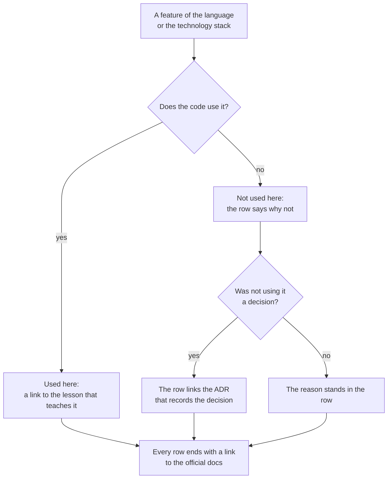
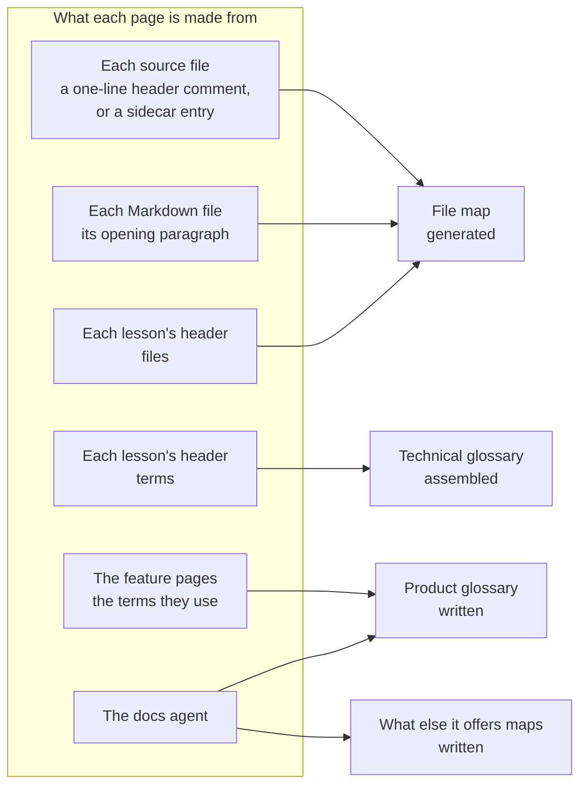
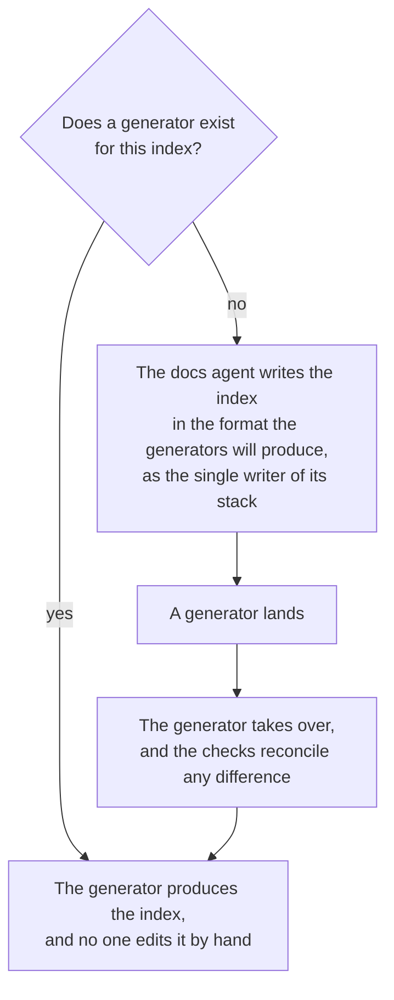
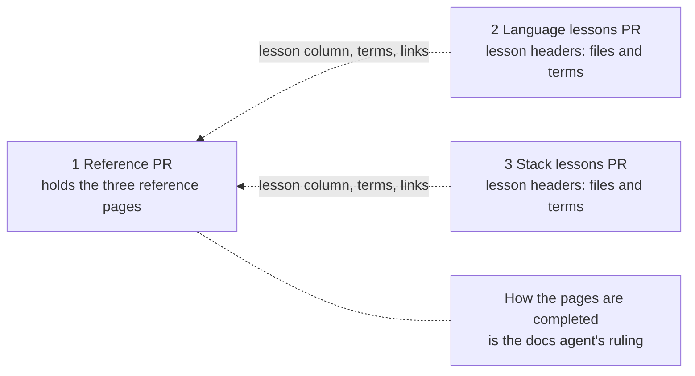

# Course reference pages

This file sets the standard for the reference pages, the three lookup pages of the guided course: the file map, the glossaries and the "what else it offers" map. It says what each page holds and where it lives, how each is produced, why the indexes among them are generated and never edited by hand, and what the docs agent does while no generator exists. [01-why-and-scope.md](01-why-and-scope.md) says why the baseline exists, [02-vocabulary.md](02-vocabulary.md) defines the terms used here, [03-stack-model.md](03-stack-model.md) sets the rules of the stack, [05-project-layout.md](05-project-layout.md) says where the pages live, [06-feature-docs.md](06-feature-docs.md) sets the feature docs, whose plain-language glossary is one of the pages, and [08-course-lessons.md](08-course-lessons.md) and [09-course-system-chapters.md](09-course-system-chapters.md) set the lessons and the chapters of the course that the pages point into. The playbook [docs-agent.md](../docs/agents/docs-agent.md) says how the docs agent writes the pages and which PR holds them.

A few words appear here before the standard defines them in full. The **docs agent** is a fresh agent, started from the finished code, that writes the descriptive documents, the ones that say only what exists at the **tip**, the last commit of a stack. Work is delivered as a **stack** of pull requests (PRs), an ordered series in which each PR is based on the one below it and merged from the bottom up. A stack holds three kinds of PR: a **thinking PR** holds the prescriptive documents, the ones that say what will be built or how work is done, a **code PR** holds code and tests, and a **description PR** holds the descriptive documents, so the reference pages go in a description PR. The **docs section** is the group of description PRs at the top of the stack, and its first PR is the **reference PR**, which holds the reference documents ([docs-agent.md](../docs/agents/docs-agent.md)). An **ADR** is an architecture decision record: one file for one decision, with the options that were explored. A **ruling** is a decision that an agent takes on the Software Engineer's behalf, without stopping to ask, and records as `Ruling: what, why, cost if wrong`. [03-stack-model.md](03-stack-model.md) explains the stack and its three kinds in full.

The word stack has a second use that the course needs. A **technology stack** is one part of a system, such as a front end or a back end, and its code lives in a **stack folder** of the repository. It is not a stack of PRs. This file says "stack of PRs" for the first and "technology stack" for the second, and the "what else it offers" map is written for each language and for each technology stack. A **generator** is a tool that produces a document from what the repository holds. Each rule below is followed by `Because:` and its reason.

## The three reference pages

The reference pages are three lookup pages in the course: the file map, the glossaries and the "what else it offers" map. The table gives each page's place in a project ([05-project-layout.md](05-project-layout.md)), its contents and how it is produced.

| Page | Where it lives | Contents | How it is produced |
|---|---|---|---|
| **File map** | `docs/course/reference/file-map.md` | A table of every tracked file: path, one line on what it does, the lesson that explains it. | **Generated.** Each source file states its purpose in a one-line header comment (files that cannot carry one get a small sidecar entry, and a Markdown file's opening paragraph serves as its line). The "lesson" column comes from each lesson's "files covered" header. |
| **Glossaries** | `docs/features/glossary.md` for the product glossary, and `docs/course/reference/glossary.md` for the technical glossary | A plain-language product glossary (for the feature docs) and a technical glossary (for the course). Each entry has a plain definition and a link to the lesson or system chapter that teaches it. | **Assembled:** the technical glossary, from the terms each lesson declares in its header, so no shared file is edited by every PR. **Written** by the docs agent: the product glossary, from the terms the feature pages use. |
| **"What else it offers" map** | The `README.md` of the folder of each language, `docs/course/languages/<language>/`, and of each technology stack, `docs/course/stacks/<stack>/` | One short page per language and per stack, a table grouped by topic (types, memory, concurrency, errors, modules, tooling, ecosystem). Each row gives the feature, a one-line description, and whether it is used here (if used, a link to the lesson; if not, why not, linking an ADR when it was a decision), plus a link to the official docs. | **Written** by the docs agent. Stays short: it is a map, not a course. |

**Write the reference pages in the reference PR, the first description PR of the docs section.** Because: the docs section is written in reading order from foundational to integrated, and the reference documents come first in it ([docs-agent.md](../docs/agents/docs-agent.md)).

**Apply every evidence rule to the reference pages.** `17-evidence-and-truth.md` lists the eleven rules, and each applies to every document that the docs agent writes. Because: the team reads line by line, so one wrong sentence costs more than a missing one.

## The file map

The file map is a table of every tracked file, with three columns: the path, one line on what the file does and the lesson that explains it. It is one of the pages that the baseline gives the Software Engineer to read what was built ([01-why-and-scope.md](01-why-and-scope.md)), and the standard requires the checker to look for every new source file on it (`22-tooling-requirements.md`). The table below is for the made-up hiking club app, with a back end in `api/` and a front end in `web/`. In a real page the last column is a link to the lesson.

| Path | What it does | The lesson that explains it |
|---|---|---|
| `api/src/main.rs` | Starts the API and listens for requests. | The lesson on the entry point |
| `api/src/signups.rs` | Stores a sign-up once, however often the request arrives. | The lesson on making a sign-up safe to repeat |
| `web/package.json` | Lists the dependencies and the scripts of the front end. | The lesson on the front end's build |

The one line on each file comes from the file itself. Each source file states its purpose in a one-line header comment, and a file that cannot carry a comment gets a small sidecar entry: `web/package.json` is JSON, which has no comments, so its line comes from a sidecar entry. A Markdown file needs neither: its opening paragraph serves as its line.

**Give every source file a one-line header comment that states its purpose, and give a file that cannot carry one a small sidecar entry.** The standard fixes that such a file gets a sidecar entry and leaves its form to the tooling. Because: the file map is generated and never edited by hand, so the one line on each file has to come from the file itself or from its sidecar entry, and the standard fixes only what the tooling must do and leaves how the tooling is built to the tooling (`22-tooling-requirements.md`).

A header comment is a comment, and comments count as code ([03-stack-model.md](03-stack-model.md)), so it belongs to a code PR, and the docs agent, which never changes code, does not write it.

**Let the opening paragraph of a Markdown file serve as its line.** The standard fixes that the opening paragraph serves as the line, and leaves to the tooling how the line is cut from it and what serves as the line of a file that does not open with a paragraph, such as a lesson, which opens with its header block, or an ADR, which opens with its status lines, as it leaves the form of a sidecar entry. Because: the file map's line has to come from the file itself, and every file of the standard opens with a paragraph that says what the file is for.

**Take the lesson column from the header of each lesson, from its `files`.** Because: the file map is generated, so the lesson column comes from the lessons' own headers, in which each lesson lists the files that it covers ([08-course-lessons.md](08-course-lessons.md)).

**Generate the file map and never edit it by hand.** Because: a file that every PR in a stack edits conflicts at every rebase of the stack, and a source file added in any PR adds a row (anti-goal A7 in [01-why-and-scope.md](01-why-and-scope.md)). "How each is produced" gives the rule and its exception.

## The glossaries

There are two glossaries. The product glossary is a plain-language glossary for the feature docs, and it lives with them as `docs/features/glossary.md` ([06-feature-docs.md](06-feature-docs.md)). The technical glossary is for the course, and it lives with the other generated reference pages as `docs/course/reference/glossary.md`. Each entry of a glossary has a plain definition and a link to the lesson or system chapter that teaches the term.

The terms of the technical glossary come from the lessons. Each lesson declares the terms that it introduces in the `terms` of its header, each with a `term` and a plain `definition` ([08-course-lessons.md](08-course-lessons.md)), and the technical glossary is assembled from them. A lesson's header does not mark a term as a product term or a technical one, so the product glossary does not come from the headers. The feature pages declare no terms or definitions either, so nothing could generate it: the docs agent writes the product glossary from the terms that the feature pages use, each linked to the lesson or system chapter that teaches it. An entry for the term "idempotent", which the example header in [08-course-lessons.md](08-course-lessons.md) declares, looks like this for a made-up lesson of the hiking club app. The layout of the page is an illustration.

```markdown
**idempotent.** An operation is idempotent when doing it twice leaves the same result as doing it once. Taught in [Making a sign-up safe to repeat](../languages/rust/03-safe-to-repeat.md).
```

**Declare in the header of each lesson the terms that the lesson introduces, and assemble the technical glossary from them.** Because: no shared file is then edited by every PR.

**Write the product glossary from the terms that the feature pages use, and link each entry to the lesson or system chapter that teaches it.** Because: a lesson's header does not mark a term as a product term or a technical one, and the feature pages declare no terms or definitions, so there is nothing for a generator to read.

**Give every entry a plain definition and a link to the lesson or system chapter that teaches the term.** Because: the glossaries are lookup pages, and the link takes a reader from a term to the lesson or chapter that teaches it.

**Never edit the technical glossary by hand.** Because: a file that every PR in a stack edits conflicts at every rebase of the stack (anti-goal A7 in [01-why-and-scope.md](01-why-and-scope.md)). "How each is produced" gives the rule and its exception. The docs agent writes the product glossary, so this rule is about the technical glossary alone.

The baseline's rules for diagrams say that a diagram's labels use the project's glossary terms (`16-diagrams.md`). The product glossary is part of the feature docs, which are always in plain language ([06-feature-docs.md](06-feature-docs.md)).

## The what else it offers map

The map is one short page for each language and each technology stack of the course, and it is the `README.md` of that language's or technology stack's folder in the course ([05-project-layout.md](05-project-layout.md)). It shows the boundary of the course: what the language or the technology stack offers, which of it the code uses and why other options were not used ([08-course-lessons.md](08-course-lessons.md) gives the reason for the map). Its table is grouped by topic (types, memory, concurrency, errors, modules, tooling, ecosystem), and each row gives the feature, a one-line description, whether the code uses it, and a link to the official docs.

The table below is for the made-up hiking club app, whose back end is in Rust. In a real page the last column is a link to the official docs of the feature, and the "Used here" cell links the lesson or the ADR.

| Topic | Feature | In one line | Used here | Official docs |
|---|---|---|---|---|
| Types | Traits | Behaviour that different types can share. | Used: the lesson on traits | The docs on traits |
| Memory | Ownership | Each value has one owner, and the value is dropped when its owner goes out of scope. | Used: the lesson on ownership | The docs on ownership |
| Memory | Unsafe code | Code that the compiler cannot check, marked in the source. | Not used: the back end has none, and an ADR records the decision to forbid it | The docs on unsafe code |
| Concurrency | Async functions | Functions that can pause while they wait for something. | Used: the lesson on async functions | The docs on async functions |



*A row of the map is either used, with a link to its lesson, or not used, with the reason, and the one thing to notice is that only a feature that was left out by a decision links an ADR, while every row ends with a link to the official docs.*

**Keep the map short.** Because: it is a map, not a course, so a row gives one line and sends the reader to the official docs for more.

**For a feature that the code uses, link the lesson that teaches it. For a feature that it does not use, say why not, and link the ADR when not using it was a decision.** Because: a reader then sees the boundary of the course and why other options were not used.

**Give every row a link to the official docs.** Because: the map stays short, so a row points to the official docs of the feature and does not copy them.

## How each is produced

The reference pages are produced in three ways: the file map is generated, the technical glossary is assembled, and the product glossary and the maps are written. The diagram shows what each page is made from.



*The file map and the technical glossary are made from what the files and the lessons say about themselves, and the one thing to notice is that the docs agent writes the product glossary, from the terms the feature pages use, and the maps, which no file or header feeds.*

The file map is generated. Its one line on each file comes from the file's one-line header comment, from its sidecar entry or, for a Markdown file, from its opening paragraph, and its lesson column comes from the `files` of each lesson's header. The technical glossary is assembled from the `terms` that the lessons declare in their headers. The product glossary and the maps are written by the docs agent, the product glossary from the terms that the feature pages use.

### Indexes are generated and never hand-edited

**Never edit a generated index by hand.** The evidence rules name five indexes, the course index, the architecture reference's index, the file map, the technical glossary and the ADR index (`17-evidence-and-truth.md`). Two of them are reference pages, the file map and the technical glossary. The course index is the generated index of the guided course and is not one of the three pages ([05-project-layout.md](05-project-layout.md) gives its place). [07-architecture-reference.md](07-architecture-reference.md) sets the architecture reference's index, and `11-adrs.md` sets the ADR index. Because: indexes are generated so that rebases never conflict on them, since a file that every PR in a stack edits conflicts at every rebase of the stack (anti-goal A7 in [01-why-and-scope.md](01-why-and-scope.md)). The standard requires the checker to verify that a generated index matches a fresh generation (`22-tooling-requirements.md`).

The product glossary and the "what else it offers" map are not on that list. The docs agent writes them, and "The what else it offers map" says what the map holds.

### While no generator exists

**In a repository whose generators do not exist yet (only the baseline's own, during its first stacks), let the docs agent write the indexes, in the format that the generators will produce, as the single writer of its stack.** It is the one exception to never editing an index by hand. Because: indexes are generated so that rebases never conflict on them, and where no generator exists yet, one writer of these files in the stack gives the same protection, while the generators' format lets them take over later ([docs-agent.md](../docs/agents/docs-agent.md)).

**When a generator exists for an index, do not write that index.** The generator takes over when it lands, and the checks reconcile any difference. Because: a generated index is overwritten, and a table that is edited by hand makes every rebase conflict ([docs-agent.md](../docs/agents/docs-agent.md)).



*An index has either a generator or a single writer, and the one thing to notice is that the hand-written path leads back into the generated one when a generator lands.*

### The pages and the lessons they draw on

The docs agent writes the reference pages in the reference PR, and the PRs above it hold the language lessons, the stack lessons and the system chapters, in that order ([docs-agent.md](../docs/agents/docs-agent.md)). The pages draw on the lessons. The lesson column of the file map comes from the `files` of each lesson's header, the technical glossary is assembled from the `terms` that the lessons declare, the product glossary is written from the terms that the feature pages use, and a row of a map that is used here links the lesson that teaches the feature. The lessons are written in PRs above the reference PR.

The standard does not settle how the pages are completed when what they draw on is written later in the order of the PRs. That is a call for the docs agent, which records it as a ruling, as [docs-agent.md](../docs/agents/docs-agent.md) says of what it leaves open.

The numbers in the diagram are the order of the PRs in the docs section.



*The reference pages are in the first description PR while what they draw on is in the PRs above it, and the one thing to notice is that the dotted arrows run against the order of the PRs, from the later PRs back to the first, with a note that how the pages are completed is the docs agent's ruling.*
