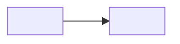
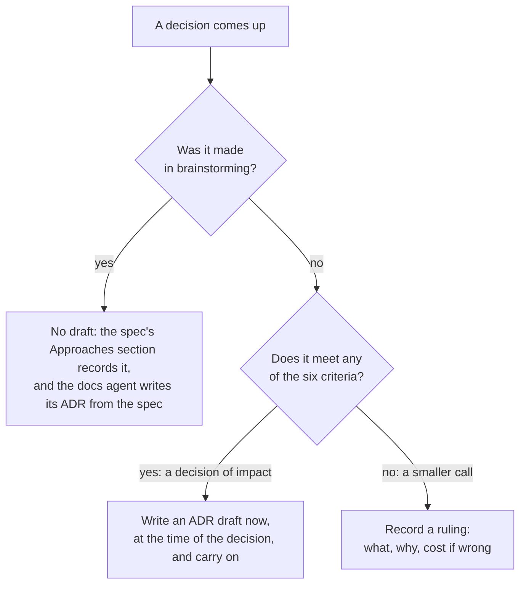
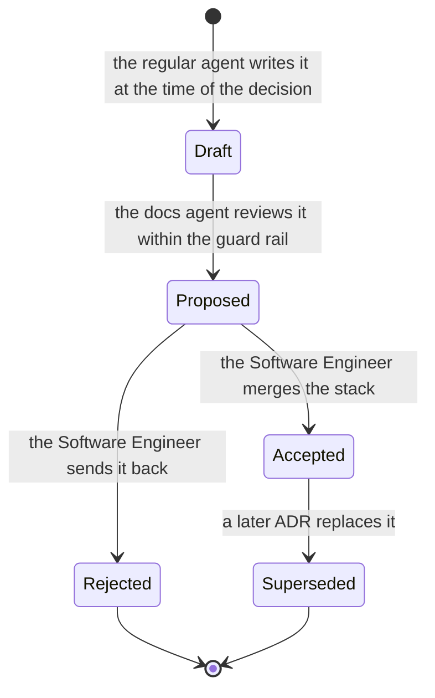
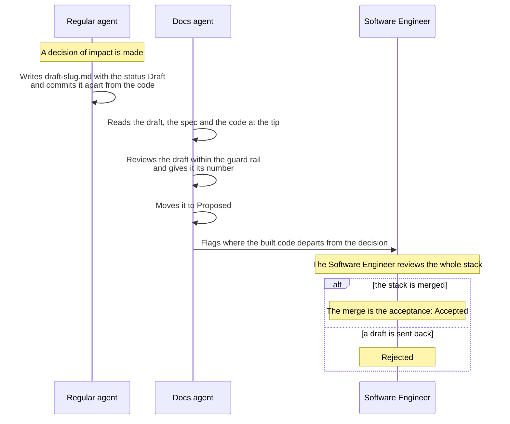
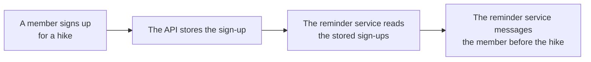
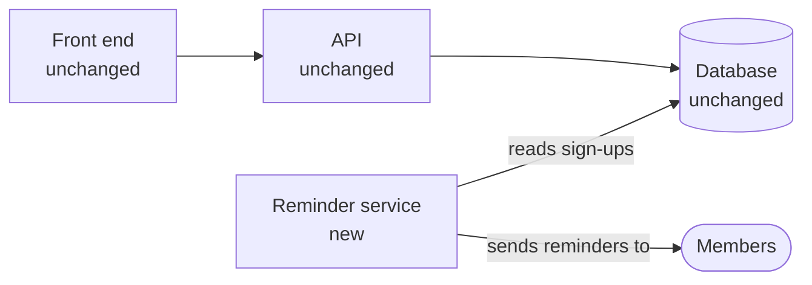
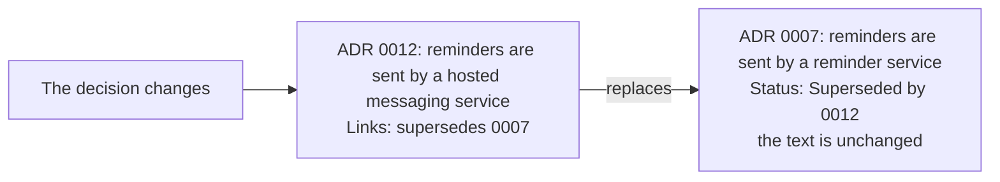
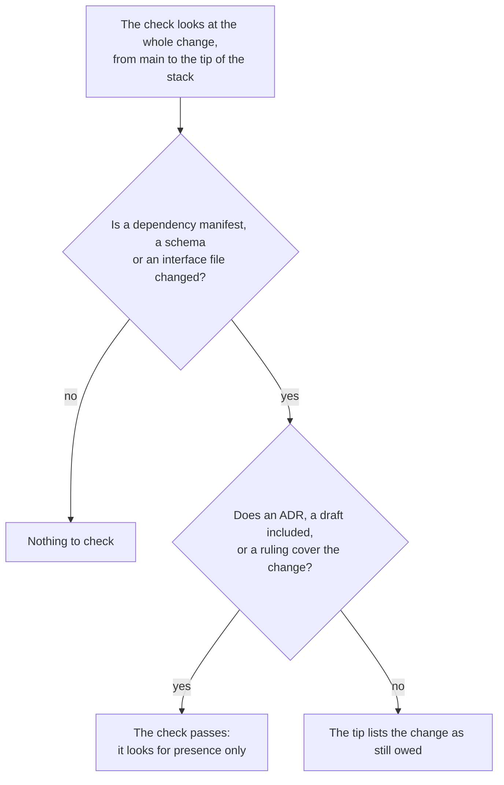

# Architecture decision records

This file sets the standard for architecture decision records, or ADRs, the documents that record a project's decisions with the options that were explored. It says what an ADR is, gives the template that every ADR follows, lists the six criteria that make a decision a decision of impact (the kind that gets an ADR draft), sets out the lifecycle from Draft to Accepted, gives the rules for writing, numbering, reviewing and changing an ADR, and ends with the presence check that ties a changed dependency, schema or interface file to an ADR or a ruling. [01-why-and-scope.md](01-why-and-scope.md) says why the baseline exists, [02-vocabulary.md](02-vocabulary.md) defines the terms used here, [03-stack-model.md](03-stack-model.md) sets the rules of the stack, [05-project-layout.md](05-project-layout.md) says where ADRs live and [07-architecture-reference.md](07-architecture-reference.md) shows how the architecture reference links to them. The playbook [adrs.md](../docs/agents/adrs.md) states the same rules as instructions to an agent, and [docs-agent.md](../docs/agents/docs-agent.md) is the brief of the docs agent, which reviews and numbers the drafts.

A few words appear here before the standard defines them in full. Work is delivered as a **stack** of pull requests (PRs), an ordered series in which each PR is based on the one below it and merged from the bottom up. A stack holds three kinds of PR: a **thinking PR** holds the prescriptive documents, the ones that say what will be built or how work is done, and ADRs are among them; a **code PR** holds code and tests; and a **description PR** holds the descriptive documents, the ones that say only what exists at the **tip**, the last commit of the stack. A **slice** is a logical group of code that becomes one code PR, and the **docs section** is the group of description PRs at the top of the stack. The **regular agent** is the agent that brainstorms, plans, builds and writes ADR drafts, and the **docs agent** is a fresh agent, started from the finished code, that writes the descriptive documents and reviews the drafts. An **ADR draft** is an ADR that the regular agent writes at decision time, before the docs agent reviews it. **Brainstorming** is the work of the `brainstorming` skill, which produces the spec. A **ruling** is a decision that an agent takes on the Software Engineer's behalf, without stopping to ask, and records as `Ruling: what, why, cost if wrong`. [03-stack-model.md](03-stack-model.md) explains the stack and its three kinds in full.

The word stack has a second use that the criteria for a decision of impact need. A **technology stack** is one part of a system, such as a front end or a back end, and its code lives in a **stack folder** of the repository. It is not a stack of PRs. This file says "stack of PRs" for the first and "technology stack" for the second. Each rule below is followed by `Because:` and its reason.

## What an ADR is

An **ADR** is an architecture decision record: one file for one decision, with the options that were explored and the evidence for each. Once an ADR is Accepted it is append-only. ADRs live in `docs/adr/`. A draft is named `draft-<slug>.md`, the docs agent renames it to `NNNN-<slug>.md` when it publishes the ADR, and `README.md` is the generated index of the folder ([05-project-layout.md](05-project-layout.md) has the whole layout). `NNNN` stands for the number of the ADR.

An ADR is a prescriptive document, written when a decision is made, and it says why the code is as it is. With the standards of a project (`19-standards-mechanism.md`), ADRs are the only documents that drive code. The descriptive documents take their reasons from them, and the architecture reference links each technology choice to the ADR that records it ([07-architecture-reference.md](07-architecture-reference.md)). In the ladder of [01-why-and-scope.md](01-why-and-scope.md), ADRs with the options explored are what the baseline gives the Principal Engineer for the hard technical calls, and ADRs on topology, trust boundaries and contracts are what it gives the Solutions Architect.

Three roles take part in the life of an ADR. The regular agent writes the draft at the time of the decision, the docs agent reviews it within a guard rail and gives it its number, and the Software Engineer accepts or rejects it. "The lifecycle" says how an ADR moves from one status to the next, and "The rules" says how far the docs agent's review may go.

## The template

Every ADR has the parts of the template below, in this order. The template is the form of a draft, and the parts stay the same when the draft is published as an ADR. Angle brackets mark what the author fills in, the date included. The block is fenced with four backticks, so that the diagram fences inside it stay plain text and the template shows exactly what a draft holds.

````markdown
# <Title of the decision>

Status: Draft

Date: <YYYY-MM-DD>

Deciders: the Software Engineer

## Context

<The problem and the forces on it.>

## Decision drivers

1. <What matters most.>
2. <What matters next.>

## Options

### Option 1: <name>

<How the option works.>


*<What the diagram shows and the one thing to notice.>*

- **Pros:** <what is good about the option>
- **Cons:** <what is bad about the option>
- **Evidence:** <a spike, a benchmark, documentation or a cost>

### Option 2: <name>

<How the option works.>


*<What the diagram shows and the one thing to notice.>*

- **Pros:** <what is good about the option>
- **Cons:** <what is bad about the option>
- **Evidence:** <a spike, a benchmark, documentation or a cost>

### Option 3: Do nothing

<What happens if things are left as they are.>


*<What the diagram shows and the one thing to notice.>*

- **Pros:** <what is good about leaving things as they are>
- **Cons:** <what is bad about leaving things as they are>
- **Evidence:** <a spike, a benchmark, documentation or a cost>

## Comparison

| Option | <Driver 1> | <Driver 2> |
|---|---|---|
| Option 1: <name> | <how it does against driver 1> | <how it does against driver 2> |
| Option 2: <name> | <how it does against driver 1> | <how it does against driver 2> |
| Option 3: Do nothing | <how it does against driver 1> | <how it does against driver 2> |

## Decision

<What was chosen, and why it beats the others.>

## Consequences

<What gets easier, what gets harder and the risks.>


*<The impact of the decision and the one thing to notice.>*

## Revisit when

<The signals that would reopen the decision.>

## Links

- <PRs>
- <Course chapters>
- <Superseded ADRs>
````

**Write the three header lines, the status, the date and the deciders, each as a paragraph of its own, with a blank line between them.** Because: in a Markdown file consecutive lines are joined into one paragraph when GitHub renders it, and GitHub is the reading venue (constraint C2 in [01-why-and-scope.md](01-why-and-scope.md)), so three lines written one under another would read as one line.

A draft has no number, so its title is the name of the decision alone. The docs agent puts the number in front of it when it publishes the ADR, and the title then reads `NNNN. Title`. The status is one of five: Draft, Proposed, Accepted, Rejected, or Superseded by NNNN, where `NNNN` is the number of the ADR that replaced it. A new draft is Draft, and "The lifecycle" says what moves an ADR from one status to the next.

The table says what each part of the template holds.

| Part | What it holds |
|---|---|
| Title | The name of the decision. |
| Status | Draft, Proposed, Accepted, Rejected or Superseded by NNNN. |
| Date and deciders | The date, and the deciders: the Software Engineer or, when the team has grown, the decider of an area that has its own ([02-vocabulary.md](02-vocabulary.md)). |
| Context | The problem and the forces on it. |
| Decision drivers | What matters most, ranked. |
| Options | At least two real ones, plus "do nothing". Each has how it works (a diagram), its pros, its cons and its evidence (a spike, a benchmark, documentation or a cost). |
| Comparison | The options against the drivers. |
| Decision | What was chosen, and why it beats the others. |
| Consequences | What gets easier, what gets harder and the risks, with the diagram that shows the impact of the decision. |
| Revisit when | The signals that would reopen the decision. |
| Links | PRs, course chapters and superseded ADRs. |

The template shows three options, which is the least that an ADR has: two real options and "do nothing". An ADR with more real options adds them before "do nothing", each with the same parts.

## Decisions of impact

The regular agent writes an ADR draft when it makes or adopts a decision of impact, which is a decision that meets any one of these six criteria:

- **A new technology or dependency.** Something the project did not use before, such as a language, a framework, a service or a package.
- **A data model or public interface.** How the data is shaped, or what other code or other people can call.
- **A security or trust boundary.** Where one party's data or authority ends and another's begins.
- **The deployment topology.** Where and how the parts of the system run.
- **A contract between stacks.** What two technology stacks, such as a front end and a back end, promise each other.
- **Anything hard to reverse.** A choice that is costly or impossible to take back once other work depends on it.

**Test every decision you make against these six, as you make it.** Because: an ADR shows the options as they stood when the decision was made, and a ruling records only what, why and the cost if wrong, so a decision of impact that was recorded as a ruling alone would have no options on record.

**Leave a smaller call as a ruling.** A new dependency is a decision of impact, but a dependency bump that tests show is safe is a ruling. Because: brainstorming already gates the big decisions, since it requires the approaches and the Software Engineer's pick before any design exists, and what is left in the middle of the build is rulings, which the execution skills (the skills that carry out a plan task by task) own and report.

**Treat the six criteria as a test and not a gate: write the draft and carry on.** There is no approval gate before code, and nothing waits for the Software Engineer. Because: brainstorming already gates the big decisions, and a second gate would collide with the continuous execution of the execution skills.

**Write no draft for a decision that was made in brainstorming.** The docs agent writes the ADRs of those decisions from the spec, in the form of the template. Where the spec records no pro, no con or no number, such an ADR says so, as "The rules" explains for any gap. Because: brainstorming requires the approaches and the Software Engineer's pick before any design exists, so the spec's Approaches section already records the options, the trade-offs, the pick and why.

**Write a new ADR draft for a change to a decision, and do not only edit the spec** (rule 8 in [03-stack-model.md](03-stack-model.md)). Because: a decision is recorded in an ADR, so a spec edit alone would leave that record unchanged.

The flow below sorts a decision in the order of the rules above.



*A decision gets a draft when it was not made in brainstorming and meets one of the six criteria, and the one thing to notice is that no branch waits for an approval: the draft is written and the work carries on.*

## The lifecycle

An ADR has one of five statuses: Draft, Proposed, Accepted, Rejected, or Superseded by the number of the ADR that replaced it. The diagram shows how an ADR moves between them. In a Mermaid state diagram `[*]` is the start when an arrow leaves it and the end when an arrow enters it.



*The merge of the stack is the acceptance, and the one thing to notice is that the only way out of Accepted is a later ADR that replaces it: append-only starts at Accepted.*

The table says what each status means and what moves an ADR on from it.

| Status | What it means | What moves it on |
|---|---|---|
| Draft | The regular agent wrote it at the time of the decision. | The docs agent reviews it within the guard rail, and it becomes Proposed. |
| Proposed | The docs agent has reviewed it, and it waits for the Software Engineer. | The Software Engineer merges the stack and it becomes Accepted, or sends it back and it becomes Rejected. |
| Accepted | The decision stands, and the ADR is append-only. | A later ADR replaces it, and its status becomes Superseded by the number of that ADR. |
| Rejected | The Software Engineer sent it back. | Nothing: it ends here. |
| Superseded by NNNN | A later ADR replaced it. | Nothing: it ends here. |

**Let the Software Engineer's merge of the stack be the acceptance of the ADRs in it.** Neither the regular agent nor the docs agent decides that an ADR is Accepted or Rejected: the status records the Software Engineer's merge or send-back. Because: accepting or rejecting an ADR is the Software Engineer's call, and the merge of a stack is theirs (`20-working-rules.md` lists what they decide).

The checker that the standard requires verifies, on every PR, that the status of an ADR is valid, that the index is consistent and that no Accepted ADR is rewritten (`22-tooling-requirements.md`).

The sequence below follows one draft from the decision to its acceptance or rejection. In a Mermaid sequence diagram, `alt` and `else` draw the two branches of a choice, and `Note over` puts a note on a participant.



*A draft is written by the regular agent, reviewed and numbered by the docs agent and accepted or rejected by the Software Engineer, and the one thing to notice is that Accepted and Rejected are notes and not messages, because the merge or the send-back is itself the acceptance or the rejection.*

## The rules

The rules below cover writing a draft, numbering it, the docs agent's review, changes to an Accepted ADR and the index. The rules about which decisions get a draft are under "Decisions of impact", and the presence check has its own section.

### Writing a draft

1. **Write the draft when the decision is made, and not afterwards.** Because: an ADR shows the options as they stood when the decision was made, and options written afterwards to justify the pick are backfilled rationale, which is a failure even when everything else works (anti-goal A4 in [01-why-and-scope.md](01-why-and-scope.md)).
2. **Follow the template, part by part, in its order, and explore at least two real options, with "do nothing" as one more.** For each option, show how it works, list its pros and its cons and give its evidence: a spike, a benchmark, documentation or a cost. Because: "options explored" is the Software Engineer's bar for a decision record, and the full template, with the options, their evidence and the comparison, is how a record meets it.
3. **List the decision drivers in rank order, with what matters most first.** Because: the comparison sets the options against the drivers and the decision says why the pick beats the others, so the drivers are what the pick is judged on, and the order says which of them weigh most.
4. **Draw one diagram for each option, showing how it works, and one more under the consequences, showing the impact of the decision. Give each a one-line caption that says what it shows and the one thing to notice, and let it hard-code no colour except the approved palette.** Because: this is the minimum for an ADR in the baseline's rules for diagrams, each diagram has to answer a question that the text cannot answer as well, and default styling follows the viewer's theme, while hard-coded colours are what break it (`16-diagrams.md`).
5. **Commit the draft on its own, apart from any code.** When the stack is cut into its PRs, which [03-stack-model.md](03-stack-model.md) explains, the drafts of a slice go in one small thinking PR, directly beneath the first slice that depends on them (rule 4 there). Because: the reviewer reads the thinking first, and each PR stays one kind, which is easier to review.

Where nothing was recorded for a part of an option, the draft says so in that place and does not fill the gap. This is not a rule of its own: it follows from anti-goal A4, because a pro, a con or a number added afterwards to justify the pick is backfilled rationale, and from anti-goal A6 and the evidence rule that anything that could not be verified says so, because a statement that nobody ran or measured and that is not marked "not verified" is an unverified claim (`17-evidence-and-truth.md`).

The two diagrams below are for a made-up decision in the hiking club app of [06-feature-docs.md](06-feature-docs.md): where the reminders that members get before a hike are sent from. It is made up as if it had come up during a build; in the made-up stack of `14-pr-descriptions.md` the same decision is made in brainstorming instead, so there it has no draft. The made-up draft has three options: the API sends the reminders itself, a separate reminder service sends them, and do nothing. The first diagram is the one for the second option and shows how it works. The second is the one under the consequences and shows the impact.



*Option 2 sends the reminders from a separate service that reads the stored sign-ups, and the one thing to notice is that the API only stores the sign-up and never sends a reminder itself.*



*The decision adds one component, the reminder service, and the one thing to notice is that the front end, the API and the database are drawn as unchanged, so the impact is what the new service reads and sends.*

### Numbering

**Name a draft `docs/adr/draft-<slug>.md`, with no number, and let the docs agent give it its number when it publishes the ADR.** The `<slug>` is a short name for the decision. The docs agent renames the file to `NNNN-<slug>.md` and puts the number in the title ([docs-agent.md](../docs/agents/docs-agent.md) says where the number comes from). Because: two stacks in flight cannot collide when no draft has a number until it is published.

### The guard rail for the docs agent

The docs agent reviews every draft before it is published, and the guard rail says how far the review may go.

| The docs agent may | The docs agent may not |
|---|---|
| Clean up the draft. | Rewrite the decision. |
| Add to it, marking each addition "Added at review". | Rewrite the drivers. |
| Review it. | Rewrite the options. |
| Give it its number and move it to Proposed. | Rewrite the rationale. |
| Flag where the built code departs from the decision. | Edit the ADR so that it matches the code. |

**Review every draft within the guard rail, mark every addition "Added at review", and where the built code departs from the decision, flag that for the Software Engineer and do not edit the ADR to match.** Because: this keeps decision-time reasoning from being backfilled.

It follows that the regular agent writes the decision, the drivers, the options and the rationale as they are to stand, since the docs agent does not rewrite them.

**Make the review edits and the numbering in a description PR.** A description PR may edit ADR files, and this is the one crossover of kinds that the standard names ([03-stack-model.md](03-stack-model.md)). Because: the review and the numbering are the docs agent's work, and they are made after the build, when the docs section is written.

### Append-only once Accepted

**Change an Accepted ADR only through a new ADR that supersedes it, and edit the Accepted ADR in nothing but its status and its links.** The new ADR names the ADR that it supersedes under its links, and the status of the replaced ADR reads Superseded by the number of the new one. Because: an ADR shows the options as they stood when the decision was made (anti-goal A4 in [01-why-and-scope.md](01-why-and-scope.md)), and a rewrite of an Accepted ADR would replace that record with a later view. The standard requires the checker to verify on every PR that no Accepted ADR is rewritten (`22-tooling-requirements.md`).

The numbers in the diagram are made up.



*A change to an Accepted ADR is a new ADR that supersedes it, and the one thing to notice is that the old ADR keeps its text and changes only its status.*

### The index

`docs/adr/README.md` is the generated index of the ADRs. **Never edit it by hand.** Because: a file that every PR in a stack edits conflicts at every rebase of the stack, so indexes are generated and never hand-edited (anti-goal A7 in [01-why-and-scope.md](01-why-and-scope.md)). The ADR index is one of the indexes that [10-course-reference-pages.md](10-course-reference-pages.md) lists under "Indexes are generated and never hand-edited", and the exception for a repository whose generators do not exist yet (only the baseline's own, during its first stacks), in which the docs agent writes the index itself, is set out there too. [docs-agent.md](../docs/agents/docs-agent.md) says that the ADR index goes in the reference PR, the first description PR of the docs section, with the review of the drafts.

## The presence check

A changed dependency manifest, schema or interface file must be covered by an ADR or a ruling. The standard requires its checker to make this check over the whole change, from `main` to the tip of the stack, at the top of the stack (`22-tooling-requirements.md`). It is an ADR check and not a dependency policy: it checks presence only, not approval. A dependency manifest is the file that lists what a project depends on, such as `Cargo.toml` or `package.json`, a schema defines how data is shaped, and an interface file defines what other code or other people can call.



*The check looks at the whole change, and the one thing to notice is that once it finds a changed manifest, schema or interface file the only question it asks is whether a record covers it: no branch asks whether the decision was right.*

1. **When you change a dependency manifest, a schema or an interface file, make sure that an ADR or a ruling covers the change.** A decision of impact has an ADR, which may still be a draft, because a draft is an ADR whose status is Draft ([02-vocabulary.md](02-vocabulary.md) defines an ADR draft), and a smaller call has a ruling. Because: a new dependency and a data model or public interface are decisions of impact, and a smaller call is a ruling, so a change to such a file has one or the other, and the check at the top of the stack looks for it.
2. **Expect the check to look for presence only.** It does not judge whether the decision was right, and it does not approve it. Because: the baseline sets no dependency policy, since security, dependency and release policy are per-project standards (non-goal N1 in [01-why-and-scope.md](01-why-and-scope.md)), so the check can ask only whether a record exists. Whether the decision was right is for the Software Engineer, who accepts or rejects an ADR.

The table gives made-up examples of what covers a change.

| A change | What covers it |
|---|---|
| A new library is added to the dependency manifest. | An ADR draft, since a new dependency is a decision of impact. |
| A library in the manifest moves to a newer version that the tests show is safe. | A ruling. |
| A public endpoint is added to an interface file. | An ADR draft, since a public interface is a decision of impact. |

Where the standard's checker does not exist yet, the same check is made by hand, and [adrs.md](../docs/agents/adrs.md) shows how.
