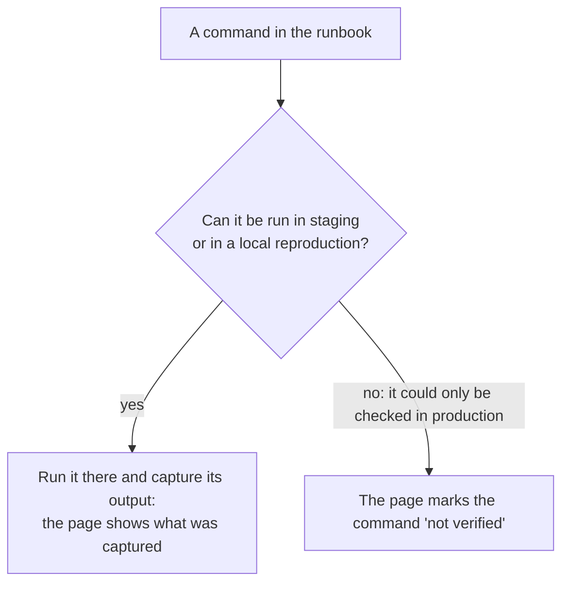
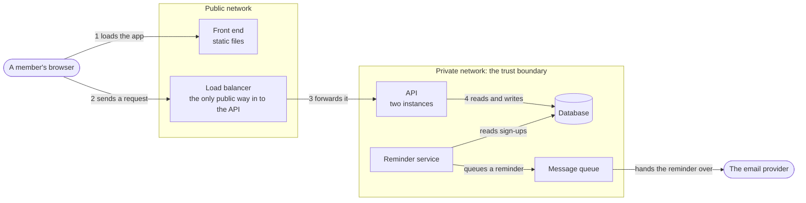
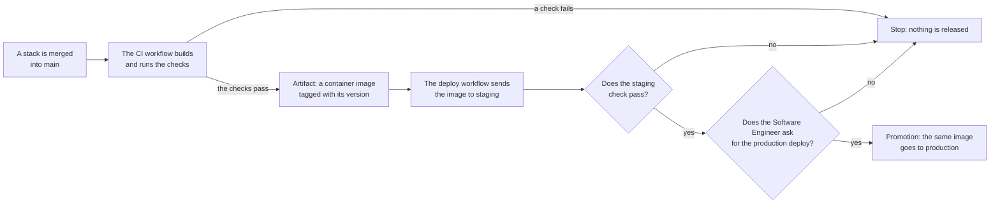
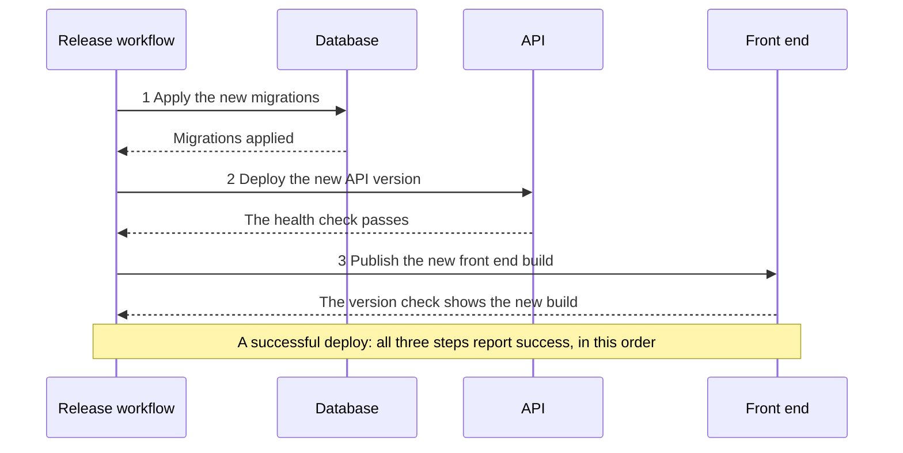
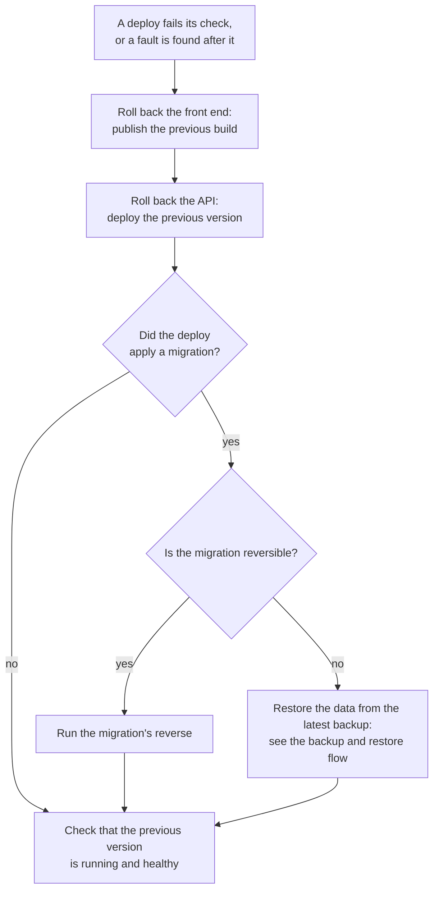
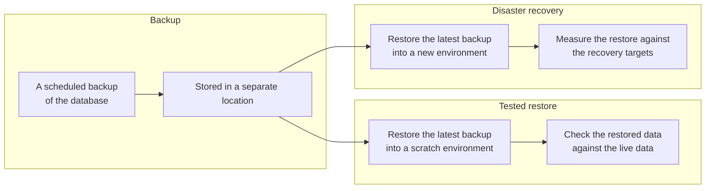

# Deployment docs

This file sets the standard for the deployment docs, the document of a project that says how the system runs in the real world. It says what the deployment docs are for, lists the eleven areas that they cover, sets the honesty rule for what an agent may claim to have verified, and names the five diagrams that they must have, with an example of each. [01-why-and-scope.md](01-why-and-scope.md) says why the baseline exists, [02-vocabulary.md](02-vocabulary.md) defines the terms used here, [03-stack-model.md](03-stack-model.md) sets the rules of the stack, [05-project-layout.md](05-project-layout.md) says where the deployment docs live, [07-architecture-reference.md](07-architecture-reference.md) sets the architecture reference, whose operations summary links to the deployment docs for the detail, and [11-adrs.md](11-adrs.md) sets the ADRs, which record the decisions on the deployment topology. The playbook [docs-agent.md](../docs/agents/docs-agent.md) says how the docs agent writes the deployment docs.

A few words appear here before the standard defines them in full. The **docs agent** is a fresh agent, started from the finished code, that writes the descriptive documents, the ones that say only what exists at the **tip**, the last commit of a stack. Work is delivered as a **stack** of pull requests (PRs), an ordered series in which each PR is based on the one below it and merged from the bottom up. A stack holds three kinds of PR: a **thinking PR** holds the prescriptive documents, the ones that say what will be built or how work is done, a **code PR** holds code and tests, and a **description PR** holds the descriptive documents, so the docs agent's deployment docs go in a description PR. The **docs section** is the group of description PRs at the top of the stack, and its first PR is the **reference PR**, which holds the reference documents ([docs-agent.md](../docs/agents/docs-agent.md)). [03-stack-model.md](03-stack-model.md) explains the stack and its three kinds in full. Each rule below is followed by `Because:` and its reason.

## Purpose

The deployment docs say how the system runs in the real world. They describe what is deployed today, and the infrastructure code stays in the repository: the third area, "Infrastructure as code", says what the repository holds. They are a folder, `docs/deploy/`, with a `README.md` and one file for each area, and the docs agent writes them ([05-project-layout.md](05-project-layout.md)). The architecture reference holds a summary of the operations and links to the deployment docs for the detail ([07-architecture-reference.md](07-architecture-reference.md)), and the configuration part of the README says where the full table of settings lives, which is the fourth area below (`13-project-readme.md`). In the ladder of [01-why-and-scope.md](01-why-and-scope.md), the deployment docs are among what the baseline gives the Solutions Architect, whose responsibility includes deployment and operation.

**Describe what is deployed today, and put no plan in the deployment docs.** Because: a descriptive document says only what exists at the tip, so plans and "coming later" live in the spec and the plan and never in the deployment docs.

**Pitch the deployment docs from the reader profile, and write them at full detail.** Because: the levels in the reader profile decide only which basics a document explains, and detail is always at its maximum, since humans keep control of code that agents write only if they can understand the system well enough to read it, review it and challenge it ([04-reader-profile.md](04-reader-profile.md); constraint C6 in [01-why-and-scope.md](01-why-and-scope.md)).

**Let the docs agent write the deployment docs from the finished tip, in the reference PR.** In a later stack it updates the files that the new code makes untrue or incomplete ([docs-agent.md](../docs/agents/docs-agent.md)). Because: the agent that built the code tends to document what it meant, and cannot tell when the code does not say it.

**Apply every evidence rule to the deployment docs.** `17-evidence-and-truth.md` lists the eleven rules, and each applies to every document that the docs agent writes. Two of them show plainly in this folder: the runbook of the sixth area carries captured command output, as the rule that output is captured by running it asks, and the header of each file pins the versions that the file was verified against, as the rule on pinned versions asks. Because: the team reads line by line, so one wrong sentence costs more than a missing one.

## The eleven areas

The deployment docs cover eleven areas. The table gives each one's number, name and contents, and each area is a file of the folder, named `NN-<area>.md` ([05-project-layout.md](05-project-layout.md)), for example `01-topology.md` for the first.

| # | Area | Contents |
|---|---|---|
| 1 | Topology | A diagram of the whole deployment: environments, hosts or clusters, networks, trust boundaries, datastores and queues, and the path a request takes in. |
| 2 | Environments | Local, CI, staging, production: purpose, how created, how they differ, what data lives there, who has access. |
| 3 | Infrastructure as code | What the repo holds, how it is applied, where its state lives, how drift is detected. |
| 4 | Configuration and secrets | Every setting in a table (name, purpose, default, where set, secret or not), plus how secrets are stored, rotated and accessed. |
| 5 | Build and release pipeline | A flow diagram of workflows, gates and artifacts, with versioning, promotion and approvals, and how a merged stack becomes a deploy. |
| 6 | Deploying | The step-by-step runbook with captured command output, the order across components (data, then back end, then client), what a successful deploy looks like. |
| 7 | Rollback and recovery | How to roll back each component, how reversible the migrations are, backup and restore with a tested restore, disaster recovery with its recovery targets. |
| 8 | Operations | Dashboards, alerts mapped to runbooks, logs and traces, incident response, scaling procedures, routine maintenance. |
| 9 | Security and hardening | Network rules, the access model, hardening steps, audit logs. |
| 10 | Cost | What it costs today per component, and what grows it. |
| 11 | Troubleshooting | A table of symptom, check and fix. |

A stack in this file always means a stack of PRs, as in area 5, which says how a merged stack becomes a deploy. A **runbook** is the list of steps that a person follows to do one operation, and a **migration** is a change to the shape of the stored data.

Two of the areas name the columns of a table that they hold: area 4 holds a table of every setting, and area 11 a table of symptom, check and fix. The two tables below are made-up examples for the hiking club app of [06-feature-docs.md](06-feature-docs.md), as illustrations of those columns.

| Name | Purpose | Default | Where set | Secret or not |
|---|---|---|---|---|
| `API_PORT` | The port that the API listens on. | `8080` | The API's environment | Not secret |
| `DATABASE_URL` | How the API reaches the database. | None | The secret store | Secret |

| Symptom | Check | Fix |
|---|---|---|
| Members report that signing up fails. | Look in the API's logs for database errors. | Restart the API when the log says that it lost its database connection. |

**Keep an area that does not apply, as one line: `Not applicable: why`.** Because: the reader then sees that the area was considered, and nothing is invented to fill it (`17-evidence-and-truth.md` gives the rule for a section that does not apply). An example of such a file, for a made-up command-line tool that runs only on the machine of the person who installs it:

```markdown
# Operations

Not applicable: the tool runs only on the machine of the person who installs it, so the project runs no server and has no dashboards, alerts or incident response to describe.
```

## The honesty rule

The deployment docs follow an honesty rule of their own, in addition to the evidence rules that every descriptive document follows. An agent cannot deploy to production. Runbook commands are verified in staging or in a local reproduction, and anything that could only be checked in production is marked "not verified". Deploying is also a call that only the Software Engineer makes, and nothing deploys unless they ask (`20-working-rules.md`).

**Verify every runbook command in staging or in a local reproduction, and capture its output by running it there.** Because: an agent cannot deploy to production, so staging and a local reproduction are the places where it can run the command, and output is captured by running it and never written from memory (`17-evidence-and-truth.md`).

**Mark anything that could only be checked in production "not verified".** Because: a statement that nobody ran or measured and that is not marked "not verified" is an unverified claim (anti-goal A6 in [01-why-and-scope.md](01-why-and-scope.md)), and the evidence rule is that anything that could not be verified says so, in a "not verified" note (`17-evidence-and-truth.md`).



*Every runbook command is either run where an agent can run it or marked not verified, and the one thing to notice is that there is no third branch in which the command is stated as working without having been run.*

A "not verified" note on a made-up step of the runbook:

```markdown
**Not verified.** This step can only be checked in production, where an agent cannot deploy. The command was run in staging only.
```

## Diagrams

The deployment docs have five required diagrams: the topology, the pipeline, the deploy sequence, the rollback flow and the backup and restore flow. The table says what each shows, and quotes the contents of the area that it draws.

| Diagram | What it shows | The contents of the area that it draws |
|---|---|---|
| Topology | The whole deployment. | Area 1: "A diagram of the whole deployment: environments, hosts or clusters, networks, trust boundaries, datastores and queues, and the path a request takes in." |
| Pipeline | How the work of a merged stack becomes a deploy. | Area 5: "A flow diagram of workflows, gates and artifacts, with versioning, promotion and approvals, and how a merged stack becomes a deploy." |
| Deploy sequence | The order of a deploy across the components. | Area 6: "the order across components (data, then back end, then client), what a successful deploy looks like." |
| Rollback flow | How each component is rolled back. | Area 7: "How to roll back each component, how reversible the migrations are". |
| Backup and restore flow | How data is backed up and restored. | Area 7: "backup and restore with a tested restore". |

**Draw all five diagrams in the deployment docs.** Because: this is the minimum for the deployment docs in the baseline's rules for diagrams, and each diagram has to answer a question that the text cannot answer as well: the minimum keeps the count high, and the question keeps it honest (`16-diagrams.md`).

**Put the name of a real file in backticks when a diagram names one, such as a workflow file.** The standard requires CI to check that it exists. Because: diagrams then stay true as the code moves (`16-diagrams.md`).

The examples below are for the made-up hiking club app of [06-feature-docs.md](06-feature-docs.md), whose reminder service messages members before a hike. They show the form of each diagram and not what a deployment has to look like. The topology example shows production only, and the examples name no real file.

### The topology

In a Mermaid flowchart, a `subgraph` draws a box around the nodes in it, which is how this diagram draws its two networks. The second box is the private network, and it is also the trust boundary. The numbers on the arrows are the path that a request takes in.



*The topology shows the networks, the components in them and the path of a request, and the one thing to notice is that the load balancer is the only way in across the trust boundary, while the database and the queue sit inside the private network.*

### The pipeline



*The pipeline takes a merged stack to a deploy through three gates, the checks, the staging check and the Software Engineer's ask, and the one thing to notice is that the image that is built once is the one promoted from staging to production.*

### The deploy sequence

In a Mermaid sequence diagram, `Note over` puts a note across the participants that it names.



*The deploy runs in the order data, back end, client, and the one thing to notice is that each step waits for the one before it to report success before the next one starts.*

### The rollback flow



*The rollback goes through the components one by one and branches on whether a migration can be reversed, and the one thing to notice is that an irreversible migration is the only path that ends in a restore from a backup.*

### The backup and restore flow



*Backups feed both a tested restore and disaster recovery, and the one thing to notice is that both start from the stored backup, and only disaster recovery is measured against the recovery targets.*
