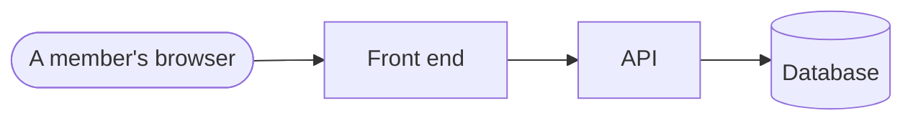
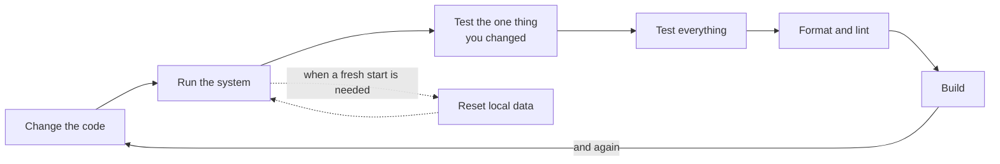
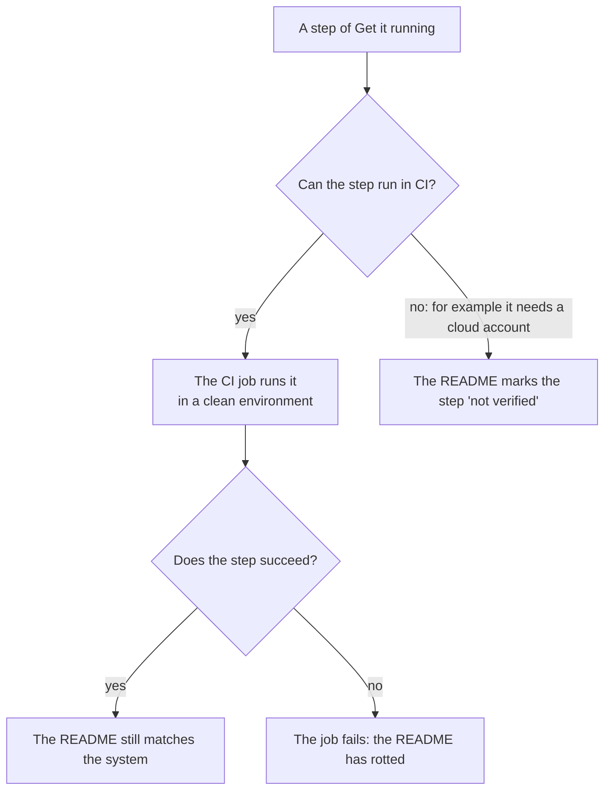

# Project README

This file sets the standard for the README, the front door of a project's repository. It says what the README is for, lists its ten parts, sets the README of each stack folder, and sets the rule that keeps the README true: a CI job runs its "get it running" steps in a clean environment. [01-why-and-scope.md](01-why-and-scope.md) says why the baseline exists, [02-vocabulary.md](02-vocabulary.md) defines the terms used here, [03-stack-model.md](03-stack-model.md) sets the rules of the stack, [04-reader-profile.md](04-reader-profile.md) describes the reader profile, which pitches the README and supplies its reading paths, and [05-project-layout.md](05-project-layout.md) says where the README and the READMEs of the stack folders live. The README points to the feature docs ([06-feature-docs.md](06-feature-docs.md)), the architecture reference ([07-architecture-reference.md](07-architecture-reference.md)), the guided course ([08-course-lessons.md](08-course-lessons.md), [09-course-system-chapters.md](09-course-system-chapters.md) and [10-course-reference-pages.md](10-course-reference-pages.md)) and the deployment docs ([12-deployment-docs.md](12-deployment-docs.md)). The playbook [docs-agent.md](../docs/agents/docs-agent.md) says how the docs agent writes the README.

A few words appear here before the standard defines them in full. The **docs agent** is a fresh agent, started from the finished code, that writes the descriptive documents, the ones that say only what exists at the **tip**, the last commit of a stack. Work is delivered as a **stack** of pull requests (PRs), an ordered series in which each PR is based on the one below it and merged from the bottom up. A stack holds three kinds of PR: a **thinking PR** holds the prescriptive documents, the ones that say what will be built or how work is done, a **code PR** holds code and tests, and a **description PR** holds the descriptive documents, so the docs agent's README goes in a description PR. The **docs section** is the group of description PRs at the top of the stack, and its first PR is the **reference PR**, which holds the reference documents ([docs-agent.md](../docs/agents/docs-agent.md)). [03-stack-model.md](03-stack-model.md) explains the stack and its three kinds in full.

The word stack has a second use that the README needs. A **technology stack** is one part of a system, such as a front end or a back end, and its code lives in a **stack folder** of the repository. It is not a stack of PRs. This file says "stack of PRs" for the first and "technology stack" for the second. `AGENTS.md` is the short instruction file for agents, at the root of the repository and in each stack folder, and the **playbooks** are the guides in `docs/agents/` that give the reason beside every rule (`15-agents-md-and-playbooks.md`). Each rule below is followed by `Because:` and its reason.

## Purpose

The README is the front door of the repository: a new developer's first hour. It assumes nothing, so every command is spelled out. It is `README.md` at the root of the repository ([05-project-layout.md](05-project-layout.md)).

**Write the README for a new developer's first hour, and spell out every command.** Because: the README assumes nothing of its reader, who is a new developer in their first hour, so no command is left for them to work out.

**Let the docs agent write the README from the finished tip, and pitch it from the reader profile.** The levels in the profile decide only which basics the README explains ([04-reader-profile.md](04-reader-profile.md)), and the README still spells out every command. The README says only what exists at the tip, and the docs agent writes it in the reference PR, with the other reference documents ([docs-agent.md](../docs/agents/docs-agent.md)). Because: the agent that built the code tends to document what it meant, and cannot tell when the code does not say it, and the reader profile pitches every descriptive document except the feature docs.

**Apply every evidence rule to the README.** `17-evidence-and-truth.md` lists the eleven rules, and each applies to every document that the docs agent writes. The output that "Get it running" shows is the output that the docs agent captured by running the steps. Because: the team reads line by line, so one wrong sentence costs more than a missing one.

## The ten parts

The README has ten parts, in this order. The list gives each part with what it holds.

1. **What this is.** A paragraph plus a diagram of how the main pieces fit.
2. **Where to go next.** Links by what you want to do (understand, contribute, operate), pointing to the features, architecture, course and deployment docs. The reading paths come from the reader profile.
3. **Prerequisites.** Every tool with its pinned version and install command, and the accounts or access you need.
4. **Get it running.** Numbered steps from `git clone` to a running system, each with the exact command and the output you should see, ending with a check that proves it works.
5. **The daily loop.** The commands you repeat (run, test one thing, test everything, format and lint, build, reset local data), with a flow diagram.
6. **Repo map.** A tree of the folders with one line each, linking to each folder's own README and `AGENTS.md`.
7. **How we work.** The stacked-PR workflow in brief, and how AI agents are used here, linking to the playbooks.
8. **Configuration.** The essentials for local development and where the full table lives.
9. **Troubleshooting the first hour.** A table of common setup errors and their fixes.
10. **Help, contributing and licence.**

Every README has these ten parts, in this order. The standard requires its checker to verify the required sections and the minimum number of diagrams of every document type that is present (`22-tooling-requirements.md`).

### The diagrams

**Draw at least two diagrams: how the main pieces fit, in part 1, and the flow of the daily loop, in part 5.** Because: this is the minimum for a README in the baseline's rules for diagrams, and each diagram has to answer a question that the text cannot answer as well: the minimum keeps the count high, and the question keeps it honest (`16-diagrams.md`).

The two diagrams below are for the made-up hiking club app of [06-feature-docs.md](06-feature-docs.md), and they show the form only. The first is the diagram of part 1.



*The main pieces of the made-up hiking club app are a front end, an API and a database, and the one thing to notice is that the front end reaches the database only through the API.*

The second is the flow diagram of part 5. In a Mermaid flowchart, `-.->` draws a dotted arrow, which is how the diagram draws the reset as a side trip that is taken only when it is needed.



*The daily loop runs from a change through run, test, format and lint, and build, and the one thing to notice is that resetting local data is drawn as a dotted side trip from the run step and not as a step of the loop.*

### Part 2: where to go next

Part 2 groups its links by what the reader wants to do: understand, contribute or operate. Its reading paths come from the reader profile, where the docs agent generates them, by role, as a section of `docs/reader-profile.md` ([04-reader-profile.md](04-reader-profile.md)).

### Parts 3 and 4: the tools and the steps

**Give every tool in "Prerequisites" its pinned version and its install command, and name the accounts or access that the reader needs.** Because: the README assumes nothing, so the reader is not left to guess a version, a command or an account.

**Write "Get it running" as numbered steps from `git clone` to a running system, give each step its exact command and the output that the reader should see, and end with a check that proves that it works.** Capture the output by running the step. Because: the README assumes nothing, so every command is spelled out, and output is captured by running it and never written from memory (`17-evidence-and-truth.md`).

### Parts 6 and 7: the map and the way of working

**Give every folder in the repo map one line, and link each folder's own README and `AGENTS.md`, where it has them.** Because: each stack folder has its own README and its own `AGENTS.md` ([05-project-layout.md](05-project-layout.md)), so the map has them to link.

**In "How we work", say in brief how stacked PRs are used and how AI agents are used, and link to the playbooks.** The playbook [stacks.md](../docs/agents/stacks.md) covers the stacked-PR workflow, and `15-agents-md-and-playbooks.md` lists the playbooks. Because: the rules reach the agents through one short instruction file and playbooks that give the reason beside each rule, so the README says it in brief and links to the playbooks.

### Parts 8 and 9: configuration and troubleshooting

Part 8 gives the essentials for local development and says where the full table lives: the deployment docs hold a table of every setting, in the area "Configuration and secrets" ([12-deployment-docs.md](12-deployment-docs.md)).

**Capture an error message that part 9 quotes by running the step that causes it, and mark an error that could not be reproduced "not verified".** Because: output is captured by running it and never written from memory, and an error message is output, and anything that could not be verified says so, in a "not verified" note (`17-evidence-and-truth.md`).

The table of part 9 of the made-up hiking club app, as an illustration:

| Error | Fix |
|---|---|
| A step stops because a tool is not found. | Install the tool at the version that "Prerequisites" pins, and open a new terminal. |
| The check at the end of "Get it running" fails because the port is already in use. | Stop what is using the port, or set another port as part 8 says. |

### A skeleton

This skeleton shows the title and the ten parts as headings, in order, for the made-up hiking club app. The text in square brackets says what each part holds. The layout is an illustration: the parts and their order are what the standard fixes.

````markdown
# Hiking club

## What this is

[A paragraph on what the project is, and a diagram of how the main pieces fit.]

## Where to go next

[Links grouped by what the reader wants to do: understand, contribute and operate. They point to the features, the architecture, the course and the deployment docs, and the reading paths come from the reader profile.]

## Prerequisites

[Every tool, with its pinned version and the command that installs it, and the accounts or access that the reader needs.]

## Get it running

1. [What the step does.]

   ```bash
   <the exact command>
   ```

   You should see:

   ```text
   <the output, captured by running the command>
   ```

2. [The next step, in the same form.]

[The last step is a check that proves that it works.]

## The daily loop

[The commands that are repeated: run, test one thing, test everything, format and lint, build and reset local data, with a flow diagram.]

## Repo map

[A tree of the folders with one line each, linking to each folder's own README and AGENTS.md.]

## How we work

[The stacked-PR workflow in brief, and how AI agents are used here, linking to the playbooks.]

## Configuration

[The essentials for local development, and where the full table lives.]

## Troubleshooting the first hour

| Error | Fix |
|---|---|
| [A common setup error.] | [Its fix.] |

## Help, contributing and licence

[Where to get help, how to contribute and the licence.]
````

## Stack READMEs

Each stack folder gets its own small README with the same run, test and build structure as the root README, scoped to that stack. A stack folder is the folder of one technology stack. Its `AGENTS.md` is a separate file: a short one that holds the commands and the layout of the stack, filled in when the stack is introduced (`15-agents-md-and-playbooks.md`).

**Give each stack folder its own small README, with the same run, test and build structure as the root README, scoped to that stack.** Because: the repo map of the root README links each folder's own README (part 6), so each stack folder has one for the map to link.

**Let the docs agent write the READMEs of the stack folders, as it writes the root README.** Because: the stack folders' READMEs are descriptive documents like the root README ([05-project-layout.md](05-project-layout.md)), and descriptive documents are written only by the docs agent, from the finished tip.

A skeleton for the back end of the made-up hiking club app. The headings are the run, test and build structure that the standard names, and the layout is an illustration.

```markdown
# API: the back end

## Run

[The commands that run this stack, each with its exact command and the output you should see.]

## Test

[The commands that test this stack: one thing, and everything.]

## Build

[The command that builds this stack.]
```

## The verification rule

A CI job runs the "get it running" steps in a clean environment, so that the README cannot quietly rot. Steps that cannot run in CI, for example ones that need a cloud account, are marked "not verified".

**Have a CI job run the "Get it running" steps in a clean environment.** Because: the README cannot then quietly rot.

**Mark a step that cannot run in CI "not verified".** Because: anything that could not be verified says so, in a "not verified" note, and a statement that nobody ran and that is not marked "not verified" is an unverified claim (anti-goal A6 in [01-why-and-scope.md](01-why-and-scope.md); `17-evidence-and-truth.md`).

A note on a made-up step of the hiking club app, as an illustration:

```markdown
**Not verified.** This step needs a cloud account, so it cannot run in CI.
```



*Each step of Get it running is either run by the CI job in a clean environment or marked not verified, and the one thing to notice is that a step that fails in the job fails the job, so the README cannot quietly rot.*

The CI job is part of the tooling, which the checkers section of the standard covers (`22-tooling-requirements.md`). The standard fixes what the job must do. It does not say that any particular repository already runs one.
