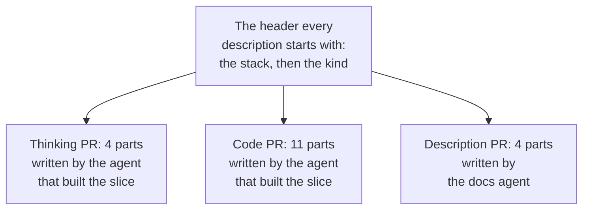
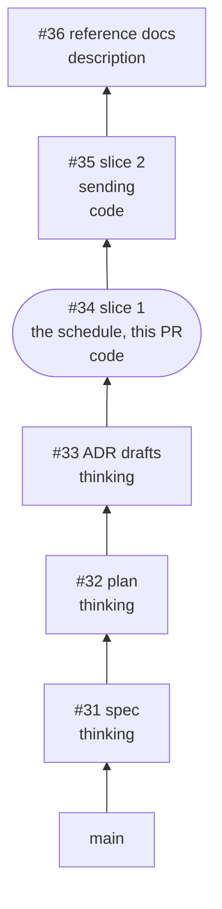
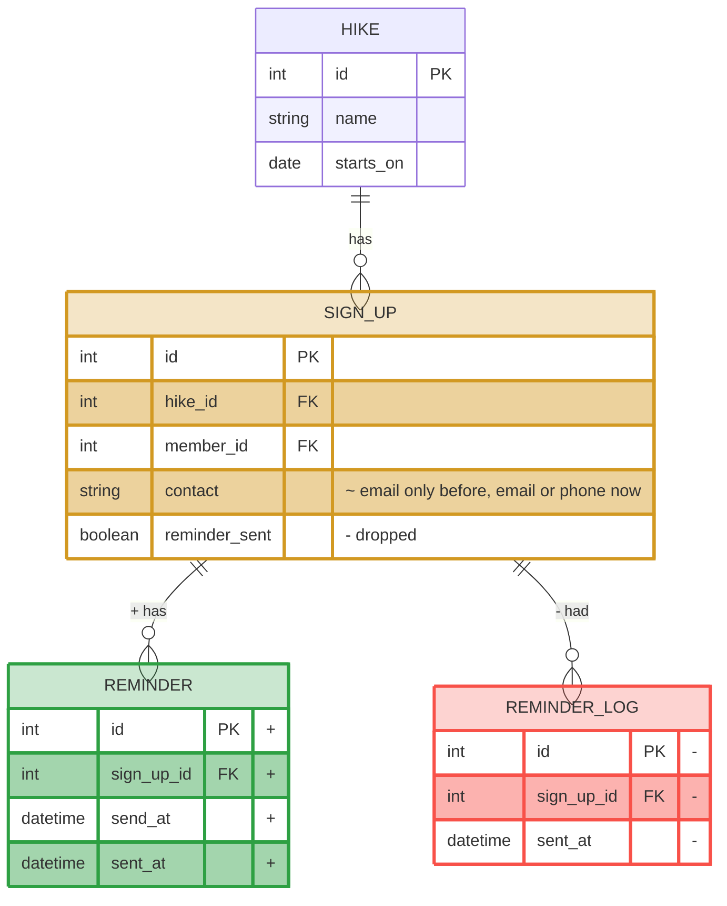

# PR descriptions

This file sets the standard for the description of a pull request (PR), the text that a human reviewer reads first. It says who writes a description and how long it may be, gives the header that every description starts with, gives the form of the description for each of the three kinds of PR, and sets the diagram that a PR with a database change carries. [01-why-and-scope.md](01-why-and-scope.md) says why the baseline exists, [02-vocabulary.md](02-vocabulary.md) defines the terms used here, [03-stack-model.md](03-stack-model.md) sets the rules of the stack and its three kinds of PR, [06-feature-docs.md](06-feature-docs.md) introduces the made-up hiking club app that the examples use, [07-architecture-reference.md](07-architecture-reference.md) sets the data file whose diagram of the current schema is not the diagram of this file, and [11-adrs.md](11-adrs.md) sets the ADRs that a code PR follows. The playbook [pr-descriptions.md](../docs/agents/pr-descriptions.md) states the same rules as instructions to an agent.

A few words appear here before the standard defines them in full. Work is delivered as a **stack** of PRs, an ordered series in which each PR is based on the one below it and merged from the bottom up. A stack holds three kinds of PR: a **thinking PR** holds the prescriptive documents, the ones that say what will be built or how work is done, a **code PR** holds code and tests, and a **description PR** holds the descriptive documents, the ones that say only what exists at the **tip**, the last commit of the stack. A **slice** is a logical group of code that becomes one code PR, and the **docs section** is the group of description PRs at the top of the stack. The **docs agent** is a fresh agent, started from the finished code, that writes the descriptive documents. An **ADR** is an architecture decision record: one file for one decision, with the options that were explored. A **ruling** is a decision that an agent takes on the Software Engineer's behalf, without stopping to ask, and records as `Ruling: what, why, cost if wrong`. An **execution skill** is a skill that carries out a plan task by task; in superpowers they are `subagent-driven-development` and `executing-plans`. A **migration** is a change to the shape of the stored data. [03-stack-model.md](03-stack-model.md) explains the stack and its three kinds in full.

The word "description" has two uses in this file. The description of a PR is the text that this file sets, and a description PR is one of the three kinds of PR. Each rule below is followed by `Because:` and its reason.

## Purpose

The description of a PR is what a human reviewer reads first. The agent that built the slice writes the descriptions of thinking PRs and code PRs. The docs agent produces the description PRs, and it writes their descriptions in the form that this file gives (`18-docs-agent.md`).

There is no length limit, and a description should be readable in one sitting, after the thinking PRs. Because: detail is always at its maximum, since humans keep control of code that agents write only if they can understand the system, and a length budget would cut what they need (constraint C6 in [01-why-and-scope.md](01-why-and-scope.md)). A reviewer reads the thinking first, then the code, then the documents that describe what was built ([03-stack-model.md](03-stack-model.md)), so a description is read after the thinking PRs.

**Give each kind of PR its own form of description, after the header that every description shares.** Because: each kind is reviewed in a different way: thinking is read for intent and soundness, code for correctness, and description for whether it matches the code ([03-stack-model.md](03-stack-model.md)).



*Every description starts with the same header and then takes the form of its kind, and the one thing to notice is that the code PR's form has eleven parts against four for each of the other two.*

### What the checker verifies

The standard requires its checker to make the PR checks on every PR, scoped to what that PR contains, and each of them blocks a PR that fails it (`22-tooling-requirements.md`). The checker infers the kind of the PR from the paths that the PR touches ([03-stack-model.md](03-stack-model.md) explains how the kind is decided), and it verifies four things.

1. The description is complete for its kind.
2. The "Implements" links of a code PR resolve.
3. The description holds no attribution line.
4. When the migrations of a PR changed, the schema-diff block is present and fresh ("Database changes" says what the block is).

A PR that mixes kinds gets a notice, and the notice never blocks the PR: it is a comment that groups the PR's files by kind and shows where the PR could be split. Because: mixing kinds is allowed, and the notice exists because a mixed PR is harder to review ([03-stack-model.md](03-stack-model.md)). The standard fixes what the checker must do. It does not say that any particular repository already runs one.

### Attribution lines

**Add no attribution line to the description of a PR, and none to a commit message: no co-author trailer and no "generated with" line.** Because: Claude Code adds such lines by default, so `AGENTS.md` states the rule explicitly (`15-agents-md-and-playbooks.md`; the convention is in [03-stack-model.md](03-stack-model.md)). The checker verifies the rule for the description of every PR, as the list above says.

## The header every PR starts with

Whatever its kind, every PR carries the same header at the top of its description. The header holds the stack and the kind, in four parts.

1. **Which PR this is:** its place in the stack, written "n of N".
2. **The stack table, a table of the whole stack that gives each PR's kind, link and one-line purpose.** It is also where the grouping of the code into slices appears. Because: the reviewer then sees the shape before reading any code (rule 6 in [03-stack-model.md](03-stack-model.md)).
3. **A stack diagram, when there are three or more PRs.** Because: this is the minimum for a PR description in the baseline's rules for diagrams, and each diagram has to answer a question that the text cannot answer as well: the minimum keeps the count high, and the question keeps it honest (`16-diagrams.md`).
4. **The kind of the PR:** thinking, code or description. Because: each kind is reviewed in a different way, and the kind says which form follows the header.

Every description carries the stack table, so each of them is out of date as soon as the stack changes. The playbook [pr-descriptions.md](../docs/agents/pr-descriptions.md) says how they are kept current.

The header as a skeleton to copy, which each of the three forms below starts from:

````markdown
## Stack

PR <n> of <N>

| PR | Kind | Purpose |
|---|---|---|
| #<number> | <thinking, code or description> | <one line> |

<the stack diagram, when the stack has three or more PRs>

## Kind

<thinking, code or description>
````

The example is the header of PR 4 in a made-up stack of six PRs for the hiking club app of [06-feature-docs.md](06-feature-docs.md): the stack adds the reminders that members get before a hike. "n of N" counts the PRs from the bottom of the stack, so this is PR 4 of 6, and `#34` is the number that GitHub gives the PR. The PR being read is marked in the table with "(this PR)" and in the diagram by the rounded node, and the two code PRs show that the agent grouped the code into two slices.

The first line of the header reads "PR 4 of 6", and the header carries this table:

| PR | Kind | Purpose |
|---|---|---|
| #31 | thinking | The spec for the reminders, as brainstorming produced it |
| #32 | thinking | The plan, as writing-plans produced it |
| #33 | thinking | ADR drafts: where the reminders are sent from |
| #34 (this PR) | code | Slice 1: the reminder schedule and its table |
| #35 | code | Slice 2: sending the reminders |
| #36 | description | The reference documents for the reminders |

It carries this diagram, because the stack has six PRs. In a Mermaid flowchart, a node written with `([` and `])` is drawn rounded, which is how the diagram marks the PR being read.



*The stack runs from main at the bottom to the reference docs on top, and the one thing to notice is that the rounded node marks the PR being read, with the PRs it builds on below it and the PRs built on it above.*

The last part of the header gives the kind, which for this PR is "code".

## Thinking PRs

A thinking PR holds prescriptive documents, committed as they were produced: the spec, the plan, ADR drafts, any other kept skill artifact, a standards update, the reader profile or a baseline-owned playbook ([03-stack-model.md](03-stack-model.md)). A **kept skill artifact** is a document that a skill produced and that stays in the repository. The description of a thinking PR is short, and four parts follow its header.

1. **What the artifact is.**
2. **Which skill or tool produced it.**
3. **What to read first.**
4. **The decisions it contains.**

**Give a thinking PR no verification part.** Because: the artifact is committed untouched.

The skeleton, after the header:

````markdown
<the header, as above, with the kind set to thinking>

## What the artifact is

<one or two sentences>

## Produced by

<the skill or tool, for example superpowers:brainstorming>

## Read this first

<the part to start with>

## Decisions it contains

<the decisions, one line each>
````

The made-up example below is for PR 1 of the stack above, with the header left out:

```markdown
## What the artifact is

The design for the hike reminders: what members are told before a hike, and which part of the system tells them.

## Produced by

superpowers:brainstorming

## Read this first

The Approaches section, which gives the options for where reminders are sent from, with the pick and why.

## Decisions it contains

- Reminders are sent by a separate reminder service and not by the API.
- A member gets one reminder, on the day before the hike.
```

## Code PRs

A code PR holds the code and its tests, and a docstring or a comment counts as code too ([03-stack-model.md](03-stack-model.md)). Its description is written by the agent that built the slice, and it follows the full template: eleven parts after the header, in this order.

1. **Implements.** Links to the spec, the plan and the ADRs that the PR follows.
2. **Why.** Two to four sentences.
3. **What changes.** The changes, grouped by idea and not by file.
4. **How it works.** Diagrams where they help (flow, sequence, state), and the auto-maintained schema diagram when the database changes ("Database changes" below).
5. **How to review.** Where to start, the reading order and what to skim.
6. **How it was verified.** The commands run and their results, what was tried by hand, and what was not verified. Verification is reported in whatever terms the project and its skills use.
7. **Risks and rollout.** Migrations, the deploy order (data, then back end, then client), rollback and data-loss risk.
8. **Rulings I made.** The execution skill's list of rulings, each with what it costs if wrong.
9. **Ideas introduced.** One line for each new concept, with a link to its lesson once the docs section exists.
10. **Out of scope and follow-ups.** What the PR leaves out of its scope, and what is to follow it.
11. **Docs owed.** An auto-generated list of what the docs section will cover for this change.

**Give every code PR these eleven parts, in this order.** Because: each kind of PR has its own form, since each kind is reviewed in a different way. The standard requires the checker to verify that the description is complete for its kind (`22-tooling-requirements.md`).

**Link the spec, the plan and the ADRs in "Implements".** Because: a future reader can then follow why, how and what through the history (rule 9 in [03-stack-model.md](03-stack-model.md)). The standard requires the checker to verify that these links resolve (`22-tooling-requirements.md`).

**Draw each diagram of "How it works" in Mermaid, the baseline's default for diagrams, with a one-line caption saying what it shows and the one thing to notice, and with no colour of your own except the approved palette.** The baseline's rules for diagrams set the minimum for a PR description: a stack diagram when there are three or more PRs, plus how it works. Because: each diagram has to answer a question that the text cannot answer as well, and hard-coded colours are what break a diagram in one theme (`16-diagrams.md`).

**Report verification in the terms that the project and its skills use, and say what was not verified.** Because: verification is a per-project standard and not the baseline's (non-goal N1 in [01-why-and-scope.md](01-why-and-scope.md)), and anything that could not be verified says so, in a "not verified" note (`17-evidence-and-truth.md`).

**List every ruling under "Rulings I made", with what it costs if wrong.** Because: the docs agent takes its list of deviations from the plan out of these lists, and the execution skills promise that they are exhaustive (`18-docs-agent.md`). A made-up ruling for PR 4 of the stack above, in the form that the execution skills log:

```text
Ruling: send the reminder at 09:00 on the day before the hike, because neither the spec nor the plan gives a time of day. Cost if wrong: one constant to change.
```

The "Docs owed" list is used in a small change as well. A change with no spec that affects documents becomes a two-PR stack, the code PR and then a description PR from the docs agent, and the "Docs owed" list of the code PR says what the description PR will cover (rule 11 in [03-stack-model.md](03-stack-model.md)).

The skeleton, after the header:

````markdown
<the header, as above, with the kind set to code>

## Implements

<links to the spec, the plan and the ADRs this PR follows>

## Why

<two to four sentences>

## What changes

<grouped by idea, not by file>

## How it works

<diagrams where they help, and the schema diagram when the database changes>

## How to review

<where to start, the reading order, what to skim>

## How it was verified

<commands and results, what was tried by hand, what was not verified>

## Risks and rollout

<migrations, deploy order, rollback, data-loss risk>

## Rulings I made

<the execution skill's list, each with what it costs if wrong>

## Ideas introduced

<one line per new concept, with a link to its lesson once the docs section exists>

## Out of scope and follow-ups

<what the PR leaves out of its scope, and what is to follow it>

## Docs owed

<what the docs section will cover for this change>
````

## Description PRs

A description PR holds the docs section: the reference documents, the lessons, the system chapters, the reference pages and the docs agent's review edits to ADRs ([03-stack-model.md](03-stack-model.md)). Its description is written by the docs agent, and four parts follow its header.

1. **What is documented and how it was checked:** the excerpts verified, the commands run and the diagrams rendered. Because: every factual claim in a descriptive document is checked against the code or a real run, and this part says how (`17-evidence-and-truth.md`).
2. **Not verified:** anything that the docs agent could not check. Because: anything that could not be verified says so, in a "not verified" note (`17-evidence-and-truth.md`).
3. **Deviations from the plan,** taken from the rulings. Because: the execution skills promise that the "Rulings I made" lists are exhaustive, whereas the history of the plan file shows only the edits that were made, so the docs agent builds the deviations from the lists (`18-docs-agent.md`).
4. **Flagged code:** the places where the code was unclear to a fresh reader. Each is fixed in the code PR that it belongs to, and never in a description PR. Because: code is kept out of a description PR for easier review, since a description PR is reviewed for whether it matches the code, so a fix made in it would not be reviewed as code. When the fix is in, the docs are rebased and re-verified ([03-stack-model.md](03-stack-model.md)).

The skeleton, after the header:

````markdown
<the header, as above, with the kind set to description>

## What is documented and how it was checked

<the documents, and the excerpts verified, commands run and diagrams rendered>

## Not verified

<anything the docs agent could not check>

## Deviations from the plan

<taken from the Rulings I made lists>

## Flagged code

<places where the code was unclear to a fresh reader, and the code PR each fix belongs in>
````

The made-up example below is for PR 6 of the stack above, with the header left out:

```markdown
## What is documented and how it was checked

The architecture reference and the feature page for the reminders. Every code excerpt was checked against the file it names, the commands of the README were run and their output captured, and every diagram rendered in the dark and the light theme.

## Not verified

The email provider's delivery report. It needs a real account, so the step is marked not verified.

## Deviations from the plan

The plan did not give a time of day for the reminder, and the code sends it at 09:00 (a ruling in PR 4).

## Flagged code

The function that picks the send time of a reminder does not say why it rounds down. The fix, a comment or a clearer name, belongs in PR 4.
```

## Database changes

A PR that changes the database, one whose migrations change the shape of the stored data, carries a diagram of the schema in the "How it works" part of its description. It is not the diagram of the current schema. That one is generated from the real database and lives in the data file of the architecture reference ([07-architecture-reference.md](07-architecture-reference.md)), while the diagram here shows the change that one PR makes. The palette and the theme rules for every diagram are set in `16-diagrams.md`.

**Show the schema as it is after the PR, in a colour-coded diagram that highlights what the PR changes against the PR's base.** In a stack the base is the PR below. Because: each PR then shows only its own change.

CI maintains the diagram: it keeps it current inside a marked block of the PR description and refreshes it on every push. The standard requires the checker to fail a PR whose migrations changed and whose block is missing, and to verify that the block is fresh (`22-tooling-requirements.md`). The standard fixes that the block is marked and leaves the form of the marker to the tooling.

Four colours carry the meaning of the diagram.

| Colour | What it means |
|---|---|
| Green | Added |
| Red | Removed |
| Amber | Changed |
| Plain, with no colour | Unchanged |

**Use the approved palette for the colours, and no other colour in the diagram.** The palette is a translucent tint and a solid border of the same colour, with no text colour set, and its three `classDef` lines are in the example below. Because: hard-coded colours are what break a diagram in one theme, so emphasis colour comes only from the approved palette (`16-diagrams.md`). The standard requires the checker to reject any hard-coded colour outside the palette (`22-tooling-requirements.md`).

**Mark every change to a column or to a relationship in the text of the diagram, with `+` for added, `~` for changed and `-` for removed.** Because: Mermaid can colour a whole table but not a single column or a relationship line, so the markers say what the colour cannot, and colour never carries the meaning alone. Mermaid accepts the markers in two places, the quoted comment at the end of an attribute and the quoted label of a relationship, so they go there.

The example is the diagram that PR 4 of the made-up stack above would carry, for a made-up schema of the hiking club app. Slice 1 adds the `REMINDER` table, drops the `REMINDER_LOG` table that it replaces, and changes `SIGN_UP`: the `contact` column takes a phone number as well as an email address, and the `reminder_sent` column is dropped. `HIKE` is unchanged, so it stays plain. In a Mermaid entity-relationship diagram, `classDef` defines a named style, and `class SIGN_UP changed` gives the entity `SIGN_UP` the style `changed`. The three `classDef` lines are the approved palette, exactly.



*The diagram shows the made-up schema after PR 4 against the PR below it, with SIGN_UP amber, REMINDER green and REMINDER_LOG red, and the one thing to notice is that the markers `+`, `~` and `-` in the text say which column and which relationship changed, because the colour covers only whole tables.*

How GitHub's own bundled Mermaid renders the colours of an entity has not yet been confirmed, and the way to confirm it is to try the example in a throwaway PR. If GitHub does not render them, the fallback is a flowchart-based diagram of the schema, which styles reliably. The markers are text, so they show whatever Mermaid does with the colours.
