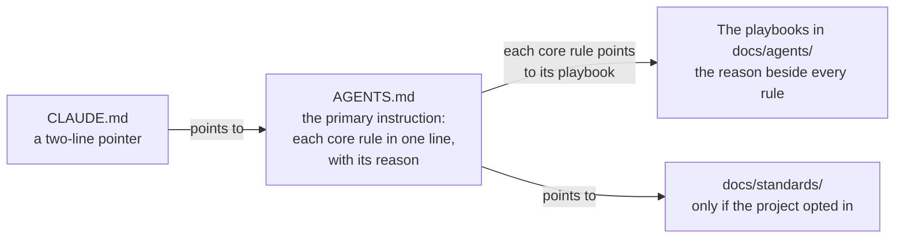
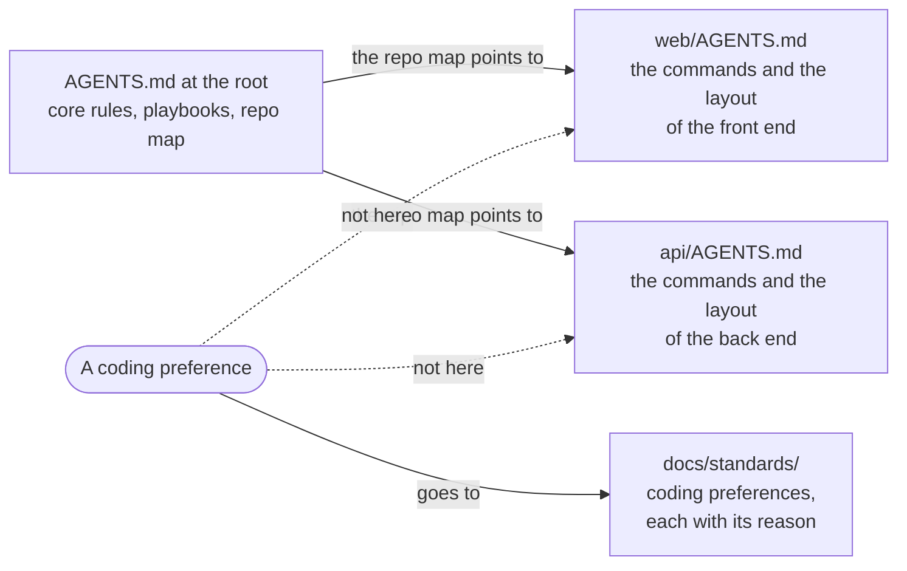
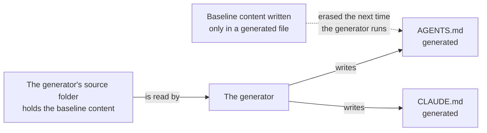

# AGENTS.md and the playbooks

This file sets the standard for the files that carry the baseline's rules to the agents: `AGENTS.md`, `CLAUDE.md` and the six playbooks in `docs/agents/`. It says what `AGENTS.md` holds and how the short `AGENTS.md` of a stack folder differs from it, what `CLAUDE.md` is, which playbooks there are, with the subject of each and when to read it, the rules for the files themselves, two that apply to `AGENTS.md` and to the playbooks and a third that applies to the playbooks alone, and what to do in a project where a tool generates `AGENTS.md`. [01-why-and-scope.md](01-why-and-scope.md) says why the baseline exists, [02-vocabulary.md](02-vocabulary.md) defines the terms used here, [03-stack-model.md](03-stack-model.md) sets the rules of the stack, [04-reader-profile.md](04-reader-profile.md) describes the reader profile that `AGENTS.md` points to, [05-project-layout.md](05-project-layout.md) says where these files live and which of them the baseline owns, [11-adrs.md](11-adrs.md) and [14-pr-descriptions.md](14-pr-descriptions.md) set two of the subjects that the playbooks cover, and [13-project-readme.md](13-project-readme.md) sets the README, which links to the playbooks.

A few words appear here before the standard defines them in full. Work is delivered as a **stack** of pull requests (PRs), an ordered series in which each PR is based on the one below it and merged from the bottom up. A stack holds three kinds of PR: a **thinking PR** holds the prescriptive documents, the ones that say what will be built or how work is done, a **code PR** holds code and tests, and a **description PR** holds the descriptive documents, the ones that say only what exists at the **tip**, the last commit of the stack. The **docs agent** is a fresh agent, started from the finished code, that writes the descriptive documents. An **ADR** is an architecture decision record: one file for one decision, with the options that were explored. A **ruling** is a decision that an agent takes on the Software Engineer's behalf, without stopping to ask, and records as `Ruling: what, why, cost if wrong`. A **skill** is a packaged set of instructions that an agent follows for one kind of work, and superpowers is a set of skills. [03-stack-model.md](03-stack-model.md) explains the stack and its three kinds in full.

The word stack has a second use that this file needs. A **technology stack** is one part of a system, such as a front end or a back end, and its code lives in a **stack folder** of the repository. It is not a stack of PRs. This file says "stack of PRs" for the first and "technology stack" for the second. Each rule below is followed by `Because:` and its reason.

## Purpose

The rules of the baseline reach the agents through one short instruction file, with playbooks that give the reason beside each rule. The instruction file is `AGENTS.md`: one at the root of the repository, and a short one in each stack folder. `CLAUDE.md` is a two-line pointer to `AGENTS.md`. The playbooks are the six guides in `docs/agents/`, and each gives the rules of one subject, with the reason beside every rule. [05-project-layout.md](05-project-layout.md) shows where each of these files lives.



*A rule reaches an agent through pointers: CLAUDE.md points to AGENTS.md, which points on to the playbooks and, when the project has them, to the standards, and the one thing to notice is that CLAUDE.md has a single arrow out and holds no rule of its own.*

## AGENTS.md

`AGENTS.md` is at the root of the repository. It is short, about 100 lines, and it is the primary instruction for working in the repository. If the Software Engineer says something different in the conversation, the conversation wins for that task.

**Keep `AGENTS.md` short, about 100 lines.** Because: the rules reach the agents through one short instruction file, and the playbooks give the reason beside each rule, so `AGENTS.md` holds each core rule in one line and points to the playbook that explains it.

**Let the conversation win for that task when the Software Engineer says something different in it.** Because: the Software Engineer is the one who decides (`20-working-rules.md`).

`AGENTS.md` holds four things.

1. **Who and what.** The project's name and purpose, the Software Engineer, the person who decides, and a pointer to the reader profile ([04-reader-profile.md](04-reader-profile.md)).
2. **The core rules,** one line each with its reason, each pointing to the playbook that explains it. "The core rules" below gives the seven.
3. **The playbooks,** each with when to read it. "The playbooks" below lists the six.
4. **The repo map,** with each stack's own `AGENTS.md`. "A stack folder's AGENTS.md" below says what that file holds.

### The core rules

The standard fixes seven core rules. The table gives each one with its reason and the playbook that explains it.

| Core rule | Because | The playbook that explains it |
|---|---|---|
| **Work as stacks, and keep each PR to one kind.** A stack is the spec, the plan, the ADR PRs, the code in slices and the docs section. | Each kind of PR is easier to review on its own ([03-stack-model.md](03-stack-model.md)). | [stacks.md](../docs/agents/stacks.md) |
| **Keep one repository per project.** | A stack cannot span repositories, and in one repository an agent sees the whole product (constraint C1 in [01-why-and-scope.md](01-why-and-scope.md)). | [stacks.md](../docs/agents/stacks.md) |
| **Let skills run as written and write where they write, and never edit a skill's documents to fit the baseline.** A skill's own later revision of a document gets its own PR. | The baseline sits beside the skills and changes nothing about how they work, so a document that a skill produced stays as the skill produced it (constraint C4 and anti-goal A9 in [01-why-and-scope.md](01-why-and-scope.md)). | [stacks.md](../docs/agents/stacks.md) |
| **Merge, deploy and publish nothing unless the Software Engineer asks.** | Merging, deploying and publishing are the Software Engineer's calls, and the merge of a stack is also the acceptance of its ADRs (`20-working-rules.md`). | [working-with-the-engineer.md](../docs/agents/working-with-the-engineer.md) |
| **Never put an attribution line in a commit message or a PR description.** That means no co-author trailer and no "generated with" line. | Claude Code adds such lines by default, so `AGENTS.md` states the rule explicitly. | [stacks.md](../docs/agents/stacks.md) |
| **Write the descriptive documents only with the fresh docs agent, from the finished tip.** | The agent that built the code tends to document what it meant, and cannot tell when the code does not say it (`18-docs-agent.md`). | [docs-agent.md](../docs/agents/docs-agent.md) |
| **Propose a standard in the chat, and never write one silently.** | A standard drives code, and only the Software Engineer's approval writes one (`19-standards-mechanism.md`). | [standards.md](../docs/agents/standards.md) |

**Give each core rule one line in `AGENTS.md`, with its reason and a pointer to the playbook that explains it.** Because: the rules reach the agents through one short instruction file with playbooks that give the reason beside each rule.

### A stack folder's AGENTS.md

Each stack folder gets a short `AGENTS.md` of its own. It holds the commands and the layout of the technology stack, and it is filled in when the stack is introduced. `baseline.yml` lists the stack folders ([05-project-layout.md](05-project-layout.md)).

**Put a coding preference in `docs/standards/`, and not in a stack folder's `AGENTS.md`.** Because: a standard records its reason, scope, date and source, and its scope can be one stack folder, so a preference for one stack still has its home in `docs/standards/` (`19-standards-mechanism.md`; [05-project-layout.md](05-project-layout.md)). The folder `docs/standards/` exists only if the project opted in.

In a Mermaid flowchart, `-.->` draws a dotted arrow, which this diagram uses for the two places that a coding preference does not go to.



*The repo map in the root AGENTS.md points to the AGENTS.md of each stack folder, and the one thing to notice is that a coding preference goes to docs/standards/ while the dotted arrows show that it does not go to a stack folder's AGENTS.md.*

A skeleton for the back end of the made-up hiking club app of [06-feature-docs.md](06-feature-docs.md). The headings are an illustration: the standard fixes that the file holds the commands and the layout of the stack.

```markdown
# API: instructions for working in this folder

## Commands

[The commands that run, test and build this stack.]

## Layout

[Where things live in this folder.]
```

### The baseline-owned block

Only a marked block of `AGENTS.md` is baseline-owned. It carries a marker with the baseline version and is replaced on update, and the rest of the file is the project's, which an update leaves as it is ([05-project-layout.md](05-project-layout.md)).

**Treat only the marked block of `AGENTS.md` as baseline-owned.** Because: the marker tells an update which lines belong to the baseline, so an update replaces that block and nothing else in the file ([05-project-layout.md](05-project-layout.md)).

### A skeleton and an example

The skeleton shows the four parts of the `AGENTS.md` of the made-up hiking club app, and the text in square brackets stands for what is left out. It shows the form and not the wording, because the standard fixes what `AGENTS.md` holds.

````markdown
# Instructions for working in the hiking club app

This file is the primary instruction for working on the hiking club app. If the Software Engineer says something different in the conversation, the conversation wins for that task, because they are the one who decides.

## Who and what

The hiking club app lets members propose hikes and sign up for them, and lets group leaders approve proposed hikes. The Software Engineer is Alex Example. `docs/reader-profile.md` says who the documents are written for.

## The core rules

1. **Work as stacks, and keep each PR to one kind.** Because: each kind is easier to review on its own. Playbook: `docs/agents/stacks.md`.
2. **Keep one repository per project.** Because: a stack cannot span repositories, and in one repository an agent sees the whole product. Playbook: `docs/agents/stacks.md`.

[The other five core rules, in the same form: one line each, with its reason and its playbook.]

## The playbooks

- `docs/agents/working-with-the-engineer.md`: read it at the start of every task.

[The other five playbooks, each with when to read it.]

## The repo map

- `web/` is the front end. Its instructions are in `web/AGENTS.md`.
- `api/` is the back end. Its instructions are in `api/AGENTS.md`.
- `docs/` holds the documents, and `docs/agents/` holds the playbooks.
````

## CLAUDE.md

`CLAUDE.md` is a two-line pointer to `AGENTS.md`.

**Keep `CLAUDE.md` to a pointer, with no rule of its own.** Because: `AGENTS.md` is the primary instruction for working in the repository.

A made-up `CLAUDE.md`:

```markdown
The instructions for working in this repository are in `AGENTS.md`.
Read that file first.
```

## The playbooks

The playbooks are the six guides in `docs/agents/`. Each gives the rules of one subject, with the reason beside every rule, and the standard file named in the second column sets the same subject in full. The table lists them in order, with each playbook's subject and an example of when to read it. The standard fixes that `AGENTS.md` lists the playbooks, each with when to read it, and the wording of the last column is an illustration.

| Playbook | Its subject, and the standard file for the same subject | When to read it, as an illustration |
|---|---|---|
| [working-with-the-engineer.md](../docs/agents/working-with-the-engineer.md) | Which decisions are the Software Engineer's and which an agent takes itself, how a decision is put to them, what an agent does while they are busy, how a report is built and how a ruling is recorded. The standard file is `20-working-rules.md`. | When a task begins, whenever it is unclear who owns a choice, before putting a question to the Software Engineer and before writing a report. |
| [stacks.md](../docs/agents/stacks.md) | How work is delivered as a stack: the kinds of PR a stack holds, the rules and conventions that govern it, `gh stack` (the GitHub CLI extension for stacked PRs), how a stack is cut from linear history and opened, how a small change is handled, and where the baseline meets the skills. The standard files are [03-stack-model.md](03-stack-model.md) and, for the seams, `21-skills-seams.md`. | When work is ready to be committed for a PR, when a stack is to be cut, opened or extended, when a skill has produced a document, when it is unclear which PR a change belongs to, and for a small change. |
| [pr-descriptions.md](../docs/agents/pr-descriptions.md) | What goes in the description of a PR: the header that every description starts with, the form for each of the three kinds, and keeping the stack tables current. The standard file is [14-pr-descriptions.md](14-pr-descriptions.md). | When a PR is opened, when a description is written or changed, and each time the stack changes. |
| [docs-agent.md](../docs/agents/docs-agent.md) | The brief of the docs agent, the fresh agent that writes the descriptive documents: what it reads and what it must not read, what it produces, the rules it follows and when it stops to ask. The standard file is `18-docs-agent.md`. | By the docs agent, in full, before it starts to write, and by the regular agent that builds, to learn what the docs agent will read from its work. |
| [adrs.md](../docs/agents/adrs.md) | The ADR draft: the six criteria that decide whether a decision gets one, how it is written, its lifecycle from draft to accepted, the guard rail on the docs agent's review of a draft, and the presence check on a changed dependency manifest, schema or interface file. The standard file is [11-adrs.md](11-adrs.md). | When a decision is made or adopted and it is unclear whether it needs a draft, when a draft is written or reviewed, when a dependency manifest, a schema or an interface file changes, and when the state of an ADR is asked. |
| [standards.md](../docs/agents/standards.md) | The standards of a project: what may go in `docs/standards/`, how a preference is proposed and approved before it is written, how wrong generated code is handled, and what is recorded beside each rule. The standard file is `19-standards-mechanism.md`. | When a preference shows up in a conversation or a review comment, before code is generated, when generated code turns out wrong, and when a rule is to be added, changed or removed. |

**Treat the playbooks as baseline-owned files.** Each carries a marker with the baseline version and is replaced on update ([05-project-layout.md](05-project-layout.md)). Because: an update that could replace what the project wrote would erase it, so the split between baseline-owned and project-owned files fixes in advance which files an update may replace.

**Put a project-specific wish in `docs/standards/` or in `baseline.yml`, and never in a playbook.** Because: an update replaces the baseline-owned files, so a wish written in a playbook would be lost at the next update, while the standards and the project's own configuration are the project's, and an update never touches them ([05-project-layout.md](05-project-layout.md)).

## Rules for the files themselves

Two rules apply to `AGENTS.md` and to the playbooks themselves, and a third to the playbooks alone.

1. **Give every rule its reason, beside it.** Because: the rules reach the agents through one short instruction file with playbooks that give the reason beside each rule, so a rule with no reason beside it does not follow what the files are for.
2. **Remove a rule whose reason is gone.** Because: this follows from the same principle, that the playbooks give the reason beside each rule, since a rule whose reason is gone would stand with nothing beside it.
3. **Hold no Markdown link in a playbook, and name another file in backticks.** Because: the playbooks are replaced on update in every project, and a project does not hold some of the files they name, the baseline's own standard, so a link would break there while a name in backticks cannot.

The standards mechanism has the same rule for the rules of `docs/standards/`, and git keeps the history of a rule that is removed (`19-standards-mechanism.md`). The playbook [working-with-the-engineer.md](../docs/agents/working-with-the-engineer.md) says what to do when you meet a rule whose reason no longer holds.

## Generated instruction files

Some tools generate `AGENTS.md`, and `CLAUDE.md` with it, from a source of their own, and such a tool may say to create docs only if they are explicitly requested. Laravel Boost may be such a tool, and the last paragraph of this section says what is not yet confirmed about it. `21-skills-seams.md` lists this among the seams between the baseline and the tools that it sits beside.

**In a project where a tool generates `AGENTS.md` (for example Laravel Boost), put the baseline content into that tool's source folder, and not into the generated file.** Because: regeneration then cannot erase it.

The dotted arrow of the diagram below marks what happens to content that is not in the source.



*The generator writes AGENTS.md and CLAUDE.md from its source folder, so what sits in the source is written again every time, and the one thing to notice is that the dotted arrow shows what happens to baseline content that sits only in a generated file: it is erased.*

The baseline adds an adapter for each generator. The adapter puts the baseline rules into the generator's source, and a standing request for the docs satisfies the generator's rule to create docs only if explicitly requested.

Whether Laravel Boost generates `AGENTS.md` and `CLAUDE.md` in this way, and from which source, has not yet been confirmed, and neither has whether a standing request for the docs satisfies its rule. This part of the standard is to be proven on a real project before it is relied on.
