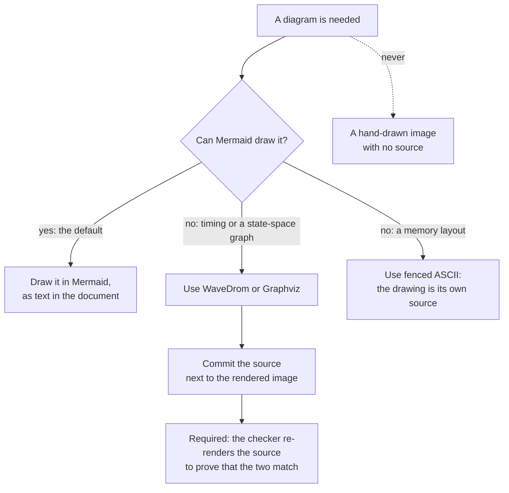
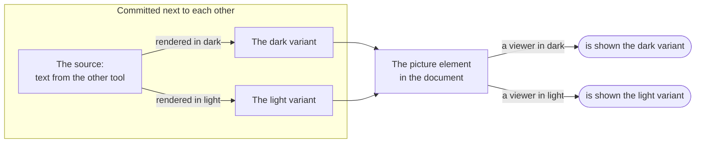
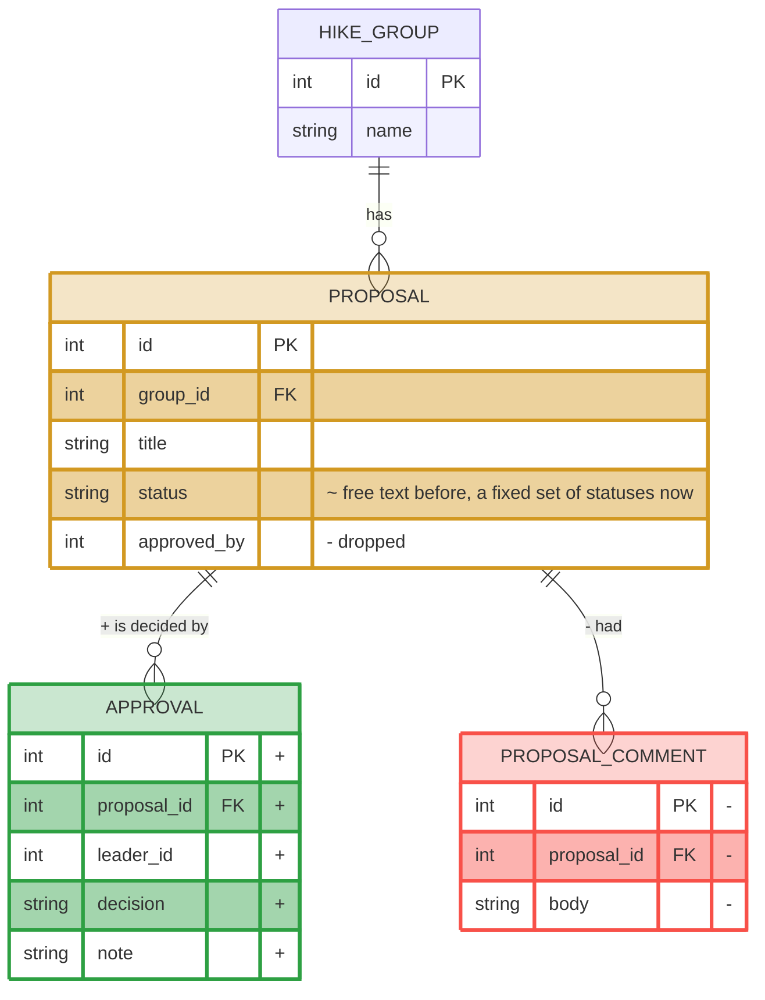
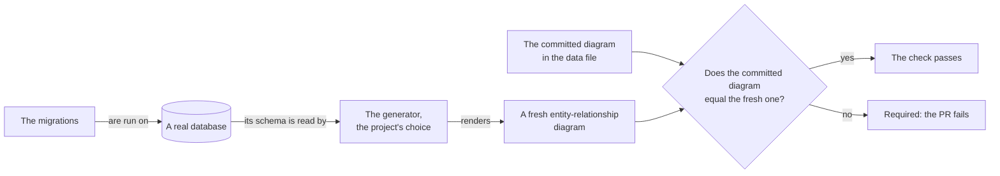

# Diagrams

This file sets the standard for diagrams, which every document of a project carries beside its text. It says how a diagram is drawn, how many diagrams each kind of document has at least, the quality rules that every diagram meets, the theme rules that keep a diagram legible in dark and in light, the approved palette for emphasis colour and the rules for the diagrams of a database. [01-why-and-scope.md](01-why-and-scope.md) says why the baseline exists, [02-vocabulary.md](02-vocabulary.md) defines the terms used here, [03-stack-model.md](03-stack-model.md) sets the rules of the stack, [06-feature-docs.md](06-feature-docs.md) introduces the made-up hiking club app that the examples use, and [07-architecture-reference.md](07-architecture-reference.md) sets the data file that holds the diagram of the current schema. The file of the standard that sets the shape of each kind of document is linked in the table under "Minimum diagrams per document". The playbook [docs-agent.md](../docs/agents/docs-agent.md) says how the docs agent writes the documents that these rules apply to.

A few words appear here before the standard defines them in full. Work is delivered as a **stack** of pull requests (PRs), an ordered series in which each PR is based on the one below it and merged from the bottom up, so the **base** of a PR in a stack is the PR below it. [03-stack-model.md](03-stack-model.md) explains the stack in full. The **description** of a PR is the text that a reviewer reads first ([14-pr-descriptions.md](14-pr-descriptions.md)). An **ADR** is an architecture decision record: one file for one decision, with the options that were explored ([11-adrs.md](11-adrs.md)). A **migration** is a change to the shape of the stored data. The **checker** is the tool that checks a project's documents and PRs against the standard, locally and in CI. Where this file says what the checker or CI does, it states what the standard requires of the tooling (`22-tooling-requirements.md`), and it does not say that any particular repository runs it today.

## How diagrams are drawn

Mermaid is the baseline's default for diagrams. Another text-based tool is for what Mermaid cannot draw, and a hand-drawn image with no source is never used. Three rules say how, and the diagram after them sums them up.

**Draw a diagram in Mermaid, unless Mermaid cannot draw it.** Mermaid covers flowcharts, sequence diagrams, state diagrams, entity-relationship diagrams, user journeys, timelines and byte-layout diagrams, which Mermaid calls `packet` diagrams. Because: Mermaid is plain text, so a PR can show a diff of it and an agent can write and fix it; GitHub renders it natively, and the documents are GitHub-flavoured Markdown plus Mermaid (constraint C2 in [01-why-and-scope.md](01-why-and-scope.md)); and the standard requires the checker to verify that every diagram parses (`22-tooling-requirements.md`).

**When Mermaid cannot draw a diagram, use another text-based tool, commit its source next to the rendered image, and have the checker re-render the source to prove that the two match.** The standard names three tools, and the table says what each is for. Fenced ASCII is the exception to the commit and the re-render: it is text already, so it is its own source, and there is no rendered image to commit beside it, to re-render or to render in two variants. Because: an image with no source cannot be diffed or verified, so the source is kept as text beside the image, and a re-render proves that the image matches it, while a fenced ASCII drawing is its own source and needs neither. The standard requires the checker to make the re-render (`22-tooling-requirements.md`).

| What it draws | The tool | What the tool is |
|---|---|---|
| Timing | WaveDrom | A text-based tool for timing diagrams. |
| State-space graphs | Graphviz | A text-based tool for graphs. A state-space graph is the graph of the states that a system can reach, and the model checker of a TLA+ specification, TLA+ being a language for specifying a system formally, can export one. |
| Memory layouts | Fenced ASCII | A drawing made of plain characters inside a code fence. |

**Never use a hand-drawn image with no source.** Because: it cannot be diffed or verified.

In a Mermaid flowchart, a dotted arrow with a label is written `-. "label" .->`, and the diagram below uses one to mark what is never done.



*A diagram is drawn in Mermaid when Mermaid can draw it, with WaveDrom or Graphviz and a committed source when it cannot, or as fenced ASCII, which is its own source, and the one thing to notice is that the only arrow to a hand-drawn image with no source is the dotted one marked never.*

## Minimum diagrams per document

The table gives the minimum number of diagrams for each kind of document. The first column links the file of the standard that sets the shape of that kind of document.

| Document | Minimum |
|---|---|
| Lesson ([08-course-lessons.md](08-course-lessons.md)) | at least 4 |
| System chapter ([09-course-system-chapters.md](09-course-system-chapters.md)) | at least 5, including the whole picture, the happy-path sequence and the failure flow |
| Architecture file ([07-architecture-reference.md](07-architecture-reference.md)) | at least 1 for each section |
| Feature page ([06-feature-docs.md](06-feature-docs.md)) | at least 2: a journey and a state or flow diagram |
| ADR ([11-adrs.md](11-adrs.md)) | one for each option, plus one showing the impact |
| Deployment docs ([12-deployment-docs.md](12-deployment-docs.md)) | the topology, the pipeline, the deploy sequence, the rollback flow, and the backup and restore flow |
| README ([13-project-readme.md](13-project-readme.md)) | at least 2 |
| Reader profile ([04-reader-profile.md](04-reader-profile.md)) | the reading-path map |
| PR description ([14-pr-descriptions.md](14-pr-descriptions.md)) | a stack diagram when there are three or more PRs, plus how it works |

**Give every document at least the minimum number of diagrams that the table sets for it.** The numbers are minimums, so a document may draw more diagrams than the table asks for. The standard requires the checker to verify the minimum number of diagrams of every document type that is present (`22-tooling-requirements.md`). Because: the baseline asks for extensive diagrams in every document (goal G2 in [01-why-and-scope.md](01-why-and-scope.md)), and the minimums keep the count high. The third quality rule keeps it honest.

A section of an architecture file that stays as one line, `Not applicable: why`, has no diagram, as [07-architecture-reference.md](07-architecture-reference.md) says. `17-evidence-and-truth.md` gives the rule for a section that does not apply.

## Quality rules

Every diagram meets four quality rules.

1. **Every diagram has a one-line caption saying what it shows and the one thing to notice.**
2. **Labels use the project's glossary terms.** For example, if the product glossary of the made-up hiking club app says "waiting list", a diagram of sign-ups labels that node "Waiting list", and not "overflow queue". [10-course-reference-pages.md](10-course-reference-pages.md) sets the two glossaries: a product glossary for the feature docs and a technical glossary for the course.
3. **Each diagram answers a question that the text cannot answer as well.** For example, the state diagram of the statuses of a hike in [06-feature-docs.md](06-feature-docs.md) answers what can happen from each status. Because: the minimums keep the count high, and this rule keeps them honest.
4. **A diagram that names a real file, module or class puts the name in backticks.** In the made-up hiking club app, a node that names the file that stores sign-ups carries `api/src/signups.rs` in backticks. The standard requires the checker to verify that the named file, module or class exists (`22-tooling-requirements.md`). Because: diagrams then stay true as the code moves.

## Theme rules

A diagram is read in two themes, dark and light, and the rules below keep it legible in both.

**Make every diagram legible in dark and in light, and check it in dark first.** The standard requires the checker to render every diagram in both themes (`22-tooling-requirements.md`). Because: the Software Engineer reviews in dark, so dark is checked first, and light must still work for other readers, exports and printouts. A diagram that is unreadable in dark or in light is the failure that anti-goal A8 names ([01-why-and-scope.md](01-why-and-scope.md)).

**Hard-code no colour in a Mermaid diagram, except the approved palette: no colour in a `style`, `classDef` or `linkStyle` statement, and no theme override.** In Mermaid, `style` sets the colours of one node, `linkStyle` the colours of one arrow, and `classDef` defines a named set of colours that nodes can share, while a theme override changes the theme of a single diagram. The approved palette is the one exception, and it has its own section below. The standard requires the checker to reject any hard-coded colour outside the approved palette (`22-tooling-requirements.md`). Because: default styling follows the viewer's theme, and hard-coded colours are what break it.

**Never let colour carry meaning alone: carry meaning by shape, label and line style, and take emphasis colour only from the approved palette.** Because: colour as the only carrier of meaning is a failure even when everything else works (anti-goal A8 in [01-why-and-scope.md](01-why-and-scope.md)).

**Capture the screenshots of the feature docs in dark by default.** Because: the Software Engineer reviews in dark, which is why dark comes first for every diagram too. [06-feature-docs.md](06-feature-docs.md) says what evidence the feature docs capture.

### Images from other tools

**Render an image that another tool made in two variants, dark and light, and embed it with `<picture>`. Commit both variants next to the source.** Because: the viewer's theme then picks the right one. The standard requires the checker to verify that an image from another tool has its source and both variants (`22-tooling-requirements.md`).

The example below embeds a made-up image of the timing of a write in its two variants. Each `<source>` names one variant, and its `media` attribute names the colour scheme that the variant is for. The `` holds the alt text and names the light variant. The source that the two variants were rendered from, for example a WaveDrom file, is committed next to them.

```html
<picture>
  <source media="(prefers-color-scheme: dark)" srcset="write-timing-dark.svg">
  <source media="(prefers-color-scheme: light)" srcset="write-timing-light.svg">
  
</picture>
```

In a Mermaid flowchart, a `subgraph` draws a box around the nodes in it, which is how the diagram below groups the three files that are committed next to each other, and a node written with `([` and `])` is drawn rounded, which is how it marks what each viewer is shown.



*An image from another tool is committed as a source and two rendered variants, and the one thing to notice is that the picture element is the only place where the viewer's theme chooses between the two variants.*

## The approved palette

The approved palette is the one set of colours that a Mermaid diagram may hard-code. It is a translucent tint plus a solid coloured border, with no text colour set. The table says what each colour means.

| Colour | What it means | The class that applies it |
|---|---|---|
| Green | Added | `added` |
| Red | Removed | `removed` |
| Amber | Changed | `changed` |
| Plain, with no class | Unchanged | None |

The three `classDef` lines that define the classes are these, exactly:

```text
classDef added fill:#2ea04340,stroke:#2ea043,stroke-width:3px
classDef removed fill:#f8514940,stroke:#f85149,stroke-width:3px
classDef changed fill:#d2992240,stroke:#d29922,stroke-width:3px
```

In each line, the first six digits of the `fill` are the colour of the `stroke`, and the last two, `40`, make the fill a translucent tint of it. The border is solid, and 3px wide. The palette sets no text colour, so the text is left to the default styling, which follows the viewer's theme.

**Test any palette in both themes, dark and light.** Because: a first palette of solid fills with white text looked fine in dark but failed in light, where in every other row of an entity the white text sat on a white background and could not be read. The tinted palette above was rendered in both themes and was legible in each. The final values are the tooling's to confirm.

### An example

The example is the schema of the made-up hiking club app after one PR, drawn against the PR below it. The PR gives the decision on a proposed hike a table of its own. It adds `APPROVAL`, which holds each decision with the leader's note, and it removes `PROPOSAL_COMMENT`, whose comments now live in the `note` column of `APPROVAL`. It changes `PROPOSAL`: its `status` column holds one of a fixed set of statuses where it held free text, and its `approved_by` column, which `APPROVAL` replaces, is dropped. `HIKE_GROUP` is unchanged, so it stays plain.

A Mermaid entity-relationship diagram draws a database as entities, which are its tables, and the relationships between them. In it, `classDef` names a style, and `class PROPOSAL changed` applies the style called `changed` to the entity `PROPOSAL`. The markers `+`, `~` and `-` are text. In the example they sit in the quoted comment of an attribute and in the quoted label of a relationship. The three `classDef` lines are the approved palette, exactly.



*The diagram shows the made-up schema after one PR against the PR below it, with APPROVAL green, PROPOSAL_COMMENT red, PROPOSAL amber and HIKE_GROUP plain, and the one thing to notice is that the markers `~` and `-` in the text of PROPOSAL say which two columns changed, because the colour covers only the whole table.*

How GitHub's own bundled Mermaid renders the styling of an entity has not yet been confirmed, and the way to confirm it is to try the example in a throwaway PR. If GitHub does not render it, the fallback is a flowchart-based diagram of the schema, which styles reliably. The markers are text, so they say what changed whatever happens to the colours.

## Database diagrams

Two diagrams show a database. The diagram of the current schema lives in the architecture reference and shows the database as it is now. The diagram of one PR's change lives in the description of that PR and shows what that PR changes. The standard sets rules for both, and for what Mermaid can colour in them.

### The current state

**Generate the diagram of the current schema from the real database, regenerate it on every PR, and never draw it by hand.** The data file of the architecture reference carries an entity-relationship diagram of the current schema, split by area when the schema is large ([07-architecture-reference.md](07-architecture-reference.md)). The migrations are run, the schema is read from the database that results, and the diagram is rendered from it. The standard requires CI to regenerate the diagram on every PR and to fail the PR when the committed diagram differs from the fresh one (`22-tooling-requirements.md`). A store that is not relational follows the same idea, with the diagram built from its schema definitions. Because: a diagram drawn by hand cannot be verified against the schema, while a diagram that is regenerated from the real database on every PR cannot drift from the schema without the PR failing.

**Leave the choice of generator to the project.** Because: it depends on the database.

**Let the lessons about the database and the system chapters that involve it embed the relevant slice of this diagram, and never draw one by hand.** Because: a slice of a generated diagram is generated too, while a diagram drawn by hand cannot be verified against the schema ([08-course-lessons.md](08-course-lessons.md) and [09-course-system-chapters.md](09-course-system-chapters.md) say the same for a lesson and for a chapter).

In a Mermaid flowchart, a node written with `[(` and `)]` is drawn as a cylinder, the usual shape for a database, and the diagram below uses one for the real database.



*The committed diagram is compared with a fresh one that is read from the real database, and the one thing to notice is that the only branch that leaves the comparison without failing the PR is the one where the two diagrams are equal.*

### PRs that change the database

**Give a PR that changes the database a colour-coded diagram of the schema after the PR, with the changes highlighted against the PR's base.** In a stack the base is the PR below it. Because: each PR then shows only its own change. The standard requires CI to keep the diagram up to date inside a marked block of the PR description, refreshing it on every push, to fail a PR whose migrations changed and whose block is missing, and to verify that the block is fresh (`22-tooling-requirements.md`). [14-pr-descriptions.md](14-pr-descriptions.md) gives the rules and an example in full, and the example above shows the colours and the markers.

### What Mermaid can and cannot colour

**Mark a change to a column or to a relationship in the text of the diagram, with `+` for added, `~` for changed and `-` for removed.** Because: Mermaid colours whole tables only, and not individual columns or relationship lines, so the markers say what the colour cannot, and colour never carries the meaning alone. In the example above, the colour says which tables changed, and the markers say which columns and which relationships.
