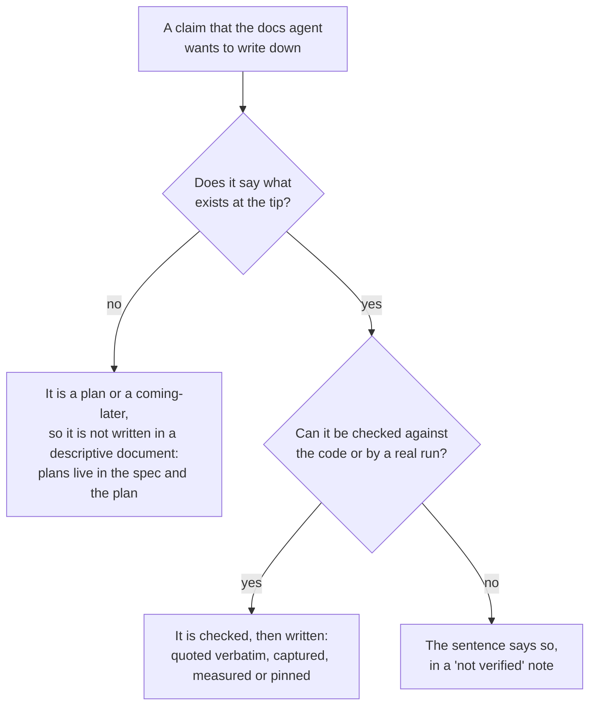
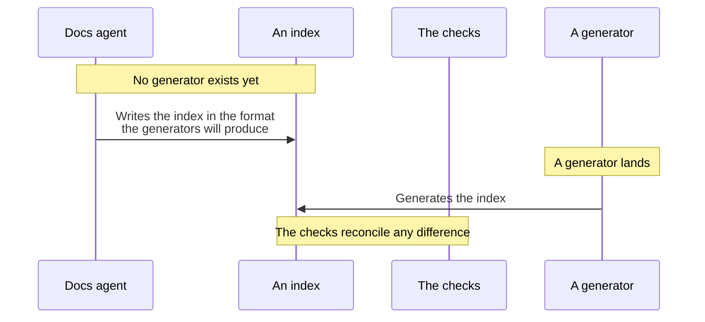

# Evidence and truth

This file sets the evidence rules, the eleven rules that keep what a descriptive document says true. It says why the rules exist, lists them, says what a section that does not apply holds, and says what the docs agent does with the indexes while no generator exists. [01-why-and-scope.md](01-why-and-scope.md) says why the baseline exists, [02-vocabulary.md](02-vocabulary.md) defines the terms used here, [03-stack-model.md](03-stack-model.md) sets the rules of the stack, [05-project-layout.md](05-project-layout.md) says where the generated files are in a project, and [16-diagrams.md](16-diagrams.md) sets the diagrams. The file of the standard for each descriptive document applies the rules to that document: [06-feature-docs.md](06-feature-docs.md) has a table with a row for each rule, in the order of this file, and [07-architecture-reference.md](07-architecture-reference.md), [08-course-lessons.md](08-course-lessons.md), [09-course-system-chapters.md](09-course-system-chapters.md), [10-course-reference-pages.md](10-course-reference-pages.md), [12-deployment-docs.md](12-deployment-docs.md) and [13-project-readme.md](13-project-readme.md) apply them to their own documents. The playbook [docs-agent.md](../docs/agents/docs-agent.md) states the same rules as instructions to the docs agent, and `18-docs-agent.md` sets its rules, each with its reason.

A few words appear here before the standard defines them in full. A **descriptive document** says only what exists at the **tip**, the last commit of a stack, and it is written after the build: the feature docs, the architecture reference, the guided course, the deployment docs, the README and the reference pages. Work is delivered as a **stack** of pull requests (PRs), an ordered series in which each PR is based on the one below it and merged from the bottom up, and [03-stack-model.md](03-stack-model.md) explains it in full. The **docs agent** is a fresh agent, started from the finished code, that writes the descriptive documents. A **generator** is a tool that produces a document from what the repository holds. The **checker** is the tool that checks a project's documents and PRs against the standard, and where this file says what the checker does, it states what the standard requires of the tooling (`22-tooling-requirements.md`) and does not say that any particular repository runs it today. Each rule below is followed by `Because:` and its reason.

## Why the evidence rules exist

When a team reads line by line, one wrong sentence costs more than a missing one. That sentence is the reason behind the eleven rules in the next section.

Three anti-goals in [01-why-and-scope.md](01-why-and-scope.md) name the same failures that the rules are about:

- **A2, documenting the plan.** A descriptive document that says what was meant instead of what exists.
- **A6, unverified claims.** A statement about behaviour, output, numbers or performance that nobody ran or measured and that is not marked "not verified".
- **A7, rebase conflicts on shared files.** Hand-edited indexes, counts or tables that every PR in a stack touches.

The first of the rules is the principle that a descriptive document says only what exists at the tip.

## The rules

Each rule below applies to every document that the docs agent writes. [06-feature-docs.md](06-feature-docs.md) lists the rules in this order, with what each asks of the feature docs.

1. **Say only what exists at the tip.** Plans and "coming later" live in the spec and the plan, and never in the architecture reference, the feature docs or the course. Because: a descriptive document that says what was meant instead of what exists is the failure that anti-goal A2 names, and when a team reads line by line, one wrong sentence costs more than a missing one.
2. **Quote code verbatim.** A captioned excerpt is a verbatim excerpt of the file it names, and a gap in it is a marked ellipsis. A script checks this: the standard requires the checker to verify that every captioned excerpt is verbatim (`22-tooling-requirements.md`). Because: when a team reads line by line, one wrong sentence costs more than a missing one.
3. **Capture output by running it.** Output is never written from memory. The standard also requires a check on a nightly schedule that re-runs captured command outputs and compares them with what was captured, for the outputs that are marked deterministic (`22-tooling-requirements.md`). Because: when a team reads line by line, one wrong sentence costs more than a missing one, and a statement about output that nobody ran is an unverified claim (anti-goal A6).
4. **Pin the versions in each document's header.** Where the standard fixes a header, the file for that document says what it holds, as [07-architecture-reference.md](07-architecture-reference.md) does for an architecture file and [08-course-lessons.md](08-course-lessons.md) for a lesson. Because: when a team reads line by line, one wrong sentence costs more than a missing one.
5. **Measure performance claims.** Keep the benchmark in the repository, or cite a source. Because: when a team reads line by line, one wrong sentence costs more than a missing one, and a statement about performance that nobody measured is an unverified claim (anti-goal A6).
6. **Say what you could not verify, in a "not verified" note.** Because: when a team reads line by line, one wrong sentence costs more than a missing one, and a statement that nobody ran or measured, and that is not marked "not verified", is the unverified claim that anti-goal A6 names, a failure even when everything else works.
7. **Measure the numbers you quote**, such as file counts, test counts and versions, and never type them. The standard requires the checker to verify, over the whole change of a stack, that quoted numbers are measured (`22-tooling-requirements.md`). Because: when a team reads line by line, one wrong sentence costs more than a missing one, and a statement about numbers that nobody measured is an unverified claim (anti-goal A6).
8. **Record the seed, the model and the versions of output that is not deterministic, such as a model's answer, or mark it illustrative.** Because: when a team reads line by line, one wrong sentence costs more than a missing one.
9. **Never hand-edit a generated index,** such as the course index, the file map, the glossaries and the ADR index. The standard requires the checker to verify that a generated index matches a fresh generation (`22-tooling-requirements.md`). Because: rebases never conflict on an index that nobody edits by hand, since a file that every PR in a stack edits conflicts at every rebase of the stack (anti-goal A7).
10. **Keep a minimum section that does not apply, as one line: `Not applicable: why`.** "Not applicable, with the reason" says more. Because: the reader then sees that it was considered, and nothing is invented to fill it.
11. **In a repository whose generators do not exist yet (only the baseline's own, during its first stacks), write the indexes yourself, in the format that the generators will produce, as the single writer of your stack.** This is the one exception to rule 9, and "The bootstrap exception for indexes" says more. Because: it is the exception to rule 9, which is there so that rebases never conflict on an index (anti-goal A7), and the exception makes the docs agent the single writer of the indexes of its stack.

### How a claim becomes a sentence

The diagram follows one claim that the docs agent wants to write down. In the made-up hiking club app of [06-feature-docs.md](06-feature-docs.md), "a repeated sign-up request stores one sign-up" says what exists at the tip, and the docs agent can check it by sending the request twice and counting the sign-ups that are stored. If the docs agent cannot run the system, the sentence says so, in a "not verified" note.



*A claim becomes a sentence of a descriptive document only if it says what exists at the tip, and the one thing to notice is that a claim that cannot be checked ends in a 'not verified' note and never in a plain sentence.*

## Not applicable, with the reason

A **minimum section** is a section that the standard for a document says the document always has, such as one of the thirteen minimum sections of the architecture reference ([07-architecture-reference.md](07-architecture-reference.md)) or one of the eleven areas of the deployment docs ([12-deployment-docs.md](12-deployment-docs.md)). Not every minimum section applies to every system: a command-line tool that prints the hike list of the made-up hiking club app and exits has no statuses to draw. Rule 10 says what stays in the document when a minimum section does not apply.

**A minimum section that does not apply stays in the document as one line: `Not applicable: why`, where `why` is the reason.** Because: the reader then sees that the section was considered, and nothing is invented to fill it.

The form of the line is this, where `<why>` stands for the reason:

```markdown
Not applicable: <why>
```

An example, for the architecture reference of the made-up command-line tool that prints the hike list and exits:

```markdown
## State machines

Not applicable: the tool has no statuses and no workflow, because each run prints the hike list and exits.
```

[06-feature-docs.md](06-feature-docs.md) says how the rule applies to a part of a feature page, [07-architecture-reference.md](07-architecture-reference.md) to a section, [08-course-lessons.md](08-course-lessons.md) to a part of a lesson, [09-course-system-chapters.md](09-course-system-chapters.md) to a part of a chapter and [12-deployment-docs.md](12-deployment-docs.md) to an area.

A section that applies, but whose claims could not all be checked, is not a section that does not apply. Its claims carry a "not verified" note, as rule 6 asks. This is not a rule of its own: it follows from rules 6 and 10, because rule 10 is for a section that does not apply and rule 6 is for anything that could not be verified.

## The bootstrap exception for indexes

Rule 9 says that an index is generated and never hand-edited, and the indexes that it names are the course index, the file map, the glossaries and the ADR index. [05-project-layout.md](05-project-layout.md) and [07-architecture-reference.md](07-architecture-reference.md) also mark the index of the architecture reference as generated. [10-course-reference-pages.md](10-course-reference-pages.md) says how the file map and the glossaries are produced, and [11-adrs.md](11-adrs.md) sets the ADR index. In a repository whose generators do not exist yet, nothing generates them. Rule 11 is the one exception to rule 9, and it is for that case: a repository whose generators do not exist yet, which is only the baseline's own repository, during its first stacks.

In such a repository the docs agent writes the indexes itself, in the format that the generators will produce, as the single writer of its stack. When a generator lands, which is to say when it is merged into the repository, it takes over, and the checks reconcile any difference. The playbook [docs-agent.md](../docs/agents/docs-agent.md) gives the same exception from the docs agent's side.

In a Mermaid sequence diagram, `Note over` puts a note on the participant or participants that it names, which is how the diagram below marks the moments of the exception.



*While no generator exists the docs agent is the single writer of an index, and the one thing to notice is that it writes in the format the generators will produce, so that a generator can take over the same index when it lands.*
