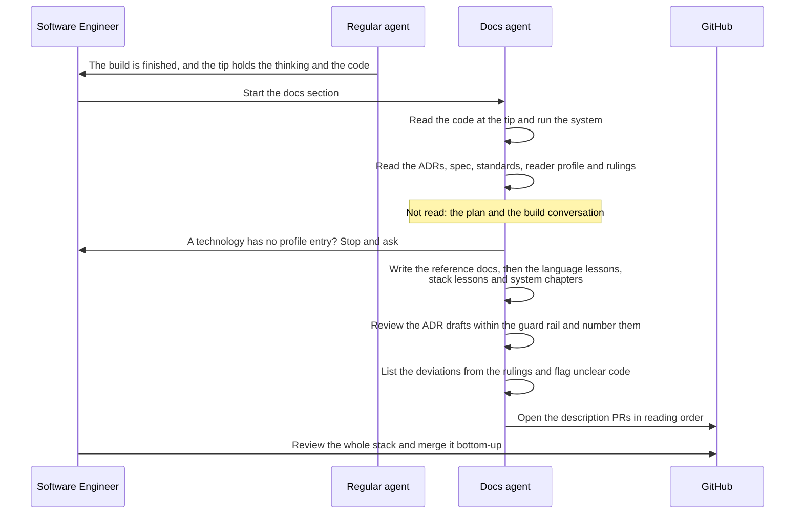
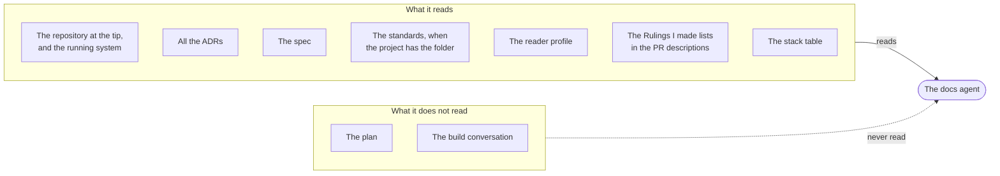
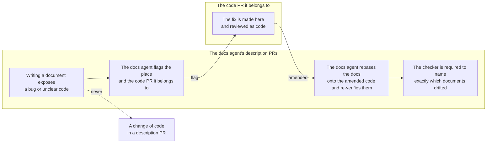
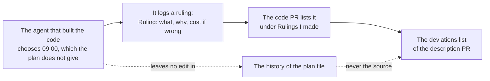
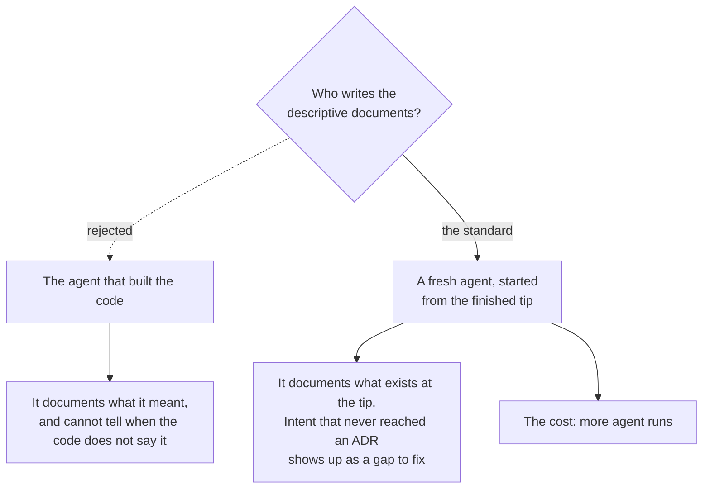

# The docs agent

This file sets the standard for the docs agent, the fresh agent that writes every descriptive document of a project from the finished code. It says what the docs agent is for, what it reads, what it does not read, what it produces, the six rules it follows and why a fresh agent writes the documents and not the agent that built the code. [01-why-and-scope.md](01-why-and-scope.md) says why the baseline exists and sets the goals and the anti-goals that this file cites by id, [02-vocabulary.md](02-vocabulary.md) defines the terms used here, [03-stack-model.md](03-stack-model.md) sets the rules of the stack that the docs agent's work sits in, [04-reader-profile.md](04-reader-profile.md) describes the reader profile that the docs agent reads, [05-project-layout.md](05-project-layout.md) says where the documents it writes live, [11-adrs.md](11-adrs.md) sets the guard rail on its review of ADR drafts, [14-pr-descriptions.md](14-pr-descriptions.md) sets the description of each PR it opens and [17-evidence-and-truth.md](17-evidence-and-truth.md) sets the evidence rules it follows. The file of the standard for each document that it writes is linked under "What it produces". The playbook [docs-agent.md](../docs/agents/docs-agent.md) is the brief of the docs agent and states the same rules as instructions to it. `19-standards-mechanism.md` sets the standards that the docs agent reads, `20-working-rules.md` lists what the Software Engineer decides and `22-tooling-requirements.md` sets what the standard requires of the checker.

A few words appear here before the standard defines them in full. Work is delivered as a **stack** of pull requests (PRs), an ordered series in which each PR is based on the one below it and merged from the bottom up. A stack holds three kinds of PR. A **thinking PR** holds the prescriptive documents, the ones that say what will be built or how work is done: the spec, the plan, decision records, standards, the reader profile and the playbooks. A **code PR** holds code and tests. A **description PR** holds the descriptive documents, the ones that say only what exists at the **tip**, the last commit of the stack, and the docs agent writes them. The **finished tip** is the tip once the building is done. The **descriptive documents** are the feature docs, the architecture reference, the guided course, the deployment docs, the README and the reference pages. The **docs section** is the group of description PRs at the top of the stack. A **slice** is a logical group of code that becomes one code PR. [03-stack-model.md](03-stack-model.md) explains the stack and its three kinds in full.

Some more words are used below. An **ADR** is an architecture decision record: one file for one decision, with the options that were explored. An **ADR draft** is an ADR that the **regular agent** writes at decision time, before the docs agent reviews it. The regular agent is the agent that brainstorms, plans, builds and writes ADR drafts, so it is also the agent that built the code. A **ruling** is a decision that an agent takes on the Software Engineer's behalf, without stopping to ask, and records as `Ruling: what, why, cost if wrong`. The **execution skills** are the skills that carry out a plan task by task; in superpowers they are `subagent-driven-development` and `executing-plans`, and they log their rulings in that form. The **reader profile** is the project's record of who its documents are written for, with a level for each technology and each knowledge area. The **stack table** is the table of the whole stack at the top of every PR description, with each PR's kind, link and one-line purpose. The **checker** is the tool that checks a project's documents and PRs against the standard, and where this file says what the checker does, it states what the standard requires of the tooling (`22-tooling-requirements.md`) and does not say that any particular repository runs it today.

The word stack has a second use that this file needs. A **technology stack** is one part of a system, such as a front end or a back end, and its code lives in a **stack folder** of the repository. It is not a stack of PRs. This file says "stack of PRs" for the first and "technology stack" for the second, and the stack lessons of the guided course teach a technology stack. Each rule below is followed by `Because:` and its reason.

## Purpose

The **docs agent** is a fresh agent, started from the finished tip of the stack, that writes every descriptive document. It exists to guard "what was built, not what was meant". It also reviews the ADR drafts and generates the sections of the reader profile that depend on its header ([04-reader-profile.md](04-reader-profile.md)). It starts from the finished tip, and it never reads the plan or the build conversation ("What it does not read"), where the build conversation is the conversation of the agent that built the code.

**Let the docs agent write every descriptive document, from the finished tip, and let no other agent write one.** Because: the docs agent exists to guard "what was built, not what was meant", and "Why a fresh agent" gives the reason that the agent that built the code does not write them. A PR description is a different thing: the agent that built the slice writes the descriptions of thinking PRs and code PRs, and the docs agent writes the descriptions of the description PRs that it opens ([14-pr-descriptions.md](14-pr-descriptions.md)).

The diagram follows the docs agent from the finished tip to the merge of the stack. Its first message is the regular agent's report to the Software Engineer that the build is finished and that the tip holds both the thinking and the code. The thinking is the prescriptive documents of the stack, such as the spec, the plan and the ADR drafts. In a Mermaid sequence diagram, an arrow from a participant back to itself, such as `D->>D`, is a step that the participant takes on its own, and `Note over D` puts a note on the participant that it names.

*The docs agent runs from the finished tip to the description PRs, and the one thing to notice is the note over it: the plan and the build conversation are never read.*

In order, the Software Engineer starts the docs agent. It reads the code at the tip and runs the system, and it reads the other sources ("What it reads"). It stops and asks when a technology has no entry in the reader profile (rule 2 under "The rules"). It writes the reference documents first and then the language lessons, the stack lessons and the system chapters ("What it produces"), reviews the ADR drafts within the guard rail and gives them their numbers (rule 3), lists the deviations from the rulings (rule 4) and flags the code that was unclear to a fresh reader (rule 1), and opens the description PRs in reading order. The Software Engineer reviews the whole stack and merges it from the bottom up, and nothing merges unless they ask (rule 10 in [03-stack-model.md](03-stack-model.md)).

## What it reads

The docs agent reads the sources in the table, and the table says why it reads each one. The plan and the build conversation are not among them ("What it does not read").

| Source | Because |
|---|---|
| The repository at the tip, and the running system. | A descriptive document says only what exists at the tip, and output is captured by running it and never written from memory (rules 1 and 3 in [17-evidence-and-truth.md](17-evidence-and-truth.md)). The feature docs are written from the running system ([06-feature-docs.md](06-feature-docs.md)). |
| All the ADRs, the drafts included. | The ADRs carry the why into the descriptive documents, which is the dotted line from the ADRs in the document map of [05-project-layout.md](05-project-layout.md), and the docs agent reviews the drafts among them ([11-adrs.md](11-adrs.md)). |
| The spec. | It carries the why into the descriptive documents too, by the other dotted line of the same document map. The artifact map records the path of the spec under `spec` ([05-project-layout.md](05-project-layout.md)). |
| `docs/standards/`, when the project has the folder. | The docs agent cites the standards in the "In this codebase" part of the lessons it writes, where a standard shaped the code that a lesson shows ([08-course-lessons.md](08-course-lessons.md)). A project has the folder only if it opted in, which `19-standards-mechanism.md` sets. |
| `docs/reader-profile.md`. | It carries the pitch and the depth of basics into the descriptive documents, by the dotted line from the reader profile in the same document map: its levels decide which basics a document explains ([04-reader-profile.md](04-reader-profile.md)). |
| The "Rulings I made" lists in the PR descriptions. | The deviations list is taken from them, because the execution skills promise that the lists are exhaustive ([14-pr-descriptions.md](14-pr-descriptions.md) says what a code PR lists there). |
| The stack table. | It is where the grouping of the code into slices appears, so that the reviewer sees the shape before reading any code (rule 6 in [03-stack-model.md](03-stack-model.md)). |

The "Rulings I made" lists and the stack table are in the descriptions of the PRs. How a fresh docs agent is started in practice, and where those lists and that table are when the PRs are not open yet, is not yet confirmed in practice, so the standard does not say how the docs agent receives them.

## What it does not read

The docs agent does not read the plan or the build conversation. The **plan** is the kept skill artifact that the `writing-plans` skill produces, the one that the artifact map records under `plan` ([05-project-layout.md](05-project-layout.md)), and the **build conversation** is the conversation of the agent that built the code.

**Never read the plan or the build conversation.** Because: a descriptive document says only what exists at the tip, and plans live in the spec and the plan and never in a descriptive document (rule 1 in [17-evidence-and-truth.md](17-evidence-and-truth.md)); a descriptive document that says what was meant instead of what exists is the failure that anti-goal A2 names ([01-why-and-scope.md](01-why-and-scope.md)); and the docs agent is a fresh agent because the agent that built the code tends to document what it meant ("Why a fresh agent"). Where the built code differs from the plan, the docs agent finds it in the "Rulings I made" lists and not in the plan (rule 4 under "The rules").

The diagram puts the two lists side by side. In a Mermaid flowchart, a `subgraph` draws a box around the nodes in it, a node written with `([` and `])` is drawn rounded, and a dotted arrow with a label is written `-. "label" .->`.

*The docs agent works from the sources in the first box and never from the second, and the one thing to notice is that the plan and the build conversation have only a dotted arrow to it, marked never read.*

## What it produces

The docs agent produces the description PRs, in reading order, and each of them has the description form of [14-pr-descriptions.md](14-pr-descriptions.md). The documents in them are the descriptive documents, and the docs agent's review of the ADR drafts rides with them.

**Open the description PRs in reading order: the reference PR first, then the language lessons, the stack lessons and the system chapters.** The **reference PR** is the first description PR of the docs section, and it holds the reference documents: the architecture reference, the feature docs, the deployment docs, the README, the file map, the glossaries and the review of the ADR drafts ([03-stack-model.md](03-stack-model.md)). Because: the docs section is last, in reading order from foundational to integrated (rule 7 in [03-stack-model.md](03-stack-model.md)), and it sits on top of the stack because it describes the final built state, so a reader moves from the foundational documents to the integrated ones.

**Write the description of each description PR in the form of [14-pr-descriptions.md](14-pr-descriptions.md).** After the header that every PR starts with, the form has four parts: what is documented and how it was checked, what was not verified, the deviations from the plan and the flagged code. Because: each kind of PR has its own form of description, since each kind is reviewed in a different way, and a description PR is read for whether it matches the code ([03-stack-model.md](03-stack-model.md)).

Besides the documents, the docs agent reviews the ADR drafts within the guard rail and gives them their numbers (rule 3 under "The rules"), lists the deviations from the rulings (rule 4) and flags the code that was unclear to a fresh reader (rule 1). The review edits and the numbering ride in the reference PR, in a description PR that edits ADR files, which is the one crossover of kinds that [03-stack-model.md](03-stack-model.md) names. The docs agent also writes the ADRs of the decisions that were made in brainstorming, from the spec, because those decisions need no draft ([11-adrs.md](11-adrs.md)).

The table gives each document that the docs agent writes with the file of the standard that sets its shape. The shape of a document is the parts it has, in their order, and its minimum number of diagrams, and this file does not repeat what those files say.

| Document that the docs agent writes | The file of the standard that sets its shape |
|---|---|
| The feature docs | [06-feature-docs.md](06-feature-docs.md) |
| The architecture reference | [07-architecture-reference.md](07-architecture-reference.md) |
| The lessons of the guided course, the language lessons and the stack lessons | [08-course-lessons.md](08-course-lessons.md) |
| The system chapters of the guided course | [09-course-system-chapters.md](09-course-system-chapters.md) |
| The reference pages: the file map, the glossaries and the "what else it offers" maps | [10-course-reference-pages.md](10-course-reference-pages.md) |
| The review of the ADR drafts and their numbers, and the ADRs of the decisions made in brainstorming | [11-adrs.md](11-adrs.md) |
| The deployment docs | [12-deployment-docs.md](12-deployment-docs.md) |
| The README and the READMEs of the stack folders | [13-project-readme.md](13-project-readme.md) |
| The generated sections of the reader profile | [04-reader-profile.md](04-reader-profile.md) |
| The description of each description PR | [14-pr-descriptions.md](14-pr-descriptions.md) |

In a repository whose generators do not exist yet (only the baseline's own, during its first stacks), the docs agent writes the indexes itself, in the format that the generators will produce, as the single writer of its stack ([17-evidence-and-truth.md](17-evidence-and-truth.md) gives the exception and [10-course-reference-pages.md](10-course-reference-pages.md) says how it applies to the reference pages).

## The rules

The docs agent follows six rules, in this order.

1. **The docs agent never changes code.** If writing a document exposes a bug or unclear code, it flags the place for a fix in the code PR that the issue belongs to, and then it rebases the docs onto the amended code and re-verifies them ("The flagged-code loop" below draws the loop). Because: a description PR is kept free of code, for easier review: each kind of PR is reviewed in a different way, and a description is read for whether it matches the code, while a fix in the code PR that it belongs to is read for correctness. The fix goes in that code PR, and the docs are rebased and re-verified afterwards ([03-stack-model.md](03-stack-model.md)).
2. **The docs agent stops when a technology has no entry in the reader profile, and asks the Software Engineer before it writes that technology's course.** Because: the entry is a level for the technology, so recording it changes the reader profile, and changing the reader profile is the Software Engineer's call (`20-working-rules.md`), and without an entry the docs agent has no level to pitch that technology's course from. [04-reader-profile.md](04-reader-profile.md) says what happens to the entry once the Software Engineer has answered.
3. **The docs agent reviews the ADR drafts within the guard rail.** It may clean up, add and review, and it may not rewrite the decision, the drivers, the options or the rationale. Where the built code departs from the decision, it flags that for the Software Engineer and does not edit the ADR to match. [11-adrs.md](11-adrs.md) has the whole guard rail, including the rule that marks every addition "Added at review". Because: this keeps decision-time reasoning from being backfilled, and an ADR whose options were written after the decision to justify it is the failure that anti-goal A4 names ([01-why-and-scope.md](01-why-and-scope.md)).
4. **The docs agent takes the deviations list from the "Rulings I made" lists, and never from the history of the plan file.** Because: the execution skills promise that the "Rulings I made" lists are exhaustive, while the plan file's history shows only the edits that were actually made.
5. **After any amendment to a lower PR of the stack, the docs agent re-verifies the docs.** The standard requires the checker to name exactly which documents drifted (`22-tooling-requirements.md`). Because: a descriptive document says only what exists at the tip (rule 1 in [17-evidence-and-truth.md](17-evidence-and-truth.md)), and goal G3 asks for documents that live: they change in the same stack as the code and are verified against it ([01-why-and-scope.md](01-why-and-scope.md)).
6. **The docs agent follows the anatomies of the lessons, the system chapters and the other documents, and the evidence rules.** The anatomy of a document is its parts, in their order, and its minimum number of diagrams. [08-course-lessons.md](08-course-lessons.md) sets the anatomy of a lesson, [09-course-system-chapters.md](09-course-system-chapters.md) that of a system chapter, and [06-feature-docs.md](06-feature-docs.md), [07-architecture-reference.md](07-architecture-reference.md), [10-course-reference-pages.md](10-course-reference-pages.md), [12-deployment-docs.md](12-deployment-docs.md) and [13-project-readme.md](13-project-readme.md) that of the other documents. [17-evidence-and-truth.md](17-evidence-and-truth.md) sets the eleven evidence rules. Because: the baseline is one documentation structure for every project, complete and deep (goal G2 in [01-why-and-scope.md](01-why-and-scope.md)), and when a team reads line by line, one wrong sentence costs more than a missing one, which is why the evidence rules exist.

### The flagged-code loop

Rules 1 and 5 meet in one loop. The docs agent flags the place, the fix is made in the code PR and is reviewed there, and the docs agent then rebases the docs onto the amended code and re-verifies them. The standard requires the checker to name exactly which documents drifted (`22-tooling-requirements.md`). The dotted arrow of the diagram marks the one thing that the loop never does: a change of code in a description PR.

*The fix is made in the code PR and never in a description PR, and the one thing to notice is that the only thing that crosses from the docs agent's PRs into the code PR is a flag, while the dotted arrow marked never leads to a change of code in a description PR.*

### Where the deviations come from

Rule 4 takes the deviations from the rulings. The example is made up and uses the stack of the hiking club app of [14-pr-descriptions.md](14-pr-descriptions.md), where neither the spec nor the plan gives a time of day for the reminder that members get before a hike. The agent that built the first slice chose 09:00 and logged it as a ruling, which the code PR lists under "Rulings I made", and it did not edit the plan. The history of the plan file therefore shows nothing about the choice, and a deviations list built from that history would miss it. The docs agent builds its list from the rulings, so the choice is in it.

*A choice that the plan does not give reaches the deviations list through the ruling, and the one thing to notice is that the history of the plan file receives no edit for it, which is why the list is never taken from there.*

## Why a fresh agent

A fresh agent is used because the agent that built the code tends to document what it meant, and cannot tell when the code does not say it. The cost is more agent runs, and intent that never reached an ADR shows up as a gap to fix. The alternative, that the agent that built the code writes its own documents, was rejected.

**Use a fresh agent to write the descriptive documents, and not the agent that built the code.** Because: the agent that built the code tends to document what it meant and cannot tell when the code does not say it, so documents written by it risk the failure that anti-goal A2 names: they would say what was meant instead of what exists ([01-why-and-scope.md](01-why-and-scope.md)). The cost of the rule is more agent runs, and intent that never reached an ADR shows up as a gap to fix.

A made-up illustration, in the stack of [14-pr-descriptions.md](14-pr-descriptions.md): the agent that built the first slice knows why the function that picks the send time of a reminder rounds down, and nothing in the code says why. Its own documents would tend to give that reason as if the code said it. A fresh agent has only what exists at the tip and the sources that it reads, so the missing reason shows up as a gap to fix, as the flagged code in the example of that file does.

In a Mermaid flowchart, a node written with braces is drawn as a diamond, the shape of a question, and the diagram uses one for the choice of who writes the documents.

*The documents are written by a fresh agent and not by the agent that built the code, and the one thing to notice is that the rejected choice is the dotted arrow, while the chosen one carries its cost, more agent runs, in a node of its own.*
