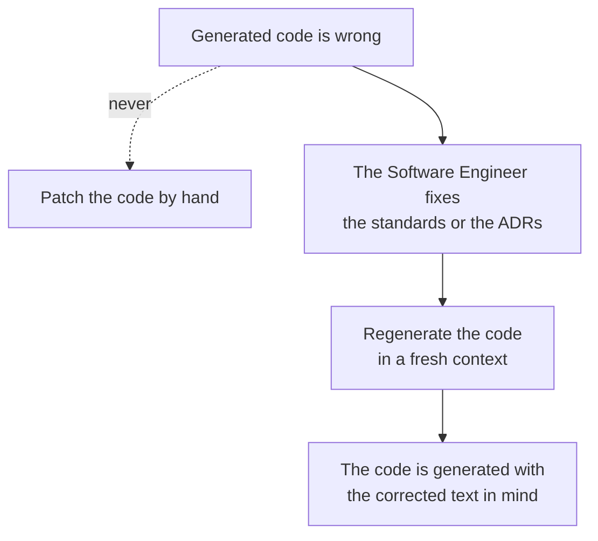
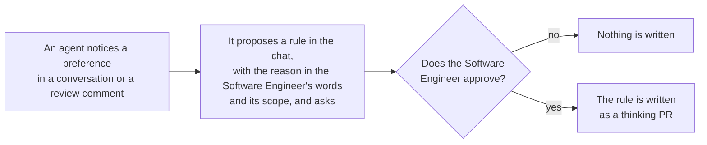
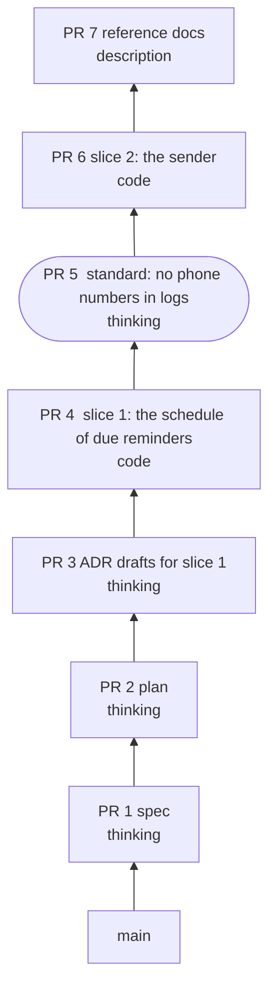

# The standards mechanism

This file sets the standards mechanism, the part of the baseline that turns a project's approved preferences into documents that drive code. It says what the mechanism is for and what to do when generated code is wrong, how a project opts in, how the folder `docs/standards/` fills, what each rule records, where a change to a standard lands in the stack, who reads the standards and what belongs in them. [01-why-and-scope.md](01-why-and-scope.md) says why the baseline exists and sets the goals, the non-goals and the constraints that this file cites by id, [02-vocabulary.md](02-vocabulary.md) defines the terms used here, [03-stack-model.md](03-stack-model.md) sets the rules of the stack and its three kinds of PR, [04-reader-profile.md](04-reader-profile.md) describes the intake and the reader profile, [05-project-layout.md](05-project-layout.md) says where the folder lives and that it exists only if the project opted in, [08-course-lessons.md](08-course-lessons.md) sets the lessons in which the docs agent cites a standard, [11-adrs.md](11-adrs.md) sets the ADRs, which with the standards are the only documents that drive code, [15-agents-md-and-playbooks.md](15-agents-md-and-playbooks.md) sets the `AGENTS.md` that points to the standards and [18-docs-agent.md](18-docs-agent.md) sets the docs agent. The playbook [standards.md](../docs/agents/standards.md) states the same rules as instructions to an agent, and the baseline follows its own standard, so its folder is a real example: [docs/standards/README.md](../docs/standards/README.md). `20-working-rules.md` lists what the Software Engineer decides and `22-tooling-requirements.md` sets what the standard requires of the tooling.

A few words appear here before the standard defines them in full. A **standard**, written lowercase and in the sense of a project, is an approved preference in `docs/standards/` that drives code generation. It belongs to a project, and it is not **the standard**, which is the text of the baseline. Work is delivered as a **stack** of pull requests (PRs), an ordered series in which each PR is based on the one below it and merged from the bottom up. A stack holds three kinds of PR. A **thinking PR** holds the prescriptive documents, the ones that say what will be built or how work is done: the spec, the plan, decision records, standards, the reader profile and the playbooks. A **code PR** holds code and tests. A **description PR** holds the descriptive documents, the ones that say only what exists at the **tip**, the last commit of the stack. A **slice** is a logical group of code that becomes one code PR. [03-stack-model.md](03-stack-model.md) explains the stack and its three kinds in full.

An **ADR** is an architecture decision record: one file for one decision, with the options that were explored. The **docs agent** is a fresh agent, started from the finished code, that writes the descriptive documents. The **intake** is the set of questions asked when a project starts, and its answers make up the **reader profile**, the project's record of who its documents are written for. A **skill** is a packaged set of instructions that an agent follows for one kind of work, and superpowers is a set of skills.

The word stack has a second use that this file needs. A **technology stack** is one part of a system, such as a front end or a back end, and its code lives in a **stack folder** of the repository. It is not a stack of PRs. This file says "stack of PRs" for the first and "technology stack" for the second, and the scope of a rule can be one technology stack. Each rule below is followed by `Because:` and its reason.

## Purpose

`docs/standards/` and the ADRs are the only documents that drive code. Code is generated with them in mind. When generated code is wrong, the Software Engineer fixes the standards or the ADRs and regenerates the code in a fresh context, instead of patching the code. To **regenerate** code is to have an agent write it again, and a **fresh context** is a new agent session, one that does not carry the conversation in which the wrong code was written.

**When generated code is wrong, fix the standards or the ADRs and regenerate the code in a fresh context, and never patch the code.** Because: standards and ADRs are the only documents that drive code, and code is generated with them in mind, so the text that drives the code is where a fix belongs. A fix to an ADR follows the rules of ADRs: an Accepted ADR is changed only through a new ADR that supersedes it ([11-adrs.md](11-adrs.md)).

The playbook for this is [standards.md](../docs/agents/standards.md). In a Mermaid flowchart, a dotted arrow with a label is written `-. "label" .->`, and the diagram uses one for the fix that is never made.



*When generated code is wrong, the fix goes into the text that drives the code and the code is generated again, and the one thing to notice is that the only arrow from the wrong code to a patch is the dotted one marked never.*

Standards and ADRs drive code together, and they are different documents. An ADR records one decision, with the options that were explored, and once it is Accepted it is append-only ([11-adrs.md](11-adrs.md)). A standard is an approved preference, written as a rule, and a rule whose reason is gone is removed ("What each rule records").

**Name the folder for standards in general, `docs/standards/`, and not for coding style.** Because: it will also hold verification, dependency, security and release preferences, and not only coding style.

## Opt-in

The standard requires the intake to ask once whether to build standards from the Software Engineer's preferences over time and, when the answer is yes, to create an empty `docs/standards/` folder with a README that explains how the folder fills (`22-tooling-requirements.md`). When the answer is no, there is no folder. [04-reader-profile.md](04-reader-profile.md) describes the intake, and says that where the skills that run it are not available, it is run by hand.

The answer is recorded as `standards_enabled`, which is `true` or `false`, in the header of the reader profile ([04-reader-profile.md](04-reader-profile.md)) and in `baseline.yml` ([05-project-layout.md](05-project-layout.md)). Neither record wins over the other, because both record the one answer, and how a difference between them is reported is for the tooling's design to settle.

**Create `docs/standards/` only on a yes at the intake, and leave a project that said no with no folder.** An agent does not create the folder on its own initiative. Because: the answer is part of the reader profile, and changing the reader profile is the Software Engineer's call ([05-project-layout.md](05-project-layout.md); `20-working-rules.md`).

## How it fills

When an agent notices a preference in a conversation or in a review comment, it proposes a rule in the chat, with the reason in the Software Engineer's words and its scope, and asks. Only the Software Engineer's approval writes the rule, and nothing is inferred silently. The approved rule is then written as a thinking PR ("Where changes land").

**Propose a preference as a rule in the chat, with its reason in the Software Engineer's words and its scope, and ask.** The scope is the whole project or one technology stack ("What each rule records"). Because: the mechanism turns the Software Engineer's approved preferences into the documents that drive code (goal G7 in [01-why-and-scope.md](01-why-and-scope.md)), so a preference has to be put to them for approval before it can become one of those documents.

**Write a rule only when the Software Engineer approves it, and infer nothing silently.** If the answer is no, nothing is written. Because: what a project's standards record is the Software Engineer's preference, approved one rule at a time (goal G7), and the baseline cannot know it in advance (non-goals N1 and N3 and constraint C7 in [01-why-and-scope.md](01-why-and-scope.md)).

In a Mermaid flowchart, a node written with braces is drawn as a diamond, the shape of a question, with a branch for each answer.



*A preference becomes a rule only through the Software Engineer's approval, and the one thing to notice is that the branch for a no ends with nothing written.*

The exchange below is made up, for the hiking club app of [06-feature-docs.md](06-feature-docs.md). The Software Engineer says a preference in the conversation, and the agent proposes a rule and asks as it asks for any decision, in the numbered form that `20-working-rules.md` sets. Nothing is written until the answer is yes.

```text
Software Engineer, in the conversation: "Don't log phone numbers. A log is read by more
people than the member agreed to."

Agent, in the chat:
1. Add this rule to docs/standards/?
   Rule: Never put a member's phone number in a log line.
   Reason, in your words: "A log is read by more people than the member agreed to."
   Scope: the whole project
   Recommended: yes, because you said it in this conversation.
   Other option: do not add a rule, and keep the preference to this conversation.

Software Engineer: 1. yes
```

## What each rule records

Each rule records its reason, its scope, its date and its source, beside the rule. The table says what each record holds.

| Record | What it holds |
|---|---|
| Reason | Why the Software Engineer wants the rule, in their words. |
| Scope | The whole project, or one technology stack, which means one stack folder. `baseline.yml` lists the stack folders ([05-project-layout.md](05-project-layout.md)). |
| Date | The date the rule was approved. |
| Source | The PR or the conversation where the preference came up. |

**Record the reason, the scope, the date and the source of every rule, beside the rule.** Because: every rule has its reason beside it, which is the first of the two rules for the files themselves, applied here to the rules of `docs/standards/` ([15-agents-md-and-playbooks.md](15-agents-md-and-playbooks.md)); and a coding preference goes to `docs/standards/` and never into a stack folder's `AGENTS.md`, so the scope of a rule can be one technology stack and a preference for one stack still has its home here ([15-agents-md-and-playbooks.md](15-agents-md-and-playbooks.md)).

The standard fixes the four records and not how they are laid out. The two rules below are made up for the hiking club app, in a layout that is only an illustration. The first has the whole project as its scope. Its source is the conversation after the first slice of the stack that "Where changes land" draws was built.

```text
Rule: Never put a member's phone number in a log line.
Reason: "A log is read by more people than the member agreed to." (the Software Engineer)
Scope: the whole project
Date: 2027-03-02
Source: the conversation after slice 1 was built
```

The second has one technology stack as its scope, the back end in the folder `api/`.

```text
Rule: A request handler calls a function of the storage module and never queries the database itself.
Reason: "I want one place to change when the schema changes." (the Software Engineer)
Scope: api/, one stack folder
Date: 2027-03-09
Source: the conversation while slice 2 was being built
```

**Remove a rule whose reason is gone, in a PR, and let git keep the history.** Because: a rule whose reason is gone is removed, which is the second of the two rules for the files themselves, applied here to the rules of `docs/standards/` ([15-agents-md-and-playbooks.md](15-agents-md-and-playbooks.md)); and removing it loses nothing, since git keeps the history. A standards update is a thinking PR ([03-stack-model.md](03-stack-model.md)), so the removal is one too. The two kinds of document differ here: an Accepted ADR is changed only through a new ADR that supersedes it ([11-adrs.md](11-adrs.md)), while a rule whose reason is gone is removed.

## Where changes land

A rule is written as a thinking PR, at the point in the stack where the preference came up. [03-stack-model.md](03-stack-model.md) explains the stack. The example below is made up for the hiking club app. It is the stack of [14-pr-descriptions.md](14-pr-descriptions.md), with one PR more. In that stack, PR 3 holds the ADR drafts for the first slice: the slice adds a table of due reminders, which is a data model, and a data model is a decision of impact ([11-adrs.md](11-adrs.md)), so its drafts sit directly beneath it (rule 4 in [03-stack-model.md](03-stack-model.md)). The PR that is added is the standard: the Software Engineer states a preference after the first slice has been built and before the second is started, and approves the rule, so the rule gets a thinking PR of its own between the two slices.

**Write an approved rule as a thinking PR, at the point in the stack where the preference came up.** Because: a standards update is a thinking PR, and a change that comes up later goes in its own PR of the matching kind, at the point in the stack where it happened ([03-stack-model.md](03-stack-model.md)); and thinking goes below the code it governs, so the reviewer reads the rule before the code that follows it.

In a Mermaid flowchart, a node written with `([` and `])` is drawn rounded, which is how the diagram marks the PR of the standard.



*A standard is a thinking PR placed where the preference came up, and the one thing to notice is that the rounded node sits between the two code slices: after the code that was built before the preference came up, and below the code that follows it.*

## Who reads it

Two kinds of reader use the standards. Agents read them before they generate code, through a pointer in `AGENTS.md`, and the docs agent cites them in the documents it writes. The skills run untouched, and the standards never depend on the reader's level.

**Read `docs/standards/`, when the project has the folder, before generating code.** Because: standards and ADRs are the only documents that drive code, and code is generated with them in mind.

**Let agents find the standards through a pointer in `AGENTS.md`, and never by editing a skill.** Because: `AGENTS.md` is the primary instruction for working in the repository ([15-agents-md-and-playbooks.md](15-agents-md-and-playbooks.md)), and the skills run untouched, so a rule is never delivered by changing how a skill works (constraint C4 in [01-why-and-scope.md](01-why-and-scope.md)).

**Let the docs agent cite a standard in the "In this codebase" part of a lesson, where the standard shaped the code that an excerpt shows.** Because: standards and ADRs are the only documents that drive code, so a standard may have shaped what an excerpt shows, and a lesson that shows such code says so ([08-course-lessons.md](08-course-lessons.md)). [18-docs-agent.md](18-docs-agent.md) lists the standards among the sources that the docs agent reads.

**Keep the standards independent of the reader's level.** Because: the reader's level shapes the documents only and never the code, and a standard drives code (the principle that outranks all others, and anti-goal A3, in [01-why-and-scope.md](01-why-and-scope.md)).

## What belongs here

A project's standards belong to the project, and they evolve over time. These are the preferences that belong in `docs/standards/`:

- coding style;
- verification and release levels;
- security and secrets handling;
- dependency and update policy;
- privacy rules;
- base-image policy, which is the rules for which base image the project's container images are built from;
- slicing preferences, which are how work is cut into slices.

A project may add more, since its standards evolve over time. The folder holds a `README.md` and one file for each topic ([05-project-layout.md](05-project-layout.md) shows the layout).

**Leave all of these to the project, and enforce none of them in the baseline.** Because: security, dependency, privacy, vulnerability, verification and release policy are per-project standards that grow over time (non-goal N1), per-stack slicing recipes are not the baseline's job and slicing preferences accumulate in `docs/standards/` (non-goal N2), coding style is recorded as approved project standards and never imposed (non-goal N3), and where a rule would depend on the project's kind or goal, the Software Engineer decides it (constraint C7), all in [01-why-and-scope.md](01-why-and-scope.md).

The table gives a made-up example of each preference, for the hiking club app. The examples are illustrations: a project writes its own rules, one at a time, with the four records of "What each rule records".

| Preference | A made-up example |
|---|---|
| Coding style | A request handler calls a function of the storage module and never queries the database itself. |
| Verification and release levels | A release goes to the staging environment and passes the end-to-end tests there before it goes to production. |
| Security and secrets handling | A secret is read from the host's secret store and never from a file in the repository. |
| Dependency and update policy | A dependency is updated at most once a month, unless the update fixes a security issue. |
| Privacy rules | A member's phone number is never written to a log line. |
| Base-image policy | A container image is built from the club's approved base image. |
| Slicing preferences | A database migration is always its own slice. |
