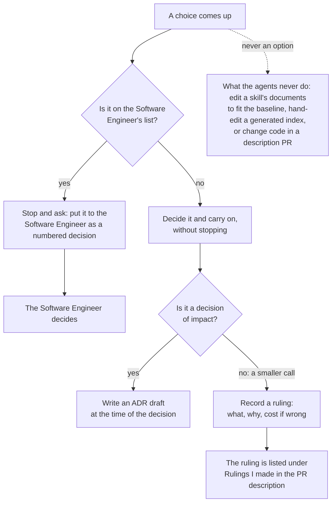
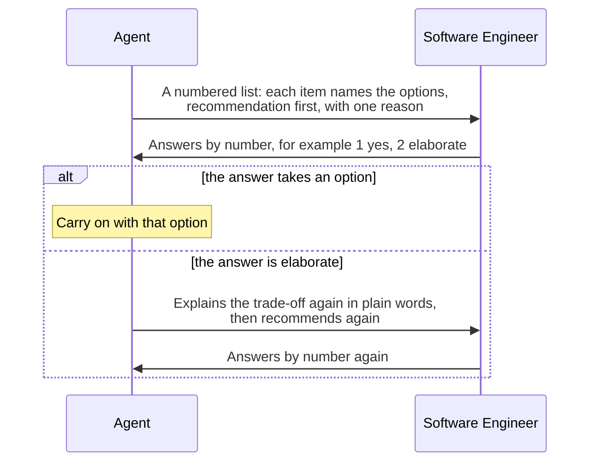
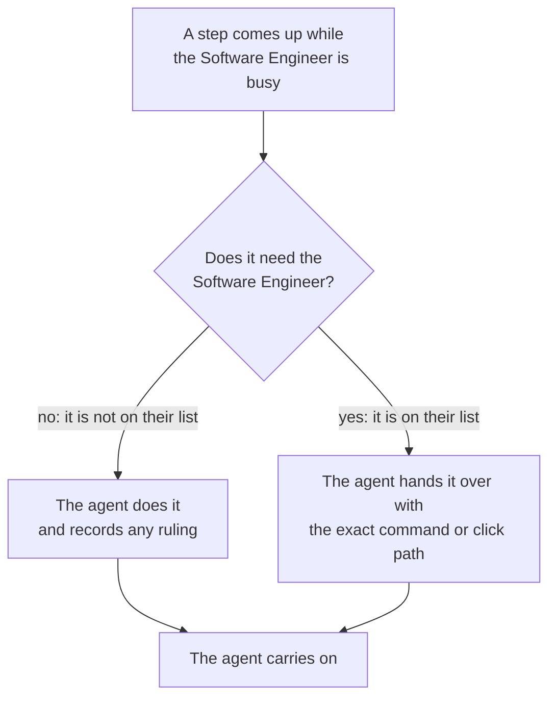
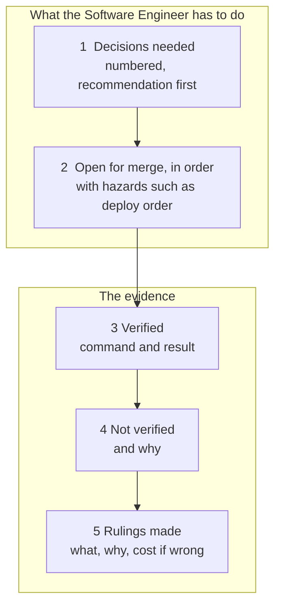

# Working rules

This file sets the working rules of the baseline: who decides what between the Software Engineer and the agents, how a decision is put to the Software Engineer, what the agents do while the Software Engineer is busy and how a report is built. [01-why-and-scope.md](01-why-and-scope.md) says why the baseline exists and sets the ladder, the goals, the non-goals, the anti-goals and the constraints that this file cites by id, [02-vocabulary.md](02-vocabulary.md) defines the terms used here and gives the roles, [03-stack-model.md](03-stack-model.md) sets the rules of the stack, [04-reader-profile.md](04-reader-profile.md) describes the reader profile, [11-adrs.md](11-adrs.md) sets the ADRs and their lifecycle, [14-pr-descriptions.md](14-pr-descriptions.md) sets the descriptions in which the rulings are listed, [15-agents-md-and-playbooks.md](15-agents-md-and-playbooks.md) sets the `AGENTS.md` that holds the rules, [17-evidence-and-truth.md](17-evidence-and-truth.md) sets the evidence rules that a report follows, [18-docs-agent.md](18-docs-agent.md) sets the docs agent and [19-standards-mechanism.md](19-standards-mechanism.md) sets the standards that the Software Engineer approves. The playbook [working-with-the-engineer.md](../docs/agents/working-with-the-engineer.md) states the same rules as instructions to an agent. `21-skills-seams.md` lists the seams between the baseline and the skills.

A few words appear here before the standard defines them in full. The **Software Engineer** is the person who decides, named in the project's `AGENTS.md`, and the person the baseline is built for: an engineer working toward Distinguished Engineer by taking on the responsibilities of the Lead Engineer, the Principal Engineer and the Solutions Architect ([01-why-and-scope.md](01-why-and-scope.md)). The agents are of two kinds. The **regular agent** is the agent that works on a task: it brainstorms, plans, builds and writes ADR drafts. The **docs agent** is a fresh agent, started from the finished code, that writes the descriptive documents ([18-docs-agent.md](18-docs-agent.md)). Work is delivered as a **stack** of pull requests (PRs), an ordered series in which each PR is based on the one below it and merged from the bottom up. A stack holds three kinds of PR: a **thinking PR** holds the prescriptive documents, the ones that say what will be built or how work is done; a **code PR** holds code and tests; and a **description PR** holds the descriptive documents, the ones that say only what exists at the **tip**, the last commit of the stack. [03-stack-model.md](03-stack-model.md) explains the stack and its three kinds in full.

Some more words are used below. An **ADR** is an architecture decision record: one file for one decision, with the options that were explored. A **skill** is a packaged set of instructions that an agent follows for one kind of work, and superpowers is a set of skills. **Brainstorming** is the work of the `brainstorming` skill, which produces the spec, and the plan is what the `writing-plans` skill produces. An **execution skill** is a skill that carries out a plan task by task; in superpowers they are `subagent-driven-development` and `executing-plans`. A **ruling** is a decision that an agent takes on the Software Engineer's behalf, without stopping to ask, and records as `Ruling: what, why, cost if wrong`. Every ruling is listed under "Rulings I made" in the description of a code PR ([14-pr-descriptions.md](14-pr-descriptions.md)). The **reader profile** is the project's record of who its documents are written for, and its answers are also the bar that the Software Engineer hires against ([04-reader-profile.md](04-reader-profile.md)). A **generated index** is an index that no one edits by hand: the course index, the architecture reference's index, the file map, the glossaries and the ADR index ([17-evidence-and-truth.md](17-evidence-and-truth.md)). Each rule below is followed by `Because:` and its reason wherever the rules of the standard give one.

## Who decides what

The Software Engineer decides what only they can decide, and the agents decide the rest and record it. The first part of this section lists what the Software Engineer decides, the second lists what the agents decide and the third lists what the agents never do.

**Let the conversation win for that task when the Software Engineer says something different in it.** Because: the Software Engineer is the one who decides, and the baseline exists so that one person who directs agents can carry the responsibilities of the Lead Engineer, the Principal Engineer and the Solutions Architect (the why in [01-why-and-scope.md](01-why-and-scope.md)). [15-agents-md-and-playbooks.md](15-agents-md-and-playbooks.md) sets the same for `AGENTS.md`.

### The Software Engineer decides, and the agents stop and ask

An agent that reaches one of these calls stops and asks the Software Engineer ("How decisions are put to the Software Engineer"). [02-vocabulary.md](02-vocabulary.md) gives the same list in short. The table gives each call, and its reason in the rows that have one.

| What the Software Engineer decides | Because |
|---|---|
| What to build and why: the scope, and the approach picked during brainstorming. | The Software Engineer is the one who directs the agents (the why in [01-why-and-scope.md](01-why-and-scope.md)), and brainstorming already requires the approaches and the Software Engineer's pick before any design exists ([11-adrs.md](11-adrs.md)). |
| Anything that changes how work is done: branching, release, CI, tooling. | No reason is stated for this call. |
| Merging a stack, deploying, releasing and store submissions, which are submissions of an app to an app store. Nothing merges, deploys or publishes unless the Software Engineer asks. | This is rule 10 of the stack ([03-stack-model.md](03-stack-model.md)), and the merge of a stack is also the acceptance of the ADRs in it ([11-adrs.md](11-adrs.md)). |
| Anything that persists or ships and cannot be undone: production data, destructive migrations (changes to the shape of the stored data that discard data), domains, accounts, secrets, billing and third-party sign-ups. | No reason is stated for this call. `21-skills-seams.md` records that the execution skills themselves stop for irreversible or destructive operations and for outside side effects, and that the baseline adds no stop of its own to theirs. |
| Accepting or rejecting an ADR (the merge of the stack is the acceptance), and what to do with a finding that cannot be fixed, such as dismissing an alert or accepting a risk. | The merge of a stack is the Software Engineer's (rule 10 in [03-stack-model.md](03-stack-model.md)), it is the acceptance of the ADRs in it, and an ADR is rejected when the Software Engineer sends it back ([11-adrs.md](11-adrs.md)). Vulnerability and security policy are per-project (non-goal N1 in [01-why-and-scope.md](01-why-and-scope.md)), so what to do with a finding that cannot be fixed is the project's own, which the Software Engineer decides (constraint C7). |
| Changing the reader profile. | The reader profile says who the documents are written for, and its answers are also the bar that the Software Engineer hires against ([04-reader-profile.md](04-reader-profile.md)). |

**Stop and ask the Software Engineer on every call in the table, and decide none of them yourself.** Each row that has a reason gives it in the table. The Software Engineer also approves every standard before it is written ([19-standards-mechanism.md](19-standards-mechanism.md)).

### The agents decide, and record each decision as a ruling

The agents decide these calls without stopping, and record each decision as a ruling:

- the order of work;
- names;
- how the stack is grouped;
- small conflicts between plan and code;
- plan defects and ambiguities;
- how to fix review findings;
- dependency bumps that tests show are safe.

**Decide the calls in this list without stopping, and record each decision as a ruling.** Because: the baseline adds no stop of its own to the execution skills (`21-skills-seams.md`), and what is left in the middle of the build, after brainstorming has gated the big decisions, is rulings, which the execution skills own and report ([11-adrs.md](11-adrs.md)). How the stack is grouped is one of them, since the agent decides how the code is grouped into slices and there is no approval step for the layout (rule 6 in [03-stack-model.md](03-stack-model.md)).

A decision of impact is not a ruling. The agent writes an ADR draft for it at the time of the decision, also without stopping, and a smaller call stays a ruling ([11-adrs.md](11-adrs.md) sets the six criteria of a decision of impact).

**Record every ruling under "Rulings I made", with what it costs if wrong.** The form is `Ruling: what, why, cost if wrong`, and it is the form that both execution skills already log: `subagent-driven-development` gathers its rulings into a final "Rulings I made" message before it deletes its ledger, which is its scratch record of the run, and that list is copied into the PR descriptions (`21-skills-seams.md`). Because: the docs agent takes its deviations list from these lists, and the execution skills promise that they are exhaustive ([18-docs-agent.md](18-docs-agent.md)).

### The agents never

Three things are not the agents' to do, whatever else they decide.

- **Never edit a skill's documents to fit the baseline.** A skill may revise its own documents, and that revision gets its own PR. Because: the skills run untouched, so a document that a skill produced stays as the skill produced it (constraint C4, non-goal N7 and anti-goal A9 in [01-why-and-scope.md](01-why-and-scope.md); rule 8 in [03-stack-model.md](03-stack-model.md)).
- **Never hand-edit a generated index.** Because: indexes are generated so that rebases never conflict on them, since a file that every PR in a stack edits conflicts at every rebase of the stack (anti-goal A7 in [01-why-and-scope.md](01-why-and-scope.md); rule 9 in [17-evidence-and-truth.md](17-evidence-and-truth.md)).
- **Never change code in a description PR.** If writing a document exposes a bug or unclear code, the fix goes in the code PR it belongs to, and the docs are rebased and re-verified. Because: a description PR is kept free of code, for easier review ([03-stack-model.md](03-stack-model.md); [18-docs-agent.md](18-docs-agent.md)).

### Sorting a choice

The flow sorts a choice that comes up in the work. In a Mermaid flowchart, a node written with braces, such as `{...}`, is drawn as a diamond, the shape of a question, with a branch for each answer, and a dotted arrow with a label is written `-. "label" .->`.



*A choice on the list is put to the Software Engineer, and any other choice is decided without stopping and recorded, as an ADR draft when it is a decision of impact and as a ruling when it is a smaller call, and the one thing to notice is that the three things the agents never do hang off the choice by a dotted arrow marked never an option, so no answer to the questions makes them allowed.*

## How decisions are put to the Software Engineer

A decision is put to the Software Engineer as a numbered list. Each item names the options and gives the recommendation first, with one reason. The Software Engineer answers by number, for example "1. yes, 2. elaborate". In that answer, "yes" takes the recommendation of item 1, and "elaborate" asks the agent to explain the trade-off of item 2 again in plain words and then to recommend again.

This is how an agent asks when it stops and asks, as "Who decides what" requires. The standard fixes the form, and the layout of the made-up example below is only an illustration, for the hiking club app of [06-feature-docs.md](06-feature-docs.md):

```text
Decisions needed

1. How should members get the reminder?
   Recommended: email only, because sending text messages needs an account with a messaging provider, and opening one is your decision.
   Other option: email and text message.
2. Should a release of the app be named by a version number or by its date?
   Recommended: a version number, because the club's support team can then ask a member which version they use.
   Other option: the date.
```

The Software Engineer answers "1. yes, 2. elaborate". The agent then explains item 2 again in plain words and recommends again:

```text
2. Both ways give every release a name that is its own. A version number such as 2.3 also says how
   large a change the release holds, and a member can read it out to the support team. A date says
   only when the release was made, so support would have to look up what the release held. I still
   recommend the version number.
```

In a Mermaid sequence diagram, `alt` and `else` draw the two branches of a choice, and `Note over` puts a note on a participant.



*Every decision is answered by number, and the one thing to notice is that the answer elaborate leads to a second round that ends in a recommendation again.*

## While the Software Engineer is busy

When the Software Engineer is busy, the agents do everything that does not need them and hand over the rest with the exact command or click path for each step.

**Do everything that does not need the Software Engineer, and hand over the rest with the exact command or click path for each step.** Because: what needs the Software Engineer is what is on their list ("Who decides what"), and every other call is the agents' to decide and record, as a ruling or as an ADR draft, so only the calls on the list wait for them.

A made-up hand-over for the hiking club app, in which the two steps that are left are on the Software Engineer's list, a third-party sign-up and a deploy. The deploy follows the order of data, then back end, then client, which the description of a code PR records under "Risks and rollout" ([14-pr-descriptions.md](14-pr-descriptions.md)).

```text
Waiting for you

1. Open an account with the mail provider that sends the reminders.
   Click path: the provider's website, Sign up, Create account.
2. Deploy to production, in this order: the data change, then the back end, then the client.
   From the repository root, run each in turn: ./deploy.sh data, then ./deploy.sh api, then ./deploy.sh web
```



*A step that does not need the Software Engineer is done by the agent and a step that does is handed over, and the one thing to notice is that both branches end with the agent carrying on, so a step that waits for the Software Engineer stops no work that does not need them.*

## Reporting

A report opens with what the Software Engineer has to do, and then gives the evidence. It has five parts, always in this order. The first two are what the Software Engineer has to do, and the other three are the evidence.

1. **Decisions needed,** in the numbered form of "How decisions are put to the Software Engineer". Because: the calls on the Software Engineer's list are theirs to decide ("Who decides what"), so a decision that is waiting for them is the first thing that they have to do.
2. **What is open for merge, in order, with hazards such as the deploy order.** Because: a stack is merged from the bottom up (rule 10 in [03-stack-model.md](03-stack-model.md)), and a hazard such as the deploy order, data then back end then client, is what the "Risks and rollout" part of a code PR records ([14-pr-descriptions.md](14-pr-descriptions.md)).
3. **What was verified, as command and result.** Because: output is captured by running it and never written from memory (rule 3 in [17-evidence-and-truth.md](17-evidence-and-truth.md)), and the "How it was verified" part of a code PR gives the commands run and their results ([14-pr-descriptions.md](14-pr-descriptions.md)).
4. **What was not verified, and why.** Because: anything that could not be verified says so, in a "not verified" note (rule 6 in [17-evidence-and-truth.md](17-evidence-and-truth.md)), and a statement that nobody ran or measured and that is not marked "not verified" is an unverified claim, a failure even when everything else works (anti-goal A6 in [01-why-and-scope.md](01-why-and-scope.md)).
5. **Rulings made.** Because: a ruling is a decision that an agent took on the Software Engineer's behalf ([02-vocabulary.md](02-vocabulary.md)), and every ruling is listed with what it costs if wrong ([14-pr-descriptions.md](14-pr-descriptions.md)).

In a Mermaid flowchart, a `subgraph` draws a box around the nodes in it, which is how the diagram groups the parts.



*A report has five parts in a fixed order, and the one thing to notice is that the two parts in the first box, what the Software Engineer has to do, come before the three parts of evidence in the second box.*

A made-up report for the stack of the hiking club app in [14-pr-descriptions.md](14-pr-descriptions.md), as an illustration of the five parts:

```text
Decisions needed
1. How should members get the reminder?
   Recommended: email only, because sending text messages needs an account with a messaging provider, and opening one is your decision.
   Other option: email and text message.

Open for merge, in order
1. PRs #31 to #36, bottom to top, in one sitting.
   Hazard: #34 changes the database, so deploy the data change first, then the back end, then the client.

Verified
- make test, from the repository root: all tests passed.
- make run, then a sign-up through the form: one reminder was scheduled for 09:00 on the day before the hike.

Not verified
- The mail provider's delivery report, because it needs a real account.

Rulings made
- Ruling: send the reminder at 09:00 on the day before the hike, because neither the spec nor the plan gives a time of day. Cost if wrong: one constant to change.
```
