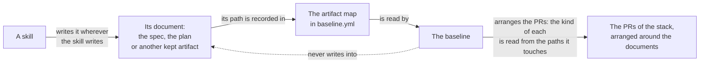
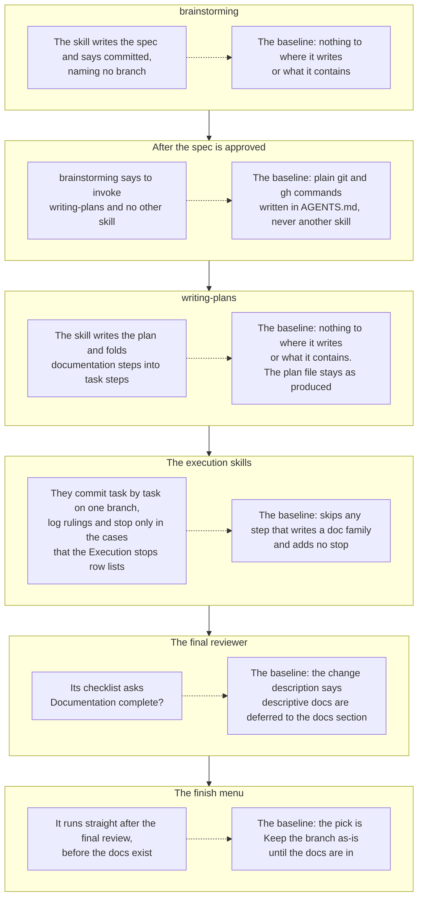

# Seams with the skills

This file lists the seams between the baseline and the skills. A **seam** is a point where what a skill or a tool does meets what the baseline does, and the file says, for each seam, what the skill does and what the baseline does. It gives the principle that keeps the seams small, the nine seams in one table, the seam with the tools that generate instruction files, and what it means to add another skill. [01-why-and-scope.md](01-why-and-scope.md) says why the baseline exists and sets the goal and the constraint that this file cites by id, [02-vocabulary.md](02-vocabulary.md) defines the terms used here, [03-stack-model.md](03-stack-model.md) sets the rules of the stack and its three kinds of PR, [05-project-layout.md](05-project-layout.md) describes `baseline.yml` and its artifact map, [11-adrs.md](11-adrs.md) sets the ADR drafts, [14-pr-descriptions.md](14-pr-descriptions.md) sets the descriptions that list the rulings, [15-agents-md-and-playbooks.md](15-agents-md-and-playbooks.md) sets the `AGENTS.md` that the seams refer to and the rule for generated instruction files, [18-docs-agent.md](18-docs-agent.md) sets the docs agent and [20-working-rules.md](20-working-rules.md) sets the calls that the agents decide without stopping. The playbook [stacks.md](../docs/agents/stacks.md) states the same seams as instructions to an agent. `22-tooling-requirements.md` sets what the standard requires of the tooling.

A few words appear here before the standard defines them in full. A **skill** is a packaged set of instructions that an agent follows for one kind of work, and superpowers is a set of skills. The `brainstorming` skill produces the spec and the `writing-plans` skill produces the plan. An **execution skill** is a skill that carries out a plan task by task; in superpowers they are `subagent-driven-development` and `executing-plans`. Work is delivered as a **stack** of pull requests (PRs), an ordered series in which each PR is based on the one below it and merged from the bottom up, and `gh stack` is the GitHub CLI extension for stacked PRs, whose command `gh stack link` registers branches as a stack on GitHub. A stack holds three kinds of PR. A **thinking PR** holds the prescriptive documents, the ones that say what will be built or how work is done, such as the spec, the plan and the ADR drafts. A **code PR** holds code and tests. A **description PR** holds the descriptive documents, the ones that say only what exists at the **tip**, the last commit of the stack. [03-stack-model.md](03-stack-model.md) explains the stack and its three kinds in full. A **slice** is a logical group of code that becomes one code PR, and a **pointer** is a branch name that points at one commit of a linear history. The **docs agent** is a fresh agent, started from the finished code, that writes the descriptive documents, and the **docs section** is the group of description PRs at the top of the stack that holds them. An **ADR** is an architecture decision record: one file for one decision, with the options that were explored, and an **ADR draft** is one that the regular agent, the agent that brainstorms, plans and builds, writes at decision time. A **ruling** is a decision that an agent takes on the Software Engineer's behalf, without stopping to ask, and records as `Ruling: what, why, cost if wrong`. Each rule below is followed by `Because:` and its reason.

## The principle

The baseline sits beside superpowers and any other skill, and it changes nothing about how they work. A skill writes its documents wherever it writes them, and the baseline does not tell it otherwise. The baseline reads those paths and arranges the PRs around them. The **artifact map** is the part of `baseline.yml`, the project's baseline configuration, that records the paths where skills write their documents ([05-project-layout.md](05-project-layout.md)).

**Let a skill run as written and write where it writes, tell it nothing about where to write, and never edit what it produced to fit the baseline.** Because: the skills run untouched (constraint C4 in [01-why-and-scope.md](01-why-and-scope.md)), and goal G8 asks that superpowers and any other skill run exactly as written and put their documents wherever they put them. A skill may revise its own documents in a later loop, and that revision gets its own thinking PR (rule 8 in [03-stack-model.md](03-stack-model.md)).

In a Mermaid flowchart, a dotted arrow with a label is written `-. "label" .->`, and the diagram uses one for what the baseline never does.



*A skill writes its document where it writes it, and the baseline only reads the path from the artifact map and arranges the PRs, and the one thing to notice is the dotted arrow marked never writes into: the baseline never writes into a skill's document.*

The seams are small because the skills already defer to the Software Engineer's instructions:

- the locations of the spec and the plan are the skill's own defaults, which the Software Engineer may override;
- finishing a branch says to follow the repository's PR conventions;
- the worktree skill honours a declared preference;
- superpowers ranks `AGENTS.md` above its skills.

The seams in the table below were checked against the skill files of superpowers 7.0.2.

## The seams

The table gives the nine seams. For each, it says what the skill does there and what the baseline does.

| Seam | What the skill does | What the baseline does |
|---|---|---|
| **Spec and plan** | `brainstorming` and `writing-plans` write to `docs/superpowers/...` and say "committed", but name no branch. | Nothing to where they write or what they contain. When the stack is cut, the spec is committed on the stack's first branch (PR 1) and the plan on the second (PR 2), as `AGENTS.md` says ([15-agents-md-and-playbooks.md](15-agents-md-and-playbooks.md)); a later revision of either gets its own thinking PR (rule 8 in [03-stack-model.md](03-stack-model.md)). |
| **Code commits** | The execution skills commit task by task on one branch. | Nothing during the run. Afterwards the stack branches are cut as pointers into that history at the slice boundaries the agent chose (rule 12 in [03-stack-model.md](03-stack-model.md)). Branches cut this way linked cleanly with `gh stack link` when this was checked on 2026-11-18, with `gh stack` 0.3.0, in a throwaway repository. |
| **Rulings** | Both execution skills log `Ruling: what, why, cost if wrong`; `subagent-driven-development` gathers them into a final "Rulings I made" message before deleting its ledger, which is a scratch file. | Nothing. That is already the baseline's format. The list is copied into the PR descriptions ([14-pr-descriptions.md](14-pr-descriptions.md)). |
| **Doc steps in plans** | `writing-plans` folds documentation steps into task steps. | Execution rule: skip any step that writes one of the baseline's doc families. The plan file stays as produced. |
| **Final reviewer** | Its checklist asks "Documentation complete?". | Execution rule: the change description says descriptive docs are deferred to the docs section, so the checklist item is not flagged and no fix loop writes docs into code PRs. |
| **Finish menu** | Runs straight after the final review, before the docs exist. | The Software Engineer's pick at the menu is "Keep the branch as-is" until the docs are in, then the stack is published with `gh stack`. Option 2 ("push and create a PR") would open one PR, so it is never used for stack work. |
| **Generated instruction files** | A tool such as Laravel Boost may write `AGENTS.md` and `CLAUDE.md` from a source of its own, and may say only to create docs if explicitly requested. | An adapter for each generator: the baseline rules go into the generator's source, and a standing request for the docs satisfies the generator's rule. Whether Laravel Boost works this way has not yet been confirmed ("Generated instruction files" below). |
| **Execution stops** | The execution skills stop only for irreversible or destructive operations, security-sensitive actions, outside side effects (a merge, a push to a shared branch, a publish) and a hopelessly broken plan. | Nothing added. The baseline adds no stop; ADR drafts are written without stopping ([11-adrs.md](11-adrs.md)). |
| **Between brainstorming and planning** | After spec approval, `brainstorming` says to invoke `writing-plans` and no other skill. | The steps in between (committing the spec on its own branch) are plain git and `gh` commands written in `AGENTS.md`, never another skill. |

Two of the rows give an **execution rule**, a rule of the baseline for the agent that carries out a plan with an execution skill: "Doc steps in plans" and "Final reviewer". The diagram below follows one build, from `brainstorming` to the finish menu, and shows what the baseline does beside each step of a skill. The seam with generated instruction files is not a step of a build, so the diagram leaves it out. In a Mermaid flowchart, a `subgraph` draws a box around the nodes in it, and the diagram uses one box for each step.



*A build runs from brainstorming to the finish menu, with the baseline acting beside each step of a skill, and the one thing to notice is the box of the execution skills: during the run the baseline adds no stop.*

Five rules follow from the table.

**Skip every step of a plan that writes one of the baseline's doc families, and leave the plan file as produced.** A **doc family** is one of the groups of descriptive documents that the docs agent writes: the feature docs, the architecture reference, the guided course, the deployment docs, the README and the reference pages ([02-vocabulary.md](02-vocabulary.md)). Because: the docs agent writes every descriptive document, from the finished tip ([18-docs-agent.md](18-docs-agent.md)), and a document that a skill produced stays as the skill produced it (constraint C4 in [01-why-and-scope.md](01-why-and-scope.md)).

**State in the change description that descriptive docs are deferred to the docs section.** Because: the final reviewer's checklist asks "Documentation complete?", and with the statement the checklist item is not flagged and no fix loop writes docs into code PRs. A code PR keeps the doc families out ([03-stack-model.md](03-stack-model.md)).

**Add no stop of the baseline's own to the stops of the execution skills, and write ADR drafts without stopping.** Because: what is left in the middle of the build, after brainstorming has gated the big decisions, is rulings, which the execution skills own and report, and a second gate would collide with the continuous execution of the execution skills ([11-adrs.md](11-adrs.md); [20-working-rules.md](20-working-rules.md) lists what the agents decide without stopping).

**Copy the list of rulings into the PR descriptions.** Because: the docs agent takes its deviations list from these lists, and the execution skills promise that they are exhaustive ([18-docs-agent.md](18-docs-agent.md)).

**Do the steps between brainstorming and planning with plain git and `gh` commands written in `AGENTS.md`, and never with another skill.** Because: after the spec is approved, `brainstorming` names `writing-plans` as the one skill to invoke and no other, and the skills run untouched (constraint C4 in [01-why-and-scope.md](01-why-and-scope.md)).

## Generated instruction files

Some tools generate `AGENTS.md`, and `CLAUDE.md` with it, from a source of their own, and such a tool may say to create docs only if they are explicitly requested. The baseline adds an adapter for each such generator. The adapter puts the baseline rules into the generator's source, so that regeneration cannot erase them, and a standing request for the docs satisfies the generator's rule to create docs only if they are explicitly requested. [15-agents-md-and-playbooks.md](15-agents-md-and-playbooks.md) gives the rule in full, with its reason and a diagram.

Whether a tool such as Laravel Boost generates `AGENTS.md` and `CLAUDE.md` in this way, and from which source, has not yet been confirmed, and neither has whether a standing request for the docs satisfies its rule. This part of the standard is to be proven on a real project before it is relied on.

## Adding another skill

The artifact map defaults to the superpowers paths: `docs/superpowers/specs/**` for the spec and `docs/superpowers/plans/**` for the plan. A tool other than superpowers, or a tool that replaces it, is added in the map of `baseline.yml`, and the baseline is not changed.

**Add or swap a tool by editing the mapping in `baseline.yml`, and never by editing the baseline.** Because: the map records where the skills put their documents so that the kinds of PRs can be inferred, and it never tells a skill where to write ([05-project-layout.md](05-project-layout.md)).

The made-up example below adds a tool that writes design notes, for a project that also uses superpowers. The path goes under `other`, the list for any kept skill artifact that is neither the spec nor the plan. A **kept skill artifact** is a document that a skill produced and that stays in the repository.

```yaml
artifact_map:
  spec: ["docs/superpowers/specs/**"]
  plan: ["docs/superpowers/plans/**"]
  other: ["docs/design-notes/**"]
```

The baseline sits beside the added skill as it sits beside superpowers ("The principle"): it changes nothing about how the skill works, and it arranges the PRs around the paths where the skill writes. A PR that touches a path in the map is a thinking PR ([05-project-layout.md](05-project-layout.md)).
