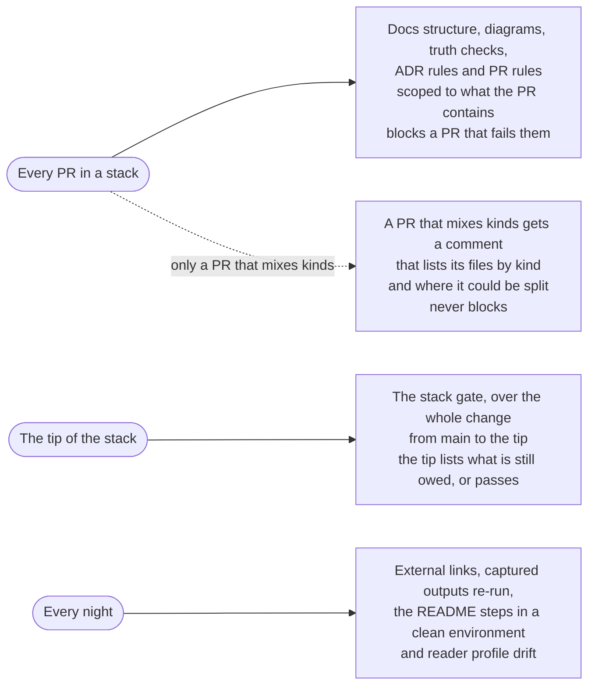
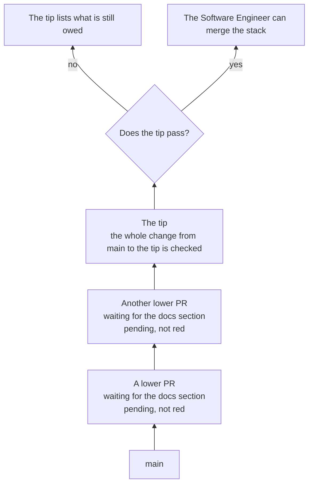
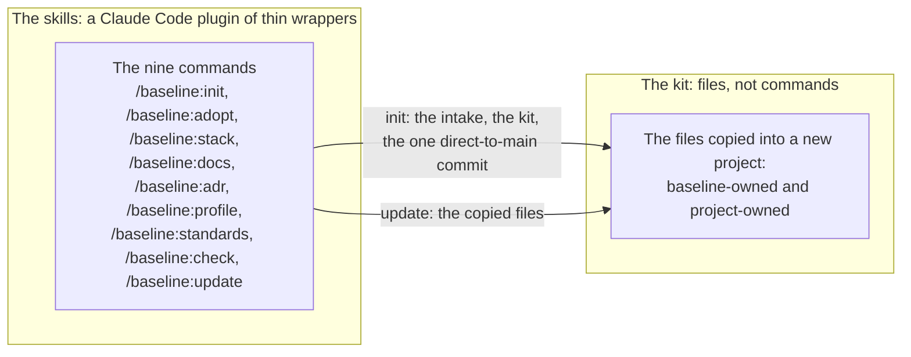
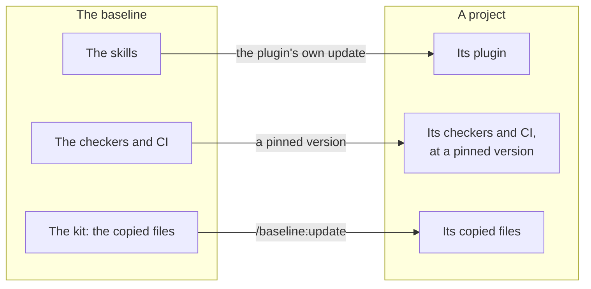
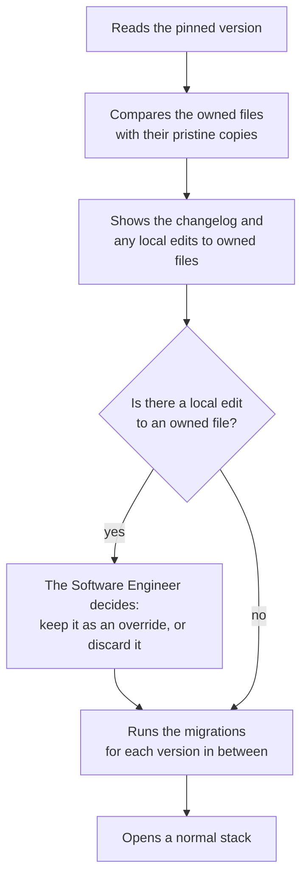
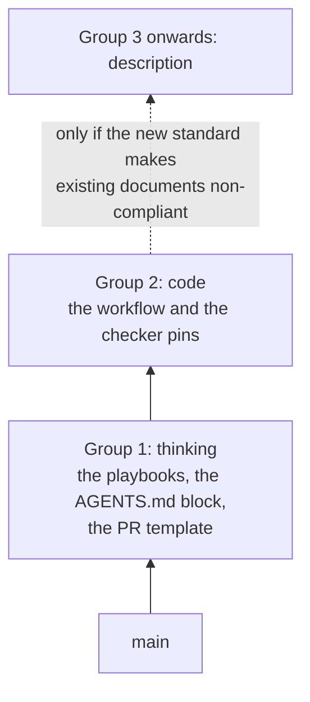

# Tooling requirements

This file sets what the standard requires of the tooling, the tools that apply the standard to a project. It says what the tooling must do, lists the mechanical checks, sets the stack gate, says what is not checked, describes the kit and the nine commands, sets the update flow and names the language of the checkers. The standard fixes what the tooling must do, and the language of the checkers; how the tooling is otherwise built is specified separately. The tooling itself is built separately, and nothing in this file says that any of it exists today: every statement below about a checker, the kit, a command or CI is a requirement. [01-why-and-scope.md](01-why-and-scope.md) says why the baseline exists and sets the goals, the non-goal, the anti-goal and the constraint that this file cites by id, [02-vocabulary.md](02-vocabulary.md) defines the terms used here, [03-stack-model.md](03-stack-model.md) sets the rules of the stack and the convention for the first commit of a new repository, [04-reader-profile.md](04-reader-profile.md) describes the intake and the reader profile, [05-project-layout.md](05-project-layout.md) describes `baseline.yml` and the two kinds of ownership, [11-adrs.md](11-adrs.md), [14-pr-descriptions.md](14-pr-descriptions.md), [16-diagrams.md](16-diagrams.md) and [17-evidence-and-truth.md](17-evidence-and-truth.md) set rules that the checks verify, [18-docs-agent.md](18-docs-agent.md) sets the docs agent, [19-standards-mechanism.md](19-standards-mechanism.md) sets the standards that the intake opts in to and [21-skills-seams.md](21-skills-seams.md) lists the seams between the baseline and skills such as superpowers. The playbook [stacks.md](../docs/agents/stacks.md) says how an agent cuts and opens a stack.

A few words appear here before the standard defines them in full. Work is delivered as a **stack** of pull requests (PRs), an ordered series in which each PR is based on the one below it and merged from the bottom up. `gh stack` is the GitHub CLI extension for stacked PRs, and `gh stack link` is its command that registers branches as a stack on GitHub ([03-stack-model.md](03-stack-model.md) explains both). A stack holds three kinds of PR. A **thinking PR** holds the prescriptive documents, the ones that say what will be built or how work is done. A **code PR** holds code and tests. A **description PR** holds the descriptive documents, the ones that say only what exists at the **tip**, the last commit of the stack. A **slice** is a logical group of code that becomes one code PR. The **docs agent** is a fresh agent, started from the finished code, that writes the descriptive documents, and the **docs section** is the group of description PRs at the top of the stack. An **ADR** is an architecture decision record: one file for one decision, with the options that were explored. A **ruling** is a decision that an agent takes on the Software Engineer's behalf, without stopping to ask, and records as `Ruling: what, why, cost if wrong`. The **intake** is the set of questions asked when a project starts, and its answers make up the **reader profile**, the project's record of who its documents are written for. A **migration** of a project's data is a change to the shape of the stored data, and "The update flow" uses the word in a second sense, for the migrations that a baseline release ships. The **checker** is the tool that is to check a project's documents and PRs against the standard, locally and in CI. The **kit** is the part of the baseline that is to be copied into a new project, and the **skills** are the Claude Code plugin of the baseline; where this file means superpowers or another skill that a project uses, it says so. Each rule below is followed by `Because:` and its reason wherever the standard gives one.

## What the tooling must do

The baseline repository is to contain four things. The table gives each, with what it is.

| Part | What it is |
|---|---|
| The standard | The text of the baseline: plain Markdown, in the files of the `standard/` folder. |
| The kit | What is copied into a new project. |
| The checkers | One command-line tool and a reusable CI workflow. |
| The skills | A Claude Code plugin of thin wrappers. The standard works without them. |

The standard is the text of the baseline, and the kit, the checkers and the skills are the tooling that is to apply it. "The mechanical checks" and "The stack gate" set what the checkers must do, "The kit and the commands" sets what the kit and the skills must do, and "The update flow" sets how each of them is to reach a project.

**Keep the standard independent of the skills.** Because: the skills are a Claude Code plugin, so Claude Code is where they run, and the standard itself is plain Markdown that does not depend on Claude Code, so no project is locked in to one tool (constraint C5 in [01-why-and-scope.md](01-why-and-scope.md)).

Every project holds a `baseline.yml`. It holds at least the pinned version of the baseline that the project follows, the artifact map, which records where the skills that a project uses, superpowers for one, write their documents, the stack folders and whether standards are enabled ([05-project-layout.md](05-project-layout.md) gives the keys and an example).

The standard requires every file that the kit copies into a project to be either baseline-owned or project-owned: a baseline-owned file carries a marker with the baseline version and is replaced on update, and a project-owned file is never touched by an update ([05-project-layout.md](05-project-layout.md) lists which files are which).

The standard requires the checks to cover only what the baseline owns: the documents and the baseline's own standards. "What is not checked" says what they leave out.

## The mechanical checks

The standard requires one command, `baseline check`, to run locally and in CI through a reusable workflow. The checks that the standard requires it to make fall into the groups of the table below, and the diagram shows when each group runs. One more requirement of CI, the re-application of the practice-task patches, is not a group of the table or a box of the diagram, and "The practice-task patches" below gives it.

**Give the `pull_request` triggers of the workflow no branch filter.** Because: every PR in a stack is checked.

In a Mermaid flowchart, a node written with `([` and `])` is drawn rounded, which is how the diagram marks what starts each group of checks, and a dotted arrow with a label is written `-. "label" .->`.

*Each group of checks is to have its own trigger, and the one thing to notice is that the only box that says never blocks is the notice, which the dotted arrow reaches only for a PR that mixes kinds.*

The table states, for each group of checks, what the checker must verify, when it must run and what a failure must do, and it gives the file of the standard that has the reason for the rule that the check verifies. The standard requires a check on every PR to be scoped to what that PR contains and to block a PR that fails it. The re-application of the practice-task patches is not in the table, because the standard states neither when CI must re-apply them nor whether a failure blocks a PR.

| Check | What it must verify | When it must run, and what a failure must do | The reason is in |
|---|---|---|---|
| Docs structure | The required sections and the minimum number of diagrams of each document type that is present. | On every PR, scoped to what that PR contains. Blocks a PR that fails it. | The file for each document type, listed in [18-docs-agent.md](18-docs-agent.md), and [16-diagrams.md](16-diagrams.md) for the minimum numbers of diagrams. |
| Diagrams | Every diagram parses and renders in both themes, dark and light. No hard-coded colour is outside the approved palette. An image from a tool other than Mermaid has its source and both variants, and is re-rendered from its source to prove that they match. Any real path that a diagram names exists, and so does a real file, module or class that a diagram names in backticks. | On every PR, scoped to what that PR contains. Blocks a PR that fails it. | [16-diagrams.md](16-diagrams.md), and [14-pr-descriptions.md](14-pr-descriptions.md) for the colours of the schema diagram of a PR. |
| Truth checks | Internal links and anchors resolve. Captioned excerpts are verbatim. Generated indexes match a fresh generation. The committed schema diagram matches the real schema. | On every PR, scoped to what that PR contains. Blocks a PR that fails it. | [17-evidence-and-truth.md](17-evidence-and-truth.md) for the excerpts and the indexes, [10-course-reference-pages.md](10-course-reference-pages.md) for the file map and the glossaries, and [16-diagrams.md](16-diagrams.md) for the schema diagram. |
| ADR rules | The status of an ADR is valid, the index is consistent and no Accepted ADR is rewritten. | On every PR, scoped to what that PR contains. Blocks a PR that fails it. | [11-adrs.md](11-adrs.md) |
| PR rules | The kind of the PR is inferred from the paths it touches, using the artifact map in `baseline.yml`. The description is complete for its kind. The "Implements" links resolve. The description holds no attribution line. The schema-diff block, the marked block of the description that holds the diagram of the schema change, is present and fresh when migrations changed. | On every PR, scoped to what that PR contains. Blocks a PR that fails it. | [14-pr-descriptions.md](14-pr-descriptions.md), and [03-stack-model.md](03-stack-model.md) for how the kind is decided. |
| Mixed-kind notice | A PR that mixes kinds gets a comment that lists its files by kind and says where the PR could be split. | A notice on a PR. Never blocks. | [03-stack-model.md](03-stack-model.md) |
| The stack gate | Four things over the whole change from `main` to the tip ("The stack gate" below). | Lower PRs show "waiting for the docs section", pending and not red. The tip lists what is still owed, or passes. | "The stack gate" below. |
| External links | The external links of the documents. | Scheduled, nightly. | No other file of the standard sets this check. |
| Captured outputs | Captured command outputs are re-run and compared with what was captured, for the outputs that are marked deterministic. | Scheduled, nightly. | Rule 3 in [17-evidence-and-truth.md](17-evidence-and-truth.md) |
| README steps | The "get it running" steps of the README run in a clean environment. | Scheduled, nightly. | [13-project-readme.md](13-project-readme.md) |
| Reader profile drift | Whether the reader profile has drifted from the technologies that are actually in the code. | Scheduled, nightly. | [04-reader-profile.md](04-reader-profile.md) |

### The schema diagrams

Two diagrams show a database, and the standard requires CI to maintain both. [16-diagrams.md](16-diagrams.md) sets the rules for them and gives their reasons.

**Regenerate the diagram of the current schema on every PR, and fail the PR when the committed diagram differs from the fresh one.** The standard requires CI to run the migrations, read the schema from the database that results and render the diagram from it. For a store that is not relational, the standard requires the same, with the diagram built from its schema definitions. The generator is the project's choice.

**Keep the diagram of the schema change of a PR up to date inside a marked block of the PR description, refresh it on every push, and fail a PR whose migrations changed and whose block is missing.** The check must also verify that the block is fresh. The standard fixes that the block is marked and leaves the form of the marker to the tooling ([14-pr-descriptions.md](14-pr-descriptions.md) gives the rules and an example).

### The practice-task patches

A lesson of the guided course ends with practice, and some of its programming exercises are tasks on the real project, about system behaviour and not syntax ([08-course-lessons.md](08-course-lessons.md)).

**Store the model solution of such a task as a patch, and have CI re-apply the patch to the current code.** Because: the solution then cannot silently go stale. [08-course-lessons.md](08-course-lessons.md) sets the rule.

### A notice that never blocks

The standard requires a PR that mixes kinds to get a comment that lists its files by kind and says where the PR could be split.

**Give a PR that mixes kinds a notice, and never block it.** Because: mixing kinds is allowed, and the notice exists because a mixed PR is harder to review ([03-stack-model.md](03-stack-model.md)).

### After an amendment to a lower PR

When a lower PR of a stack is amended, a document above it may no longer match the amended code.

**After any amendment to a lower PR, have the checker name exactly which documents drifted.** The docs agent re-verifies the docs after such an amendment ([18-docs-agent.md](18-docs-agent.md)). Because: a descriptive document says only what exists at the tip (rule 1 in [17-evidence-and-truth.md](17-evidence-and-truth.md)), and goal G3 asks for documents that live: they change in the same stack as the code and are verified against it ([01-why-and-scope.md](01-why-and-scope.md)).

## The stack gate

The standard requires the stack gate to be made over the whole change, from `main` to the tip of the stack, and not over one PR, and to verify four things. The table gives the file of the standard that sets each.

| What the gate verifies | Where the standard sets it |
|---|---|
| Every new technology has a reader-profile entry and its course files. | [04-reader-profile.md](04-reader-profile.md) and [08-course-lessons.md](08-course-lessons.md) |
| Every new source file is on the file map. | [10-course-reference-pages.md](10-course-reference-pages.md) |
| Quoted numbers are measured. | Rule 7 in [17-evidence-and-truth.md](17-evidence-and-truth.md) |
| Every dependency, schema or interface change is covered by an ADR or a ruling. | "The presence check" in [11-adrs.md](11-adrs.md) |

The standard requires a lower PR to show "waiting for the docs section", which is pending and not red. It requires the tip either to list what is still owed or to pass, and the Software Engineer merges only when it passes. The docs section is the last part of the stack (rule 7 in [03-stack-model.md](03-stack-model.md)), so a lower PR is waiting for it.

**Merge a stack only when its tip passes.** Because: the whole stack, docs section included, is approved first and then merged bottom-up in one sitting, so the stack is complete only with its docs section (rule 10 in [03-stack-model.md](03-stack-model.md)).

In a Mermaid flowchart, a node written with braces is drawn as a diamond, the shape of a question, with a branch for each answer.

*The lower PRs are to wait for the docs section and the tip is to decide, and the one thing to notice is that only the yes branch of the tip's check leads to the merge.*

That a lower PR can show a pending status, and that required checks apply to every PR in a stack, are behaviours of GitHub's stacked-PR feature. Neither has yet been confirmed, and each is to be proven in a throwaway repository before it is relied on, because the feature is in public preview.

## What is not checked

The standard requires the baseline to check none of these: security, secrets, dependencies, vulnerabilities, code verification and release verification. They are per-project standards.

**Leave all of these to the project, and check none of them in the baseline.** Because: security, dependency, privacy, vulnerability, verification and release policy are per-project standards that grow over time (non-goal N1 in [01-why-and-scope.md](01-why-and-scope.md)), and a check that cannot know the project's kind or goal is the failure that anti-goal A1 names ([01-why-and-scope.md](01-why-and-scope.md)). [19-standards-mechanism.md](19-standards-mechanism.md) lists what belongs in a project's standards.

The check on a changed dependency manifest, schema or interface file, in "The stack gate", is not one of these. It is an ADR check and not a dependency policy: the standard requires it to check that a record exists, and not whether the decision was right ([11-adrs.md](11-adrs.md)).

## The kit and the commands

The **kit** is what is copied into a new project, and the **commands** belong to the skills, the Claude Code plugin. The kit is the copied files, and no command is one of them. The part before the colon in the name of a command is the name of the plugin ([04-reader-profile.md](04-reader-profile.md)).

*The commands belong to the skills and the kit is the copied files, and the one thing to notice is that they sit in separate boxes: no command is a file of the kit.*

The table gives the nine commands and what each must do.

| Command | What it must do | Where the standard says more |
|---|---|---|
| `/baseline:init` | The intake, the kit and the one direct-to-main commit. | [04-reader-profile.md](04-reader-profile.md) for the intake, and [03-stack-model.md](03-stack-model.md) for the commit. |
| `/baseline:adopt` | The same for an existing repository, with the docs agent documenting the current code as a docs-only stack, a stack made only of description PRs. | [18-docs-agent.md](18-docs-agent.md) |
| `/baseline:stack` | Cuts the stack branches at the slice boundaries, opens PRs 1 and 2, keeps the stack tables current and publishes with `gh stack`. | [03-stack-model.md](03-stack-model.md) for the rules of the stack, including PRs 1 and 2, and [14-pr-descriptions.md](14-pr-descriptions.md) for the stack table. |
| `/baseline:docs` | Dispatches the docs agent. | [18-docs-agent.md](18-docs-agent.md) |
| `/baseline:adr` | Drafts an ADR. | [11-adrs.md](11-adrs.md) |
| `/baseline:profile` | The intake in update mode. | [04-reader-profile.md](04-reader-profile.md) |
| `/baseline:standards` | Proposes and records a preference. Only the Software Engineer's approval writes a rule. | [19-standards-mechanism.md](19-standards-mechanism.md) |
| `/baseline:check` | Runs the checks. | "The mechanical checks" and "The stack gate" in this file. |
| `/baseline:update` | Updates the copied files to a newer version of the baseline. | "The update flow" in this file. |

`/baseline:init` is to make the one commit that goes straight to `main`. It is the very first commit of a new repository, which is the one exception to "everything is a PR", since there is nothing yet to branch from. The foundation itself, which is CI, the document skeleton and the first code, is then its own stack ([03-stack-model.md](03-stack-model.md)).

The standard requires the intake to ask once whether to build standards from the Software Engineer's preferences over time, to create an empty `docs/standards/` folder with a README that explains how the folder fills when the answer is yes, and to create no folder when the answer is no. [04-reader-profile.md](04-reader-profile.md) describes the intake, and [19-standards-mechanism.md](19-standards-mechanism.md) sets the standards.

Two points about these commands have not yet been confirmed, and each is to be proven against the real thing before it is relied on. The first is whether branches cut as pointers into the linear history link cleanly with `gh stack link`, and what `gh stack view`, the command that shows a stack, displays for a stack made that way. It bears on `/baseline:stack`. The second is how a fresh docs agent is dispatched in practice, and what its brief has to hold. It bears on `/baseline:docs`.

## The update flow

The standard requires the baseline to reach a project by three routes: the skills through the plugin's own update, the checkers and CI through a pinned version, and the copied files through `/baseline:update`. In a Mermaid flowchart, a `subgraph` draws a box around the nodes in it.

*The baseline is to reach a project by three routes, and the one thing to notice is that only the copied files go by a command, /baseline:update, while the skills go by the plugin's own update and the checkers and CI by a pinned version.*

### What `/baseline:update` must do

The standard requires `/baseline:update` to take five steps. The list gives them, and the diagram below draws them.

1. It reads the pinned version, which is the `baseline_version` of `baseline.yml` ([05-project-layout.md](05-project-layout.md)).
2. It compares the owned files with their pristine copies, the files as the baseline shipped them.
3. It shows the changelog and any local edits to owned files.
4. It runs the migrations for each version in between. These are the migrations that each baseline release ships, and not those of a project's database.
5. It opens a normal stack.

**Let the Software Engineer decide, for each local edit to an owned file, whether to keep it as an override or to discard it.** Because: a change to a baseline-owned file changes how work is done, and anything that changes how work is done is the Software Engineer's call ([05-project-layout.md](05-project-layout.md)).

**Open the update as a normal stack.** Because: an update that arrives as an ordinary stack, in PRs of one kind each, can be reviewed like any other change (goal G10 in [01-why-and-scope.md](01-why-and-scope.md)). [03-stack-model.md](03-stack-model.md) sets the rules of a stack.

In a Mermaid flowchart, a node written with braces is drawn as a diamond, the shape of a question, with a branch for each answer.

*The update is to run from the pinned version to a normal stack, and the one thing to notice is that a local edit to an owned file is the one step that waits for the Software Engineer's decision.*

The standard requires the stack that the update opens to have the groups in the table below, the third onwards only if the new standard makes existing documents non-compliant. The `AGENTS.md` block is the marked block of `AGENTS.md` that is baseline-owned.

| Group | Kind | What it holds |
|---|---|---|
| 1 | Thinking | The playbooks, the `AGENTS.md` block and the PR template. |
| 2 | Code | The workflow and the checker pins. |
| 3 onwards | Description | Only if the new standard makes existing documents non-compliant. |

*The update's normal stack has a thinking group and a code group, and the one thing to notice is that the description group hangs from the code group by a dotted arrow, because it exists only if the new standard makes existing documents non-compliant.*

The standard requires an update to replace baseline-owned files and never to touch project-owned files ([05-project-layout.md](05-project-layout.md)). The stack that `/baseline:update` is to open is a normal stack, and its description PRs, which exist only if the new standard makes existing documents non-compliant, are written by the docs agent, as the rest of the baseline says ([18-docs-agent.md](18-docs-agent.md)).

**Ship the migrations with every baseline release, and test the update from the previous version against a worked example.** The standard requires each release to do both. A **worked example** is an example project with its complete set of documents.

Versions follow semver. A patch version is for fixes, a minor version is for optional additions, and a major version is for new required structure, with an upgrade guide. A nightly job can report that a newer baseline version is available, for example "baseline vX.Y is available".

Three other mechanisms are rejected: a git submodule or subtree, Copier's `update` command and manual copying.

## The checker language

The standard fixes the language in which the checkers are written.

**Write the checkers in Python, with Node only for rendering Mermaid (pinned).** Because: Python is strong at text processing, fast to change and easy to test. Go or Rust would give a single binary but more effort.

**Record the choice of the checker language as an ADR.** Because: the team will read this code.
