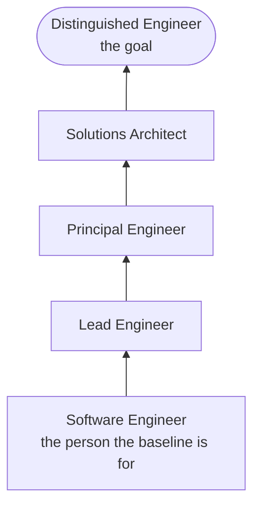
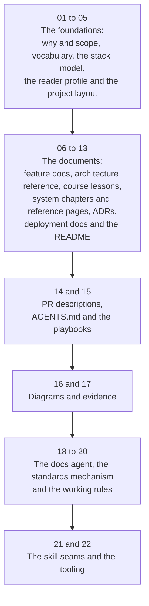

# The baseline standard

This folder holds the baseline standard, and this file is its index and its front door.

## What this is

The baseline standard is a standard for documenting and delivering a software project of any kind, in any technology. It fixes which documents a project has and who writes them, how work is delivered through pull requests, and how a project's approved preferences become the standards that drive code.

The standard is plain Markdown with Mermaid diagrams, written to be read on GitHub in dark and light themes (constraint C2 in [01-why-and-scope.md](01-why-and-scope.md)). It sits beside the skills and changes nothing about how they work ([21-skills-seams.md](21-skills-seams.md)). The tooling that applies it, the kit, the checkers and the baseline's own skills, a Claude Code plugin, is what [22-tooling-requirements.md](22-tooling-requirements.md) requires, and it is not part of this folder. Wherever a file of the standard says what a checker, CI, the kit or a command does, it states a requirement on that tooling, and not that any repository runs it today.

A few words are used before the standard defines them in full.

- A **stack** is an ordered series of pull requests (PRs), each based on the one below it and merged from the bottom up, and `gh stack` is the GitHub CLI extension for stacked PRs. [03-stack-model.md](03-stack-model.md) explains the stack.
- A stack holds three kinds of PR. A **thinking PR** holds the prescriptive documents, the ones that say what will be built or how work is done, such as the spec, the plan and the ADRs. A **code PR** holds code and tests. A **description PR** holds the descriptive documents, the ones that say only what exists at the **tip**, the last commit of the stack, such as the README and the architecture reference.
- The **docs agent** is a fresh agent, started from the finished code, that writes the descriptive documents ([18-docs-agent.md](18-docs-agent.md)).
- An **ADR** is an architecture decision record: one file for one decision, with the options that were explored ([11-adrs.md](11-adrs.md)).
- A **skill** is a packaged set of instructions that an agent follows for one kind of work, and superpowers is a set of skills. The **kit** is what is copied into a new project, and the **checkers** are the tools that check a project's documents and PRs against the standard.

## The why

The baseline exists for the **Software Engineer**, the person who decides on a project and the person the baseline is built for. Their goal is to behave as a **Distinguished Engineer**, and to get there by taking on, rung by rung, the responsibilities of the Lead Engineer, the Principal Engineer and the Solutions Architect. The baseline is how one person who directs agents, rather than writing most of the code, can carry those responsibilities on real projects.

[01-why-and-scope.md](01-why-and-scope.md) gives the ladder as a table, with the responsibility of each rung and what the baseline gives the Software Engineer to carry it, and it sets the goals, non-goals, anti-goals and constraints that frame the rest of the standard. In a Mermaid flowchart, `BT` draws the chart from the bottom to the top, and a node written with `([` and `])` is drawn rounded, which is how the diagram marks the goal.

*On the way to the goal the Software Engineer takes on each rung's responsibilities and keeps carrying them, and the one thing to notice is that the goal is the rounded node at the top of the ladder.*

## How to read it

The files are numbered in reading order, and each begins with a paragraph that says what the file covers. The numbers also group the files, and the groups are these.

1. **The foundations, 01 to 05:** why and scope, the vocabulary, the stack model, the reader profile and the project layout.
2. **The documents, 06 to 13:** the standard for each document of a project: the feature docs, the architecture reference, the course lessons, the course system chapters, the course reference pages, the ADRs, the deployment docs and the README.
3. **PR descriptions, `AGENTS.md` and the playbooks, 14 and 15.**
4. **Diagrams and evidence, 16 and 17.**
5. **The docs agent, the standards mechanism and the working rules, 18 to 20.**
6. **The skill seams and the tooling, 21 and 22.**

*The 22 files form one reading order in six groups, and the one thing to notice is that the arrows run in number order, from 01 to 22, with no branch.*

The reader profile, [docs/reader-profile.md](../docs/reader-profile.md), records who this repository's documents are written for, and so which basics each document explains. This index sets no reading path for a role: the reading paths by role are among the sections that the docs agent generates in the reader profile ([04-reader-profile.md](04-reader-profile.md)).

The playbooks, [working-with-the-engineer.md](../docs/agents/working-with-the-engineer.md), [stacks.md](../docs/agents/stacks.md), [pr-descriptions.md](../docs/agents/pr-descriptions.md), [docs-agent.md](../docs/agents/docs-agent.md), [adrs.md](../docs/agents/adrs.md) and [standards.md](../docs/agents/standards.md), state the rules of several of these files as instructions to an agent ([15-agents-md-and-playbooks.md](15-agents-md-and-playbooks.md) says when to read each).

## Contents

The table lists the 22 files in reading order, each with what it covers.

| File | What it covers |
|---|---|
| [01-why-and-scope.md](01-why-and-scope.md) | Who the baseline is for and why it exists, what it is, what success looks like and the principle that outranks every other, then the goals, non-goals, anti-goals and constraints, each with an id and its reason. |
| [02-vocabulary.md](02-vocabulary.md) | The words the standard uses, each in one sense throughout, and who takes part in the work. |
| [03-stack-model.md](03-stack-model.md) | How a project delivers its work as one stack of PRs: the picture of a stack, the three kinds of PR, how the kind of a PR is decided, what happens when something changes later, and the thirteen rules and seven conventions of a stack. |
| [04-reader-profile.md](04-reader-profile.md) | The reader profile, the record of who a project's documents are written for, and the intake that creates it: why the profile exists, what the intake asks, when it runs, what the saved file looks like and what the docs agent generates from it. |
| [05-project-layout.md](05-project-layout.md) | Where everything lives in a project: the documents sorted by when they are written, the folder layout, `baseline.yml`, which files belong to the baseline and which to the project, and the artifact map that records where skills write their documents. |
| [06-feature-docs.md](06-feature-docs.md) | The feature docs, the non-technical document of a project: who they are for, what the folder holds, what the overview page, the Users and access page and each feature page contain, how a system with no screen is described and what evidence is captured from the running system. |
| [07-architecture-reference.md](07-architecture-reference.md) | The architecture reference, the technical document of a project: the system as it is now, with no history and no plans; how it is shaped, what the header of each file holds, its thirteen minimum sections, how sections are added and what a section looks like when it does not apply. |
| [08-course-lessons.md](08-course-lessons.md) | The lessons of the guided course, which teaches a project's codebase: what the course is for and its three tiers, what it covers and leaves to other products, the ten parts of every language and stack lesson, the lesson header and the practice a lesson ends with. |
| [09-course-system-chapters.md](09-course-system-chapters.md) | The system chapters of the guided course, its third tier: what a chapter is for, the ten parts of every chapter, the four kinds of lab and the practice a chapter ends with. |
| [10-course-reference-pages.md](10-course-reference-pages.md) | The three reference pages of the guided course, the file map, the glossaries and the "what else it offers" map: what each holds and where it lives, how each is produced, why generated indexes are never edited by hand and what the docs agent does while no generator exists. |
| [11-adrs.md](11-adrs.md) | Architecture decision records: what an ADR is, the template, the six criteria of a decision of impact, the lifecycle from Draft to Accepted, the rules for writing, numbering, reviewing and changing an ADR, and the presence check on a changed dependency, schema or interface file. |
| [12-deployment-docs.md](12-deployment-docs.md) | The deployment docs, which say how the system runs in the real world: what they are for, their eleven areas, the honesty rule for what an agent may claim to have verified and their five diagrams. |
| [13-project-readme.md](13-project-readme.md) | The README, the front door of a project's repository: what it is for, its ten parts, the README of each stack folder and the rule that keeps it true, a CI job that runs its "get it running" steps in a clean environment. |
| [14-pr-descriptions.md](14-pr-descriptions.md) | The description of a PR, the text that a reviewer reads first: who writes it and how long it may be, the header every description starts with, the form for each of the three kinds of PR and the diagram that a PR with a database change carries. |
| [15-agents-md-and-playbooks.md](15-agents-md-and-playbooks.md) | The files that carry the baseline's rules to the agents, `AGENTS.md`, `CLAUDE.md` and the six playbooks: what each holds, the two rules for the files themselves and the third for the playbooks alone, and what to do in a project where a tool generates `AGENTS.md`. |
| [16-diagrams.md](16-diagrams.md) | Diagrams: how a diagram is drawn, the minimum number of diagrams for each kind of document, the quality rules, the theme rules that keep a diagram legible in dark and in light, the approved palette and the rules for the diagrams of a database. |
| [17-evidence-and-truth.md](17-evidence-and-truth.md) | The evidence rules, the eleven rules that keep what a descriptive document says true: why they exist, the rules, what a section that does not apply holds and what the docs agent does with the indexes while no generator exists. |
| [18-docs-agent.md](18-docs-agent.md) | The docs agent, the fresh agent that writes every descriptive document from the finished code: what it is for, what it reads and does not read, what it produces, its six rules and why a fresh agent writes the documents. |
| [19-standards-mechanism.md](19-standards-mechanism.md) | The standards mechanism, which turns a project's approved preferences into documents that drive code: what to do when generated code is wrong, how a project opts in, how `docs/standards/` fills, what each rule records, where a change lands in the stack, who reads the standards and what belongs in them. |
| [20-working-rules.md](20-working-rules.md) | The working rules: who decides what between the Software Engineer and the agents, how a decision is put to the Software Engineer, what the agents do while the Software Engineer is busy and how a report is built. |
| [21-skills-seams.md](21-skills-seams.md) | The seams between the baseline and the skills: the principle that keeps them small, the nine seams in one table, the seam with the tools that generate instruction files and what it means to add another skill. |
| [22-tooling-requirements.md](22-tooling-requirements.md) | What the standard requires of the tooling: what it must do, the mechanical checks, the stack gate, what is not checked, the kit and the nine commands, the update flow and the language of the checkers. |

## Versioning

The baseline's versions follow semver. A patch version is for fixes, a minor version is for optional additions, and a major version is for new required structure, with an upgrade guide.

A project pins the version of the baseline that it follows in `baseline_version`, a key of its `baseline.yml` ([05-project-layout.md](05-project-layout.md)). The update flow, by which a project adopts a newer version, is in [22-tooling-requirements.md](22-tooling-requirements.md).
